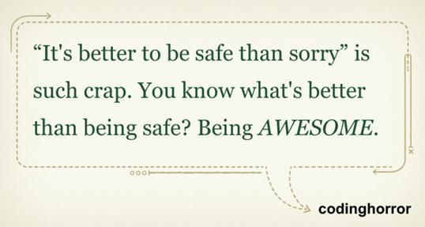

It was [this piece in Wired Enterprise](http://www.wired.com/wiredenterprise/2012/08/nasa-patch), about
the Curiosity robot and the software patch they had to apply to it,
 that got me thinking about some lessons NASA can teach us.

It turns out the launch date for these missions is set by the
moment when Mars and Earth are closest. It's obvious: launching
the spacecraft at that moment saves fuel, which is the most
expensive item of the whole mission. So everything has to be ready to
match that date; otherwise the launch can be
postponed for several more years.

It happened on an earlier mission. The launch had to take place in June,
but the robot's control software would not be ready by that
date. The arrival date at Mars, however, was January of the following
year, so the development team had 6 more months to
complete all the software, testing it with the simulators
available down here on Earth.

Would you launch into space a piece of equipment that costs millions of dollars,
with heavy media exposure, without having the control software
ready and properly tested? Well, at NASA they did.

The mission's launch date didn't slip because the software wasn't
completely ready. For NASA the deadline is an essential characteristic
of the project; that feature is not negotiable (actually they
sent it up with one version of the software, which was partially
updated during the flight).

All this reminds me of [a line from Jeff Attwood](http://www.codinghorror.com/blog/2012/05/how-to-stop-sucking-and-be-awesome-instead.html):

When NASA makes such a risky decision and pulls it off, they come out
as real heroes.

Now we say that everything they do at NASA is
awesome, but the truth is that to be awesome you have to
take risks.

The other lesson comes from this latest mission, Curiosity. This rover
carried only the software needed to land and to operate for the first
moments on the surface of Mars. Later, once the robot was
safe on the surface, they went on to send the software
for the rest of the mission, which required erasing the previous software.

Why? Because Curiosity has a limited amount of memory,
so this infrastructure constraint forced them to split the software
delivery into two phases, and notice that the first phase was thrown away
entirely after it fulfilled its mission (the landing).

The operation of pushing this change request to production
on Curiosity is enough to kill you with nerves. Consider this:
you run a command to load the patch, you press ENTER, and you have to
wait 28 minutes to get an answer back from Mars! Communications
with the Curiosity rover take 14 minutes out and 14
minutes back.

Applying the Curiosity patch took 4 days in total,
mainly because of the communications delay and because they executed a
very meticulous plan to make sure the robot was not left inoperative in
the process.

All of that is very risky, but you know what? The result is
spectacular, and that matters a lot.
