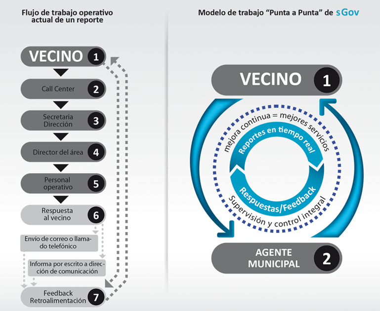

Marcos Malamud is one of those friends I found by writing this blog.
Through his comments I got to know him and his work on
management systems, and we also had the chance to share a
memorable episode of El Test Acido. For me it is a great satisfaction
that he accepted this invitation as a guest villain and that he is giving us
this excellent post. Enjoy:

# **From open government to service government** 

By Marcos Malamud ([\@mismatica](https://twitter.com/mismatica) --
[www.mismatica.com](http://www.mismatica.com))

I am going to open this post by repeating the hackneyed and famous goals of
oGov (*short for Open Government*):
transparency, citizen participation and collaboration. Why do I open
the post like this, you may ask?

Because it is a "fashionable" term that rides on the advance of
information technology (*IT, to stay on the good side of the blog's
owner ;) hehe*). Ever since we have had stable democracies in our
countries these concepts have **ALWAYS** been the pillars for
building citizenship, whether from a technical,
personal or collective point of view. Although it does not depend exclusively on IT, the
new technologies have allowed the three concepts to reach
citizens in a more natural way, affordable
and literally "at hand" (*with tablets and smartphones*). But let's not
fool ourselves: the possibility of demanding and exercising
these principles always existed. The big difference is that today the level of
citizen engagement and the ease that the "at hand" concept
provides boost that demand exponentially. People ask for transparency and
participation because it is "comfortable" to do so from the couch at
home, or walking down the street, and to a certain extent they collaborate with
others to demand similar things. Don't get me wrong: that apparent "comfort"
(*I think it's great that it exists*) actually works as
strong, massive social pressure that makes things change.
That is precisely the greatest fear our government
representatives feel today.

A line that captures all this well, which I adapted for a workshop
I gave at the Encuentro Nacional de Ciudades Digitales in 2011,
was: *\*"Open government, an old idea whose time has come" by
\@lnds \**-- originally it was "Cloud, an old idea whose time has
come".

From the point of view of "citizen-government-citizen demand"
(call it local, regional or central), government teams are being
pushed to deliver better services. We should stop
focusing on principles already acquired *(won?*) in today's
democracies, and dare to go through the process that takes us "**from
open government to service government**".

I used the lines above to make very clear my concept
of **sGov**, which I coined as service government
(*a good "kick in the chest" for "oGov initiatives" ;) hehe*).
Now I will tell you about my experience over these years of developing and
selling management tools for local governments, which are
my niche of expertise, combining management and IT
in equal parts, on the road to trying (*in some cases successfully*) to
turn municipalities into a service government.

I fervently believe, and I back my statements with concrete data
obtained in implementations with some municipal clients (*further
on I present some interesting results on this*), that
sGov tools or applications must be "end to end".
In other words, a citizen (*I call them neighbor-customers, even if
that gives some people hives*) should not have to browse around looking for
a government service, much less know where to send their
complaints or questions. It must be the government itself that redirects and
assigns the requests in a way that is transparent to the neighbor (*this is where
IT comes into play*) and that lets them file questions or requests in a simple and
direct way, "with no middlemen and no delays". Of course, this must be
"multi-channel": physical and in person, virtual, mobile or web. This
will allow governments to actively listen to the governed,
to respond in real time (*or as efficiently as possible, as I
like to say*), and consequently to receive what, in my
experience, is the best part of service government:
direct, unfiltered *\*FEEDBACK\**. This working model
undoubtedly makes it possible to deliver better, quality services, with control from both
sides of the problem, committing both actors to the solution and
then to watching over and taking care of everything achieved.

 

Here I'll share my experience on this, since many (*not to
say all*) of the mid- and high-ranking officials I visit
show me a deep fear of what some call
"*consumer empowerment*", and I would love to show you the look of
panic on their faces when I tell them that with sGov you can give the
neighbor a tool to report, ask about or flag problems
live from the street as they walk -- paradoxically, the lower ranks
or field agents think exactly the opposite and understand that the neighbor
is not the enemy (*since these same agents make up most of the
State's workforce and are in turn neighbors themselves of the places where they
work*). This "fear" comes fundamentally from cultural,
bureaucratic, corrupt or negligent causes (*or all of them together
;) hehe*), but I must also acknowledge mistakes by software
developers who sell systems that do not take into account the
operational side of a citizen report or complaint, and who produce mere systems
for capturing and piling up report numbers in giant
bedsheet-sized lists, which only add more dread to that initial
"fear".

At this point there has to be a turning point among the government agents who
make the decisions. They must take the bull by the horns and face the
problems seriously and in a planned way, come clean with the neighbors and
give them clear and exact information about the times and ways in which
the problems asked about or reported will be solved (*note that I did not
say "honesty suicide"; they are already doing that today,
repeatedly promising things they don't deliver*), or else they can
bury their heads in the sand like the ostrich, with the consequences
that entails.

As I mentioned before, my claims are based on real data,
using as an example an analysis I did of indicators for a
municipal public service: street lighting *(a municipal
obligation in every municipality, ayuntamiento or prefeitura in
Latam)* where, based on 35,000 responses or pieces of feedback, out of 400,000
complaints or reports accumulated in two of my systems from 2004
until yesterday, the results were these:

80% = "Thanks" or "Thank you very much" as a single word or a full sentence.

15% = "Safety, Darkness or More lighting".

5%   = Other words in general.

What point do I want to make with these 3 indicators? -- that sGov systems or
applications simply deliver BETTER services from the
neighbor's perspective, meaning quality and satisfaction, or in the language of the
government official, "votes" ;). As I always tell my
clients, the first goal must be "Fix everything that gets reported",
that is, a concept of EFFECTIVENESS, and then, once that step is achieved, to move toward
something like "The best service is the one you don't notice", that is, a concept
of EFFICIENCY.

To wrap up, I believe sGov applications must be conceived
as a "business intelligence" tool rather than as mere
systems for piling up flat or linear data, but resting their
pillars on expert systems for internal operational management, so that,
based on concrete data from the daily management of each of the
government services and the needs of the neighbor-customers,
better, more efficient and higher-quality political and strategic
decisions can be made.

It will only be possible to do this well if we take into account something very
important that I consider the "Achilles' heel" of e-government,
which is that in most cases the developments or implementations
do not take into account the HUMAN FACTOR that has to USE the applications
and systems. I am a fervent believer that municipal agents
must be taken very much into account when developing, and it is
important to listen to them and get them involved, integrating them into the
final product. This is a NECESSARY condition for the success of
the implementations. Nowadays we focus on usability for one
of the "ends" - the neighbors (*which is all very well*), but we have
to concentrate on the other "end" -- the municipal agents. In
my experience these actors can sink a project completely or
launch it to success with the same speed. And then, as I like
to put it, let the software "evolve" and grow.

Finally I want to thank Eduardo infinitely for the honorable
invitation to write on his blog, and also Marco and Ubaldo who,
through that crazy and brilliant digital get-together they chose to call
\@eltestacido, bring in and give a voice to leading figures in
IT, entrepreNERDs and restless minds like mine in their talks, and
let us share experiences, knowledge and all of it with plenty of humor
and wine. Cheers, friends, and **THANK YOU!!**
