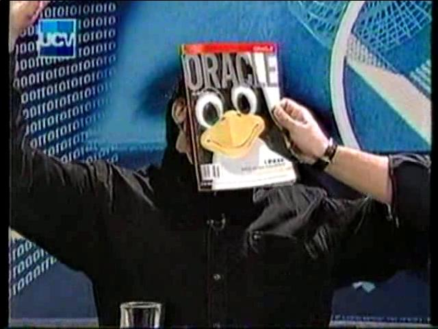

I'm lucky, because for this anniversary I've had the chance to bring
together great Chilean bloggers, but this is the first time a
"celebrity" writes on this blog.

Well, for me at least Franco Catrin is a celebrity, the kind that
appears on television, because he really has been on TV, on the
fondly remembered show
[TvNauta](http://www.youtube.com/watch?feature=player_embedded&v=yxhrpbV0xAU).
Franco is a reference for many Chilean developers, and it is an
honor that he agreed to take part with this post, quite a timely one
at that:

The ritual 
=========

It was two or three in the morning, I no longer remember very well. I was
preparing a delivery of an application and at the same time thinking about
the coming days: the upgrade ritual was upon me. That ritual I
always avoid until there is no other choice left or until
[some disaster](http://franco.arealinux.cl/2005/08/oportuncrisis-frinki-con-ubuntu/) strikes.
As an Ubuntu Linux user I would migrate to the new version when it had
been out for almost a year, but this time my wait was already going on a
year and a half. Why such a long wait? Because when it comes to a machine
I work on, I can't risk some exotic problem leaving me
without my main work tool. That's why I always waited until
all the problems were known or had some solution, or else
waited for a window of time to run the obligatory tests and
check that my whole development environment worked correctly.
Even so, I don't recall ever having had serious upgrade
problems, but you never know.

This time there was an extra difficulty, because I also needed a
hardware upgrade. That 1.6GHz Pentium Dual Core, which was more than enough for
the web and listening to music, now fell short for developing
software (Java/GWT/VMs, etc). To the upgrade ritual was now added
the ritual of the price quotes: look for reviews, ask friends, see
what's available on the local market, compare prices and, in the end,
make sure everything ended up better than before. As a Linux user,
that search also meant checking that the hardware was well
supported, that the video outputs worked correctly, that it
had no power management problems, etc etc. That search is not so
complicated when it's a laptop: you just find some
Linux user who has the same machine and you're done. But when it's
a desktop machine like the one I was looking for, it was no longer that simple.

I didn't want to go through all that again.

That was how -- while I kept putting the finishing touches on the
application, and with some alcohol in my system -- someone told me that
Joel Iturra was over in Yankeeland and was bringing back some tablets for some
friends. I contacted him and, expecting a no, asked if he
could bring me a Mac Mini. When he said that was no problem at all,
the conflict began.

A Mac Mini had enough power for my tasks, it solved a
large part of the problems of the upgrade ritual not only this time but
in the future as well, and as if that weren't enough, in Yankeeland
it cost almost the same as the upgrade I needed. I had already
tried OSX on my desktop before and it worked well enough; the
typical development tools were available. Since it was an
additional machine I could try it out and at the same time keep using my
development desktop, and in the worst case I could sell it if I
changed my mind. The purchase decision was pretty easy, unless... your
name is Franco Catrin.

Some of my friends will think it's an exaggeration, but I was troubled about
no longer using Linux as my main desktop, for several reasons:
several projects I was working on were directly
related to Linux, and for those a virtual machine is no good. On the
other hand, moving away from daily use also meant falling behind
on new developments around Linux, one of the things that
set me apart from normal users. And worse still, migrating
from Linux to Mac OSX sounded to me like jumping into the lifeboats to flee a
platform that seemed never to have taken off, even though I actually knew
that wasn't so.

What reassured me was knowing that many developers from the
Linux / open source world were using Apple machines, with and
without Linux. If they, who were far more involved than I was, could
do it, why couldn't I? What's more, just yesterday Miguel de Icaza published
an article on how [he no longer felt guilty about using Mac OS X
instead of Linux](http://tirania.org/blog/archive/2012/Aug-29.html), and he is
the founder of GNOME and Mono.

Fast forward in the story and here I am, writing from Mac OS X
Lion, my main desktop for almost a year now. Adapting
from Linux was not painful, but it wasn't simple either. That story is enough
for a long article, something I'm saving for my blog, which is still
hosted on the [arealinux.cl](http://franco.arealinux.cl) domain. I can
only tell you in advance that the much-trumpeted ease of use isn't all that, and
that some things are even much easier on Linux than on this
system, which to me speaks very well of those who still work
on improving Linux as a desktop system.

I've thought about going back to Linux on this same hardware, given that
my wife's notebook, with more modest hardware, runs much better with
Linux than this Mac Mini does with OS X Lion. I've made so many jumps already that
maybe it doesn't even matter; few people know that before using Linux I was a
well-known Windows user/developer/advocate on the newsgroups.
Maybe someday I'll want to go back to the upgrade ritual, somewhere between
2 and 3 in the morning, with a little alcohol.
