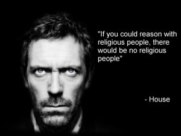
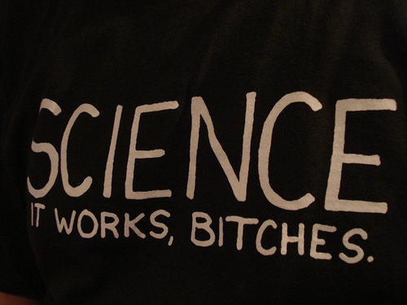

> "Science is the great antidote to the poison of enthusiasm and
> superstition" -- a quote given to me by the ICCI students at
> UTEM

During the 2008 presidential campaign, then-candidate Barack Obama
said:

>  "We've seen just a skyrocketing autism rate. Some people are
> suspicious that it's connected to the vaccines. This person included.
> The science right now is inconclusive, but we have to research it."[^1]

With this comment Barack Obama[^2] reinforces an error that was put to rest
years ago and that is causing a public health disaster not only in
the United States, but in many countries where parents are no longer
vaccinating their children.

This whole myth that vaccines cause autism is based on a
discredited, because fraudulent, "study" published in 1998 by
[Andrew Wakefield](http://en.wikipedia.org/wiki/Andrew_Wakefield), in which,
working from a population of 12 individuals, he establishes a connection between
vaccines and autism. Besides the fact that his method has been questioned and he has been
accused of elaborate fraud, science has also been unable to reproduce
his results. In 2002 the New England Journal of Medicine
published a study of some 537,000 individuals, in which no
relationship between autism and vaccines could be found.

Unfortunately, the Obama administration's scientific view of
vaccines has wreaked havoc, since in 2009 his government's policies
prevented the use of multi-dose vials for the
vaccines that prevent H1N1, a practice used in Europe and other
countries. The reason was to reduce the use of thimerosal, a preservative
that according to some groups is linked to the onset of autism. This,
added to other policies, caused a drop in the supply of flu vaccines
and also in their effectiveness[^3]. It is estimated that in 2010 some 65 million
people in the United States were infected with H1N1, of whom
274,000 had to be hospitalized, and 12,470 died.[^4]

## Is progressivism more scientifically enlightened? 

There's no denying that greater opposition to science is more often
found in conservatism, especially in American religious
conservatism.

Denying evolution, or global warming, is a regular part of
American ultraconservative discourse.

But they are not the only political movements with anti-science
positions. If the subject interests you I recommend books like [The
Republican War on Science](http://amzn.to/RShTP1). But the aim of
this post is a different one.

Since progressivism supports these scientific facts, it is usually
accepted that progressive positions are enlightened in scientific
terms. Which is not true.

The progressive position seems to be to use science when it
suits the political ideas and to ignore it completely when it doesn't
square with them.

## *Amicus Plato, sed magis amica veritas* 

According to Alex Berezow and Hank Campbell, in their book 
[The Science Left Behind](http://amzn.to/TWHg33), progressive thinking about science rests on four myths:

1.  Everything natural is good

2.  Everything unnatural is bad

3.  Unchecked science and progress will destroy us

4.  Science is only relative anyway

The adherents of the first myth are found among those who believe in
homeopathy, natural medicine, or that it's better to go jogging
barefoot, because that's how our ancestors did it and therefore it's
good, without considering that there's a reason those same ancestors invented
shoes.

The second myth is a corollary of the first. According to it, when man
interferes with something, it is no longer natural. Notice how
humans, accepted as natural by the first myth, have suddenly
lost all their "naturalness". All of human intelligence and
ability becomes something bad. For the progressives of the
second myth any unnatural substance, like a vaccine, even if it
saves millions of lives, has become something repugnant.

For the progressives of the third myth, science and technology are
inherently dangerous. That's why they oppose nuclear
energy or the use of genetically modified foods[^5]. These
people demand that a new technology be 100% safe before it is
adopted, a standard impossible to guarantee. This kind of person
attacks the conservatives who don't believe in global warming, but
attacks science when it conflicts with their own ideas,
accusing it of selling out to big industry, or of plotting to destroy the
planet.

Behind this third myth hides an unbearable paternalism, the
idea that it is possible to build a utopia dictated by their superior
ethics; they believe they know what is good for all of us. If
energy policy were up to them, only the rich
would be able to have electricity and electric washing machines.[^6]

The last myth is the most serious of all. The idea that everything is
relative, that dangerous postmodernist idea. For them science is
just one more opinion. This relativism puts the soft sciences on the
same level as the hard ones; sociology or economics carry the same
relative weight as physics or chemistry. The opinion of a
doctor who recommends a vaccine is worth the same as whatever the guru of the day says. All
of this erodes the value of objective research.

## The fight that matters

The fight should not be left vs. right, conservatism vs.
progressivism. The fight that matters now in this world, to keep it
from going over the cliff of ignorance, is the fight for science.

Let me share with you the words of [Mark
Anderson](http://www.stratnews.com/aboutmark.php), [quoted by David
Brin](http://davidbrin.blogspot.com/2012/09/the-case-for-scientific-nation-part-two.html),
on the value of science. Anderson says this after witnessing
Curiosity's landing on Mars:

> Science is reality. At a time when a large and increasing
> fraction of the U.S. population does not "believe in" science (i.e.,
> objectively provable reality) - or, worse, has bought into the idea that
> science is just one choice on the reality menu - NASA has again given
> concrete reason to understand that science works, and that
> science is not an option, not a theory, not a menu item,
> but instead represents the finest efforts of human minds in
> understanding, and addressing, objective reality.

Those on Earth who currently think that science is a political football
should take note: not only are you endangering your own reputation,
you are endangering the welfare of your constituents, and today,
of the planet itself.

Any person or party which mocks science should be
considered for what he or it is: a threat to the welfare and future of us
all. Under the influence of political propagandists, misled religious
zealots, and truly dangerous television and radio empires,
too many people today have been led to believe that science is in
some way an option to opinion.

Science is as optional as gravity. Ignorant delusion is the
only real option.

**It is time for all Earth inhabitants to recognize the value of
science. In doing so, we will find common ground for agreeing
on other important things.**

**NOTES**

[^1]: [Article in The
Independent](http://www.independent.co.uk/news/science/scientific-illiteracy-all-the-rage-among-the-glitterati-1212406.html)

[^2]: Senator McCain, Obama's opponent at the time, also
shared the same mistaken perception about vaccines, saying (see the
article above): "It's indisputable that \[autism\] is on the rise
among children, the question is what's causing it," he said.
"There's strong evidence that indicates it's got to do with a
preservative in the vaccines."

[^3]: [Junk Science Returns To White House](http://www.realclearmarkets.com/articles/2009/11/02/junk_science_returns_to_the_white_house_97481.html),
by Bill Frezza, November 2009

[^4]: [CDC (Centers for Disease
Control) report](http://www.cdc.gov/h1n1flu/estimates_2009_h1n1.htm)

[^5]: I have seen anti-GMO vegans happily eating soy
empanadas in Chile; most likely that soy comes from Argentina,
where 97% of it is transgenic soy.

[^6]: Please watch this Hans Rosling
TED video: [http://www.ted.com/talks/lang/es/hans*rosling*and*the*magic*washing*machine.html](http://www.ted.com/talks/lang/es/hans_rosling_and_the_magic_washing_machine.html)
