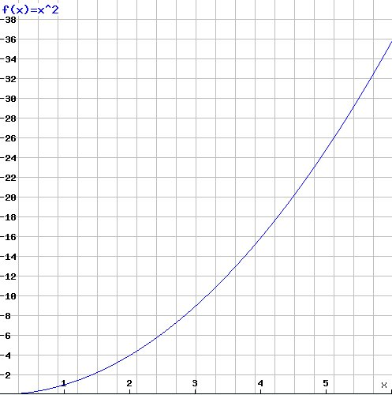
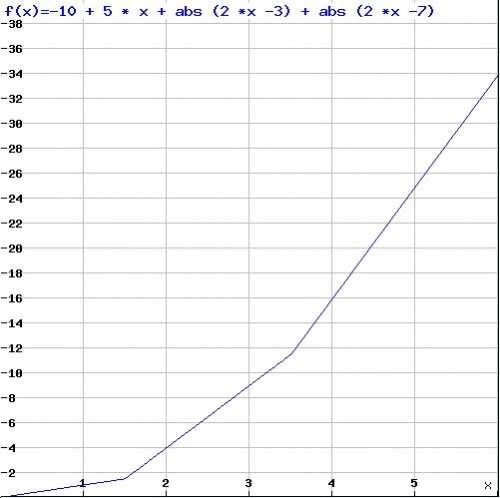
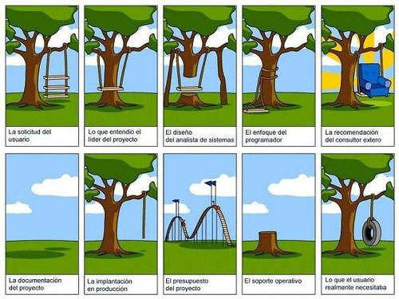

We have a function such that:

-   for 0, it returns 0

-   for 1, it returns 1

-   for 2, it returns 4

-   for 3, it returns 9

-   for 4, it returns 16

-   for 5, it returns 25

What is the value for 6?

Many of you will say the value is 36, which would be valid if the
function were

> f(x) = x\^2

But if I tell you that the value for 6 is 34, what happens to what you
assumed?

A function that satisfies all the statements above and the requirement
that f(6) = 34 would be this one:

f(x) =-10 + 5 x + \|2 x -- 3\| + \|2 x -7\|

Changes the picture quite a bit, doesn't it?

We can't assume, from a set of particular values, the
value of the function at any other point, as this example makes
clear.

Dijkstra has a famous line: "testing shows the presence, not the
absence of bugs".

Given his scientific background, Dijkstra's line evokes [the epistemological principle of falsificationism](http://es.wikipedia.org/wiki/Falsacionismo), which says that
a single counterexample, or one experiment that contradicts the predictions
of a theory, is enough to refute it.

The fact that we know that for 6 the value of our function is 34
rules out the assumption that the function is quadratic, but it doesn't
guarantee either that the linear combination we proposed is the solution.

In a [recent post](http://bertrandmeyer.com/2012/10/14/a-fundamental-duality-of-software-engineering/),
Bertrand Meyer confronts us with the duality between proofs and
tests.

> "In software engineering the corresponding duality is between
> proofs and tests, or
> (equivalently) specifications and use cases. A
> specification is like a "for all": it tells us what must happen for
> all envisioned inputs. A test is like a "there exists": it
> tells us what happens for a particular input and hence, as in predicate
> calculus, it is interesting as a disproof mechanism:
>
> -   A successful test brings little information (like learning the
>     value for 5 when trying to figure out what a function is).
>
> -   An unsuccessful test brings us decisive information (like a
>     false value for a ∀): the program is definitely not correct.

A proof, for its part, brings the discussion to an end when it is successful. In
practice, testing may still be useful in this case, but only testing that
addresses issues not covered by the proof:

> -   Correctness of the compiler and platform, if not themselves
>     proved correct.
>
> -   Correctness the proof tools themselves, since
>     most practical proofs require software support.
>
> -   Aspects not covered by the specification such as, typically,
>     performance and usability.
>
> It is not appropriate to use tests in lieu of the specification. Agile
> approaches have caused much confusion. A powerful
> insight has gotten lost inside a practice that can be
> harmful. The insight is that the practice of software
> development has improved with the practice of regression testing. The
> bad practice is to ditch the requirements specification in
> favor of tests.
>
> There is a property that specifications have and that tests
> lack; that property is generality. There is an
> asymmetric relationship between specification and tests. One can generate
> tests from a specification, but not the other way around.
>
> The same holds for use cases and requirements. Use cases
> complement the requirements by describing the system's
> behavior in selected important cases. It is a check, to
> ensure that the abstract aims have been defined, and that
> the known cases of immediate interest are covered. But to rely on
> use cases as requirements means that you will get a system
> that will satisfy the use cases, and possibly little else."[^1]

It's what happens to us when we visit certain websites, where we
suddenly notice that the problem has been solved for a few
fairly limited cases, and not for our particular needs.

That is the danger of methodologies like [BDD (Behavior Driven Development)](http://en.wikipedia.org/wiki/Behavior-driven_development)
taken to the extreme. If all development is driven by a
handful of behaviors, we can end up in a scenario worse
than the one where use cases replace requirements.

We'll have a scenario like that of the developer who believes he is
programming a quadratic function, when in reality the function was
something much more complex, so complex that the linear combination is only
one part of the whole story.

Agile methodologies have the virtue of adapting very well to an
exploratory environment, where we are investigating unknown
terrain, where the customer and the users probably aren't
clear about what is needed. But that isn't always the case. As
far as possible we must look for the abstractions that let us
generalize the system's behavior. In the more
unknown, still fuzzy aspects, we must explore the possible
scenarios together with the user, and in those cases tools like BDD, unit
tests, use cases and prototypes must be used judiciously.

We must always consider that we may find ourselves in a situation in
which our solution covers only one aspect of reality, like our
approximation of the quadratic function, and therefore we must be
aware of the limitations of what we assume and of their costs.

[^1]: Adapted from Bertrand Meyer's blog, [a fundamental duality of
software engineering](http://bertrandmeyer.com/2012/10/14/a-fundamental-duality-of-software-engineering)
