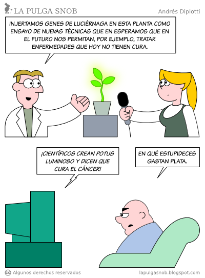
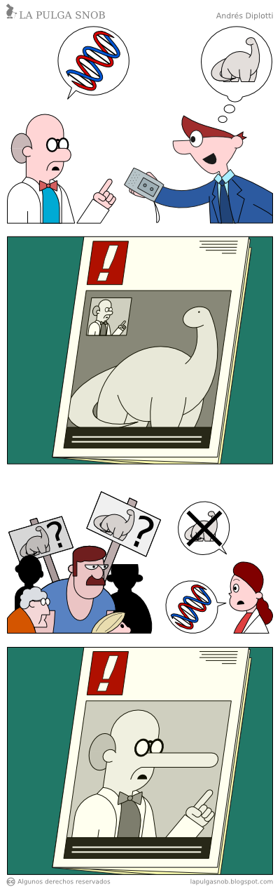

Yesterday our esteemed [Francotirador](https://twitter.com/Francotirador)
surprised us with this piece on the Radio Bio Bio site: [Study
explains why engineers, programmers and scientists are
antisocial](http://www.biobiochile.cl/2012/10/31/estudio-explica-por-que-ingenieros-programadores-y-cientificos-son-antisociales.shtml).

I asked my Twitter timeline what they thought of the article, and that set off
a very interesting and intense debate.



Many people didn't like it, obviously, because after all many of
us completely disagree with the stereotype that
engineers, programmers and scientists are
[***asocial***](http://lema.rae.es/drae/?val=asocial) people, and we are even less
going to agree with being called
***[antisocial](http://lema.rae.es/drae/?val=antisocial)***[^1].

Look at the first comment in the image above, to see how much
this kind of article hurts among the professionals who get
stereotyped this way. I could say a lot about that, but I'm going
to concentrate on this "dialogue" between Carlos Orrego and Christian, because
it contains a statement about journalistic responsibility that is very
important for the rest of this article:



Notice how the journalist defends himself, but the critic is right,
very much so, as we are about to see. Because the piece really is very bad(\*),
and very biased on top of that, starting with the picture of
 Sheldon Cooper included in the article.

We will go to the source, to settle whether we should shoot the messenger or not.
But first let's remember how science works.

## The scientific method

First, scientific studies never prove or demonstrate anything. The
scientific method works like this: a hypothesis is put forward,
then scientists run experiments and make observations to test
whether that hypothesis is invalid. The fact that a result agrees with
what the hypothesis proposed does not mean the hypothesis is correct;
it is only a temporarily valid theory. Science is nothing more than a
"continuous approximation to the truth", as some philosopher once
put it.

The great Richard Feynman explains it very well in this video:

## Science journalism

This aspect of science is unfortunately ignored by many
journalists. I don't know whether our universities have courses in science
journalism, but anyone who is going to devote themselves to science
journalism should at least understand how science really
works, or they run the risk of making the mistakes shown in these
panels from [La Pulga Snob](http://www.lapulgasnob.com/)[^2]:

Are we programmers asocial?

All of yesterday's discussion in my Twitter timeline came from [this piece on
Bio
Bio](http://www.biobiochile.cl/2012/10/31/estudio-explica-por-que-ingenieros-programadores-y-cientificos-son-antisociales.shtml),
which makes several mistakes as I see it. First, the headline is
wrong: it calls an entire segment antisocial when it means
that they are less empathetic, or asocial.

Second, it distorts the study's result, presenting it as a
definitive explanation of a supposed behavior of a certain group of
people. We already saw that a hypothesis is not a definitive explanation,
even if the observations and results are temporarily and
circumstantially valid (other scientists still have to replicate
the observed results).

And third, [the original Science
Daily article](http://www.sciencedaily.com/releases/2012/10/121030161416.htm),
which is the basis for the Bio Bio piece, never claims there is anything
special about the personality of engineers, scientists, programmers
or any other profession, except perhaps CEOs.

But let's look at some other distortions by the messenger:

Traduttore, Traditore! {#traduttoretradittore}
----------------------

In his piece Christian writes, quoting one of the study's authors (his
Spanish, rendered literally):

> "This shows that scientific personalities really do leave
> something out: human sensitivity. A great challenge for cognitive
> science will now be how we can better translate the cold and distant
> mechanical descriptions that neuroscience produces and the
> intuitive and emotional understanding that allows us to relate to
> one another as people."

The original text in English says:

>  "This shows scientific accounts really do leave something out \--
> the human touch. A major challenge for the science of the mind is how
> we can better translate between the cold and distant mechanical
> descriptions that neuroscience produces, and the emotionally engaged
> intuitive understanding which allows us to relate to one another as
> people."

I think the first sentence should be translated like this:

> "Esto demuestra que las explicaciones científicas realmente dejan
> algo fuera, el toque humano"

At what point "scientific accounts" turned into "scientific
personalities" is something we ought to figure out. Maybe it's a
challenge for the neuroscientists (actually there is a theory that
explains this behavior, it's called cognitive bias,
[like the ones I wrote about a while ago](/en/blog/lnds/2011/07/05/irrational-decisions/)).

Another example of bad translation, and of a lack of investigative rigor:

> "The disconnect between our experimental understanding and our
> scientific understanding is known as the 'explanatory gap'. In
> 2006, the philosopher Philip Robbins and I conceived a pretty
> crazy theory: that the explanatory gap is determined by our
> neural structure. Now I am surprised to realize how consistent
> these results are with that theory"

The text in English:

> "The disconnect between experiential understanding and scientific
> understanding is known as the explanatory gap," Jack said. "In 2006,
> the philosopher Philip Robbins and I got together and we came up with
> a pretty crazy, bold hypothesis: that the explanatory gap is driven by
> our neural structure. I was genuinely surprised to see how powerfully
> these findings fit that theory."

A more adequate translation of the first sentence is:

"La desconexión entre el entendimiento experiencial y el entendimiento
científico es conocido como la brecha explicativa." (experiential, not
experimental), and further on the
word *driven* should be translated as *dirigida*, rather than
*determinada* (determined).

It is important to note that at this point we are talking about a fairly
complex philosophical concept. The "Explanatory Gap" is an idea
introduced by the philosopher Joseph Levine, which addresses the difficulty
physical theories of the mind have in explaining how physical properties
give rise to the way things feel when we
"*experience*" them[^3]. This thesis is central to what is
known as the dualism debate, the idea that mind and body are separate
entities.

Put simply, some hold that the experience of
subjective consciousness is something located outside the body; the
mind, or the soul, cannot be described by means of neural
"circuitry", and is explained by something outside this world (dualism), or by a
physical phenomenon not yet explained (such as the [quantum
mind](http://en.wikipedia.org/wiki/Quantum_mind), or
[indirect realism](http://en.wikipedia.org/wiki/Indirect_realism)).

This matters, because the hypothesis of the work was to test the thesis
that there is an explanation in our neural circuitry for this
phenomenon we call the "human touch", the "soul".

## The study

Let's see what the scientists say about their work directly in the
paper they published[^4]:

> "Two lines of evidence indicate that there exists a reciprocal
> inhibitory relationship between opposed brain networks. First, most
> attention-demanding cognitive tasks activate a stereotypical set of
> brain areas, known as the task-positive network and simultaneously
> deactivate a different set of brain regions, commonly referred to as
> the task negative or default mode network. Second, functional
> connectivity analyses show that these same opposed networks are
> anti-correlated in the resting state. We hypothesize that these
> reciprocally inhibitory effects reflect two incompatible cognitive
> modes, each of which is directed towards understanding the external
> world."

What these gentlemen mean is that when we are doing a
task that requires all our concentration we go into a
"do not disturb" mode. At that moment, when we are thinking, or working
on a task that demands all our cognitive capacity, we will have
zero empathy.

That is something we have all observed, and it doesn't only happen when we are
programming; it happens when we are writing a brainy article just as much as
when we are playing "[League of Legends](http://na.leagueoflegends.com/)".

If we are in intense cognitive task mode, our social brain
will be inhibited. "I'm thinking, don't bother me, OK!".

What they did in the experiment was take a group of
young students. They were shown texts or videos in which they were
asked to make observations about other people's feelings, or
to solve physics problems. That is, tasks that required recognizing
feelings and tasks that required mechanical reasoning. All of this
while their brains were being observed with magnetic resonance imaging.

They observed that different neural networks were activated depending on the
type of task, and that while one network was active, the other was inhibited.
During the resting phases, however, the minds of the young people
studied oscillated between activating one network and the other.

Now, all of this is interesting, because it could have applications for
understanding autism, or Williams syndrome, or in the treatment of
certain disorders such as schizophrenia, or anxiety and depression,
but that requires other experiments.

Now, where does it come from that engineers, programmers or scientists
are more antisocial?

From nowhere! There is nothing in the Science Daily piece that implies
that kind of conclusion.

In fact, the only reference that amounts to an extrapolation in
that direction talks about the personalities of senior executives, such as a
CEO:

> But, even healthy adults can rely too much on one network, Jack said. A
> look at newspaper business pages offers some examples.

"You want the CEO of a company to be highly analytical in order to run
a company efficiently, otherwise it will go out of business," he said.
"But, you can lose your moral compass if you get stuck in an analytic
way of thinking."

I could say that what this study really shows is that all
senior company executives are immoral. But that wouldn't be
true!

The hypothesis this analysis tested is that there are two neural circuits,
one more "social" and another more "analytical", that inhibit each
other. They also found that at rest our mind jumps between
the two circuits.

The other hypotheses, yet to be demonstrated, say that if we get stuck
in one mode or the other we run certain risks. And that can happen to
anyone; it can lead us to depression, anxiety, asocial
behavior, etc.

We can all be **antisocial**, because apparently this is the
"neural circuitry" of the brains of all healthy people. And
future studies will probably show that something happens in the balance
of our internal neural networks.

So if a disorder occurs in this circuitry that makes us
antisocial, it is something that could affect any healthy person,
even a journalist.

(\*) The judgment is of the press article; I am not passing judgment on
the person.

[^1]: To clarify, in Spanish the word
[antisocial](http://lema.rae.es/drae/?val=antisocial) denotes a
person opposed to the social order; in fact the press itself uses this
word when it refers to criminals, it is the favorite word
for crime-page headlines. The word
[asocial](http://lema.rae.es/drae/?val=asocial), on the other hand, refers to those
people who do not integrate or connect with society.

[^2]: The panels were taken from these strips: [Sección de
Ciencia](http://www.lapulgasnob.com/2008/10/seccin-de-ciencia.html) and
[Ciencia
Popular](http://www.lapulgasnob.com/2010/02/ciencia-popular.html). [La
Pulga Snob](http://www.lapulgasnob.com/) is the creation of Andrés
Diplotti. It is one of my favorite webcomics.

[^3]: *Experienciar* does not exist in Spanish, but I use it as an alternative
to *experimentar*. The difference between *experimental* and *experiencial*
does exist, but not the one between *experimentar* and *experienciar* (to experiment and to experience), which our
language expresses with the same word, and that is rather limiting
when it comes to expressing the ideas of neuroscience and the philosophy of
mind.

[^4]: The study is available in the [online version of NeuroImage](http://www.sciencedirect.com/science/article/pii/S1053811912010646?v=s5); it costs 31 dollars if you are interested, but I'm not going to invest them, so I will use as my source its abstract (quoted below) and [this piece](http://www.sciencedaily.com/releases/2012/10/121030161416.htm) from Science Daily that Radio Bio Bio cites. The abstract of the paper is the following:
*"Two lines of evidence indicate that there exists a reciprocal\
inhibitory relationship between opposed brain networks. First, most
attention-demanding cognitive tasks activate a stereotypical set of
brain areas, known as the task-positive network and simultaneously
deactivate a different set of brain regions, commonly referred to as
the task negative or default mode network. Second, functional
connectivity analyses show that these same opposed networks are
anti-correlated in the resting state. We hypothesize that these
reciprocally inhibitory effects reflect two incompatible cognitive
modes, each of which is directed towards understanding the external
world. Thus, engaging one mode activates one set of regions and
suppresses activity in the other. We test this hypothesis by
identifying two types of problem-solving task which, on the basis of
prior work, have been consistently associated with the task positive
and task negative regions: tasks requiring social cognition, i.e.,
reasoning about the mental states of other persons, and tasks
requiring physical cognition, i.e., reasoning about the
causal/mechanical properties of inanimate objects. Social and
mechanical reasoning tasks were presented to neurologically normal
participants during fMRI. Each task type was presented using both text
and video clips. Regardless of presentation modality, we observed
clear evidence of reciprocal suppression: social tasks deactivated
regions associated with mechanical reasoning and mechanical tasks
deactivated regions associated with social reasoning. These findings
are not explained by self-referential processes, task engagement,
mental simulation, mental time travel or external vs. internal
attention, all factors previously hypothesized to explain default mode
network activity. Analyses of resting state data revealed a close
match between the regions our tasks identified as reciprocally
inhibitory and regions of maximal anti-correlation in the resting
state. These results indicate the reciprocal inhibition is not
attributable to constraints inherent in the tasks, but is neural in
origin. Hence, there is a physiological constraint on our ability to
simultaneously engage two distinct cognitive modes. Further work is
needed to more precisely characterize these opposing cognitive
domains."*
