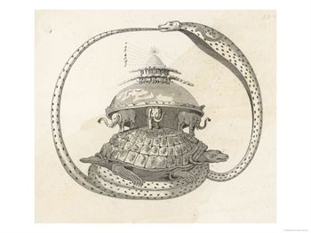
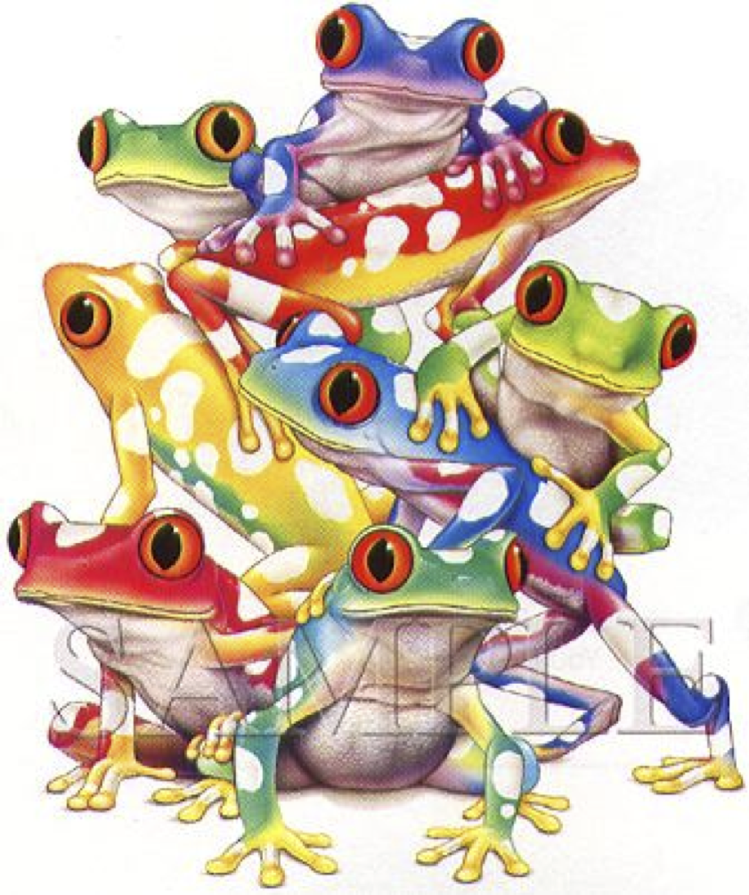

> Alan Kay creates Smalltalk and invents the term "object oriented."
> When asked what that means he replies, "Smalltalk programs
> are just objects." When asked what objects are made of
> he replies, "objects." When asked
> again he says "look, it's all objects all the way down.
> Until you reach turtles."
> -- [A Brief, Incomplete, and Mostly Wrong History of Programming Languages](/en/blog/lnds/2013/11/06/a-brief-and-absurd-history-of-programming-languages/),
> James Iry

In Hindu cosmology the "Universe was a closed entity, contained in
the coils of Seshu, the black cobra. At the bottom of everything there was a sea
of milk completely surrounded by that serpent. An enormous turtle
swam in the milky ocean, and on its shell stood four
elephants (one at each cardinal point). In turn, those
elephants held the Earth on their backs. At its center rose
a great central mountain, around which a gigantic fire revolved,
bringing about day and night. Seshu, with an upper coil, contained
the vault of heaven."[^1]

Seen a certain way, all our system architectures with
all their layers have a structure similar to these exotic
cosmologies. The difference is that sometimes it seems that instead of
a tower of solid animals, like turtles and elephants, what we have
is a tower full of frogs ready to jump at any moment
:smile:

