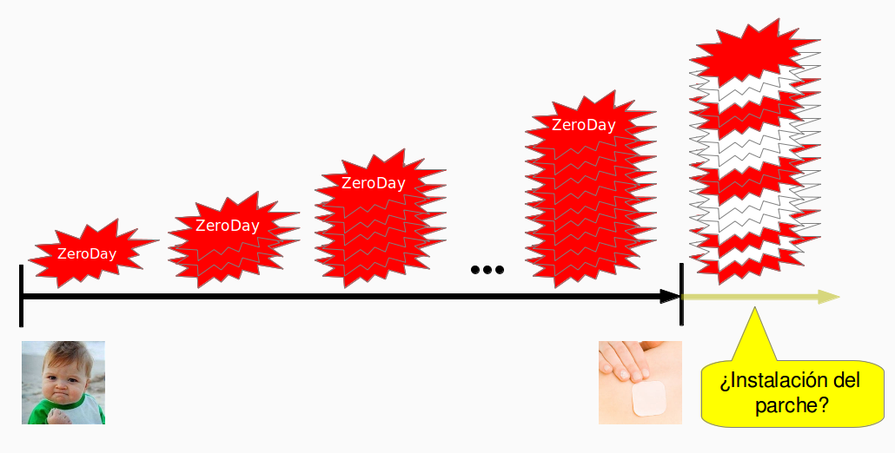
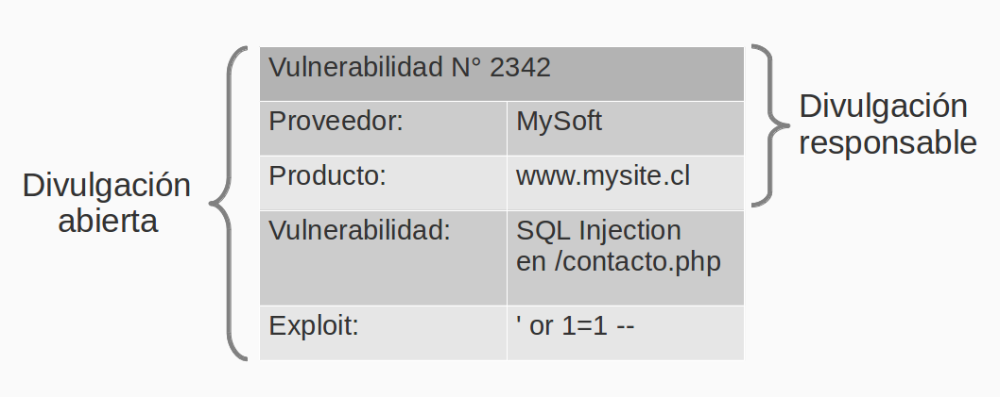

The following post is by a notable "[guest villain](/en/tag/guest-villain/)":
the security expert, and beer guru ;-),
[Cristián Rojas.](http://injcristianrojas.github.com/about.html)

This piece was born from a conversation with Cristián on El Test Acido, which,
given the format of the show, we couldn't take any deeper. That's why I asked
Cristián to develop the subject in an article that I now share with
you.

Disclosure: you can't just go and do it
=======================================

By **Cristián Rojas**

I recently witnessed (was a victim of?) the disclosure of a
vulnerability in a set of UNIX servers distributed with NIS on
which I have a user account. The vulnerability is that
with one command any user could obtain the list of all
the users of the NIS server set along with their respective
password verifiers. Even though the passwords are
turned into verifiers using
[crypt](http://unix.stackexchange.com/questions/8229/what-methods-are-used-to-encrypt-passwords-in-etc-passwd-and-etc-shadow),
as happens on every UNIX-based system, a very easy password
(or one based on a dictionary word) could be cracked
using tools like [John The
Ripper](http://www.openwall.com/john/).

The problem, however, is not the vulnerability but who
disclosed it. The reporter is another user of the system, who mentioned that
it was not the first time he had reported the vulnerability through the forum.
I privately contacted the system administrators and told
them about the problem, which they fixed the next day, and
I also asked them whether they had received any private communication
from the reporter, to which they answered no.

Most likely, by disclosing the vulnerability on the forum, the
reporter felt he was doing the system's user community
a favor. The problem is that in doing so he needlessly
exposed the affected users to having their accounts
compromised, or worse, [to having other services they use
compromised
as well](http://splm.blogspot.com/2011/11/guia-practica-para-el-manejo-de.html).
Malice on the reporter's part? Far from it. Ignorance,
perhaps.

Models of (non) disclosure {#modelosdenodivulgacin}
--------------------------

Today there are 3 disclosure models a user can follow
on finding a security vulnerability in a computer
system, a network or a piece of software.

The first model is **Non-Disclosure**, in which whoever finds
a vulnerability simply keeps quiet. This model is
interesting because, if the person who finds the vulnerability is
unscrupulous, he could exploit it all by himself and profit from
it. Nobody else finds out, not the vendor (by this word I mean
the webmaster, sysadmin, or developer in the case of software), and not
other users. The problem is that the vulnerability will go on existing,
and the information will go on being exposed or illicitly modified, that
is, until someone else stumbles on the vulnerability and reveals it,
at which point one of the other two models may come into play.

The second model is **Full Disclosure**, also known to
some as *Irresponsible Disclosure*, in which the
user, on finding a vulnerability, makes it public on his blog,
forums, etc., and publishes all the details: which
application/system it is in, what the vulnerability is and how to exploit it. By
doing this he allows, for example, security researchers to
start writing new antivirus signatures, system
administrators to go on alert and take pseudo-mitigating measures
(workarounds), and end users to get very scared. Not only that,
it also puts pressure on vendors to patch their systems or
software.

There are 2 problems with this kind of disclosure. The first
is that with an unpatched vulnerability that
everyone knows about, you get what are known as *Zero
Day* attacks, which are attacks against systems that have not been patched
against that vulnerability and are therefore completely exposed, and
will remain so until a patch comes out. And from there comes the second
problem: the vendor will have to rush out a patch and worry about two
things: that the patch mitigates the vulnerability and that it doesn't cause a
regression. On top of that, the vendor won't be able to sleep 100% soundly, because
releasing the patch is one thing and people actually installing it
is quite another.

A clear example of this is the following: if you are a
Windows user, have you ever wondered
what this *Windows Malicious Software Removal Tool*
that arrives through Windows Update is, and why it arrives every month?
It is not an antivirus. It is a tool that
automatically patches Windows systems against worms like Nimda or SQL
Slammer, which were released almost 10 years ago and yet still
wreak havoc because many Windows systems around the world are
unattended, and these worms keep replicating themselves across the
network from and to those vulnerable systems.

Does that mean we are all exposed to vulnerabilities, Zero Days
and people who disclose them openly?

Not necessarily. There is a little-known (or little-used) model
known as **Responsible Disclosure**, in which the
reporter privately contacts the vendor and reveals the details of the
vulnerability only to him, while publicly stating that the
application has a vulnerability.

## The devil is in the details

In both cases the reporter publishes the vulnerability. Where is the
difference? In the details he makes public on discovering the
vulnerability. With full disclosure all the details
are disclosed immediately, while with responsible
disclosure the reporter limits himself to saying "this system has
a vulnerability", without going into further detail. In fact, the
"responsible" part is a responsibility both toward the
vendor and toward the users of the application, since the
reporter agrees on a reasonable deadline with the vendor for
fixing the vulnerability, after which the reporter will make
all its details public.

The recommendation is to use responsible disclosure. There are even
organizations that [offer money](https://www.google.com/about/appsecurity/reward-program/) as
an incentive to report vulnerabilities using this model.
Not everyone has that financial possibility, however. But now
we are clear about what the disclosure models are, and we know how to
disclose well (and badly) the security vulnerabilities of the systems
we use.

About the author:

Cristián Rojas is a computer engineer (Ingeniero Civil en Computación) from the Universidad de
Chile. He currently works as a systems monitoring specialist
for Firenxis, and as a freelance consultant in secure software
development and corporate information security
policies.

He also teaches, as
instructor of the Software Security module in the Postgraduate Diploma
in Computer Security at the Faculty of Physical and
Mathematical Sciences of the Universidad de Chile, and as an undergraduate
instructor in the course CC5315: Software Security at the same faculty.
