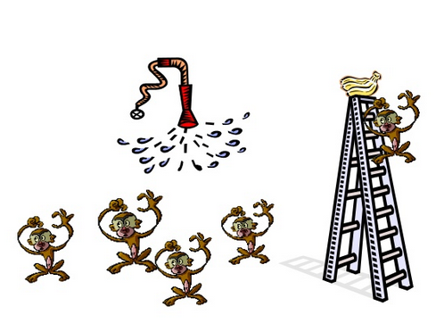

> "The ship wherein [Theseus](http://es.wikipedia.org/wiki/Teseo) and
> the youth of [Athens](http://es.wikipedia.org/wiki/Atenas) returned
> from [Crete](http://es.wikipedia.org/wiki/Creta) had
> thirty oars, and was preserved by the Athenians down even to the time
> of [Demetrius Phalereus](http://es.wikipedia.org/wiki/Demetrio_de_Falero), for
> they took away the old planks as they decayed, putting in new and
> strong timber in their places, insomuch that this ship became a
> standing example among the philosophers, for the logical question of things that
> grow; one side holding that the ship remained the same,
> and the other contending that it was not the same."\
> -- [Plutarch, quoted from Wikipedia](http://es.wikipedia.org/wiki/Paradoja_de_Teseo)

"Let the institutions do their work" is almost a commonplace in
Chilean politics, a phrase that rests on the idea of their perpetuity
and continuity: "people change, institutions
remain".

On one of his travels the English writer [Douglas
Adams](http://www.douglasadams.com/) visits the Golden Pavilion in Kyoto,
Japan, and tells the following anecdote:

> "I remembered once, in Japan, having been to see the Gold Pavilion
> Temple in Kyoto and being mildly surprised at quite how well it had
> weathered the passage of time since it was first built in the fourteenth
> century.

I was told it hadn't weathered well at all,
and had in fact been burnt to the ground twice in
this century. "So it isn't the original building?" I had asked my Japanese
guide.

> "But yes, of course it is," he insisted, rather
surprised at my question.\
"But it's been burned down?"\
"Yes."\
"Twice."\
"Many times."\
"And rebuilt."\
"Of course. It is an important and historic building."\
"With completely new materials."\
"But of course. It was burned down."\
"So how can it be the same building?"\
"It is always the same building."

So the question is: if the elements change gradually, one by
one, how is the unity, or the identity, of the institution maintained?

Aristotle tries to resolve the paradox by arguing that there are four
causes or reasons that describe a thing.\
There is the Formal Cause, or the design of the thing, while the Material
Cause is the matter things are made of.\
The Ship of Theseus, or the Golden Pavilion, can be described as the
same thing because of the formal cause, or design, which does not change, even though
the material used to build them varies over time. In the
same way a river has the same formal cause, even though its material
cause (the water it contains) changes over time.

Another of Aristotle's causes is the end, or Final Cause: the
intended purpose of a thing. The Ship of Theseus could have the same end,
carrying Theseus, even though its material cause might
change over time. Lastly there is the Efficient Cause, which is how and
by whom a thing is made, for example the way the
craftsmen built and assembled something. In the case of the Ship of
Theseus, the workers who built the ship in the first place
could have used the same tools and techniques to replace
the planks on the ship.

So Aristotle's answer leads us to conclude that the
essence of institutions does not necessarily reside in people,
but in the procedures, the formalities, the rules, the
laws that govern them. Or the end for which they were conceived. Or sometimes
it may be simple habit.

Which reminds me of another story, about some monkeys:

> In an experiment, a group of scientists put five apes in
> a room. In the middle of it they placed a stepladder,
> like the ones painters or carpenters use on a job. At
> the top of the ladder they put some bananas. Whenever one of the
> monkeys climbed the ladder to get to the bananas, the
> scientists sprayed the rest of the monkeys with a jet of ice-cold water. After
> a while, the monkeys connected the use of the ladder with the
> jet of cold water, so that whenever one of them ventured
> up in search of a banana, the rest of the monkeys stopped him
> by force. In the end, even with the temptation of food, no
> monkey dared to go up the ladder.

> At that point, the scientists removed one of the five original
> monkeys at random and replaced him with a new one in the room. The
> new monkey, naturally, climbed the ladder in search of the
> bananas. As soon as the others saw what he was up to, they
> pounced on him and beat him down before the jet of cold water
> could be unleashed on them. After the
> experience was repeated several times, the new monkey understood that it was better for
> his health to give up climbing the ladder.

The researchers again replaced one of the monkeys from the original
group. The monkey who had been the previous replacement took part with special
enthusiasm in the beatings of the new climbing monkey.

Later the process was repeated with the remaining monkeys, until
the moment came when all the monkeys from the original experiment had
been replaced.

At that point, those running the study were surprised by
the results. None of the monkeys in the room had
ever been subjected to the jet of cold water. And yet none of them
dared to climb up and grab the coveted bananas.

Although [I'm not sure whether this is a true story or an apocryphal one](http://skeptics.stackexchange.com/questions/6828/was-the-experiment-with-five-monkeys-a-ladder-a-banana-and-a-water-spray-cond),
its lesson is clear, and you can't deny that it often reflects what
happens in our institutions, or organizations. The same at a smaller
scale, like our work teams. How often does it happen that someone
arrives and nothing is explained to them, but they are asked to do a certain job
a certain way, and deep down nobody really knows why. Like the
monkeys in the story, nobody dared to experience the result of
breaking the rule, or questioning it; nobody even knows what might
happen, like the monkeys.

They say that if the original timbers of the ship of Theseus had been
stored somewhere else, some intrepid soul would have been able to
rebuild it, and could have claimed, quite rightly, to be
the owner of the true Ship of Theseus. Except for the small detail that
he didn't have Theseus and his friends. But that is a subject for another,
later reflection.
