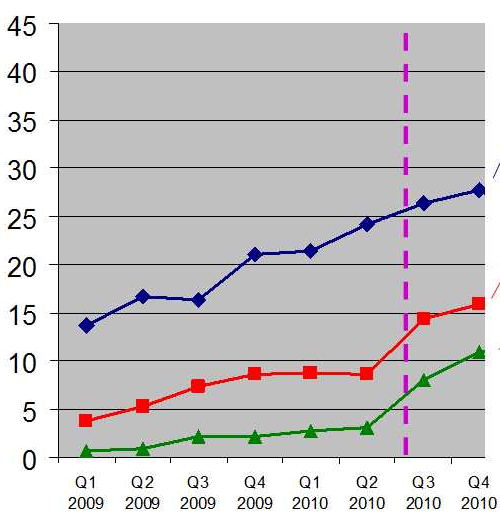
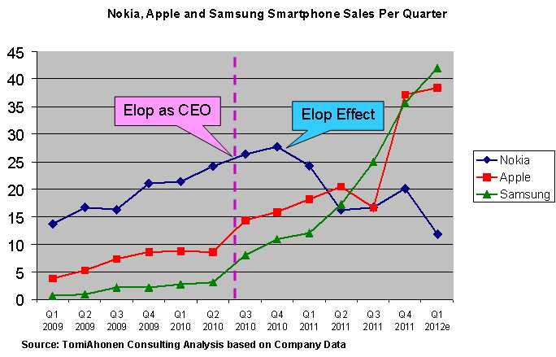
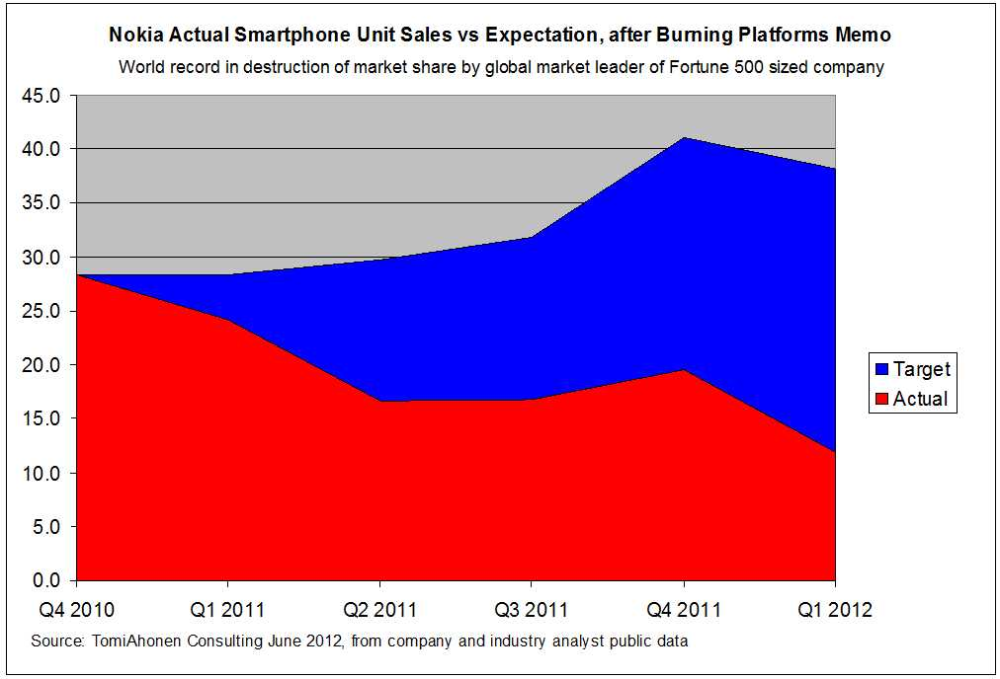
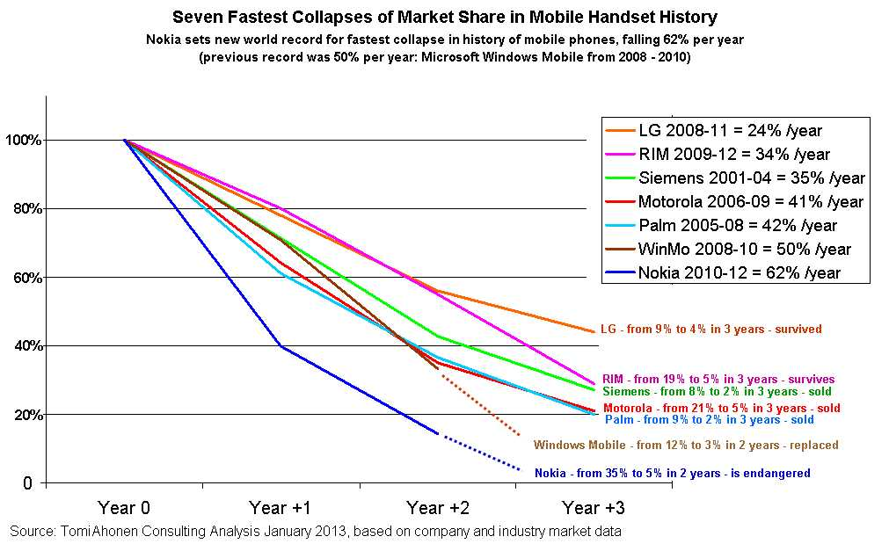

> "If you know the enemy and know yourself, you need not fear the
> result of a hundred battles. If you know yourself but not the
> enemy, for every victory gained you will also suffer a defeat. If you
> know neither the enemy nor yourself, you will succumb in every battle."\
> -- Sun Tzu

The chart shows the revenue of the smartphone
divisions of three big companies, from the first quarter of 2009
to the fourth quarter of 2010. Which one is Nokia?

# Finnish pride

From December 7, 1939 to January 8, 1940, Finnish and
Soviet troops faced each other in the battle of Suomussalmi.
Colonel Hjalmar Siilasvuo of Finland was given the mission of
attacking the Soviet Ninth Army led by General Mihail
Pavlovitz Duhanov, which had crossed the northern border with the Soviet
Union a week earlier. The Russian Ninth Army had 45,000
troops, 90 tanks and air power. The Finnish troops numbered no more than
11,000. On some of the coldest terrain in the world, very close
to the Arctic Circle.

Despite being outnumbered 4 to 1, and having
neither tanks nor an air force, he was able to defeat the Russian troops,
with a loss of 1,000 men, while the Soviet army
lost 13,000 soldiers (some claim it was more) and some 2,100 prisoners
were captured. In this battle the Finns
captured 43 tanks (at the start of the war Finland had only
30 tanks in its entire army). Not only that, Suomussalmi was able to
block the Soviet 44th Division, which was coming to reinforce General
Duhanov's troops.

After the battle the Soviets dismissed General Duhanov.
One of his division commanders, General Alexei Nikolajevitz
Vinogradov, was found to be so incompetent and inept that he was tried,
convicted and executed four days after the battle. He was shot
along with other commanders and officers on a frozen lake in front of
the troops who had survived the battle, on January 11, 1940.

You will understand that for the Finns Suomussalmi is a hero, and he really
deserves to be considered one of history's great strategists,
able to defeat an adversary with better technology and four times
the resources.

Just as Steve Jobs can be considered one of the most brilliant CEOs,
up against one of the worst, Stephen Elop, in the battle for the
smartphone market. That's why it hurts the Finns so much that Nokia
has lost its leadership in this industry. As told by Tomi T.
Ahonen, a Finnish-born author and consultant, who lamented it in a
[long post](http://communities-dominate.blogs.com/brands/2012/07/the-sun-tzu-of-nokisoftian-microkia-mirror-mirror-on-the-wall-whose-the-baddest-of-them-all-waterloo.html)
in which he calls for Elop's head, and rightly so in my view[^1].

## Nokia, our platform is burning

The dotted line in the chart above marks the moment Stephen
Elop takes over as CEO of Nokia. At that moment, going into the second
half of 2010, Nokia was selling more than twice as much as Apple. The iPhone was
introduced in 2007; at the start of 2010 the iPhone was still lagging
behind Nokia. In all of history we can find a
similar situation (a competitor selling twice as much as its closest rival) only
if we go back to 1915, when Ford sold more than twice as much as GM.

Elop was hired to fix execution problems. Nokia
Corporation had been badly managed by its previous
CEOs, but not the smartphone division. That division was
in impeccable health, as the chart shows, with revenue
double that of its competitors. It was a dream scenario, the opportunity
to build an empire in the smartphone industry.

But what happened? Let's let the clock run and look at the same chart
a few quarters later.

Remember, we are looking only at the smartphone division, which was the
jewel in Nokia's crown.

At the end of 2010 the "Elop effect" kicks in.

This hit to sales was not the result of a failed product, or of
unexpected problems, or of a sudden change in consumer
tastes. Not natural disasters, not strikes. It was a memo, Stephen Elop's
famous Burning Platform Memo, whose text I have included at
the end in the notes[^3].

What led Elop to think that, being the top seller of smartphones in
2011, he was doomed to lose the leadership of the industry?

In the memo Elop likens Nokia's situation to that of a man
trapped on an oil platform in the North Sea, in the
dark of night, surrounded by flames. The man decides to jump into
the darkness of the sea.

According to Elop, Nokia was standing on a burning platform, in complete
darkness and uncertainty, and all the company could do was jump bravely
into the void.

Mind you, at that time Nokia's sales were growing; it is
after Elop's memo that they began to decline.

According to Ahonen this is one of the costliest memos in the entire
history of management.

It was after this memo that Nokia decided to abandon Symbian and MeeGo
and go with Windows Phone 7.

Let's remember that Stephen Elop had been head of the business division for
Office 2010 at Microsoft, and that in March 2011 he received 6
million dollars from Nokia in bonuses as "compensation for lost income
from his prior employer", on top of his annual salary of 1.4
million dollars.

According to Ahonen, the whole image in Elop's memo is self-deception.

In the first quarter of 2011 Nokia fell further than Palm, Motorola,
Windows Mobile, Ericsson, Blackberry or any other handset
maker at its worst moment.

The moment the memo appeared, trust inside Nokia
collapsed: trust in Nokia's employees, and their trust in the CEO.
Elop's great mistake: not trusting his product, the tremendous
history and capability Nokia had shown until then.

According to Ahonen, Elop's memo cost Nokia 13 billion
dollars in sales in 12 months (4.8 billion in profits) [^2].

The conventional idea is that the iPhone killed Nokia's smartphones.
According to Ahonen, and he has the data to show it, every year of the
iPhone's existence was a year in which Nokia's sales grew, until 2010. From the time
the iPhone appeared until Elop's memo, Nokia sold twice as many units
as the iPhone. Nokia was winning on technology, it had an app
store, games, a good operating system, it was innovating with
MeeGo, etc.

All of that was lost, because of what is probably one of the
biggest management blunders of our time.

Notes
-----

[^1]: [Ahonen's analysis is from July
2012](http://communities-dominate.blogs.com/brands/2012/06/the-final-reckoning-of-burning-platforms-memo-damaged-nokia-by-wiping-out-13b-in-revenues-and-destro.html),
a long blog post, but very detailed and full of information, from which
I took the charts in this post.

Also see his January 7 piece [on the seven biggest collapses in
smartphone
history](http://communities-dominate.blogs.com/brands/2013/01/the-seven-biggest-collapses-in-mobile-handset-or-smartphone-history-this-is-part-3-in-the-nokia-disa.html)

[^2]: [Post about Nokia's losses](<http://communities-dominate.blogs.com/brands/2012/06/the-final-reckoning-of-burning-platforms-memo-damaged-nokia-by-wiping-out-13b-in-revenues-and-destro.html>)

[^3]: *The Burning Platform Memo*\
This is the text of the memo sent by Stephen Elop in February 2011:\
*Hello there,\
There is a pertinent story about a man who was working on an oil\
platform in the North Sea. He woke up one night from a loud explosion,\
which suddenly set his entire oil platform on fire. In mere moments, he\
was surrounded by flames. Through the smoke and heat, he barely made his\
way out of the chaos to the platform's edge. When he looked down over\
the edge, all he could see were the dark, cold, foreboding Atlantic\
waters.\
\
As the fire approached him, the man had mere seconds to react. He could\
stand on the platform, and inevitably be consumed by the burning flames.\
Or, he could plunge 30 meters in to the freezing waters. The man was\
standing upon a "burning platform," and he needed to make a choice.\
\
He decided to jump. It was unexpected. In ordinary circumstances, the\
man would never consider plunging into icy waters. But these were not\
ordinary times - his platform was on fire. The man survived the fall and\
the waters. After he was rescued, he noted that a "burning platform"\
caused a radical change in his behaviour.\
\
We too, are standing on a "burning platform," and we must decide how
we are going to change our behaviour.\
\
Over the past few months, I've shared with you what I've heard from\
our shareholders, operators, developers, suppliers and from you. Today,\
I'm going to share what I've learned and what I have come to believe.\
\
I have learned that we are standing on a burning platform.\
\
And, we have more than one explosion - we have multiple points of\
scorching heat that are fuelling a blazing fire around us.\
\
For example, there is intense heat coming from our competitors, more\
rapidly than we ever expected. Apple disrupted the market by redefining\
the smartphone and attracting developers to a closed, but very powerful\
ecosystem.\
\
In 2008, Apple's market share in the \$300+ price range was 25 percent;\
by 2010 it escalated to 61 percent. They are enjoying a tremendous\
growth trajectory with a 78 percent earnings growth year over year in\
Q4 2010. Apple demonstrated that if designed well, consumers would buy a\
high-priced phone with a great experience and developers would build\
applications. They changed the game, and today, Apple owns the high-end\
range.\
\
And then, there is Android. In about two years, Android created a\
platform that attracts application developers, service providers and\
hardware manufacturers. Android came in at the high-end, they are now\
winning the mid-range, and quickly they are going downstream to phones\
under €100. Google has become a gravitational force, drawing much of the\
industry's innovation to its core.\
\
Let's not forget about the low-end price range. In 2008, MediaTek\
supplied complete reference designs for phone chipsets, which enabled\
manufacturers in the Shenzhen region of China to produce phones at an\
unbelievable pace. By some accounts, this ecosystem now produces more\
than one third of the phones sold globally - taking share from us in\
emerging markets.\
\
While competitors poured flames on our market share, what happened at\
Nokia? We fell behind, we missed big trends, and we lost time. At that\
time, we thought we were making the right decisions; but, with the\
benefit of hindsight, we now find ourselves years behind.\
\
The first iPhone shipped in 2007, and we still don't have a product\
that is close to their experience. Android came on the scene just over 2\
years ago, and this week they took our leadership position in smartphone\
volumes. Unbelievable.\
\
We have some brilliant sources of innovation inside Nokia, but we are\
not bringing it to market fast enough. We thought MeeGo would be a\
platform for winning high-end smartphones. However, at this rate, by the\
end of 2011, we might have only one MeeGo product in the market.\
\
At the midrange, we have Symbian. It has proven to be non-competitive in\
leading markets like North America. Additionally, Symbian is proving to\
be an increasingly difficult environment in which to develop to meet the\
continuously expanding consumer requirements, leading to slowness in\
product development and also creating a disadvantage when we seek to\
take advantage of new hardware platforms. As a result, if we continue\
like before, we will get further and further behind, while our\
competitors advance further and further ahead.\
\
At the lower-end price range, Chinese OEMs are cranking out a device\
much faster than, as one Nokia employee said only partially in jest,\
"the time that it takes us to polish a PowerPoint presentation." They\
are fast, they are cheap, and they are challenging us.\
\
And the truly perplexing aspect is that we're not even fighting with\
the right weapons. We are still too often trying to approach each price\
range on a device-to-device basis.\
\
The battle of devices has now become a war of ecosystems, where\
ecosystems include not only the hardware and software of the device, but\
developers, applications, ecommerce, advertising, search, social\
applications, location-based services, unified communications and many\
other things. Our competitors aren't taking our market share with\
devices; they are taking our market share with an entire ecosystem. This\
means we're going to have to decide how we either build, catalyse or\
join an ecosystem.\
\
This is one of the decisions we need to make. In the meantime, we've\
lost market share, we've lost mind share and we've lost time.\
\
On Tuesday, Standard & Poor's informed that they will put our A long\
term and A-1 short term ratings on negative credit watch. This is a\
similar rating action to the one that Moody's took last week. Basically\
it means that during the next few weeks they will make an analysis of\
Nokia, and decide on a possible credit rating downgrade. Why are these\
credit agencies contemplating these changes? Because they are concerned\
about our competitiveness.\
\
Consumer preference for Nokia declined worldwide. In the UK, our brand\
preference has slipped to 20 percent, which is 8 percent lower than last\
year. That means only 1 out of 5 people in the UK prefer Nokia to other\
brands. It's also down in the other markets, which are traditionally\
our strongholds: Russia, Germany, Indonesia, UAE, and on and on and on.\
\
How did we get to this point? Why did we fall behind when the world\
around us evolved?\
\
This is what I have been trying to understand. I believe at least some\
of it has been due to our attitude inside Nokia. We poured gasoline on\
our own burning platform. I believe we have lacked accountability and\
leadership to align and direct the company through these disruptive\
times. We had a series of misses. We haven't been delivering innovation\
fast enough. We're not collaborating internally.\
\
Nokia, our platform is burning.\
\
We are working on a path forward \-- a path to rebuild our market\
leadership. When we share the new strategy on February 11, it will be a\
huge effort to transform our company. But, I believe that together, we\
can face the challenges ahead of us. Together, we can choose to define\
our future.\
\
The burning platform, upon which the man found himself, caused the man\
to shift his behaviour, and take a bold and brave step into an uncertain\
future. He was able to tell his story. Now, we have a great opportunity\
to do the same.\
\
Stephen.*
