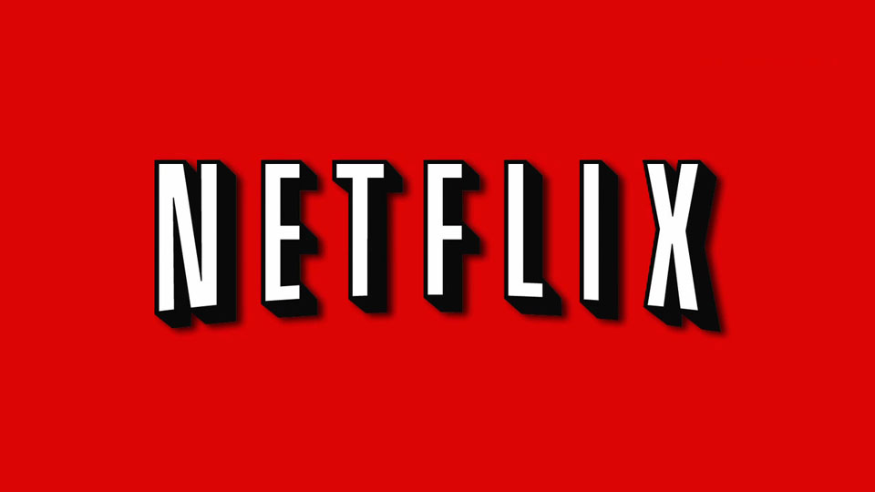

Adrian Cockcroft is the "cloud architect" at Netflix. Yes, cloud
architect. What the hell is that? I'll explain some other time. What
matters is that he writes a very interesting
[blog](http://perfcap.blogspot.com/), on which almost everything I'm
going to write today is based.

In December 2011 he wrote a post titled
["How Netflix gets out of the way of innovation"](http://perfcap.blogspot.com/2011/12/how-netflix-gets-out-of-way-of.html),
which I suggest you read. It is actually the "script" of a talk about
Netflix's culture.

What Cockcroft wants to explain in his talk is how Netflix can do things
so fast (sometimes too fast), so that they have been able to pull off
large-scale strategic moves, in a short time and with a small team of
engineers.

Look at what I just wrote: "pull off large-scale strategic moves, in a
short time and with a small team of engineers".

It's not easy, of course. Where is the key?

As always, the key is in not playing by the book, in doing things the
way the prophets of doom say they must not be done, without fear, and
bending the rules a little.

Netflix was born in 1997, founded by Marc Randolph and Reed Hastings,
both software developers who worked at Pure Software, the makers of
Purify, a memory debugger for C and C++ that was quite popular in Unix
environments in the early nineties. In those days it was an extremely
valuable tool for debugging programs. Reed Hastings was also the founder
of that company.

In 1997 they were acquired by Rational Software, the company behind UML
and RUP, which now belongs to IBM.

Of those days Hastings recalls that Pure Software was a small company,
fairly free and anarchic, but as it grew it became more and more
bureaucratic. So he left as soon as it was acquired by Rational, and
[spent 2 years thinking about how to organize his new venture](http://www.businessweek.com/stories/2007-09-23/netflix-flex-to-the-max)
so that it wouldn't fall into these "vices of growth".

The result is Netflix, a company based on the principles of "freedom and
responsibility". Hastings pays his employees very well, they have
unlimited vacation, and he lets them structure their own compensation
packages. In exchange, high performance is expected: every employee
should be able to do the work of 3 or 4 people.

I'm going to quote Cockcroft, who describes Netflix's innovative culture
this way (the full text is in [his post](http://perfcap.blogspot.com/2011/12/how-netflix-gets-out-of-way-of.html)):

> [...] the culture is what enables innovation, so that Netflix can get
> things done quickly [...]
>
> They have time to do this because we took the BS out of their role.

> It takes less process, fewer rules and simpler principles. Give people
> freedom, hold them responsible, replace the ones that can't or won't
> perform in that environment.
>
> This is your challenge, can you get a band together and go on a
> mission to save your company?

That is the message, and the second reason why I like Netflix. Freedom
and responsibility, that's how you have to work. Would you dare to
follow a model like the one Netflix proposes? Do you think a cultural
change like this would be accepted where you work? What are we missing?
