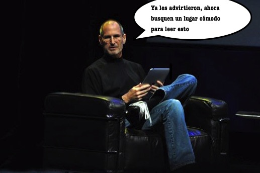
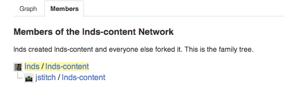
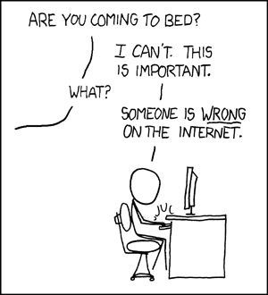
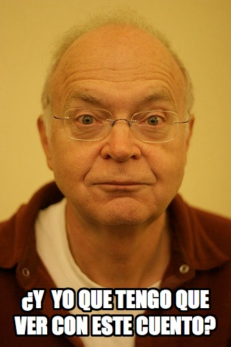
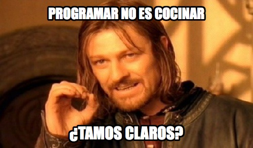
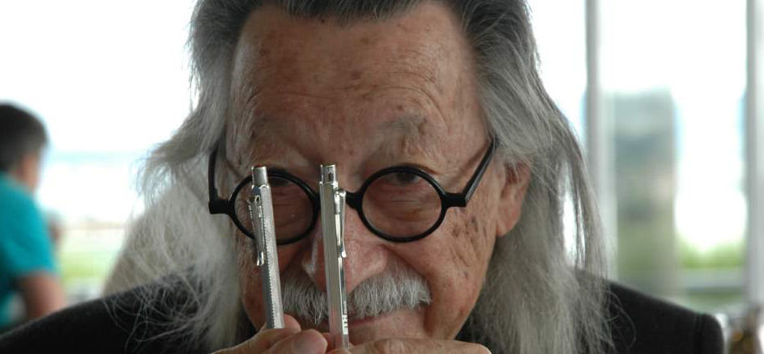
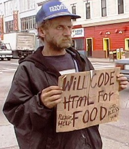
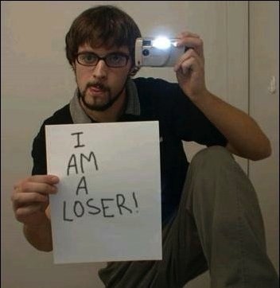
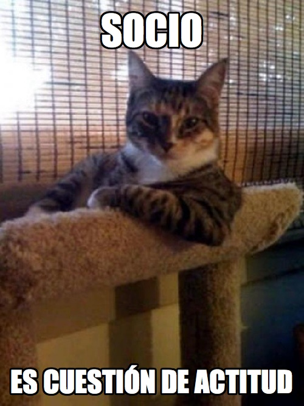

This post is long, I mean looooong, because it has ambition, and it
means to say many important things. As Chef Antoine of New Orleans says
(quoted by Fred Brooks in [The Mythical Man Month](http://amzn.to/zhUwYa)):

> "Good cooking takes time. If you are made to wait, it is
to serve you better, and to please you"

If I were you I would find myself a good couch and a quiet moment to
read this, which at times can get pretty dense, but I think it's worth
it. At least I decided to take the proper time to write it, calmly,
reflectively, the way it should be done when we consider the things we
do important.

## **Community**

> "The isolated man does not develop any intellectual
power. It is necessary for him to be immersed in an environment...
He might perhaps do a little research on his own and make a few
discoveries... the search for new techniques must be regarded as
carried out by the human community as a whole, rather than by
individuals."\
-- Alan Turing

I write this blog to learn. Preparing a post can take me a long time in
some cases. I take the time because I like to learn.

When I research I find interesting things, I discover relationships I
didn't suspect, and the way this opens your mind is remarkable. If I
were asked for one piece of advice on how to get better, whether
professionally or in life, it would be: "write a blog, but write it
well". That is, do your research, make sure what you say is true and
well argued. Worry first about the **essential**: that the topic is
interesting, and that you research it as deeply as you can afford to.
Also consider the **accidental** carefully, like
[spelling](/en/blog/lnds/2012/10/30/bad-speling/) and
the writing itself. I must admit I have flaws there, but I believe the
solution comes with time.

Only by practicing an art can you come to master it, even in the
accidental details.

A few months ago I decided my texts would live in [a GitHub
repository](https://github.com/lnds/lnds-content), so that anyone can
clone them and help me improve the quality of my posts. For example, one
of my oldest readers, Javier Novoa
([\@jstitch](https://twitter.com/JaviStitch)), from Mexico, found a flaw
in one of my articles, and kindly decided to use this tool to offer me
the correction, through what is known as a Pull Request. In the end I
found and fixed the error in parallel, but it was the first time the
initiative took shape, the intention I was after when I published my
texts on GitHub: that you help me correct their content. This blog is
open source, which means you can help me improve it and enrich it.

Something as personal and individual as writing a blog is enriched by
the community. You don't write for yourself, you write for others to
read. But a blog has the advantage of allowing debate, comments, and
interaction with other authors. When the little comment box gets too
small, you have to go back to your own space and write your own post
answering the other one. At least that's what I do in many cases.

But I think I have taken one more step, because now, besides
commenting, you can directly help improve the quality of this blog.

## **The nature of software**

The reason I can now "enrich" the content of this blog even further,
with your help, is that, after all, these words I write are software.

Once on Twitter someone told me that I could now remix my texts and turn
them into audio, using text-to-speech technology, and who knows, in an
act of maximum creativity they could even be set to music. That would
be remarkable!

That is the infinite plasticity of software, one of the attributes that
makes it so fascinating, one of the most important creations of human
ingenuity.

Software is more than code. If you haven't understood that, you end up
with a very serious limitation. There are many people who produce
software without being aware of it. Software has permeated our everyday
lives without our noticing. It seems invisible, a given. Nobody reflects
much on the nature of the software running on their phones or tablets.
That is the charm, and the misfortune at the same time. It is that
profound impact we have achieved on people's lives, that silent
transformation, which is so wonderful and so terrifying at once.

## **What is software?**

> "What is software? Why do classical professionals and
scientists, not to mention the "humanists", appreciate/use/benefit from
software but despise the activity and its professionals? I will argue
that it is because software is a first cousin of cooking. And these
people sense it. Cooking is an activity whose products are appreciated
like few others, but the activity itself and those who practice it seem
to belong to the dark back room of the socially superfluous."

The quoted text was published a few days ago on the blog of the
Department of Computer Science of the Universidad de Chile, under the
title [El Goce Del Puro
Hacer](http://dccuchile.blog.terra.cl/2013/03/06/software-el-goce-del-puro-hacer/)
(The Joy of Pure Doing), and written by Claudio Gutierrez, a professor
in that department.

In that article he develops an argument that I will try to summarize in
the next few paragraphs.

Prompted by reading Plato's Gorgias, the author sets out to explain why
the "classical intelligentsia" benefits from software, but despises this
activity and its professionals.

The chosen hypothesis is that "software is a first cousin of cooking",
and since, as Plato's dialogue shows, cooking has always been looked
down on by philosophers, software is despised in the same way.

That is, software is like cooking, and what we seek from cooking is
pleasure (flattery). But there is positive flattery, the fulfillment of
desires, and negative flattery, which is the manipulation of desires.

What programmers do, according to Gutierrez, is satisfy users' desires
through software. The author calls this the "flattery of doing". Since
authors as prestigious as Fred Brooks or Ivar Jacobson have failed to
define the nature of software, we are left with the idea that it
consists of the "flattery of doing".

And this constitutes a double fault in the eyes of tradition, because:
"First, the software developer does not care about causes, about nature.
He does not concern himself with the "good", but with what the user
desires. That is why it does not constitute an art; it is flattery.
Second, the thing flattered by software, doing, unlike the body or the
soul, is something that has never been well regarded."

Why is it not well regarded? Because everyone wants to get pleasure
without doing anything. That is what is offered to the new generations.
And then comes the epilogue, which personally leaves me with a strange
feeling:

> Let us finish: would a world without software be possible? Of
course. And it would be a calmer world, with unhurried, rustic doings.
People would not die of hunger or cold... but they would die of
boredom. There would be no one to flatter us in our doing, to satisfy
the insatiable pleasure of doing.

Let's try to clear all of this up, because I think it has already become
pretty confusing.

## **Philosophy and cooking**

> "It is always my habit, when someone speaks, to give him
my attention, especially when the speaker seems wise to me, and in my
desire to understand what he says, I inquire, I re-examine, I compare
what is said, in order to learn. If the speaker seems to me of little
worth, I neither press my questions nor take an interest in what he
says. By this you will recognize those I consider wise; you will find
that I am persistent about what they say and that I question them in
order to learn and to profit."\
-- Socrates in Plato's dialogue "Lesser Hippias"

The first problem is that it isn't clear what the author means by
software. From what can be gathered from the text, I think he is talking
about programming, rather than software itself. And I believe that is
where the confusion in the argument starts.

The other problem lies in the thesis we are presented with, which looks
like a case of [begging the
question](http://es.wikipedia.org/wiki/Petici%C3%B3n_de_principio). The
thesis, remember, is that the classical intelligentsia benefits from
software but despises this activity.

In essence the argument goes more or less like this.

-   The classical intelligentsia despises software.
-   Software is like cooking, because it is flattery, not an art.
-   The classical intelligentsia takes pleasure in flattery (like
    anyone), and yet despises it.
-   Therefore the classical intelligentsia despises software.

The proof rests on the premise that software is flattery of doing, and
that this consists in software being made to satisfy the user's
desires.

But that definition looks more like a rhetorical trick (begging the
question), and that is why I think the argument falls apart (it is worth
noting that the Gorgias is the dialogue on rhetoric, and that in one of
its passages what Socrates tries to prove is that rhetoric is nothing
more than a trick, something minor, not an art, and therefore less
valuable).

And what is wrong with that definition? Because if it holds, even if
there is some formal logical problem with the exposition, the central
argument can be saved.

## **The cook's problem**

I like cooking, a lot. I don't consider myself a cook, I barely show up
in the kitchen, to tell the truth, but every now and then I grab my wok
and make a stir-fry, or some salad.

What I like most about cooking is the experimentation, the mixing of
flavors. Cooking is indeed a pleasurable activity, and **surprising**
your guests is the great reward, and so what we are after when we cook
is to flatter, just as Socrates says in the Gorgias.

On the other hand, analogies between programming and cooking come up
naturally. I already told you [on another occasion](/en/blog/lnds/2011/10/16/salads-and-algorithms/)
how cooking gives you a special view of what it means to tackle the
understanding and programming of an algorithm.

And for all that, I cannot say that my profession is similar to, or like,
cooking, at least not if we understand it as simply flattering the
user.

We could argue about whether cooking is more than flattery, and on the
contrary a true art. At least in many respects it seems to be, and a
chef would surely defend that point.

When cooking goes beyond mere technique, and is [much more than
mixing
ingredients](/blog/2007/07/ratatouille-lecciones-de-ingenieria-de-s.html),
it does more than please the user's request, and it is the art of the
chef to surprise us, let's not forget that. (I recommend reading
[my reflection on the movie Ratatouille](/blog/2007/07/ratatouille-lecciones-de-ingenieria-de-s.html)
where I elaborate on this point a bit more, and reinforce my idea that
programming is actually [more like making movies](/2005/08/desarrollar-software-es-como-hacer-una-pelicula.html)
than like cooking).

So only if cooking goes beyond pleasing the user could we begin to
accept the comparison. But let's try to clarify these terms.

## **Dining philosophers**

There is a famous problem in computing known as the dining philosophers
problem, posed by Edsger Dijkstra to represent the problem of process
synchronization in operating systems.
[See Wikipedia](https://es.wikipedia.org/wiki/Problema_de_la_cena_de_los_fil%C3%B3sofos)

That problem lets us recall the old maxim that to philosophize you
first need a full belly. Philosophy requires certain basic needs to be
covered. Even
[Cioran](https://www.akarru.com/blog/2011/03/cioran/) and the Stoic
philosophers had that problem solved. It is known that Diogenes, the
poorest of philosophers, had solved the problem with lentils, and boy,
are lentils good! Which suggests to me that this may be a good moment to
fix yourself a snack before continuing ;-).

So only once we have solved the basic problem of eating do we devote
ourselves to philosophizing. Maybe that is why philosophers have not
been interested in spending much time on the problem of cooking. For
them it is a solved matter, so why give it any more thought?

But the truth is something else. It so happens that my brother is a
philosopher, and we lived together in a small apartment during our
university years. So while he studied, I was exposed to these texts.
That is where I developed my taste for Plato's Dialogues, and the
Gorgias is an important text. Gorgias is the dialogue on rhetoric (what
a remarkable coincidence). It is one of Plato's mature texts, where he
lays out his ideas, using the voice of Socrates, on politics and
justice, a subject he will go deeper into in his famous magnum opus, The
Republic.

There is a section of the Gorgias that talks about the nature of
rhetoric, and whether it has to do with justice and politics. At one
point in the dialogue the discussion centers on determining whether
rhetoric is an art, as Gorgias claims. Socrates denies this possibility,
and argues that rhetoric is not an art as Gorgias considers it, but a
practice, a trick, something minor, "flattery" (and here come the
problems of translation). To support this point, Socrates uses several
analogies, one of the most famous being the comparison of cooking with
medicine.

It is also important to understand that the Greeks considered frugality
a virtue. In fact they found the Persians, their eternal enemies,
decadent for their luxury and gastronomic exuberance. Being a chef was
not good business in Plato's Greece.

Although it is a somewhat idle exercise, I maintain the opposite of what
Gutierrez says: that if Plato were alive today he would necessarily have
to reach the conclusion that software is the product of an art, not
flattery, if his thinking is consistent with what he sets out in the
Gorgias. There is the
[Gorgias](http://es.wikisource.org/wiki/Gorgias_(Plat%C3%B3n%29) so
you can draw your own conclusions.

But to clarify my point I am going to quote Donald Knuth, who puts it
quite well in his beautiful lecture on
[the art of programming](/blog/lnds/2009/12/01/la-programacion-como-un-arte-parte-i/).

> If we go back to the Latin roots, we find ars, artis,
meaning "skill". It is perhaps significant that the corresponding Greek
word was τεχνη, the root of "technology" and "technique".
\* (This is the word used by Plato in the Gorgias, note by E.D.)
>
> Nowadays when someone speaks of "art" they probably think first of the
"fine arts" such as painting and sculpture, but before the twentieth
century the word was generally used in quite a different sense.
>
> In medieval times, the first universities were established to teach
the so-called "seven liberal arts", namely grammar, rhetoric, logic,
arithmetic, geometry, music and astronomy. Note that this is quite
different from the curriculum of today's liberal arts colleges, and that
at least three of the seven liberal arts are important components of
computer science. At that time, an "art" meant something devised by the
human intellect, as opposed to activities derived from nature or
instinct; the "liberal" arts were liberated or free, in contrast to
manual arts such as plowing. During the Middle Ages the word "art" by
itself usually meant logic, which usually meant the study of
syllogisms.

As Knuth tells us, classical philosophers have long defined art as the
product of the human intellect. Eating is something that comes from
instinct, and therefore cooking, being an activity tied to or arising
from a primary need, cannot be considered an art in the classical sense
of the term.

By the same token, software cannot be considered anything less than an
art, for the very reason Gutierrez gives in the last paragraph of his
article! Precisely because a world without programming is conceivable,
because programming arises as an activity proper to the human intellect,
beyond basic or natural needs. Programming goes beyond mere flattery or
the satisfaction of pleasure. It is not flattery in doing. The
intellectual challenge is born of the need to solve a larger problem.
Just as in the Platonic conception politics is born of the problem of
seeking justice and truth, programming, and therefore software, is born
of an even greater need: that of solving a problem.

And here I need to add more words from Knuth's lecture:

> Science is knowledge which we understand so well that we
can teach it to a computer, and if we cannot understand something
completely, it is an art to deal with it. Since the notion of an
algorithm or a computer program provides us with an extremely useful
test for the depth of our knowledge about any given subject, the process
of going from an art to a science means that we learn how to automate
something.

So I cannot accept that programming is flattery in doing, because it is
more than that. It is an art in the classical sense of the term, and
being an object whose root is the human intellect it cannot be compared
with cooking, which is born of covering a basic human activity. In the
classical sense, programming would be a liberal art.

## **Goodness, beauty and truth**

> The programmer develops software that does what the
user wants. There is no "good", "true", "beautiful", absolute program.
Good software satisfies desires in the world of doing. Nothing more.
Many times these get confused with the dull desires of businessmen:
efficiency, speed, economy. \-- Claudio Gutierrez, Op.
Cit.

The fragment I just quoted carries many consequences that worry me. It
has been known since ancient times that you cannot load things, or
animals, with virtues that belong to human beings. A knife is not guilty
of a murder. It is the use we make of things, and their aesthetic
virtues, that make us value them more or less. We say this knife is good
if it does its job properly. By the same token, we say that a program
(not a piece of software) is useful, or good. Its beauty is an attribute
that will depend on the observer.

An application can be useful and beautiful at the same time. That beauty
can be appreciated at different levels and by different people. For a
user the beauty may be in the interface, in the fluidity and design of
the interactions. If the application responds properly, solves the
problem, and on top of that is pleasant to look at, it will be
appreciated.

But a technical person can appreciate the beauty of an application at
other levels. In its architecture, the degree of coupling, the elegance
of the API design. It can even be appreciated in
[the programming style](/en/blog/lnds/2011/09/11/poetry-calligrams-and-the-beauty-of-code/).
As Dijkstra would say, ["Beauty Is Our Business"](http://amzn.to/WVVxdO)

The engineer will appreciate efficiency, speed and economy of resources.
I remember that when I studied engineering we were taught to value these
three things, and not because they are "dull desires of businessmen". It
is the engineer's job to use resources efficiently and economically. It
seems that has changed in academic discourse. Or could it be that there
are no longer engineers training engineers, and the old virtues of this
noble profession have been forgotten?

If there is no goodness, beauty and truth in the professional's work,
and only the compulsive desire to please, then the profession is no
longer worth pursuing. I think this idea is dangerous, discouraging. I,
at least, don't want to devote myself to a profession that sees itself
that way. That is not why I have devoted myself to the beautiful art of
programming all these years.

## **The compulsive programmer**

But there is a risk with programming, a kind of pathology, identified by
Joseph Weizenbaum many years ago, and if we follow and extrapolate the
vision of "flattery in doing" it can drop us straight into this trap.

Because from the flattery of doing it is easy to slip into programming
for the simple pleasure that programming produces.

> The computer programmer \[\...\] is the creator of
universes for which he alone is the lawgiver. So, too, is the designer
of any game. But universes of virtually unlimited complexity can be
created in the form of computer programs. What's more, and this is a
crucial point, systems formulated and elaborated this way act out their
programmed scripts. Without a murmur they follow their laws and vividly
display their obedient behavior. No playwright, no stage director, no
emperor, however powerful, has ever exercised such absolute authority to
arrange a stage or a battlefield and to command such unswerving,
dutiful actors or troops.
>
> One would be surprised if Lord Acton's observation that power corrupts
did not apply in an environment where omnipotence is so easily
attainable. It applies. And the corruption evoked by the computer
programmer's omnipotence shows itself in a form that is instructive in a
domain much larger than the immediate environment of the computer. To
understand it, we have to look at a mental disorder that, although quite
old, seems to have been transformed into a new kind: the compulsion to
program.
>
> [At various computer centers] bright young men of disheveled
appearance, often with red, sunken eyes, can be seen sitting at computer
consoles, their arms tense and waiting to fire their fingers, ready to
strike at the buttons and keys on which their attention seems to be
riveted like a gambler's on the rolling dice. \[...\] They work until
they practically drop, twenty, thirty hours at a time. Their food, if
they arrange for it, is brought to them: coffee, Cokes, sandwiches. If
possible they sleep on cots near the computer. But only for a few hours,
then it's back to the console.\[...\] They exist, at least while they
are hooked, only through and for the computers. They are computer bums,
compulsive programmers. They are an international phenomenon.
>
> How can a compulsive programmer be told apart from a dedicated
professional programmer who simply works very hard? First, by the fact
that the ordinary professional programmer addresses himself to the
problem to be solved, while the compulsive programmer sees the problem
mainly as an opportunity to interact with the computer. The ordinary
programmer will usually discuss both his substantive problem and the
technical problems with others. He will generally do a lot of
preparatory work, such as writing and diagramming, before working with
the computer itself. His sessions with the computer may be comparatively
short. He may even let others do the work at the console. He develops
his program slowly and systematically. When something doesn't work, he
may spend a long time away from the computer, carefully considering
hypotheses about the causes of the malfunction, and designing crucial
experiments to test them. \[...\] He is able, while waiting for results
from the computer, to attend to other aspects of his work, such as
documenting what he has already done. When he has composed the program
that goes into production, he is able to write a reasonable description
of it and turn his attention to other things. The professional sees
programming as a means to an end, not as an end in itself. His
satisfaction comes from having solved a substantive problem, not from
having bent the computer to his will."
>
> -- Joseph Weizenbaum, Science and the Compulsive Programmer, in Computer Power and Human Reason, 1976

I'm going to repeat that last part because it's important: **the
professional programmer's satisfaction comes from having solved a
substantive problem, not from having bent the computer to his will**.

When Weizenbaum was writing, professional programming work required more
time for reflection away from the computer than it does today. Nowadays
interaction with the computer is more compulsive than in 1976, because
we have faster compilers and more agile methodologies. The danger of
compulsion is greater, in my opinion.

In his book [Computer Power and Human Reason](https://amzn.to/ZcmD2i),
Joseph Weizenbaum warns about the dangers of this pathology, and
compares it with other well-known ones, like that of the compulsive
gambler. And he is right about many of his concerns. What's more, I
suspect that many technology corporations abuse this pathology to
exploit these bright young people. It is no coincidence at all that they
are offered a campus, food, and all their needs covered (even
recreation) in the same buildings where they work. Nor is it a
coincidence that candy and energy drinks are free in these programming
centers. It has been studied that chocolate provides nutrients that
affect our mood and well-being ([tryptophan](https://es.wikipedia.org/wiki/Tript%C3%B3fano),
which regulates [serotonin](https://es.wikipedia.org/wiki/Serotonina),
known as the well-being hormone;
[phenylethylamine](https://es.wikipedia.org/wiki/Feniletilamina), a
neuromodulator that improves mood; and
[anandamide](https://es.wikipedia.org/wiki/Anandamida), which makes us
feel calm and content).

Well then, the compulsive programmer will agree with this idea of the
pleasure of the pure doing of programming. And I don't know whether
Claudio Gutierrez agrees with me or not, because it isn't clear to me
whether this is a concern for him, or something he sees as positive.

Finally, I think this "pathology" of the compulsive programmer ends up
expressing itself in another kind of mood, one that exacerbates a
natural human need, which is the sense of recognition.

## **The emo programmer**

> Why do classical professionals and scientists, not to
mention the "humanists", appreciate/use/benefit from software but
despise the activity and its professionals?

We all need recognition. It is such a natural need that we demand it
from the moment we cry for the first time to claim our mother's
attention.

However, with time we mature and recognize that there is no need to go
around demanding recognition, that it comes on its own as the fruit of a
job well done. We gain confidence, and once we are mature we don't go
around begging for recognition. We know we will get it through the
quality of our actions.

That's why when I read a text like the one quoted at the beginning of
this section I get annoyed, because it falls into that cliché of many
computer people which, at this point, frankly has me pretty fed up.

It's that attitude of "poor us, the computer people, everyone uses our
creations, and yet we're ignored by the whole world, nobody loves us,
everybody hates us, we want to eat worms...", as an old proto-emo
children's song from the eighties goes.

If you expect to be recognized because you bent the computer to your
will, then you're lost. Nobody is going to care about that, except maybe
other compulsive programmers like yourself.

But if your activity is substantial, if it contributes to the well-being
of humanity, if your contribution is valuable, beautiful, just. If you
meet a need, if you scratch an itch, if you truly contribute something
to another human being, the recognition will come.

I have felt gratitude many times. A few months ago I met a woman who
found out that I had written a certain program several years back, one
she was now using. When we were introduced she came up to me, shook my
hand and gave me a hug, and thanked me, because she found my program to
be the most useful and practical solution she had come across in many
years for her problem.

Can I say that my activity is despised by others? No, because I have
many similar examples and anecdotes to tell. What greater satisfaction
is there than that?

The problem is not that others don't appreciate computer people and
their work. The problem, I believe, is that those who complain about
that lack of recognition have never solved anything that could really be
appreciated, or they are in the wrong place. So, whose problem is it?

