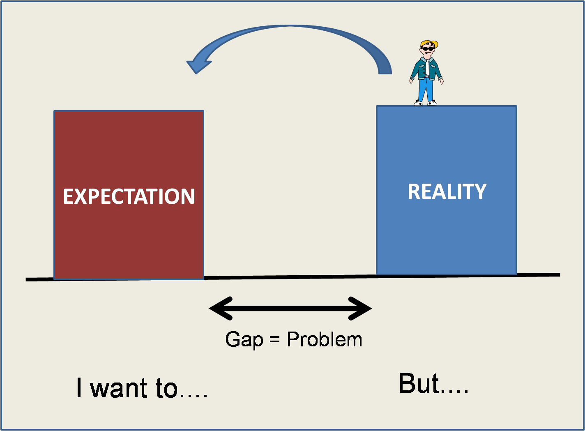

> "Architecture is a
product of an activity called design, and there is no design without a
*problem*. A problem definition is an explicit, written statement of a
problem: the gap between the current state and the desired state"\
-- James O. Coplien [Lean Architecture: for Agile Software Development](http://amzn.to/185Jang)

I like this definition of a problem: "the gap between the current state
and the desired state". What we do when we solve a problem is change a
situation, usually an annoying one. Or satisfy a need.

This is why it is important to know and properly define what the problem
is. If we understand it as closing a gap, it is easier to state and
understand the problem. Let's look, as an example, at this dialogue with
some developers, taken from [Coplien's
book](http://amzn.to/185Jang) quoted above:

> -- What problem are you
solving?\
-- We're trying to become more
object-oriented.\
-- No, that's a solution to a problem, not a
problem. What problem are you solving?\
-- Oh, we're using object
orientation to get better reuse.\
-- No, reuse is itself a solution to a problem. What problem
are you solving?\
-- Well, the last project was too expensive, and we're trying to reduce our costs.\
-- How many alternatives have you
considered?\
-- Well, none. Everybody else is using objects,
so we decided to take a low-risk path.[^1]

I'm sure you can identify some organization you have worked for. It is a
classic symptom of how unclear the purpose of software engineering work
tends to be.

It comes down to a lack of reflection on the meaning, the direction of
the work. In some cases it takes the form of [Prodan's
Law](/en/blog/lnds/2009/03/06/latency-still-recycling/):
**"I don't know what I want, but I want it now!"**.

I say that what fails there is leadership, which is what defines the
initial vision, and the objectives subordinated to that vision. Remember
what we said about
[Direction, Organization and Method](/en/blog/lnds/2012/05/19/do-you-know-pin-pon/): when
we lay out a vision we must define the **result**, the **deadline or
timing** and the **quality parameters**.

Before we start solving a problem, and even before defining these three
elements, we must be clear about what we want to solve, but above all
what for. That is what we call purpose. A good problem definition makes
that purpose clear.

Many problems come out of day-to-day conversation. It happened to me
recently: an application gave feedback about errors, but not in enough
detail for the user to make the corrections. We are working on
implementing a list of new requirements, but that list did not account
for the fact that better detail was needed when reporting errors. That
problem only came up from the interaction during some tests. It was
through that interaction that we were able to raise a new requirement.

This case is the typical situation that reveals there is a difference
between what the [user asks for and what the user
expects](/en/blog/lnds/2013/03/23/expectations/).\
And you discover that by identifying the gap between the current
situation and the desired one. That is an expectation. The bad part, and
this is where the art comes in, is that expectations are not always
stated, because in most cases it is hard to put them into words. This
situation produces one of the most frequent facts in the life of
projects: "the emergent requirement". And I say fact, not problem. Some
people consider the "emergent requirement" a problem. It isn't. The
problem is believing that you must have all the requirements clear
before starting. "Expect the unexpected" should be the motto of a good
project manager. The agile literature says that what happens is that we
discover new problems along the way. That's not it. What happens is that
the act of designing actually creates new problems, and what's more, in
many cases the design changes the very nature of the problem. That is
why we must always revisit our problem definition.

A good problem definition is vital. It helps us focus, and of course, it
guides our project management work. But how do you get a good
definition? Here comes the bad news for our engineer friends of the
Asperger's persuasion: "the best way to define a problem is by
talking".

## **Team**

My boss likes the definition that a team is a "set of recurring
conversations", and the ones who solve the problem are the members of
the team. Who are the members of the team? The customers, the users, the
developers, the systems engineers, etc. Thinking that the team is made
up only of the developers is one of the biggest mistakes you can make.
Everyone must be involved in solving the problem. Again, some will see
all this talking as a waste of time, but it is actually time well
spent.

## **Ownership of the problem**

One important thing before continuing: it is necessary to identify who
owns the problem. This very simple concept is usually handled badly, and
it leads to problems when executing. The important thing is that
whatever the answer to the question "who owns the problem?" may be, it
must always consider and respect the people with the power to solve the
problem.

> "It is common in life for one person to formulate the problem and
delegate it to another to solve. You ask your secretary to get rid of
the salesman. Your boss asks you to cut your budget by
15%. A customer asks you to fix a bug. As long as these situations
persist in the world, it is better if the person who has (or the people
who have) the problem are the ones who write the problem definition.
Otherwise, the problem statement becomes a way for one person to wield
power over another, and that constrains the self-organization and
feedback that make agile possible."[^1]

The owner of the problem is the one who must define it, and by defining
it we mean "writing it down in an explicit statement". But we must guide
them in the conversation beforehand, so they don't end up confusing the
solution with the problem.

We often receive a "request to fix something" that originates somewhere
along the organization's chain of power. What we can do is rewrite that
"request to fix something" as a good problem definition and propose it
to the requester, as feedback. This rewriting of the problem should help
define the solution criteria (they must be measurable), so that the
problem doesn't turn into a trap that leads to failure.

**The capacity to solve**

We are clear about who owns the problem, and we respect the role of
those who are able to solve it, because we have delegated solving the
problem to another part of the team. The users define the problem,
because they own it. The developers are the ones who solve the problem,
because they have the ability and have been empowered to do so. The
operations (systems) team is the one that makes sure the solution is
available whenever it is needed. Every role is valuable, and that is why
it is important to keep the conversation alive among all the members of
the team, always, and from the beginning.

**Defining the problem**

So, how do we define the problem well?

There are several techniques. One could be Toyoda's [5
Whys](http://en.wikipedia.org/wiki/5_Whys), which is widely used to find
the root cause of a problem.

Another technique is to answer the 7 basic questions: Who? What? When?
Where? Why? How? and How many?

There are many more techniques, and all of them involve talking, in a
more or less structured way. The important thing is not to dodge that
conversation.

Throughout this process of defining the problem we must apply three of
the four basic activities of the engineer's work: listening,
understanding, solving and communicating. We'll talk about those later
on.

Finally, the result of all those conversations must be captured in the
**problem definition**, written by its owner. Once we have this problem
definition, we can get on with solving it in peace, and when doubts
arise, or we see that we are drifting from the objective, we must go
back to this definition, always. It is our guide, the compass that will
keep us from getting lost.

[^1]: The quotes are taken from the book [Lean Architecture: for Agile Software Development](http://amzn.to/185Jang), by James O. Coplien and
Gertrud Bjornvig

