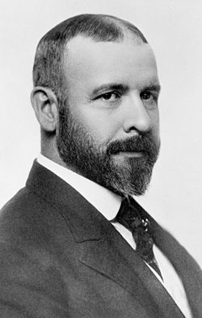
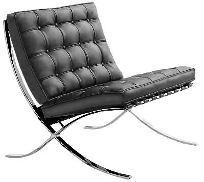

> It is the pervading
law of all things organic and inorganic, of\
all things physical and metaphysical,of all things human and all things
superhuman ---of all true manifestations of the head, of the heart, of
the soul--- that the life is recognizable in its expression, that form
ever follows function. This is the law.\
> -- Louis Sullivan, ["The Tall Office Building Artistically Considered"](http://es.scribd.com/doc/104764188/Louis-Sullivan-The-Tall-Office-Building-Artistically-Considered)

For the architect Louis Sullivan, an admirer of American rationalist
thinkers like Thoreau, Emerson, Whitman and Melville, there was a single
aesthetic creed, with one simple rule "that permits no exceptions":
"form ever follows function".

Sullivan developed the concept of the steel-frame skyscraper in the
Chicago of the late 19th century. The forces of economics and technology
were converging at that moment and something new had to be designed,
outside the old patterns written down in old architecture books. For
Sullivan, if anything was to determine the form, it would be the purpose
of the building. Sullivan's proposal is that "form follows function",
versus the earlier creed that "form follows precedent". Until then,
architecture rested on the principle that it should reuse the great
forms of antiquity.

This led architects to look for architectural styles that were not
influenced by history. The idea was to express the true form of the
building through strict adherence to its function. To the point of
rejecting all architectural ornament, as reflected in Adolf Loos's
essay: ["Ornament and Crime"](http://en.wikipedia.org/wiki/Ornament_and_Crime).

These concepts led to the rise of the
[modernist movements in architecture](http://en.wikipedia.org/wiki/Modern_architecture).

Loos proclaimed that the evolution of culture, progress, seeks the
elimination of ornament from useful objects. Ornament causes objects to
go out of style, and therefore they become obsolete. That is why wasting
effort on ornamenting an object is a crime, because it will lead the
object to its obsolescence. Useful objects must be simple, without
ornament. That is the aim of this proposal.

It is very interesting to study the discussions and proposals in design
and architecture from the late 19th and early 20th centuries, because
they can be illuminating for the development of software architecture in
particular.

Although I have argued that developing software is not building
software, in the sense that the analogies between constructing buildings
and developing systems should not be applied directly, it is undeniable
that software requires prior design.

Let's see what happens if we adopt a definition of software architecture
in line with these concepts of form and function. Let's say for now that
software architecture is about the study of the form and function of a
system.

**Form is what the system is, function is what the system does**. But
how does it do it? When we try to understand how the system does what it
must do, we get into the discussion about structure. Structure is the
support for form, and form, as Sullivan reminds us, follows function.

If I ask you to design a chair, the form is given immediately by the
function, which is to let the body rest in a certain precise way. You
can't make a completely vertical chair, because we want to keep the
person in a certain specific position. However, it is relevant to ask
how this chair will bear the weight, what materials it should be made
of, what forces the materials will be subjected to, how long it should
last, how many people could potentially use the chair, for how long,
etc.

The same would happen with a computer system. Function is the first
thing we must define: what the system does, what it responds to, what we
are making it for. From this comes the form, and once the form is
defined we must develop the best structure to support it.

Let's look at the consequences of this with a practical example:

We want to develop a system that lets people indicate where they are and
what they are doing at any given moment. To do this, users will enter
their "Status", a brief message that says what they are doing at each
relevant moment. The idea is that others can know where they are and
what they are doing, since that is useful for coordinating a team's
tasks. To indicate their status, people will not necessarily need access
to a computer. That is the function.

To fulfill this function, we will let users send their status messages
to a central site, and we will let anyone look at a timeline with the
statuses of each of the system's participants. People who use this
system will be able to choose whom to follow, and will be able to know
who follows them. This is the form.

And here comes the interesting architecture discussion. Since we want
access from anywhere, we will allow messages to be sent via SMS. This
puts a limit on the status message, which, in order to be compatible
with all the cell phone messaging systems of the time, means the status
will be limited to 140 characters.

We will use a website to check the timeline of the other participants,
and to put together our lists of users we are interested in following,
along with checking the status of our followers.

With all this, we can build this site using Ruby on Rails, in a short
time, and we can make it available on the web. We'll call it Twitter.

Here comes the fundamental difference from traditional architecture, the
kind that is limited by the force of gravity. Because Twitter starts to
become popular, and starts to be used for more than its initial
function. We say that Twitter, the system, evolves, and needs to adapt
to the new requirements, which emerge dynamically, because software
allows greater malleability.

Today Twitter is a tool that serves functions different from the ones
its creators dreamed of. Its current architecture is not the same as the
one it had when it started. Right now the team is surely very worried
about the security of Twitter accounts. We have already seen how the
hijacking of a Twitter account
[caused the Dow Jones index to drop on the stock market](http://bigstory.ap.org/article/hackers-compromise-ap-twitter-account).
The architecture must take care of those aspects too.

What started with Ruby on Rails and MySQL is now a combination of many
frameworks, languages (mainly Ruby, Scala and Java) and databases
(relational and NoSQL). Supporting mobile platforms and all kinds of
clients, and supporting thousands of applications that take advantage of
its API.

We say that Twitter's architecture has evolved, and indeed that is what
it is all about: permanent evolution. It is the big difference between
software architecture and traditional architecture.

So our definition of architecture must change. Software architecture has
to do with the form and function of systems, and with their evolution.
That is why we say we develop software rather than build it, to account
for the dynamic nature of our architectures.
