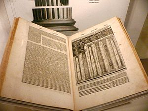
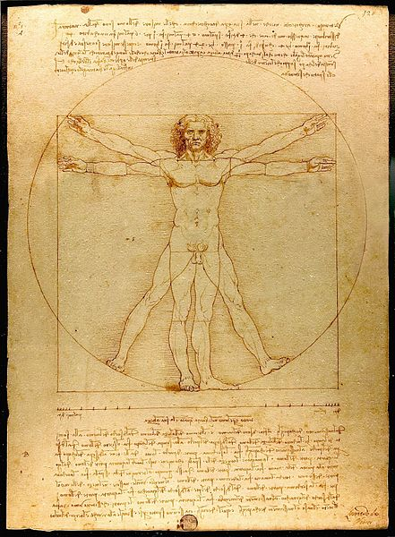

Architect comes from the Greek arkhitekton: arkhi is chief and tekton is
builder. The architect was the chief of the builders.

Besides Phidias, the famous Greek architect, what we have kept from
antiquity is the work of
[Vitruvius](https://es.wikipedia.org/wiki/Marco_Vitruvio), a Roman
**architect, engineer and writer**, who wrote a treatise called "The Ten
Books on Architecture", which for centuries was the only material
architects had to build on. This book was fundamental in the Renaissance
and had a great influence on Leon Battista Alberti, Leonardo da Vinci
and Michelangelo. It is in this treatise that Vitruvius establishes the
three essential characteristics of every structure: "utilitas, venustas
and firmitas" (utility, beauty and firmness).

Utilitas refers to utility: it must answer the question of what we are
building a given structure or tool for. Venustas is beauty: we
appreciate the beauty of a building because by our nature we want to use
things that are beautiful, pleasing to our senses and appreciated by our
mind. Firmness has to do with the soundness of what we build: we want
things to last and to withstand the use we will give them. For Vitruvius
there had to be a balance among these three elements; none should
outweigh the other two.

Unfortunately Vitruvius's treatise is the only thing we have recovered
in the way of theory from Roman architecture. We can't be sure it was
the best treatise on the subject in its time, and it probably wasn't.
Some critics have noted that he wavers on how to organize the art of
architecture. But his contribution is interesting, because it starts
from practice, from experience. According to Vitruvius:

> "Architecture is a science arising out of many other
sciences, and adorned with much and varied learning; by the help of
which a judgment is formed of those works which are the result of other
arts. Practice and theory are its parents. Practice is the frequent and
continued contemplation of the mode of executing any given work, or of
the mere operation of the hands, for the conversion of the material in
the best and most finished manner. Theory is the result of that
reasoning which demonstrates and explains that the material wrought has
been so converted as to answer the end proposed. For the merely
practical architect is not able to assign sufficient reasons for the
forms he adopts; and the theoretic architect also fails, grasping the
shadow instead of the substance. He who is theoretic as well as
practical, is therefore doubly armed; able not only to prove the
propriety of his design, but equally so to carry it into execution."

Vitruvius's merit lies in this definition of balance among three
fundamental aspects of all architecture: **Utility, Beauty and
Firmness**.

If we apply it to our designs, when we plan an application or a system,
we should take Vitruvius's advice into account.

That dialectic between the beautiful and the useful is always present
when we discuss architecture, to the point that it defines great periods
of its history. The same thing happens in software architecture. Only
now are we discussing the value of beauty, understanding it both from
the point of view of interfaces and from that of the way we organize our
code.

For me, beauty arises from the combination of the four elements into
which Vitruvius breaks it down: architectural order ("the relation of
each part to its use"), arrangement ("the layout in plan, in elevation
and in perspective"), proportion ("the agreement of the whole work and
its parts") and distribution ("the proper and best possible use of
materials and of the site, and seeking the lowest cost for the work,
achieved in a rational and measured way").

We appreciate an architecture that respects these four elements, but it
is obvious that in software architecture this applies in a different
way, although the fundamental aspects are preserved.

For Vitruvius, his ideas of architectural harmony are in accord with
what we observe in nature, and they are present in the greatest of all
its works: the human body. Vitruvius describes the proportions of the
human body, which were captured years later by Leonardo da Vinci, who
made a famous drawing applying the proportions described by this author.
It is the famous "Vitruvian Man", which reminds us that in the end
architecture must fit the needs of human beings, as [Leon
Battista Alberti](http://es.wikipedia.org/wiki/Leon_Battista_Alberti)
used to say.

