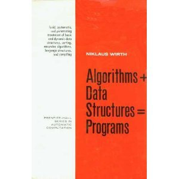
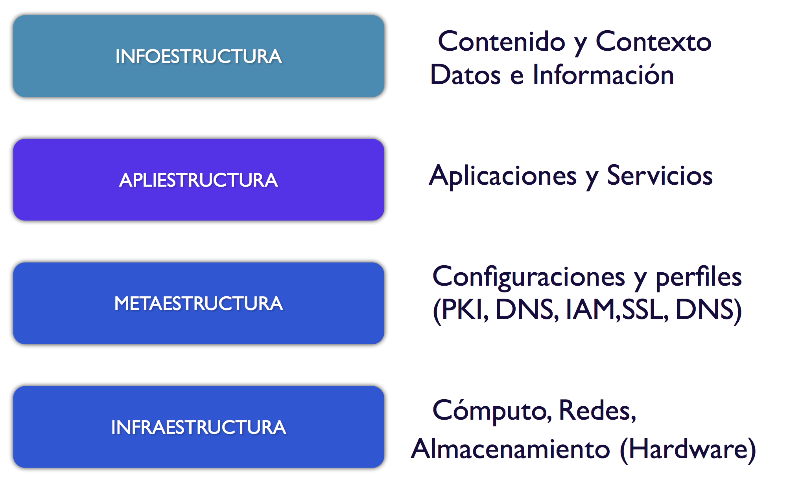

I remember that back when I was a student I came across a book by Niklaus Wirth
titled [Algorithms + Data Structures = Programs](http://amzn.to/OcAn8s).

How simple the world of computing looks from the perspective of that
title, but we have evolved a lot in the years since. We are at a
stage in the development of computing that is centered on service. The wheel
has turned and we are back at the point where it all began, only this time the
wheel sits at a higher level. Computing started out as a
service, controlled by a few for a few. Now
computing is a service for the many, self-managed. Anyone can
build a service, or at least the potential is there for
anyone using the cloud to develop their own innovations.

The question is: how do we structure a modern application in the reality
of cloud computing and software as a service? How do we account for
things like security, fault tolerance, scaling,
consistency, operational continuity, and a long etcetera?

We see many entrepreneurs who have picked up programming
skills and built an innovative application, only to
run into situations they had not considered. Servers
collapsing, hard-to-maintain code that forces the new development
teams coming on board to rewrite it, losing valuable
time, and with it competitiveness.

In response, magic formulas show up, mostly tied to
changes in methodology, with very little thought given to applying the experience
built up over thousands of hours of engineering spent solving these
problems in the past. No matter how innovative your application is,
there is basic engineering work that cannot be avoided.

Just as [Vitruvius told us centuries ago](/en/blog/lnds/2013/06/08/utility-beauty-and-firmness/),
architectural order, arrangement, is essential to developing a
robust and useful architecture.

[Chris Hoff](http://www.rationalsurvivability.com/blog/) proposes a
conceptualization for the structure of cloud applications, which
sums up in a layered model the elements and components needed to
operate a service in the new reality that cloud computing brings.

Hoff's model is this:

This model makes clear the four layers into which we have to divide
our work when we work in the cloud.

At the bottom we have the infrastructure, which covers
the most basic things needed to operate, the hardware and the base software: CPU,
memory, storage, operating systems, compute and
storage capacity.

Another foundational level is the metastructure, the layer that
defines the configuration, access and profiling aspects of the
infrastructure. In this layer we find networking elements such as DNS,
routing definitions, access controls, network segregation,
security, the PKI layer, SSL, etc. It is not infrastructure, but it defines
how the infrastructure operates. In a way it is what defines the
constraints on the infrastructure.

In the middle is the applistructure, the layer where
applications and services live, where the code runs.

And at the top we have the context, the data, the information,
which is what matters to the user.

It is important to understand that the infrastructure sometimes escapes
our application or service. Think about it: if you expose a service
as a REST resource, others will probably use that REST resource to
build a mashup, that is, a new application of our data in
another context. That is why, although at first glance
data and applications seem inseparable, in the reality of cloud
computing it is better to see them as separate things.

This model is the structure. It is what defines [the form](/en/blog/lnds/2013/05/12/form-and-function/) of every
cloud application, and it is interesting because it lets us focus
our work, and even divide and organize our
team, with each collaborator developing their skills
according to the layer they operate in. Something we will look at in the next post.
