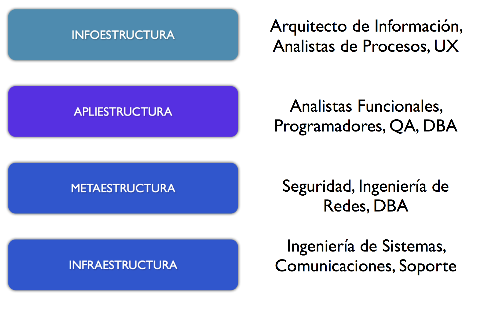

This is one of my favorite photographs, a fairly famous one,
showing the workers who were building the RCA Building at
Rockefeller Center, enjoying their lunch on one of the building's
beams.

There are many similar photos from that era, showing these
construction workers going about their jobs without a care among the beams of
those enormous steel structures, with none of the safety
gear we take for granted today.

That is why it catches our eye. It is said that this one was a
publicity stunt staged at the time by Rockefeller Center. Either
way, these are still impressive photos. The workers
really were there, and the picture was taken at that height.

It is said that, given the economic situation in those Depression years, the
workers were willing to take these jobs with no personal
protection of any kind. That is something we would no longer tolerate.

The other thing that strikes me about this photograph is the arrangement of
the workers within the structure. It is a literal image of
what we are going to discuss: how activities are arranged within the
structure of a software solutions architecture.

Who is in charge of what? That is what this post is about,
and it complements
[the previous one on structure](/en/blog/lnds/2013/06/09/structure/).

Let's recall Hoff's model of the four \"structures\" that underpin
a modern application architecture:

In each layer of this model there are one or more
roles to be filled, and they have to be carried out by different
IT professionals.

IT operations have become specialized, and the best way to
visualize the scope of each one today is, in my opinion,
the following diagram, which is Hoff's, but with the roles and
functions drawn next to each layer.

Each layer has its matching roles and functions. Some
move across more than one layer. For example, in my personal
view, a good programmer knows all the layers, but
the programmer is often seen as someone who concentrates on
the applistructure.

The role of the architect, as ["master builder\"](/en/blog/lnds/2013/06/08/utility-beauty-and-firmness/),
is to arrange the team across these layers and to work with each
professional in charge of a layer, or of specific aspects of one. For
example, it is the architect's job to make sure the security
engineer applies the right rules on the firewalls, or to instruct the
DBA to keep the data dictionary for the various
applications up to date. The architect, as I see it, has the mission of overseeing
the proper functioning of each of the four structures
that support the application or system. To do that, the architect delegates the
execution of each layer's specific tasks to the professional or
professionals who specialize in that structure.

That is why the image in the photograph seems to me a literal
representation of this idea. Just as in the picture of the workers on the
beam, we should imagine each of the 4 structures as a plane
holding up our application, and on each of these planes we find
the professionals who work there, doing their jobs
in coordination, at different moments in time.

This is really very simple to state, but hard as it may be to believe,
on many occasions it is not understood by managers, or by
architects. Separation of duties is useful, and it lets you draw the lines of
responsibility. That brings robustness. The important thing is that there has
to be a dialogue among the participants in each layer, all of it guided
and orchestrated by the architect.

The architect is the one in charge of guaranteeing harmony among these
four layers. The architect must help create the dialogue among the
team members who operate at the different levels. The arrangement in this
diagram does not imply that some activities are more important than
others, or that construction has to proceed from the bottom up, or
the other way around. This is a diagram for understanding that there are four fundamental
beams that must be properly looked after. It is impossible to
separate them from one another. Software is useless without hardware; there is no
information without infrastructure to support it. If there is no network
access we cannot reach our data, and so on. Everything is related and
connected. That is why managing a modern application
architecture is complex. This model lets us conceptualize and organize the
way we will carry out our project.

Today, thinking that an application gets built and then left running
is far too simplistic. Going to production is simply the first
step of many. A modern application keeps changing, because in reality
we no longer offer packaged solutions, which in a way is what
the word application suggests. Today we are squarely
in the era of services: information, processing,
discovery, etc. Teams are in permanent motion
keeping the services up. The applistructure is at the service of the
infrastructure, which is what defines the processes and the information
requirements.

So a software architecture, or better,
a software-as-a-service architecture, should not be thought of as something static. Those
days are gone. Permanent change in the architecture is what
we have to plan for. What we need to design are dynamic
architectures, or better still patterns, or rules, that allow them to evolve
in complex ways, responding to changes in the service's business
environment. Something we will talk about later on.
