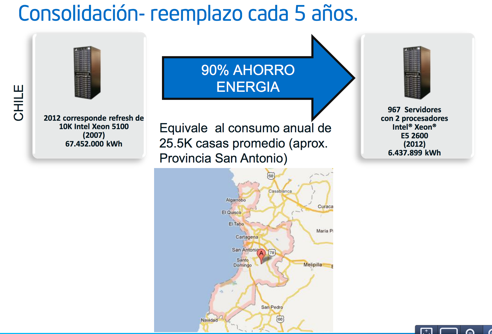
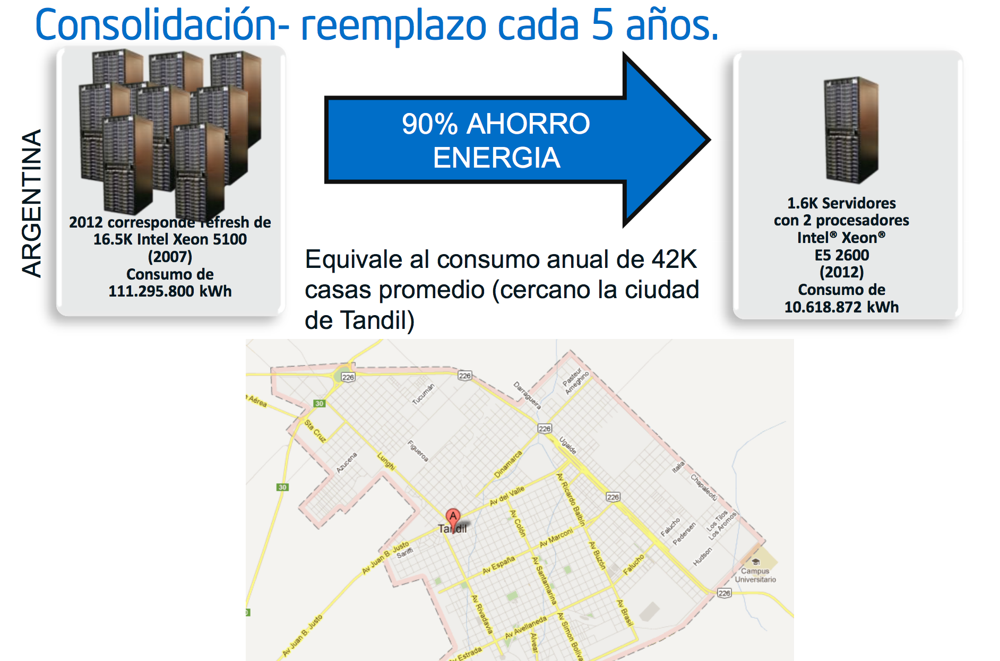

A few days ago I was talking with a datacenter services provider
here in Chile. He told me that unfortunately it is not possible to have
[Tier-4](http://en.wikipedia.org/wiki/Data_center#Data_center_tiers) certified
datacenters in
our country. The reason, in simple terms: we have only
one "electrical highway" supplying power to the computing
centers. To reach the highest level of datacenter
certification, the power has to come from two sources that are independent of
each other.

We all sense how fragile our energy infrastructure is. Just
remember the events after the earthquake, and the big
blackout that hit much of the country a few months after the
2010 earthquake.

The truth is that our energy policy as a country is
hurting us when it comes to technological development. It is very hard to
aspire to build an international-grade infrastructure services
industry with this level of immaturity in managing our
energy needs.

Modern datacenters, high-density and with green technology,
consume between 800 and 1,200 watts/hour per square meter. A datacenter
of some 1,000 square meters, like the ones that already exist in Chile, can
end up consuming the equivalent of what some 2,500 to 4,000
homes consume.

But that is quite efficient. Thanks to new virtualization and
high-density technologies, these datacenters can
sustain 10 times more computing power than many current technologies.

Next I am going to share with you some images from
an Intel presentation from last year, in which they introduced their
new server-oriented CPUs.

What this first slide tells us is that in 2012 it was time to
replace 10,000 Xeon 5100 servers located in Chile. These
servers consume every year the equivalent of what all
the homes in the Province of San Antonio consume.

All of those 10,000 servers can be replaced by 967 Xeon E5 2600
servers, and consumption drops drastically, to 10% of
current demand!

For Argentina, we have the following:

The servers that would have to be replaced consume the
equivalent of the homes in the city of Tandil. Again, with the
change in technology we can save 90% of the energy.

In May of this year [Alejandro Barros](http://www.alejandrobarros.com/)
requested, under the transparency law, the report on the impact of the
daylight saving time change. In this [post by
Alejandro](http://www.alejandrobarros.com/cambio-de-hora-efectivamente-la-evaluacion-fue-light)
you can see an analysis of that document.

According to that memo, the measure meant estimated savings of 39
GWh (a calculation apparently done
[on the back of an envelope](https://en.wikipedia.org/wiki/Back-of-the-envelope_calculation),
because there do not seem to be any concrete measurements or evidence for these
results.

But let's accept those figures as real for a moment. According to our
authorities, changing winter time saves 39 GWh. Well, if you
look at Intel's proposal to replace servers more than 5
years old, you get 68 GWh of savings a year, real and
permanent, without the externalities of changing the clocks. And that study
only considers part of our installed base of servers and computers.

There are two problems I have laid out in this post. One is that there is no
serious policy for generating and distributing energy, and that is
holding back the development of high-quality standards in a
specific service industry: providing computing infrastructure
and data processing services (datacenters). Until we fix
this, our datacenters will not be able to certify at the highest standard
(Tier-4).

The other problem is that the authorities apparently have not had the
right expertise to analyze effective solutions for improving
energy efficiency. I have shown you the case of improvements
the IT industry can make, which with moderate effort can be
more effective than the current measures. But all of this requires the
authorities to listen to the specialists, and not insist on solutions that
worked 5 or 6 decades ago, when technology and the way it
was used were very different.
