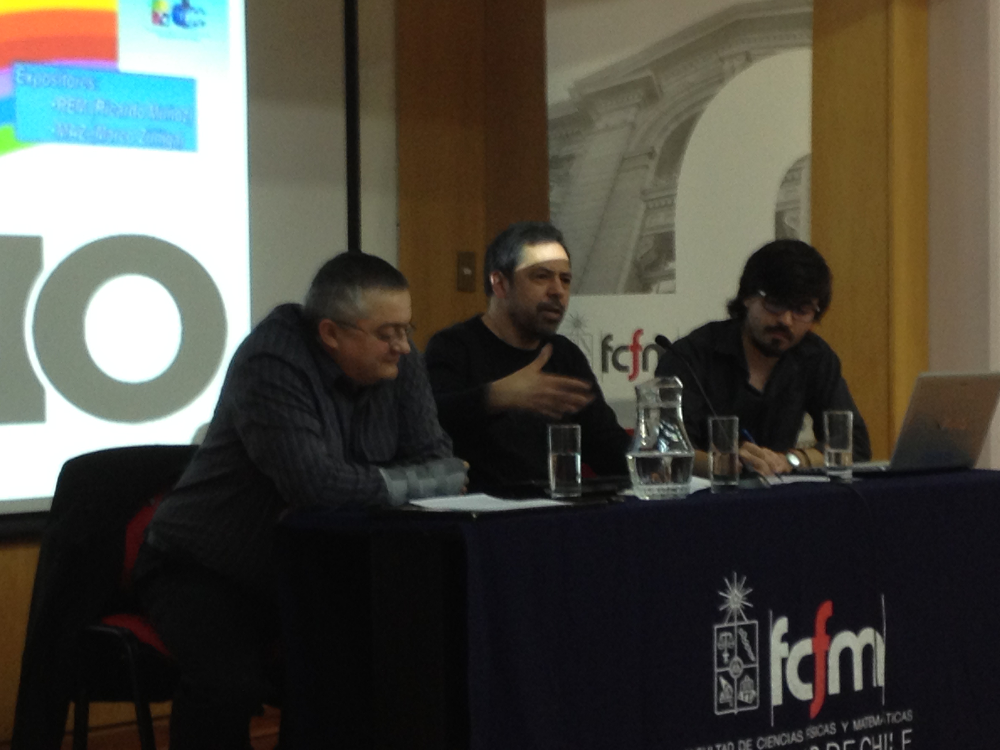

It's a funny thing, but it turns out that now every Chilean who
lived through those days voted No, so I don't know what's so special
about [this story](/blog/2008/10/los-hackers-del-5-de-octubre.html)
that I published a few years ago. At least last year it was
remembered by the students of the computer science department at the
Universidad de Chile, as this photo from that event shows, where
we see the two protagonists of the story below, MAZ and
REM:

It is now 25 years since the triumph of the No, and with it the end of
Pinochet's dictatorship, so remembering this story has a
special meaning, for the simple reason that 25 is a multiple of
five. But it doesn't seem fair to me that everyone remembers how they voted
No while this story goes unmentioned, so here it is for you again.
I suppose that when the 30 years come around, and the dinosaurs have
gone extinct, they will start inviting those who were young back then and
threw themselves, with the passion of youth, into the task of recovering
our democracy.

**The hackers of October 5**

It was [**October** 5, 1988](http://news.bbc.co.uk/hi/spanish/latin_america/newsid_7646000/7646154.stm),
~~twenty~~ twenty-five years ago! Thousands of young people my age were taking part, one
way or another, in that great historic moment, some, like me, only by
going to the polls and voting NO.

But in those days there was technological activism too. This is the
story of a group of computer geeks, fighting with what they knew how to do,
with computers and technology, to make sure that plebiscite was not
manipulated by the dictatorship. The story as told
by [MAZ](http://blog.maz.cl/)
and [REM](http://www.dcc8090.cl/dcc8090/index.php/REM/), two hackers
fighting for the return of democracy, two of my best friends.

It is the morning of **October** 5:

> **MAZ**: We've gone 30 hours without sleep \... I can't feel my mouth anymore from the
> stench of cigarettes and coffee \... How are my folks and my
> sisters doing? \... We finished installing the last FAX machine
> last night in the living room of someone's apartment downtown, with
> the whole family there, coordinating with the building's doorman, who
> fortunately is on our side, making sure he lets in
> the tally runners on motorcycles and bicycles who will bring the results from the
> polling tables at the voting centers, so the results can be sent to the
> collection centers \... We had a bug in the program that counts the
> table tallies, which we finished fixing last night \... My head
> hurts \... Fortunately the local network has been working fine \...

> We have to be careful not to kick the network coax \... There's no
> time for backups, but just in case they took away a set of
> 5 1/4" floppies with the sources and the databases \...
>
> You never know \... What time do I get to go vote? Who's going to
> take me? \... We're having trouble with the FAX operators \... For
> fuck's sake \... It's dead easy \... You put in the paper, dial the number and
> press the green button \... Why the hell isn't that working? \... The
> modems have been fine, thank goodness, but we have to go easy on them because
> they caught on that we were moving data and the other day they took
> down some of our phone lines \... But those were the test ones \... The
> official numbers we're only using for the first time now \...

> We have to use the modems only as much as strictly necessary \... But we can send
> the**files** to the remote sites and that's what matters \... The
> table openings are coming in \... They're being set up early
> \... Let the campaign command know \... Concepción is slow, have them send more
> poll watchers \... Or is it a problem sending the information? They had
> to switch a collection center at the last minute because the neighbors
> across the street caught on and ratted them out \...

> What's going on? Are the tables not being set up, or do we have
> problems with the data flow? \... We have to run the opening
> count processes \... They're showing cartoons on TV \...
> Any word from the Central Command? We're sore because they
> have Unix and money, and we have plain PCs and Clipper applications,
> but never mind \...

Our protagonists are members of the backup group for counting
the vote, a secret group created in case
the central group, the one everybody knows about, was somehow shut down
by the government.

According to REM's account:

> For people who have read about the plebiscite, there were two counting
> lines, line N and line O. We didn't exist. We were
> the backup in case the military decided to disregard the results.
> Our only defense was to go unnoticed. We were the
> clandestine ones, so very few people could know we existed, and
> far fewer where we were operating. In fact we only found out at the last minute
> where our computing center was going to be. That's where we spent several
> intense hours on that **October** 5 and 6. That's where I spent my
> birthday, shut in.

> One of my clearest memories is when we started
> getting problems from the collection centers. There were tables that couldn't
> be entered because the system rejected them. Our system was
> based on collection centers with a system written in Clipper, which were
> the ones sending us the information. There was no way to change the
> programs. We had to find a solution fast, but first we had
> to find the problem. After a while we realized that the
> men's and women's tables were swapped, and we got in touch with
> the central command, who were the ones who had generated the databases
> we were using. They had the error too and had already found
> the problem, had fixed it, and had forgotten about us.
> For them it was easy, their system was one Unix machine where
> they centralized everything. We couldn't do that, so we had to look for
> an alternative solution, which we found after some good
> arguments. Remember how good the two of us were at fighting
> when we argued over some piece of development? Everyone else always looked at us
> with a face that said here comes the shitstorm, and in the end we would reach an
> agreement and carry on as good friends as ever.

During the morning they are taken to vote, in shifts, and always accompanied
by someone. They have to vote as fast as possible and come back. Little time
to reflect on how important the event is. All of us who
voted for the first time that day felt the same thing MAZ describes:

> **MAZ**: \... I'm 22 and this is the first public vote
> I'm going to take part in \... Now I realize I've never voted in
> public life, though I've been lucky enough to vote many times at
> the University \... But this is different \... Electing
> a delegate or a Student Center President is not the same as this real line,
> which I share with dozens of people who are my neighbors \... I'll never
> get to know them all \... I'm scared of tearing my ballot and
> getting it wrong \... One little line, just one little line \... The campaign's TV spots said it and
> said it again \... Take care of your vote \... Just one little line \... How many votes
> are going to be lost to people who, after so long, will take
> their ballot and express what they haven't been able to say or do for so
> long? \... One little line \... Nothing more than that \... Did I vote right? Am I
> sure?\...

Time to go back:

> **MAZ:** .. What strikes me most is the silence of Santiago \...
> Very different from the days before, when I had to walk past
> the marches of one side and the other without being able to wear a button for
> the NO\...

> We came back from downtown after fixing the FAX \... It was a minor thing
> but the trip made it look hairy \... Besides, we had to drive
> fast \... There were no people in the streets and they were
> starting to close off downtown \... We were scared, plenty scared \...
> We got back to our place very quickly \... A company meeting room has
> never felt so cozy to me \... It's starting to get
> dark, but while many people are starting to listen to the
> news at home and the TV is starting to give partial results,
> for us the work is only beginning ..

> . We've already received results from many places \.... Our
> first counts show the SI winning, and dismay starts to
> take hold of us \... But the old foxes tell us \... Don't be fooled \...
> The first tables are the most conservative, for many reasons we
> didn't want to hear \... The numbers were telling us other things and the
> priority was to receive, process, count, add \... And send whatever
> results we had \... There was no time to think \... Just
> look at numbers and process **files** \... But new
> results started coming in \... In many places the NO was starting to climb and to
> win \... The trend was reversing \... We watched Cardemil, the Interior undersecretary, give the
> first count, and in his speech he described as an "irrevocable
> trend" the SI's lead, with a ridiculous number of tables
> \... "They're going to wipe us out," I think to myself, and I know several people around
> me feel the same, but we have to keep going \... By
> 7:30 p.m. we had more than 25% of the count \... And the numbers were
> giving us different results .

And the tension starts to build

> MAZ: We thought the NO victory was going to be overwhelming \... I
> was expecting over 70% \... But when we started getting results
> and we barely made it past 50%, we were winning \... but
> lukewarmly. Where did we fail? What did we miss? Why isn't
> our country expressing what we did and denounced for so many years? What
> did we do wrong?\... Never mind \... We have to process \... We have to
> keep going \... And we have to send what we have so others can
> analyze it and preserve it \... "Guys, they've closed off downtown \... There's a
> high probability they'll blow up the Central Command next to the Diego
> Portales building \... The only thing protecting it is the international press coverage"
> \... The other lines are weaker \... "Get ready, because we may
> be the only alternative left" ..

It was REM's birthday that very day. In the end, friendship matters
more than any political revolution. I'm not wrong about that; these
young men think so too:

> REM: The other thing I remember is that during that day and that night there
> was no time for anything but work. We had to get out report
> after report and send all our counts to "the pool." What the
> hell was the famous pool? I've never been 100% sure. Some
> say it was an embassy, others that it was the church. The fact is that
> it was "something" where all our results ended up. Anyway,
> the thing is that at some point you stopped us all and told them
> it was my birthday, and they sang to me and there were hugs and a lot of
> emotion and\... and everybody went back to what they were doing\... everyone, even me,
> our minds were elsewhere\...

> MAZ: \... Happy Birthday, dear friend \... We sang you happy
> birthday, but really we were more worried about
> our **files**, about the TV and about the night wearing on \...
> We've remembered that birthday all these years over a drink,
> fewer times than I would like, but every time I hear something about
> the \'88 plebiscite, my main memory is the hug we
> gave each other for your birthday \...

> REM: That year I practically didn't celebrate my birthday. In fact I wasn't
> with my family and I was with very few friends, but the gift
> I received was the best one I could have received. Maybe it wasn't
> for me, but I made it mine the very instant I learned that
> we had officially won.

So after that small celebration came the whirlwind of finishing
the vote count and waiting for the result:

> MAZ..around 1, they gave another count on TV \... Cardemil
> started reading the numbers \... First we were surprised that the
> percentage of tables counted was high, very high \... And our stomachs
> started to tighten \... We all stood in front of the television, in
> silence, packed together, hardly moving \... When he gave the official
> figures, we didn't quite understand, because we couldn't believe what we were
> hearing \... Maybe, used to constant lies, we weren't
> prepared to hear a truth \... But it was true
> \... They were officially acknowledging that we had won \... By a little \...
> Maybe a point or less below what we had counted, but that hardly
> mattered \... We started jumping in front of the TV and hugging each other
> \... Someone brought a couple of bottles of champagne and we all
> soaked each other with them \... And we hugged, my friend, a big one,
> the kind that lasts a lifetime \... And I started crying like a little kid
> \... We won, compadre, we won \... And I kept crying while we
> kept greeting each other, jumping \... And the order came: Stop everything,
> close up shop, we're going out to celebrate, damn it \... And that's what
> we did. I remember we got to Plaza Italia around 3 in the
> morning \... Thousands of people \... Tens of thousands of people \...
> My body had nothing left, but with a warm heart and a permanent
> smile, tiredness doesn't exist \... By car, on foot, with flags,
> confetti, whistles, champagne \... But what struck me most \... So many
> smiles, everybody was smiling \... I gave hundreds of hugs to people I
> didn't know \... I climbed onto cars \... I waved a flag in front of the
> Diego Portales with all my strength \... And we went to the Command, to
> meet up with everyone \... What a lovely photo from that night \... My
> copy is kept among my favorite mementos \... What a lovely
> photo that is, compadre \... Afterward, in the morning, I went to the University \...
> It was a party \... And in the afternoon, to Grecia \... From there, a few
> blocks' walk to my house, to say hello to my parents \... And sleep, sleep \...

That day many of us celebrated. We were happy: the end of the dictatorship,
joy had arrived.\
In time we realized it wasn't entirely so, but that
is another story. Historical processes are not as simple as
people would like, and a state of absolute happiness
cannot be achieved. What matters is what remains, in this case friendship, and the
example that young people, even the techiest of them, are capable of great
things.

### Sources

The accounts of [MAZ](/docs/CartaMAZ.pdf) and [REM](/docs/RespuestaREM.doc).
