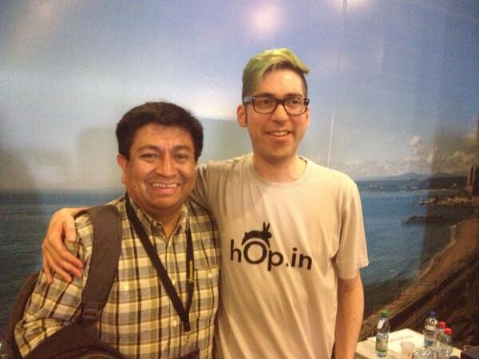

This year I took part in StartechConf 2013, a real honor for me,
I have to say. Not only did I get to give my presentation, I also
got to meet several people I have shared with on my
Twitter timeline, make new friends and hang out with the
speakers, such as "Sensei Jano Gonzalez"([\@janogonzalez](https://twitter.com/janogonzalez)).

The truth is I felt very happy during these two days of the conference.
I had a great time and I thank the organizers for letting me
take part.

Below I leave you my presentation. Much of what I talk about in this talk
has been covered in various posts on this blog.

For reference, the topics covered in my talk correspond to the
following posts:

-   [Mars needs women](/en/blog/lnds/2013/09/08/mars-needs-women/)
-   [What is programming](/en/blog/lnds/2012/05/09/what-is-programming/)
-   [Expectations](/en/blog/lnds/2013/03/23/expectations/)
-   [It can't be done](/en/blog/lnds/2013/08/08/it-cant-be-done/)
-   [A lunch in Lafayette Square](/en/blog/lnds/2012/03/31/a-lunch-in-lafayette-square/)

The presentation is on Slideshare:
<https://www.slideshare.net/EduardoDiazCortes/creadores-de-universos-startech>



The video of my presentation is this one:


