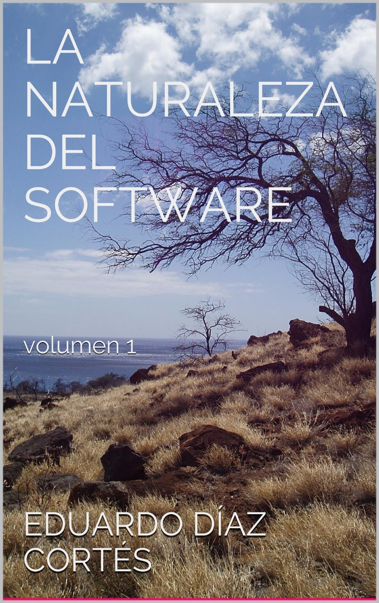

I wanted to share several pieces of good news with you, friends. First, as
I write this post my first ebook, ["La Naturaleza Del Software - volumen 1"](http://amzn.to/17bKPdO) (in Spanish), has been out for 12
days, is closing in on 400 downloads and sits at \#1
among the [internet computing bestsellers](http://www.amazon.com/gp/bestsellers/books/301742/ref=pd_zg_hrsr_b_2_3_last)
for Kindle books in Spanish.

(<http://amzn.to/17bKPdO>)

Of course I am very happy and
[proud](http://akarru.org/blog/2010/12/11/arete/). I know several of
you have helped reach this milestone, and I thank you very much. For
those who haven't bought it yet, let me tell you that until next
Friday, November 22, 2013, the book is at a special sale
price, almost a third of its original price. You can
get it on Amazon [here](http://amzn.to/17bKPdO).

Many people have asked about other formats. As I mentioned on
launch day on this very blog, the book is available only
on Amazon until the end of January. After that date it will be
released on Apple's iBook platform. In any case, you can use
[the Kindle reader app available for several
devices](http://www.amazon.com/gp/feature.html?docId=1000493771)
to read it. As for the print version, I am in talks
to make it happen, but I ask for your patience. I too want to hold the
paper in my hands, so believe me, I will get the book done as
soon as I can.

An important note: in the coming weeks I will publish a series of mini
books in digital format. These will be available on more
platforms, and they consist of a series of articles that
complement each of the book's four parts. So stay tuned.
If you want to keep up with news about this book, and about
future volumes of La Naturaleza Del Software, you can subscribe to the
La Naturaleza del Software mailing list at this address:
<http://eepurl.com/IS8gb>.

In case you didn't notice, at the top of this site there is now a
new section titled [Books](http://www.lnds.net/books/), which also
serves to keep you informed of what's coming.

Thank you very much to all of you, and remember to
[buy the book](http://amzn.to/17bKPdO), and share your reviews!
