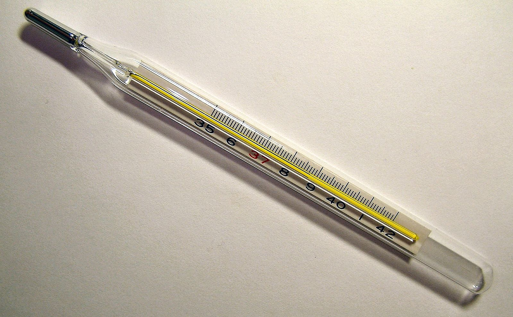
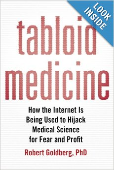
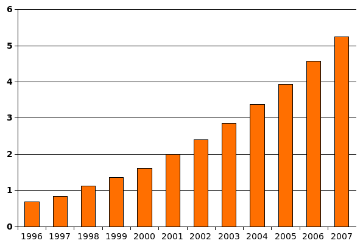
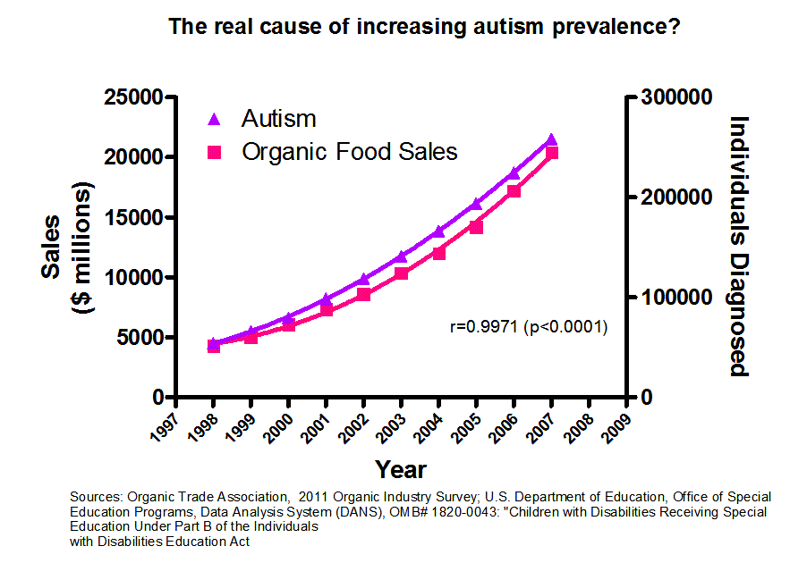

My youngest daughter was about a year old when she grabbed a
thermometer, bit it, and swallowed the contents. It was a regrettable
lapse on our part that left that dangerous object within her reach.

Luckily my wife noticed right away, called me at work, and we rushed to
see her pediatrician. The doctor ordered X-rays, which showed the little
beads of metal making their way through her intestinal tract. We were
very scared and the doctor was baffled, since he wasn't sure what to do
in a case like this.

Mercury is toxic, although that wasn't known for a long time. It is said
that the Chinese emperor who built the Great Wall, in his quest for
eternal life, consumed small amounts of this element, and that this diet
is what led to his death before he turned fifty. Among the ancient
alchemists it was considered a healing element with mystical properties.

At 40 degrees Celsius mercury already starts to evaporate. The way the
metal expands with temperature is easy to see in thermometers, and that
property is why it is used in those instruments.

As a vapor it is highly harmful. In fact, if mercury vapors reach the
brain they can cause serious neurological damage. On top of that,
prolonged exposure causes loss of appetite, fatigue, insomnia, changes in
behavior, and even in personality. Besides the brain, it can damage the
kidneys and lungs. The damage is greater in small children. We are
talking about large amounts of mercury, or permanent and prolonged
exposure.

Its handling is regulated in many countries around the world. Dentists,
for example, used to use a lot of mercury in amalgam fillings, which has
been banned in many countries, and since 2009 the WHO has recommended
phasing it out worldwide. Today less toxic ceramic materials are
preferred. By the way, the amount of mercury in one amalgam filling is
thousands of times what there is in a vaccine with thimerosal.

But back to my daughter. The treatment to get rid of the mercury in her
body consisted of speeding up its expulsion. The pediatrician recommended
certain foods and fiber supplements to get her to pass the toxic stuff.
We were watchful and anguished, until one day little silver beads showed
up in a crappy diaper :smile:, and calm returned.

What a huge relief! You have no idea what parents go through over
anything that happens to their little girl.

Was all the mercury expelled from her system? Unlikely. The X-ray showed
a large number of little beads, and it is almost certain that some of the
thermometer's contents were absorbed by my daughter's body.

But she has developed completely normally over these twelve years. The
other day she took part in
[the Santiago Makerspace summer workshop](http://stgomakerspace.wordpress.com/2014/01/10/peliculas-en-estreno-del-campamento-de-verano-maker-i/)
and learned how to make animated shorts with stop motion. At twelve years
old she has never shown any neurological problem.

Autism? Nothing. I'm more autistic than she is ;). My daughter is a calm
girl, but very sociable; she goes out bike riding, dances, sings, reads,
invents things, draws very well, has a gift for acting, and is the
sweetest daughter a father could have.

I mention this because, apart from being proud, I have to tell you that
she was also inoculated with vaccines preserved with thimerosal, in
accordance with our country's health programs. Like many children,
thousands, or millions around the world. Like me, and probably you too,
dear reader.

How much mercury was my daughter exposed to?

So we can make comparisons:

A standard thermometer has about 700 milligrams of mercury, in 0.005
milliliters of volume at room temperature.

A vaccine with thimerosal can have between 10 and 50 micrograms of this
substance (which is an organic mercury compound).

700 milligrams of mercury, the amount my daughter swallowed, is 700,000
micrograms of mercury. In other words, my daughter swallowed a portion
between 14,000 and 70,000 times what a vaccine with thimerosal contains!
(Actually more, because thimerosal is a mercury compound, not pure
mercury.)

Would you inject into your daughter's intestine 14,000 times the amount
of mercury in a vaccine? I wouldn't.

OK, she expelled most of what she swallowed, but how many milligrams
stayed in her body? Remember that she also received the standard vaccines
every child her age gets.

You got lucky, you'll tell me. "Thank God!", someone once told me. And
they're partly right; it's great that my daughter expelled most of the
mercury. But if I believed the whole theory linking autism to thimerosal,
I would have to be baffled, or believe that she is the exception that
proves the rule.

Mind you, I'm not saying that a single case proves there is no
correlation between thimerosal and autism, so I ask you to keep reading
calmly.

It was because of this incident with my daughter that I started
researching mercury and autism. So I have spent eleven of my daughter's
twelve years reading something about the supposed connections between
mercury and autism.

Don't think I didn't worry; of course I did. In 2002 this was already an
issue. In 2000 there were thousands of lawsuits related to the use of
thimerosal in vaccines. By the time my daughter had her accident this was
already known, and discussed on the internet, although it had also been
refuted, in 1999.

But the myth that thimerosal causes autism persists. In 2011 "The Annals
of Pharmacotherapy" published the following:

> In 1998, Dr. Andrew Wakefield, a British gastroenterologist, described
> a new autism phenotype called the regressive autism-enterocolitis
> syndrome triggered by environmental factors such as measles, mumps, and
> rubella (MMR) vaccination. The speculative vaccination-autism
> connection decreased parental confidence in public health vaccination
> programs and created a public health crisis in England and questions
> about vaccine safety in North America. After 10 years of controversy
> and investigation, Dr. Wakefield was found guilty of ethical, medical,
> and scientific misconduct in the publication of the autism paper.
> Additional studies showed that the data presented were fraudulent. The
> alleged autism-vaccine connection is, perhaps, the most damaging
> medical hoax of the last 100 years.[^1]

"The most damaging medical hoax of the last 100 years."

And on January 15 my country's deputies approved a law based on this very
hoax. A law that bans the use of thimerosal in vaccines.

But what is thimerosal?

It is an organic compound that contains mercury. It is an antiseptic and
antifungal agent. It has been used as a vaccine preservative since 1930.
Its use was approved after an incident in 1928, in which 12 of 21
children died after being vaccinated against diphtheria. The vaccines
were contaminated with staphylococcus bacteria, because of the poor
quality of the preservatives used back then.

At the time, thimerosal was chosen as a vaccine preservative because,
unlike other compounds in use, it did not reduce the potency of the
vaccine.

So almost all of us who were vaccinated from 1930 until now owe our lives
to thimerosal. Otherwise, vaccines would have been the leading killers of
children of all time.

The thimerosal controversy appears after Wakefield's paper is published,
along with a speculation by Redwood and Bernard[^2] based on the
similarity between mercury poisoning and the symptoms of certain forms of
autism. Time and again it has been proven that thimerosal is harmless if
used in the correct doses.

In 2007, an editorial in the New England Journal of Medicine said the
following:

> The idea that thimerosal caused autism has given rise to a cottage
> industry of charlatans offering false hope, in part in the form of
> mercury-chelating agents. In August 2005, a 5-year-old autistic boy
> died of an arrhythmia caused by the injection of the chelating agent
> [EDTA](http://es.wikipedia.org/wiki/EDTA)
> (ethylenediaminetetraacetic acid). Even though the notion that
> thimerosal causes autism has already been ruled out by a good number of
> excellent epidemiological studies, about 10,000 autistic children in
> the United States receive mercury chelators every year.

The terrible thing about this whole idea that thimerosal causes autism is
that parents are poisoning their children with dangerous chelators, like
EDTA, which can damage the kidneys. All because of the ignorance bred by
this horrible, stupid theory!

This fear has also been used by pseudoscientific charlatans to spread
their ideas and profit by deceiving anguished parents. As Robert Goldberg
denounces in his book ["Tabloid Medicine - How the
Internet is Being Used to Hijack Medical Science for Fear and
Profit"](http://amzn.to/LkcHCo).

Just as the certainty of climate change is backed by the publication of
thousands of scientific papers, the evidence ruling out a link between
vaccines and autism is backed by more than 1,000 scientific papers.

Like the study by John R. Hughes, "A review of recent reports on
autism: 1000 studies published in 2007", which you can read from this
[link](http://desafiandoalautismo.org/wp-content/uploads/2011/11/A-review-of-recent-reports-on-autism-08.pdf)
on the site [DesafiandoAlAutismo.org](http://desafiandoalautismo.org/).

I'll take the chance to quote that site, which has guidance for parents
and people interested in this syndrome:

> It has been argued that the measles, mumps, rubella vaccine (MMR) or
> thimerosal (a mercury-containing preservative used in some vaccines),
> or both, were responsible for an epidemic of autism. As far as MMR is
> concerned, epidemiological research has been consistently negative with
> respect to that claim (Rutter, 2008), the decisive evidence being that
> in Japan, when MMR was withdrawn entirely, there was no effect on the
> overall rise in the rate of autism diagnoses (Honda et al. 2005). The
> situation with thimerosal is a bit more complicated, in that there is
> no doubt that mercury is a proven neurotoxin. However, the same kinds
> of epidemiological research have also failed to show that this led to
> an epidemic of autism. In particular, the withdrawal of thimerosal from
> vaccines across Scandinavia, at a time when its use continued in the
> rest of the world, offers convincing evidence against the
> 'Epidemic'[^3].

To sum up: for a while the hypothesis was that MMR vaccines or thimerosal
caused an epidemic of autism, but when the compound was withdrawn in
certain countries, the rate of increase of autism did not change;
everything stayed the same, in Denmark, Sweden, Norway, Iceland and
Japan. The supposed epidemic did not go away when the compound was taken
out of circulation.

By the way, we are joining those countries. Great!, some will say. The
funny part is that deputy Juan Luis Castro boasted about this "feat" and
presented it as a great innovation by our country. Sorry, deputy, the
Scandinavian countries and Japan did it first, without all the
fanfare[^4].

But it's not as good as it looks, because replacing thimerosal raises the
cost of vaccination plans as much as 6 or 7 times. In 2009, the US
government decided to promote mass vaccination to prevent H1N1, or swine
flu. Some 120 million doses were needed, but it was decided that
thimerosal would not be used as a preservative. That decision meant only
16 million doses could be acquired. (Well, in any case, we know that H1N1
[was not as catastrophic as suspected](/en/blog/lnds/2009/05/01/swine-flu-thats-all-folks/);
in fact, the common flu still kills more people.)

Chile has decided, by law, to squander 6 times more money on vaccination
programs, all based on a myth, pseudoscientific speculation and
barefaced deceptions by doctors who were found guilty.

But our legislators say this was a serious, informed, even innovative
decision. Vaccines!

PS:

Here is a funnier argument (against the idea of not vaccinating
children):



Look at this chart, which shows the growth in the number of children with
autism per 1,000 children, from 1996 to 2007 (the time of the supposed
epidemic) in the United States:

Compare it with this chart, which shows a correlation between autism and
organic food sales

Does this chart prove that the rise of organic food causes autism?[^5]

Of course not; correlation does not imply causation. And yet this is the
argument of those who link thimerosal to autism.

# *On the precautionary principle.*

Taken from Wikipedia:

> "The precautionary principle is a concept that supports adopting
> protective measures when there are well-founded suspicions that
> certain products or technologies create a serious risk to public health
> or the environment, but without yet having definitive scientific proof
> of that risk".

This principle has been argued in favor of no longer using vaccines.

This principle reminds me a lot of the discussion we had about
["the morning-after pill"](/en/blog/lnds/2008/04/30/dr-horacio-croxatto-and-the-morning-after-pill/),
because it was argued that this pill could be abortive, and so, on the
basis of the precautionary principle, the distribution of this
contraceptive should have been banned.

Another problem is that they forget this principle has to come with a
cost-benefit analysis. The same thing that happened in the United States
with the vaccine supply could happen to us. It could also raise the
suspicion of who benefits from this measure; the suspicion could arise
that those who sell the other vaccines, the ones without thimerosal, are
happy with it. But what worries me more is that we are wasting resources
on the basis of this principle, when the degree of uncertainty is far too
low; I even suspect it is lower than in the case of "the morning-after
pill".

## *Causes of autism.*

At present science has no absolute certainty about the causes of autism.
It is a broad-spectrum syndrome that shows up in different forms. The
most likely cause would be related to genetics.
You can read something about it, although it is a 2011 article, in
["Progress in understanding autism"](http://desafiandoalautismo.org/progresos-en-la-comprension-del-autismo/)
on the Desafiando al autismo site.

One of the latest books with up-to-date information on the autism
spectrum was published by Temple Grandin: ["The
Autistic Brain: Thinking Across the Spectrum"](http://amzn.to/1eTBWqf).
The remarkable thing is that Temple Grandin is autistic; she learned to
speak at age five and went on to earn a PhD in animal science. She
published her autobiography, ["Thinking in Pictures, My Life with Autism"](http://amzn.to/1dErS5O), which was even made into a movie.

Notes
-----

[^1]: Taken from the site of The Annals of Pharmacotherapy, "The
Vaccine-Autism Connection: A Public Health Crisis Caused by Unethical
Medical Practices and Fraudulent Science"
<http://aop.sagepub.com/content/45/10/1302>

[^2]: Autism: a novel form of mercury poisoning. A medical hypothesis from 2001. Available at the US National Library of Medicine. This text has been refuted, by the way. One refutation can be read in the book "Tabloid Medicine. How the Internet is being used to hijack Medical Science for Fear and Profit", published by Robert Goldberg, PhD. Available on Amazon <http://amzn.to/LkcHCo>.

[^3]: Progress in understanding autism, taken from the site
Desafiando al Autismo
<http://desafiandoalautismo.org/progresos-en-la-comprension-del-autismo/>

[^4]: La Nación newspaper, "CHILE SERÁ EL PRIMER PAÍS QUE EXCLUYE EL
TIMEROSAL POR LEY" ("Chile will be the first country to exclude
thimerosal by law")
<http://www.lanacion.cl/noticias/pais/salud/chile-sera-el-primer-pais-que-excluye-el-timerosal-por-ley/2014-01-15/184733.html>.
I don't know whether the other countries removed thimerosal by law or by
executive action; the deputy might have a point there.

[^5]: Taken from <http://imgur.com/1WZ6h>. The discussion on Reddit is
entertaining
<http://www.reddit.com/r/skeptic/comments/14qbn9/rskeptic_i_was_practicing_graphpad_and_i_think_i/>
