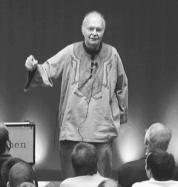

> "I achieved every IT person's dream: getting out of IT".

I'm told that line was heard from a professional more or less my age.
Apparently he is very happy with his current job and somewhat annoyed at
having wasted so much time on computing.

*"I want to fall back in love with computing :/"*, says a tweet a young
woman posted a couple of days ago, which showed up in my timeline.

There is an alert here, a cry for help, a person in vocational anguish.

It isn't clear to me, because I don't know her and wasn't following her
on Twitter, what is going on. It may be the collision between the reality
of work and the idealized world of the university. It may also be the
crash into the mediocre reality of much of our local IT.

I heard of the case of a certain fairly well-known company where, instead
of configuring DNS and parameterizing the applications so they use names
instead of IP addresses, they are developing a script that walks through
all the necessary configuration files, changes the IPs and restarts the
systems every time the addresses change (!).

I've seen worse.

Achilles says in the Iliad

> "The same lot falls to the one who stays idle and the one who fights
> his hardest. The coward and the brave man are held in the same honor.
> The slacker dies just the same as the author of countless feats. I gain
> no advantage from having suffered pains in my heart".

Mediocrity abounds.

I think anyone who acts like the person in this post's opening line is
small-minded and selfish. He should never have studied computing, and his
presence in the field did more harm than good, so it's good that he left.
"Vaya con Dios, amigo."

On the other hand, it's the people who run into mediocrity, into routine,
who need to fall back in love.

If the work is worth it, if what you do makes sense, and you are with
people committed to the result, if you find yourself among
[cathedral builders](/blog/2009/12/motivacion-personal.html) and not mere
stonecutters, then working will be a pleasure.

As [I said recently](/en/blog/lnds/2013/11/11/satisfaction-2013/), what we seek as
human beings is to transcend. We don't want financial rewards as much as
we want to be recognized.

If your job doesn't give you that, then instead of
[complaining](/en/blog/lnds/2012/03/15/philoctetes/),
[quit](/blog/2009/03/nada.html)!

Let go of the fear. Twitter is the wailing wall; stop tweeting and take
charge of your life. Don't ask others to make you fall back in love; the
answer is in you! There are plenty of jobs that are worth it, that need
committed people. If you really love your profession, the right job will
show up.

Maybe you haven't found the meaning in your work; maybe you don't know
why you do what you do. Did you ask your boss? If he doesn't know either,
then run from that place, please!

To wrap up, and to leave you with something more concrete, I'll leave you
with the words of one of my personal heroes, Donald Knuth:

> Sometimes we are assigned to a programming task which is almost
> hopelessly dull, giving us no outlet whatsoever for any creativity; and
> at such times a person might well come to me and say, "So programming
> is beautiful? It's all very well for you to declaim that I should take
> pleasure in creating elegant and charming programs, but how am I
> supposed to make this mess into a work of art?"
>
> Well, it's true, not all programming tasks are going to be fun.
> Consider the "trapped housewife," who has to clean off the same table
> every day: there's not room for creativity or artistry in every
> situation. But even in such cases, there is a way to make a big
> improvement: it is still a pleasure to do routine jobs if we have
> beautiful things to work with. For example, a person will really enjoy
> wiping off the dining room table, day after day, if it is a beautifully
> designed table made from some fine quality hardwood.
>
> Therefore I want to address my closing remarks to the system
> programmers and the machine designers who produce the systems that the
> rest of us must work with. Please, give us tools that are a pleasure to
> use, especially for our routine assignments, instead of providing
> something we have to fight with. Please, give us tools that encourage
> us to write better programs, by enhancing our pleasure when we do so.
>
> It's very hard for me to convince college freshmen that programming is
> beautiful, when the first thing I have to tell them is how to punch
> "slash slash JoB equals so-and-so." Even job control languages can be
> designed so that they are a pleasure to use, instead of being strictly
> functional.
>
> Computer hardware designers can make their machines much more pleasant
> to use, for example by providing floating-point arithmetic which
> satisfies simple mathematical laws. The facilities presently available
> on most machines make the job of rigorous error analysis hopelessly
> difficult, but properly designed operations would encourage numerical
> analysts to provide better subroutines which have certified accuracy.
>
> Let's consider also what software designers can do. One of the best
> ways to keep up the spirits of a system user is to provide routines
> that he can interact with. We shouldn't make systems too automatic, so
> that the action always goes on behind the scenes; we ought to give the
> programmer-user a chance to direct his creativity into useful channels.
> One thing all programmers have in common is that they enjoy working
> with machines; so let's keep them in the loop. Some tasks are best done
> by machine, while others are best done by human insight; and a properly
> designed system will find the right balance.

## **Garbage collection**

Sometimes it's good to do the exercise of collecting spiritual garbage.
I'm going to quote one of my favorite philosophers, Cioran:

> ...writing, however little, has helped me get through the years, since
> obsessions, once expressed, are weakened and half overcome. I am sure
> that if I hadn't scribbled on paper I would have killed myself long
> ago. Writing is an extraordinary relief. And so is publishing. This
> will seem ridiculous to you, and yet it is very true. Because a book is
> your life, or a part of it, made external to you. You shed everything
> you love and above all everything you detest about yourself.
>
> I'll go further: if I hadn't written, I could have become a murderer.
> Expression is a liberation. I advise you to do the following exercise:
> when you hate someone and feel like finishing him off, take a piece of
> paper and write that So-and-so is a pig, a crook, a scoundrel, a
> monster. You will notice right away that you hate him less. It is
> precisely what I have done with regard to myself. I have written to
> insult life and to insult myself. The result? I have put up with myself
> better, and I have put up with life better.

That's right, I too run into mediocrity, frustration, and boredom. My
solution is to garbage collect my soul, as good old Emile advises, by
writing.

Now it's your turn: collect your garbage, and get it away from your mind
and your spirit, so you can face life with more energy.

Related posts:

-   [Knuth answers all the questions](/en/blog/lnds/2011/01/21/knuth-answers-all-questions/)

-   [What is programming?](/en/blog/lnds/2012/05/09/what-is-programming/)

-   [The practice of programming](/2007/07/12/la-practica-de-la-programacion)

-   [Mars needs women](/en/blog/lnds/2013/09/08/mars-needs-women/)

-   And of course, part four of my book  [La Naturaleza Del Software](/books)

