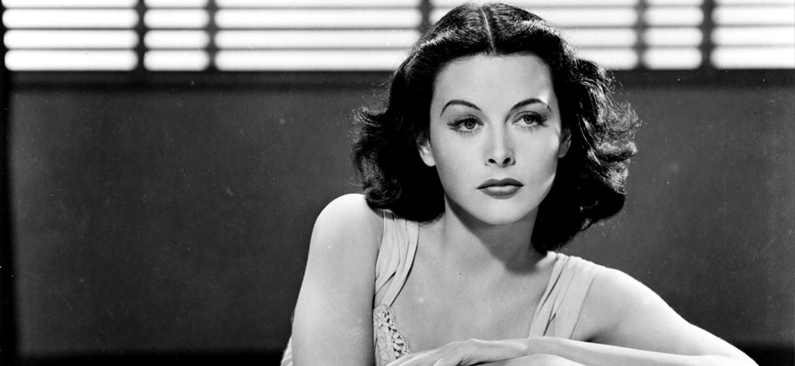
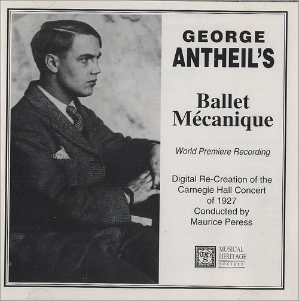
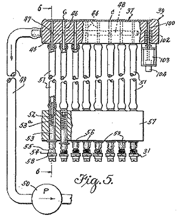
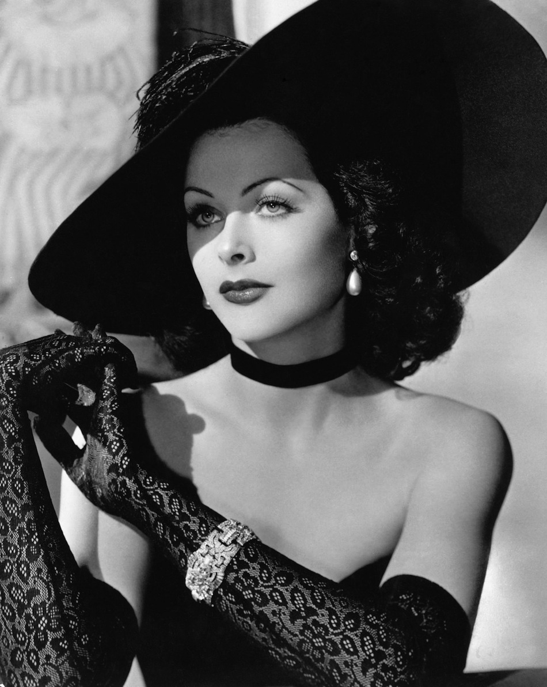

A scandalous actress {#unaactrizescandalosa}
--------------------

A young woman, riding her horse, heads into the forest. For a few moments
we lose sight of her. Through the branches and foliage of the trees we
see her reappear, running naked to dive into a river.

Then the camera shows us that the young woman's clothes are on the
horse's back. The animal grazes calmly until a mare peeks out from behind
a wooden fence a few meters away in a clearing. The horse whinnies and
runs toward the mare, abandoning our protagonist.

She notices and shouts, calling the animal, but it does not obey.
Desperate, she swims to the bank and this time we see her run naked; the
camera shows us her reflection on the water.

The steed has reached the mare, and when the girl catches up with them it
bolts again, running toward the edge of a road where a crew of laborers
is working. The men scare the animal off, but a young worker runs after
the horse until he stops it and calms it down.

The girl watches all this hidden behind a bush, and that is how the man
finds her. At first she tries to cover herself and looks at him in
fright, while he smiles; finally she decides to stare at him defiantly.
The young worker smiles, handing back dress and horse.

These scenes are part of the 1933 film Ecstasy. The sequence described is
the one that brings the lovers together. The later scene, of their first
amorous encounter, has the distinction of being the first in cinema to
depict a female orgasm (in a non-pornographic film).

Filmed in Czechoslovakia, it took two years to be shown in Germany,
because of censorship. In the United States it was condemned by various
moral institutions, including the Catholic Church. In 1936 the film's
American distributor began the process of obtaining the seal of approval
of the [Hays Code](http://en.wikipedia.org/wiki/Hays_code), without
success. Only in 1940 was the film shown, without the Hays seal,
privately in a few art houses.

The star was the beautiful young Austrian Hedwig Kiesler, who would later
achieve international fame in Hollywood under the name Hedy Lamarr.

Hedy was eighteen when she filmed Ecstasy. Although it wasn't her first
film, it was the one that made her famous worldwide and secured her
arrival in the "Mecca of Cinema" years later.

On turning nineteen Hedy married Friedrich Mandl, an important Austrian
businessman who owned large armaments factories.

Mandl hated the film, since he held that it exploited his wife and the
expression on her face during the simulated orgasm. He bought as many
copies as he could to prevent its public exhibition. Once they were
married, he forbade his wife to pursue her acting career or to leave his
enormous mansion without him.

However, the businessman used his wife's beauty as a means of improving
his business, especially with the fascist governments of Germany and
Italy. It is said that the young woman made a great impression on Adolf
Hitler during a dinner. Another anecdote claims that Mussolini kept a
copy of Ecstasy, which he considered one of his most prized possessions.

The young woman began accompanying her husband to business meetings and
conferences on armaments. Hedy was very intelligent. She used to take
long walks with her father, a wealthy Viennese banker, talking about
science and the mechanical nature of the world. During the armaments
conferences she paid close attention and learned how many of the
mechanisms of the weapons and munitions developed in her husband's
factories worked.

But Hedy wanted to escape. Not only was the marriage torture for her, she
also hated the Nazi regime, because among other things her parents were
Jewish. One day she convinced her husband to let her wear all her jewels
during a dinner. That same night she disappeared disguised as a maid.

She reached Paris, where she contacted Louis B. Mayer and got a contract
to make films for MGM, on the condition that she change her name. Mayer
wanted somehow to divert the censors' attention (until then she was known
in the United States as "the Ecstasy Lady"). That is how a successful
career in American film began.

The piano man
-------------

In June 1926 an exclusive private concert was held in Paris. The event
was the premiere of a curious
[Dadaist](http://es.wikipedia.org/wiki/Dada%C3%ADsmo)-style work, titled
"Ballet Mécanique", which was to be performed by, among other things, a
player piano, eight grand pianos, several anvils, and an airplane
engine.

The cacophony of the concert bewildered the audience and several of them
left the theater outraged, causing disturbances in the street. The
sponsor, a wealthy American woman, was tossed in a blanket by two
princesses, three baronesses and a duke.

The author of such a scandalous work was George Antheil, a young American
pianist and composer of twenty-six. Five years earlier this young
musician had arrived in Europe intending to become a renowned
ultra-modern composer and pianist. He achieved moderate success, and in
some concerts his works were even played alongside those of Stravinsky
and Debussy.

After the fiasco in Paris he traveled to Germany, where he managed to
premiere his first opera in 1930. But his avant-garde music was not well
received by the Nazis, and in the middle of the Depression he decided to
return to his native country. Antheil went to Hollywood, where he wrote
scores for various filmmakers, Cecil B. DeMille among them.

Apart from composing, Antheil wrote mystery novels, and also worked as a
reporter and critic for music magazines. Before World War II he took part
in the Hollywood Anti-Nazi League, exhibiting works of art censored by
Hitler's Germany.

He also wrote an advice column for couples, syndicated in newspapers
nationwide, along with regular columns in magazines like Esquire and
Coronet. He considered himself an expert in "female endocrinology" and
published a series of articles on "how to determine a woman's
availability based on glandular effects on her appearance". He even went
as far as writing books on the subject.

It was these articles and books that led him to meet Hedy Lamarr.

The Hollywood star wanted the expert's advice on how to improve the
appeal of her upper torso. The pianist recommended glandular extracts.
Then the conversation drifted to other matters, and in particular to
torpedoes.

Torpedoes
---------

Radio-controlled torpedoes were developed at the end of World War I. But
their control and guidance mechanism had several flaws. An effective
countermeasure was to send a jamming signal on the same frequency used to
steer the weapon.

Lamarr knew this effect from her experience at the conferences she had
attended alongside Mandl, her ex-husband. When she learned of the German
submarine attacks on civilian ships, she became obsessed with finding a
way to support the Americans with her ingenuity and her knowledge of
armaments.

Hedy wanted to improve the torpedoes' control mechanism, and for this she
conceived the idea of transmitting a guidance signal in short bursts on
different frequencies. The code for the sequence of frequencies had to be
identical on both the control ship and the torpedo. Since the sequence
would be unknown to the enemy, the transmission could not be blocked by
flooding the spectrum with noise. And trying to jam every possible
frequency would require too much power.

Antheil's contribution was to control the frequency hopping using a
mechanism similar to a player piano's. He knew very well how it worked,
since he had composed Ballet Mécanique to be performed by eight
synchronized pianos.

They designed the device so that the signal would hop among 88
frequencies, just like the 88 keys on a piano. In 1941, Lamarr and
Antheil signed patent US2292387: "Secret Communication System".

Although a technical presentation was made to the US Navy, the invention
met opposition and was rejected. It has to be said that the technology of
the time wasn't ready; only in 1957 was the concept adopted, and it was
tested in the 1962 blockade of Cuba.

It is known that Hedy Lamarr wanted to join the National Inventors
Council, but she was persuaded that she could contribute more by selling
war bonds.

So in 1942 she gets her most memorable line, "I am Tondelayo\...", in
the film White Cargo, and becomes one of the favorite pin-up girls of the
troops fighting in the Pacific.

Wireless networks
-----------------

Lamarr and Antheil's invention is the basis for the signal modulation
techniques known as [Spread
Spectrum](http://en.wikipedia.org/wiki/Spread_spectrum).

This technique has been used in the mobile communications standard known
as CDMA, a variant of which, known as W-CDMA, is used in the 3G protocol.
The same principles are applied in Bluetooth and in WiFi networks.

The fourth generation of wireless networks, known as LTE, is also based
on the same principle, and much of its speed is due to its signals being
spread across the spectrum using this frequency switching.

Lamarr and Antheil's technological legacy was only recognized in 1997,
when the [Electronic Frontier Foundation gave her its sixth annual
award for technology
pioneers](https://w2.eff.org/awards/pioneer/1997.php).\
On hearing the news Lamarr exclaimed "it's about time!", and sent her son
to receive the award on her behalf. Antheil died in 1959, so he never
even got to see the practical application of his idea.

Lamarr died in 2000 at her home in Florida. She is probably remembered
more for her spectacular beauty than for her technological contributions.
"My face has been my misfortune," she once said, "it's like a mask I
cannot remove. I curse it." She was probably expressing her frustration
at not being accepted as something more than a pretty face, as a woman
with original and effective ideas.

