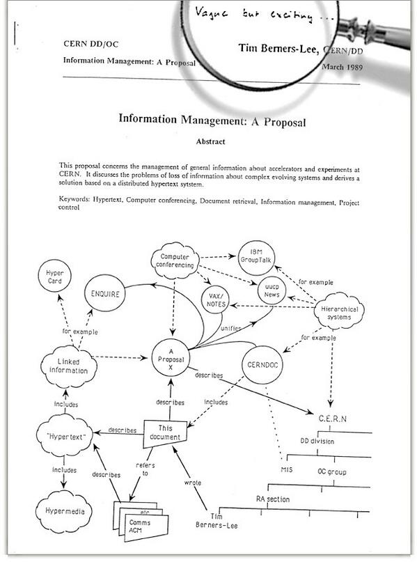

Watching on Twitter how some people reminisce about their experience with
the web on the occasion of its "25th birthday", I set out to clear up a
couple of things.

First, a lot of people, including some who should know better, especially
given the positions they hold, confuse the World Wide Web with the
Internet.

The Internet is much older than the Web. The Internet is a set of
interconnected networks characterized by their use of the TCP/IP
protocol.

If we take the specification of this protocol in the famous
[RFC-675](http://tools.ietf.org/html/rfc675) as the starting point, then
the Internet was born in December 1974. Of course, its history goes back
several years earlier.

What is being celebrated these days is the date of the first formal
proposal to create the Web. What Tim Berners-Lee has shown is the
document in which he proposes creating this tool for sharing information,
which he called "Information Mesh".

This document is from March 1989 and is what everybody today calls the
birth of the Web; I prefer to talk about the **"Conception of the
Web"**.

The Web is an application built on top of the Internet.

The real work began in late 1990; by December of that year we already had
the basic tools to operate the Web. Around that date Berners-Lee also
released the HTTP protocol, version 0.9.

He built all of this on a NeXT workstation on the CERN premises.

The Web was announced to the public on August 6, 1991, in the
alt.hypertext newsgroup. But it only became accessible on August 23.

The first servers began to be ported from Berners-Lee's NeXT version to
other operating systems during 1992. By 1993 we already had Mosaic, the
first web browser.

My first experience with the Web was probably in early 1993, when someone
handed me a tar file and I installed Mosaic on a Sun workstation at the
DCC (the Computer Science Department) of the Universidad de Chile. That
day I got to watch the Mona Lisa slowly load on the screen, I don't
remember from which website. I also remember seeing the website with the
map of Chile that Pepe Flores published back then, on the first Chilean
web server. I don't remember the date either.

The truth is that at first I didn't pay it much attention, except as a
curiosity, and probably a way to replace Gopher with a more graphical
interface. By then I was already working, and outside the university the
internet was practically unknown. Explaining what the internet was to
executives at banks or other institutions was really hard back then.

IRC, newsgroups, Gopher, Veronica, FTP were the applications we used to
find information before the Web. Outside the Internet it was chaos; there
were interesting things like some very well thought-out email services,
or exotic things like EDI (electronic data interchange), but it was the
Web that really made possible an enormous leap in sharing information.

That is the value of Sir Tim Berners-Lee's proposal.

On the cover of the initial 1989 proposal, the evaluator Mike Sendall
wrote in pencil "vague, but exciting", and boy did it turn out to be an
exciting idea. So that's what we are celebrating, the conception of this
idea; the code came later ;).

