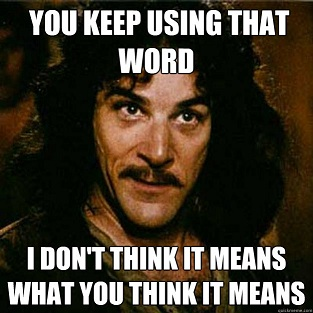

By now it should be clear to you that
[my last post](/en/blog/lnds/2014/03/20/respect/) was pretty
**"cathartic"**\...

Or however you say it. What happened is that I was annoyed by an
argument, by two arguments actually, that reached the same ending.
Anyway, I'm also partly to blame for never learning the lesson\... In
short, in the end, to control my anger I followed the advice of one of
my favorite philosophers, [Emile
Cioran](http://akarru.org/blog/2011/03/27/cioran/):

> "Writing is an extraordinary relief. And so is publishing. This will
> seem ridiculous to you, and yet it is very true.\[\...\] You shed
> everything you love and above all everything you detest about
> yourself. I'll go further: if I hadn't written, I could have become a
> murderer. Expression is a liberation. I advise you to do the following
> exercise: when you hate someone and feel like finishing him off, take a
> piece of paper and write that So-and-so is a pig, a crook, a scoundrel,
> a monster. You will notice right away that you hate him less. It is
> precisely what I have done with regard to myself. I have written to
> insult life and to insult myself. The result? I have put up with myself
> better, and I have put up with life better."

So that's what I did, nothing more. After all, this is my blog and I do
what I want on it, and if I want to I can use it as a mechanism for
**catharsis**.

Or whatever.

However, I have to take responsibility for what I say, and also maintain
a certain degree of mental hygiene in this virtual environment I've
built.

The thing is that, although you don't notice it, this blog gets pretty
unpleasant comments from time to time, ones that add nothing to the
discussion and are even provocative, and that, if I approved them, would
turn this site into a not very pleasant place.

Running a blog forces you to have a policy on the blog's comments, but
I've realized that I have never told you what my comment policy is.

So let's fix that. Here are the moderation rules for this site, or at
least the criteria I have applied so far, which may change later on, but
consider this the "legislation in force" for now:

1.  This blog uses [disqus](http://www.disqus.com/) as its comment
    platform, so to voice your opinions you have to register with that
    service. I suggest reading [their terms of
    service](http://help.disqus.com/customer/portal/articles/466260-terms-of-service).
2.  I don't accept anonymous comments; it's good to know who is saying
    what, and for them to own it. Sometimes I accept the nickname used on
    some social network, but I handle those cases one by one.
3.  The comment must not promote hatred of people. You can be against my
    ideas and lay out the reasons why you think I'm wrong, or any other
    commenter is wrong, but I ask you to give an argument. I don't accept
    personal attacks on anyone, much less provocations. Let's keep this
    space in harmony.
4.  The idea is for your comment to add to the debate. No problem if you
    contribute a joke, as long as it's witty and helps lighten the mood,
    but if it adds nothing positive, or is just clowning around, it won't
    be accepted.
5.  I don't accept SPAM either, that is, any kind of promotion of
    products or websites. When comments come with a lot of links they go
    automatically to the moderation queue, because they could be spam,
    so it takes a while to review them. Be patient.
6.  I can close comments on a post at any time. In general I try not to,
    but sometimes it's necessary because the discussions are in danger of
    going nowhere, or I simply don't have the capacity to keep
    moderating.
7.  The final call on rejecting a comment is mine, and when I make it I
    don't owe you any explanation.

Those are the rules about comments on this blog.

If I deleted a comment of yours and you think I had no right to, try
contacting me; it's not that hard. The answer may still be no, or I may
never get back to you, and maybe you'll hate me for it. In that case I
suggest applying Cioran's advice: set up your own blog and write about
how much you hate me for not publishing your comment. Doing so might
just make the anger go away.
