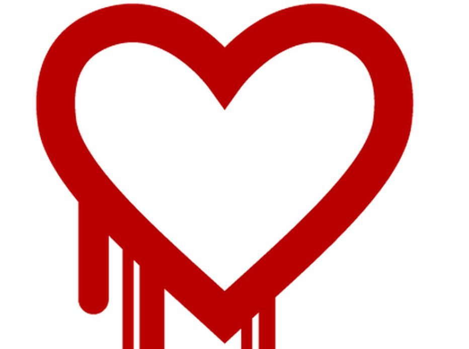

This year has started with a series of alerts and discoveries of
vulnerabilities affecting the network's security infrastructure. Since
it's a very important and timely topic, I've invited my friend
[Cristián Rojas](https://twitter.com/injenierobarsa) to give us his
opinion as a security expert. This is his contribution:

2014, the year of SSL/TLS? 
==========================

**by Cristián Rojas**

Let me start by thanking Eduardo for letting me step in [once again](/en/blog/lnds/2012/11/20/disclosure-you-cant-just-go-and-do-it/)
as *guest villain* on his blog, this time over an issue that has the
computing community as a whole pretty worried.

This week the existence of a serious vulnerability was disclosed in the
code of the popular cryptographic library
[OpenSSL](https://www.openssl.org/), which causes sensitive information
to leak from HTTPS web servers. This vulnerability, together with two
others published earlier, puts on the table not only the problem of
secure communications, but other important aspects of the security of our
applications.

Heartbleed
----------

The OpenSSL library is used by a good share of the web servers around the
world, since it provides the cryptographic capabilities required to make
secure connections to websites. One of its features is the one known as
**Heartbeat**, designed to provide Keep-Alive capabilities and avoid
unnecessary (and sometimes insecure) renegotiations of SSL sessions.

The programming error in question, known as Heartbleed, is a missing
bounds check in that feature, which allows, by means of a renegotiation
request, a 64 KB block of the server's memory to leak. If an attacker
makes multiple consecutive requests, he can piece together, chunk by
chunk, the server's entire memory, which could include, among other
things, the *master key*, which is nothing less than the private key it
uses to decrypt the information it exchanges with the clients that
connect to it.

With the master encryption key in hand, an attacker could record
the
conversations between the server and its clients, which travel encrypted
in the first place, and decrypt them later. It's quite similar to the
theoretical attack that can be repelled by [implementing Forward
Secrecy](http://vimeo.com/80837142), except that in this case, instead of
20 agents showing up kicking down the server room door, invoking some
*Act* and demanding the master key be handed over, an outside attacker
can get that information, and what's worse, without leaving any trace.

### Mitigation {#mitigacin}

Server administrators have work to do. The first thing that has to be
done, no matter what, is to patch OpenSSL, especially if it is version
1.0.1a through 1.0.1f. Other versions of the library are not affected.

Another important point is that patching the library doesn't mean the job
is 100% done, since the master key could perfectly well have leaked
already, before the patch. So the server needs to generate a new key, and
a new SSL certificate, tied to that key, has to be requested for the
site.

### The press reaction 

Unfortunately, as usually happens, the press reacts to these events by
misinforming users, not out of malice but out of ignorance. For example,
[a report by TeleTrece](http://www.13.cl/t13/tecnologia/falla-de-seguridad-en-internet-expone-millones-de-contrasenas-y-datos)
says that the experts (curiously, it doesn't specify which ones, or from
what institution) recommend changing the passwords of all the online
services\
you use.

The problem with that claim is that nothing guarantees that some attacker
hasn't already obtained a server's master key, in which case the password
change "recommended by the experts" will be completely useless, since the
attacker could, as mentioned before, record that password-change session,
decrypt it later, and thereby obtain the new password the user entered as
part of the change.

The other vulnerabilities {#lasotrasvulnerabilidades}
-------------------------

Even though Heartbleed may be the worst SSL vulnerability we've seen in a
good while, it is not the first one this year.

### goto fail; {#gotofail}

This implementation flaw, discovered at the end of February this year, is
caused by an error in the SSL implementation for Apple systems (iOS and
MacOSX), which causes an encrypted connection to be established [*even
when the verification of the digital certificate that precedes it does
not happen*](http://nakedsecurity.sophos.com/2014/02/24/anatomy-of-a-goto-fail-apples-ssl-bug-explained-plus-an-unofficial-patch/),
and all for writing, twice on consecutive lines, [the much-hated `goto`
statement in C](https://xkcd.com/292/).

### The GnuTLS bug {#elbuggnutls}

GnuTLS is a library that serves the same purpose as OpenSSL, but under
the [GPL license](https://www.gnu.org/licenses/gpl.html). It is used by
several GNU applications (such as the
[GNOME](http://www.gnome.org) project), in response to the fact that [the
OpenSSL license is not compatible with the
GPL](https://en.wikipedia.org/wiki/GnuTLS#License_and_motivation).

This particular case appeared a week after goto fail. The `goto`
statement is involved here too, and [it also involves validating
certificates that should not be
validated](http://blog.existentialize.com/the-story-of-the-gnutls-bug.html).

Is open source really more secure? {#esopensourcerealmentemsseguro}
----------------------------------

Many people who defend open source tooth and nail argue that it is much
more secure than closed source. The argument is that its security lies in
the fact that the code is open and the community can review it and
identify and mitigate vulnerabilities much faster. However, the fact that
the community *can* review it does not necessarily mean that it *will*
review it.

This is shown by how long vulnerabilities take to be\
discovered. In the case of Heartbleed the vulnerability sat in the code
for 2 years without anyone discovering it. And the GnuTLS vulnerability,
according to the reports, was there, *in plain sight of the whole
community*, [at least since 2005](http://www.reddit.com/r/netsec/comments/1zhjwh/certificate_verification_vulnerability_in_all/cftxbe5).

Nor do we know whether the development teams of open source projects have
a culture of secure development, security knowledge, or methodologies
(such as the [SDL](https://www.microsoft.com/security/sdl/default.aspx),
for example). 

The democratization of open software development brings diversity in
knowledge and in the level of that knowledge, so it is hard to know, a
priori at least, whether the developers taking part in these projects
have a minimum of security knowledge.

Managing dependencies {#elmanejodedependencias}
---------------------

A while ago, my [old mentor](http://pregrado.dii.uchile.cl/academico/jorge-aravena-salazar/)
at the university said something very true: "Developing software today is
like playing with Lego". A language here, a framework there, several very
useful libraries that come from who knows where\... modern software
development looks more and more like putting together a Lego set or a
jigsaw puzzle than building the application from scratch.

And that's just fine. Applications get out onto the network faster
(the\
time-to-market is shorter, as *the management types* would say), and they
are more scalable and maintainable. The abstraction is higher. However,
we don't worry about whether that JAR that was downloaded automatically
through Maven, or that gem we are using as part of our Rails application,
does its job securely. And we don't have to worry about it either. We are
not going to be reading the source code of every library, framework or
language we use. But we do have to stay alert. Software evolves, and with
it the threats and vulnerabilities. We must keep an inventory of what
software we rely on in our development and, based on that inventory, pay
attention to the security advisories for every piece of software we use,
from the operating system down to the smallest library. That includes,
especially in a scenario like the current one, where a small programming
error can lead to serious vulnerabilities, cryptographic libraries like
OpenSSL.

**About the author:**

Cristián Rojas is a computer engineer from the Universidad de
Chile.\
He is also an associate researcher at [CLCERT](http://www.clcert.cl) and
teaches Software Security at that same university. He holds the CSSLP
(Certified Secure Software Lifecycle Professional) certification and is
a\
consultant in secure application development. For application security
consulting you can find him on his
[LinkedIn](http://www.linkedin.com/in/crirojas/es).
