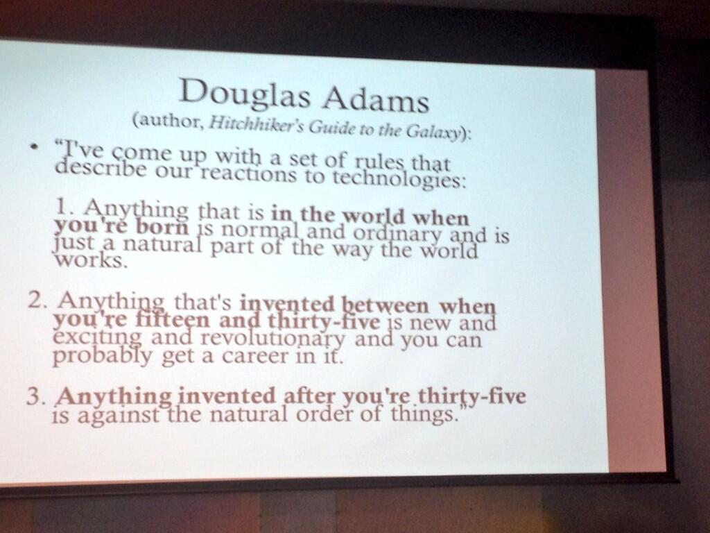

Douglas Adams, the author of The Hitchhiker\'s Guide to the Galaxy,
reflected on our reactions to technology:

> I've come up with a set of rules that describe our reactions to
> technologies:
>
> 1. Anything that is in the world when you're born is normal and
>     ordinary and is just a natural part of the way the world works.
>
> 2. Anything that's invented between when you're fifteen and
>     thirty-five is new and exciting and revolutionary and you can
>     probably get a career in it.
>
> 3. Anything invented after you're thirty-five is against the natural
>     order of things.

Via @annegalloway:


