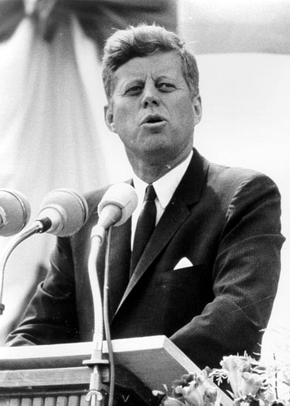

I remember a soccer match between two national teams. One of
them had a coach who showed up in an elegant suit,
the way European managers usually do. The other coach
wore a tracksuit.

Their coaching styles were different too. While the
first one stayed on the bench for the whole match, the
second spent almost all of it shouting and giving orders from the
touchline.

As a spectacle, the team of the coach
in the tracksuit played better: a flashier style, always on the
attack, *"jogo bonito"*, as the
Brazilians say.

Although worry crossed the face of the coach in the elegant suit
several times, he wore a satisfied smile at the
end, because his team was the winner. The one in the tracksuit headed to the locker room
with his frustration in his clenched fists.

Two leadership styles: one that defines the objectives and lets the team
do its job, the other more of a micromanager. But here
the pragmatic
attitude of the coach in the suit, who is very clear that what matters is
scoring goals, is the one that secures
success.

I have heard arguments about which matters more, the process or
the result. That argument makes no sense: the result always
matters more than the process. The process is subordinate to the
result.

When we define an objective, what we do first is state the
expected result.

When I think about this, the example I usually turn to
is Kennedy's mandate to send a man to the
Moon:

> "I believe that this nation should commit itself to achieving the
> goal, before this decade is out, of landing a man on the Moon and
> returning him safely to the Earth."

In this mandate Kennedy clearly sets the objective[^*], which has
three parts:

1. What must be done: land a man on the Moon.
2. When it must be done, the deadline: by the end of the decade.
3. The quality, or acceptance, criterion: return him safely to
the Earth.

How many badly defined goals and objectives do we see?

We once joked that if the objective in Chile were to put a
man in space, once he was up there in orbit the president
would ask when the astronaut was coming back to Earth, and the
obvious answer would be: "come back? Nobody told me we had to
bring him back to Earth!"

So Kennedy takes the precaution of being explicit when defining the
goal.

It's a fairly common mistake, and one I have made several times, to
forget these three things. Let's be explicit and clear about our
objectives, but let's also not forget that what matters is achieving them.
We have to score goals. Playing pretty is a *plus*, but what matters is
winning in the end.

Of course, to get results the makeup of the team
is very important, but that is something we'll talk about
later.

[^*]: Or the why, although there can also be higher-level distinctions,
such as the mission and the vision, which are in charge of clearly defining the
why and the what for.
