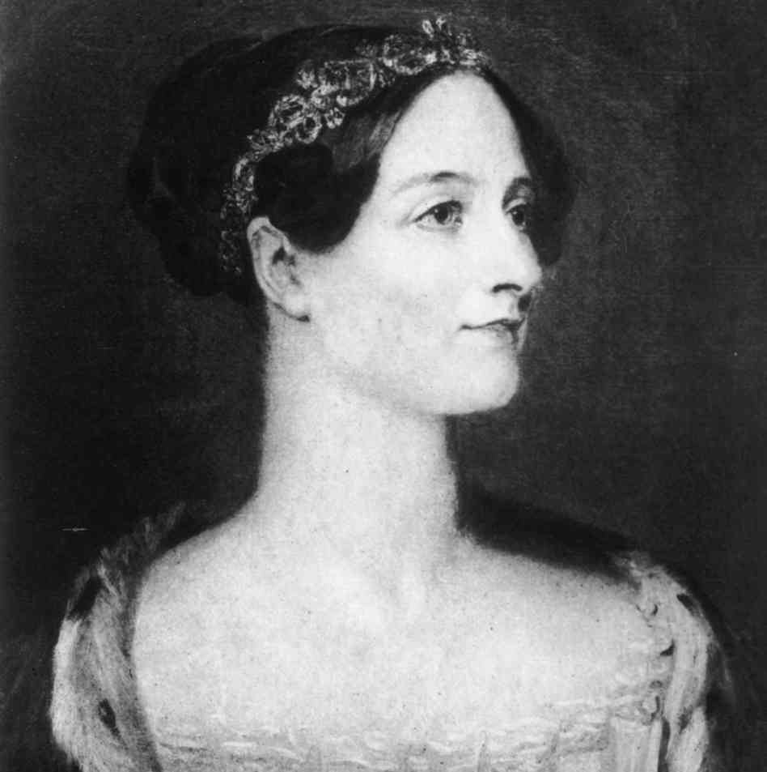

I heard about a young woman whose father forbade her to study computer engineering
because it is a "career for men only". Unfortunately, this
mistaken perception is still lodged in the minds of many people and, worse
still, in the minds of many of my colleagues.

Look at this chart, taken [from Bob Martin's blog (Uncle
Bob)](//blog.cleancoder.com/uncle-bob/2016/01/15/Manhandled.html), which
shows the share of women in different fields, including
computing.



The worrying drop in women's participation in
computer science is plain to see.

Why does this happen?

What makes so many colleagues think this is a profession for
men only?

I lead a team of thirteen people, six women and seven men. That
is not by chance; there is a conscious decision to keep a team with
an even gender split. It is a decision I made years
ago and so far it has served me well.

I explained the reasons years ago in [this other post](/en/blog/lnds/2013/09/08/mars-needs-women/);
I think it is what we should do. Computing is not the exclusive
domain of men, and it never was.



This photograph became famous a couple of years ago. It is Margaret
Hamilton, head of the team of software engineers who wrote
[the code for the Apollo 11 mission](//github.com/chrislgarry/Apollo-11)
that took the crew,
led by Neil Armstrong, safe and sound to the Moon and back,
just as [President Kennedy had committed to](/en/blog/lnds/2015/06/13/results-vs-process/).

These photographs are less well known. They show the women who
did the calculations for several NASA missions.





During the Manhattan Project, a group of women,
[led by Richard Feynman](/en/blog/lnds/2011/04/17/two-men-and-a-universal-machine/),
worked as human computers to carry out the complex calculations
needed to build the atomic bomb. Those women later programmed
the digital computers that replaced them.



Here we have Katherine Johnson, an African American mathematician and physicist who
was part of this group of women who calculated and later programmed
for NASA. In 2015 she received the American Presidential
Medal of Freedom from President Obama, in
recognition.



These are the original programmers of the Eniac, who show that
women were involved in computing from the very beginning.
There is a documentary about them, in case you want to know more, at this
link:[ https://vimeo.com/ondemand/eniac6](//vimeo.com/ondemand/eniac6)



And finally, Lady Ada Lovelace,
[who worked with Charles Babbage designing a computer in the first half of the 19th century](/en/blog/lnds/2012/06/17/the-father-of-computing/).

So where did it come from, this stupid idea that computing is a
profession for men only?
