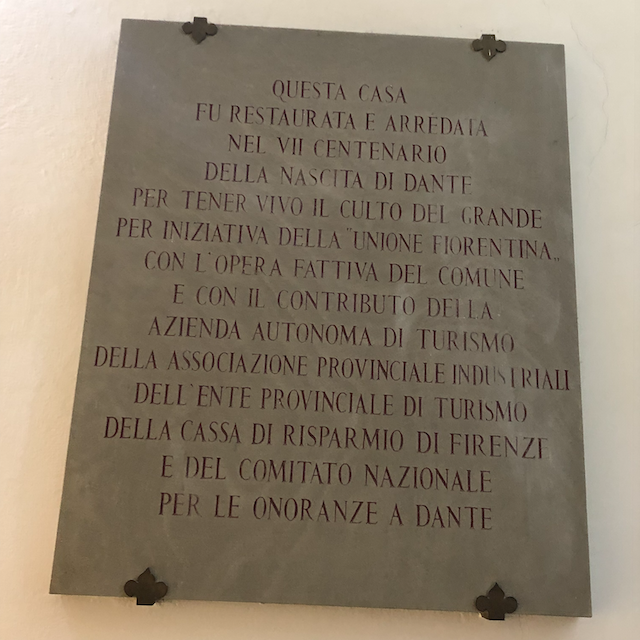
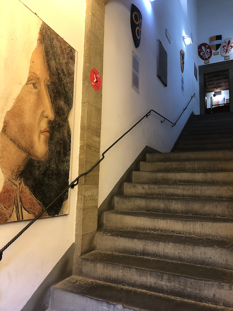

> _"Remember tonight… for it is the beginning of always" -- Dante_

February twenty-ninth. Every four years we add this special day so we can adjust our calendars and make sure the seasons start when they're supposed to.

It's almost certain that more than one computer system [has failed for mishandling this date](/en/blog/lnds/2012/02/29/leap-year/).

Time is, in many ways, a mere convention. The Earth's orbit around the sun doesn't take 365 days, nor does a day take 24 hours. They could be any arbitrary value. We find comfort in having these conventions. Months and days keep us in order.

So let's take advantage of this extra day to get ourselves in order and mark a new beginning for this blog.

## Routine

Steven Wilson writes in [Routine](https://www.youtube.com/watch?v=sh5mWzKlhQY):

> _Routine keeps me in line
Helps me pass the time
Concentrate my mind
Helps me to sleep_

Routine says summer is ending and fall is coming. In Chile, the year starts in March. Everything comes back to life. Classes begin, people return from vacation.

But there are times when that routine breaks. And this 2020 will be anything but routine in Chile.

## Motivation

> _"He who knows pain knows everything" -- Dante_

And if routine, which keeps us in order, which concentrates our mind, is lost, what can we do?

It's been hard for me to get back to writing regularly on this blog.

Meanwhile, these last three months I've spent part of my time migrating everything written over these [last fifteen years](/en/blog/lnds/2020/02/02/the-fifteenth-year/) to a new platform. In the process I've reread many of those pieces, and I've discovered things about myself along the way. Some were pleasant surprises; others I didn't like at all.

In 2006 [I wrote](/en/blog/lnds/2006/08/21/motivation/):

> I haven't written on this blog in a long time, almost two months now. We're not always motivated, or we have problems, or we simply lack the time.
>
> According to the RAE, the Spanish language academy, motivation is "a preparatory mental rehearsal of an action, to encourage oneself or others to carry it out with interest and diligence."
>
> Without motivation, it's very hard to do anything well, or with interest. So motivation is very important if we are to "function" as people.
>
> So each of us looks for an objective, and with it in mind gets motivated to carry out some action, with interest and diligence.
Many of us who write blogs do it more out of vanity than anything else. We feel we have something valuable to contribute and we write it down.
>
> Be that as it may, there are times when we find no motivation in what we do, or in anything around us. Those are the moments when we need help, support, patience, and also a good shake.
>
> We need those people who tell us we're in bad shape, or who show concern for us. Who know how to shake us, to tell us what's wrong, who are able to forgive us despite the mistakes we make, but who are there to point out when you're getting it wrong.
>
> It's not that I want to share my problems with you. I only want to say that for those of us who don't have the gift of faith, love is a source of the energy needed to find motivation. And love comes from sharing with others; even though you can love yourself a great deal, we need to receive the love of others in order to live. In my case, the love of my wife, my children, friends and family.
>
> A religious person will tell me that God is Love. Could be.
>
> What matters is getting into that state that gives you motivation. That drive to start something, to work, or to do anything at all. That state that improves your concentration, gives you more energy, and lets you say yes or no depending on what's asked of you.
>
> If I want to climb a mountain, I have to motivate myself to take on the mental state that will let me reach the summit. But it's clear there has to be a mountain to climb.
>
> Motivation is important, but motivation comes from the desire, or the need, to do something. A goal, an objective.

On the other hand, in February 2019 I wrote on [my Patreon](https://www.patreon.com/posts/la-trampa-de-la-24998702) about the "motivation trap."

> _"Motivation is overrated. What matters is commitment: commitment lets you give your best when you're not motivated." - From Leonardo Jofré's Facebook wall_
>
> The problem with motivating is that it's a way of pushing people to do something they may not want to do, because they see no point in it, or because they're interested in other things.

## Crisis

> _"Midway upon the journey of our life,\
> I found myself in a dark wood,\
> for I had strayed from the straight path."_
> -- Dante, "The Divine Comedy"



In September 2019 I took a long vacation in Europe. Many ideas for articles came up during those weeks I spent with my wife traveling around the old world. But they never saw the light. We got back to Chile just two weeks before the *estallido social*, the mass protests that erupted that October. But apart from that external side of things, I came face to face with the mistakes I made as the leader of my team. A crisis followed, which I'll surely talk about later on.

Life is full of crises, social or personal. The way we face them and get past them is what shows us who we are. It is the ultimate test.

In 2006 I was going through a crisis; at the end of 2019, too. But the contexts are different. So are the ways of resolving them.

This is a year we'll spend on edge. All that's left is to try to do our best in our personal microcosm and contribute to the social cosmos.

## Florence

> _Mankind is at its best when it has the highest degree of freedom -- Dante_

On that vacation I just mentioned I had the good fortune to visit the house of the Florentine poet Dante Alighieri, one of my favorite authors. I was deeply moved, walking the steps the poet trod more than seven centuries ago. Seeing the chapel his beloved Beatrice Portinari used to visit (and where she was married). Wandering those narrow little streets of Florence.

Dante's words are immortal. Because Dante lived through complicated times, times of political turmoil. All of us, if we live long enough, will face an age of great disturbance and social upheaval. Being neutral in such times is moral cowardice, as Dante reminds us. I am not neutral about what's happening in my country, and to the extent it's relevant I'll voice an opinion on this blog. That doesn't mean the point of what gets written here will change.

## Organizing the writing

> _He listens well who takes notes -- Dante_

Since 2010 I've kept three blogs: ["Akarrú"](https://www.akarru.com/), ["La Sombra de Dijkstra"](https://www.programando.org/) and this one, ["La Naturaleza del Software"](https://www.lnds.net/).

In these last few weeks, to get back the habit, the routine of writing, I published some challenges on ["La Sombra de Dijkstra"](https://www.programando.org/).

On Akarrú I published [a small tribute to Neil Peart](https://www.akarru.com/blog/2020/01/11/neil-peart/) after his death. Two weeks ago I added a [short science fiction story](https://www.akarru.com/blog/2020/02/16/la-nina-relato/).

Little by little I'll get back into the routine of writing posts on this blog: sometimes an aphorism, every now and then a long, well-documented technical article. My more personal reflections will go to ["Akarrú"](https://www.akarru.com/); everything that has to do with technology, reflections on the art of developing software, and the occasional reflection of an epistemological kind will go here. Finally, everything related to programming and software architecture will be published on ["La Sombra de Dijkstra"](https://www.programando.org/).

## A new journey begins

> _"Incipit Vita Nova"_

When Dante descends into hell he gets the company of Virgil, who guides him through the circles that make up the underworld and explains what he sees. When he ascends to heaven, his host is his beloved Beatrice.

In his work the Florentine bard passes on his long reflection on his own moral and ethical growth; he criticizes, and conveys to us in allegory, the crises he had to witness. He is a witness to his time and leaves us an account of the human baseness and greatness he got to observe.

I'm at the start of a new journey. A restart in which new allies walk with me. Some cycles come to a close, and you need to form new teams to take on new challenges. Different contexts.

## Against routine

> _"A mighty fire is only the continuation of a small spark"_ -- Dante

Routine doesn't keep us in order. It doesn't calm our mind. Steven Wilson's song of that name speaks from the perspective of a tormented person who takes refuge in routine because it's so hard to accept the terrible reality they were exposed to.

It's not that I like routine, although I am a friend of having a certain discipline, rhythm and ritual for working and for approaching my life.

I discovered that in the first years of this blog there was an astonishing pace of publication, even though the content was often pretty poor. Back then blogs were the trend in "social media." Today we use social networks. So that's where we dump much of the content of the moment. But in 2005, or 2006, it was normal to use blogs to argue about the national situation.

## Objectives

> _"The secret of getting things done is to do them"_ -- Dante

Today there are many people who use Medium to publish longer posts, to get past the space barrier that social networks impose. But it also happens that there's a lot of content that is pure vanity, or snake oil.

That is not the objective of this blog, at least not in this era or context. What I hope to contribute is quality content, from my experience, from my level of knowledge. I also use this medium as a mechanism to learn and to improve. When I discover something I like to explain it, to make sure I understand it. That is the main objective of "La Naturaleza del Software," that is the ultimate commitment. It's the idea that will stay alive in the texts to come. We're going to move forward.

Let's remember Dante: "the secret of getting things done is to do them." So here we are again. We're going to write again.

Rhythm and ritual.

One word after another, one idea and then the next.

(*) All photos taken by the author
