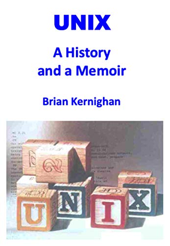
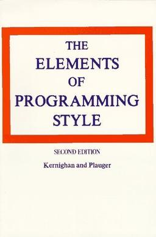
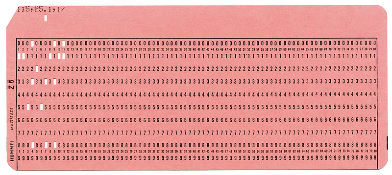

> _Do what you think is interesting, do something that you think is fun and worthwhile, because otherwise you won't do it well anyway._ -- Brian Kernighan

Unix is the most successful operating system in history. Some variant of Unix runs on almost every device that connects to the internet today.

Indeed, if you use an Android phone, you're running on top of the [Linux kernel](https://es.wikipedia.org/wiki/GNU/Linux); if your phone is an iPhone, you're using iOS, which is built on an [XNU](https://es.wikipedia.org/wiki/XNU) kernel.  Both belong to the Unix family.

On top of that, it's very likely that the internet services you use are backed by servers running some variant of Unix or Linux.

How can we explain this success?

One way is to dig into what we're told by one of the people involved in the creation of Unix.

## Brian Kernighan

The story of Unix has been told many times, but in October of last year a definitive source on the origin of this successful operating system was published, told by someone who was directly involved in its creation: Brian Kernighan.



This researcher and computing pioneer is known, among other things, for his great skill as a communicator and writer.

Kernighan writes beautifully, and among his best-selling books is ["The C Programming Language"](https://amzn.to/2WNPj8G), the one that introduced this important programming language to the world. It was co-written with the language's creator, [Dennis Ritchie](/en/blog/lnds/2011/10/13/dmr/), and it's one of the best technical books I've personally read, besides being considered a true classic.

It's in this book that the famous ["Hello World"](https://en.wikipedia.org/wiki/%22Hello,_World!%22_program) program is introduced to the world.

```c
main( ) {
        printf("hello, world\n");
}
```

It's worth noting that this program first appears in a 1974 internal Bell Labs memorandum, written by Kernighan himself, titled ["Programming in C: A Tutorial"](https://www.bell-labs.com/usr/dmr/www/ctut.pdf). Today it's a tradition to introduce a new programming language with this program, and it's also good practice to run it the first time we try a new language or programming environment.

Another of Kernighan's books, [one I always recommend to new programmers](/en/blog/lnds/2007/07/12/the-practice-of-programming/), is [The Practice of Programming](https://amzn.to/2xrulC1).

But let's talk about ["UNIX: A History and a Memoir"](https://amzn.to/2WM44ZT), published in October 2019. It's the author's personal memoir of his years at Bell Labs and of the origin and evolution of Unix.

## Unix: A History and a Memoir



There are several interesting anecdotes in this volume. It's an entertaining, quick read, no more than 190 pages.

In the first chapters the author introduces us to Bell Labs and its culture. As he says, to understand Unix you have to understand Bell Labs, how it operated and the creative atmosphere that environment provided.

### Bell Labs

Founded in 1925, Bell Laboratories was created to foster innovation in telephony through scientific research. During World War II, Bell Labs made important contributions to the U.S. government, not only in communications systems but also in fire-control computers, the development of radar, and cryptography.

Bell Labs is where, for example, the transistor was developed, an invention of [John Bardeen](https://es.wikipedia.org/wiki/John_Bardeen), who would receive the Nobel Prize for this discovery.

Other Nobel winners who worked at Bell Labs were [Penzias](https://es.wikipedia.org/wiki/Arno_Allan_Penzias) and [Wilson](https://es.wikipedia.org/wiki/Robert_Woodrow_Wilson), who accidentally discovered the background radiation generated by the Big Bang while working on improving telecommunications antennas.

For a long time AT&T, the company that owned Bell Labs, invested as much as 2.8% of its revenue in research and development. Of that, 0.3% went to basic research. This steady investment gave freedom to the scientists it hired, who could do research in areas that wouldn't necessarily pay off in the short term, even research that might never have a practical application.

### Computing at Bell Labs

Among the researchers who stood out at Bell Labs was Claude Shannon, the father of Information Theory [(whom I've talked about before)](/en/blog/lnds/2011/04/23/talking-drums/).

In the early 1960s a computing research group was created. And in 1967 Brian Kernighan joined the Computing Science Research Center, under the guidance of Doug McIlroy.

Kernighan says he was lucky to be very close to several giants of the field whose offices were right near his. Among the famous researchers working there at the time was Richard Hamming, author, among other things, of the [famous error-correcting code that bears his name](/en/blog/lnds/2018/10/21/correcting-errors/), which makes reliable high-speed communications possible.

It was Hamming who pushed Kernighan to write. For Hamming the training of programmers was deficient; according to the author, he expressed his opinion of programmers' abilities with the following line:

> _We give them a dictionary and grammar rules, and we say, 'Kid, you're now a great programmer.'_

For Hamming, programming should be taught the same way writing is taught. There should be a notion of style that separates good code from bad code, and programmers should be taught to write well and to appreciate good style.

This idea was the seed of the book that Kernighan and Plauger published in 1974: ["The Elements of Programming Style"](https://amzn.to/3dB1mfC).

[](https://amzn.to/3dB1mfC)

## Operating systems

[A computer](/en/blog/lnds/2018/12/09/what-is-a-computer/) isn't much more than a calculator. The thing is, they can execute millions of arithmetic operations per second.

Programming consists of creating a sequence of operations for the computer to execute, using what we call a programming language. For example, if we want to compute the grade average for a class, one possible algorithm would be:

    1. Reserve a section of memory that we'll call ACCUMULATOR
    2. Load a student's grade into a variable that we'll call GRADE
    3. Add the value of GRADE to ACCUMULATOR
    4. Increment a counter N by 1
    5. Repeat steps 2 to 3 until there are no more grades to read
    6. Divide ACCUMULATOR by N and store it in AVERAGE
    7. Print the value of AVERAGE.

This had to be expressed in a language the machine could understand, something like this:

```
      dword acum
      dword nota
      dword n
      set acum 0
      set nota 0
      set n 0
  loop:
      load nota
      jz end
      add acum nota
      store acum
      inc n
      jmp loop
  end:
      div acum n
      print
```

On the first computers this was transcribed onto punched cards like the one in the picture:



Typically each card held one line of code. The data was stored on these cards, too.
In our example, if there were 100 students, there would be one card for each data item.
These cards were handed to an operator, who loaded both the program and the data into a card reader; this machine read the cards and stored them in the computer's memory. Then the operator ran the program, and the result was normally printed on paper. After a while the programmer would come by to pick up the result, asking the operator for it.

As you can see, this way of working meant only one user could use the computer at a time. This mode is called _"batch processing"_.

When we automate this job, on the other hand, the concept of the operating system appears. In a way, the operating system is the replacement for the human operator.

In 1964 one of the most innovative operating systems was CTSS, the ["Compatible Time Sharing System"](https://es.wikipedia.org/wiki/Compatible_Time-Sharing_System), developed at MIT.

With this system there was no need for punched cards. Programmers could type their programs at terminals that were connected, directly or over telephone lines, to a big computer, the IBM 7094.

The operating system divided its attention among the connected users, switching quickly from one active user to the next, giving each user the illusion of having the computer entirely to themselves. This was
called _"time sharing"_, and at the time it was seen as far more pleasant and productive than _batch processing_.

CTSS was so successful and productive that in 1965 MIT decided to create an improved version, which they called Multics, for Multiplexed Information and Computing Service.

## MULTICS

Multics would be a large-scale effort, requiring the construction of quite ambitious software and of the hardware to support it. So MIT reached an agreement with General Electric and Bell Labs to back them on the project.

The project was too ambitious and fell into the ["second-system effect"](/en/blog/lnds/2012/01/14/concept-album/), a trap in which you set out to fix every problem of the first system and also to add everyone's favorite features. The result is often an overly complicated, over-engineered system. In Sam Morgan's words, it was an attempt "to climb too many trees at once"[^1].

Half a dozen Bell Labs researchers worked on Multics, including Doug McIlroy, Dennis Ritchie, Ken Thompson and Peter Neumann.

McIlroy was involved in the development of the PL/I language used to program the operating system.
Ritchie, who was a fresh Harvard graduate, worked at the labs on the input and output subsystems, as did Thompson.

Thompson described his work on Multics as being _"a notch in a huge wheel, and it was producing something I didn't want to use"_[^2].

In 1969 Bell Labs decided to withdraw its support for the project.

Multics was eventually finished. According to Kernighan it was used and supported until the year 2000.

In any case it was the source of several ideas and an influence, if only by reaction, on the creation of Unix.

## Proto Unix

After Bell Labs left the Multics project, several of the researchers still wanted to develop an operating system. But management wanted nothing more to do with a project of that kind and had no interest in buying special hardware for such an adventure.

One of those most eager to continue was Ken Thompson, who shared ideas on paper for possible implementations with other colleagues.

Eventually Ken found a little-used computer, a [DEC PDP-7](https://es.wikipedia.org/wiki/PDP-7).



This was a computer built in 1964 and by then already considered obsolete, which is why Thompson could have it for several hours at a time. It was an underpowered machine, with a memory of 16K of today's bytes (it was organized as 8K 18-bit words).

The computer had a good graphics display, and Thompson wrote a [space travel](https://en.wikipedia.org/wiki/Space_Travel_(video_game)) game for this machine.



The PDP-7 had a peripheral that posed an interesting challenge. It was a disk whose rotation speed was too fast for the computer. So Ken Thompson developed an algorithm that would maximize the _throughput_ of any disk, including this one in particular.

But to test the algorithm he had to write a program that would fill the disk with a large amount of data. That was when Thompson realized he was three weeks away from completing an operating system.

He needed to create three programs, one per week: an editor, so he could create code; an assembler that could turn the code into machine language that would run on the PDP-7; and a kernel, that is, an operating system.

Right around then Thompson's wife took a three-week vacation, taking the couple's one-year-old son to visit his paternal grandparents in California. So Ken had three weeks to work on this project without interruption.

You can hear this story in an interview Kernighan did with Thompson in May 2019:



In 2003 Kernighan asked Thompson by email about the origin of Unix, and he replied with the following:



Which shows how consistent the story is.

## Unix

And out of Thompson's work a small group of users of this proto operating system formed inside Bell Labs. The name UNICS is said to have come out of those conversations; it's usually attributed to Kernighan, and it would be a kind of pun on, and parody of, MULTICS.

Where MULTICS would be "many of something," UNICS means at most "one of something," that is, uni instead of multi. Another rumor is that AT&T's lawyers didn't like the word UNICS because it sounds like "eunuchs." So eventually it became UNIX. Either way the name was a parody of Multics, as Dennis Ritchie pointed out.

After the system's success on the PDP-7, Ritchie and Thompson started lobbying for approval to buy a PDP-10, a more powerful computer. The PDP-10 cost 500,000 dollars and management rejected the purchase.

But DEC announced the availability of a minicomputer, the PDP-11, at a cost of 65,000 dollars. So the team requested the purchase of the cheaper model, which was also rejected.

In [^1] Sam Morgan says:

> The management principles here are that you hire bright people and you introduce them to the environment, and you give them general directions as to what sort of thing is wanted, and you give them lots of freedom.
Doesn't mean you always necessarily give them all the money that they want.
And then you exercise selective enthusiasm [...] over what they do.
And if you mistakenly discourage or fail to respond to something that later on turns out to be good.
If it is really a strong idea it will come back.

Being forced to work within constraints can be a good thing. In his lecture on receiving the Turing Award in 1983, Ken Thompson wrote:

> UNIX swept into popularity with an industry-wide change from central mainframes to autonomous minis. I suspect that Daniel Bobrow[^3] would be here instead of me if he could not afford a PDP-10 and had had to "settle" for a PDP-11.

The way they got the approval was entirely sideways.

Bell Labs produced an enormous number of patents a year. These had to be submitted in a standardized format, on pages with numbered lines. No system at the time could handle that kind of format. So the patent department was willing to buy special hardware to make its operation more efficient.

[Joe Ossanna](https://en.wikipedia.org/wiki/Joe_Ossanna) proposed that the patent department buy the PDP-11, and the Unix group would write the software they needed to print patent applications in the required format. Of course nobody was going to write an operating system, no sir :wink:.

This proposal had the support of the acoustics research center, which was interested in text-processing applications.

So the PDP-11 was bought, a machine with 24 Kbytes of main memory and a disk with half a megabyte of capacity.

Ken Thompson and Dennis Ritchie translated and adapted the PDP-7 kernel to the PDP-11. This kernel took up 16 Kbytes of memory, leaving 8 Kbytes for user programs.



Ossanna wrote a program called nroff ("New roff"), analogous to the existing Roff program, which was used to generate the files in the format required for patents.

By mid-1971 Unix was being used daily to produce Bell Labs' patents.

The experience was so successful that the patent department bought another PDP-11 so the Unix team could improve the operating system.

## The Unix environment

Unix grew little by little through the collaboration of several Bell Labs researchers.

One of the most important innovations was the concept of pipes.

In 1964 Doug McIlroy proposed the idea that programs should be connected the way garden hoses are screwed together.

Unix had the property that the input and output of every program were already standardized. Meanwhile McIlroy kept pressing Thompson with the idea of these hose couplings, until one day it occurred to Ken to add one more system call, which turned out to be fairly simple, since the standard mechanism already existed. This is what we know as pipes.

One example is the following command, which tells you how many files there are in a directory:

    ls | wc 

`ls` is a command that lists the files, one per line. `wc` (word count) is a program that counts lines.

The pipe is written with the vertical bar `|`, and what this expression says is that the output of `ls` must be passed to the `wc` program as input.

The potential of this enabled the Unix culture of creating many small programs, each specialized in just one thing, which could be used to compose more complex operations.

To make the system easier to maintain, Dennis Ritchie built the C language. Along with it came a standard library, which gave access to the operating system's services.

With C available, others could contribute mini languages, or scripting languages, such as sh, or bash.
Kernighan himself, together with Al Aho and Peter Weinberger, created the [AWK](https://es.wikipedia.org/wiki/AWK) language, which lets you operate on patterns.

In 1973, Steve Johnson and Al Aho created Yacc, a program that makes it easier to build compilers. This allowed even more special-purpose languages to flourish within the Unix environment, which kept enriching it.

Since Unix was "sold" as a project to support document production, from the start it had many text-processing programs, such as `roff` and `nroff`; later, with the acquisition of a phototypesetting machine, `troff` was created.

In 1974 Lorinda Cherry created the `Eqn` language, using Yacc, which lets you write mathematical equations. This program was an inspiration for Donald Knuth's later work on TeX in 1978.

That way, when someone was preparing a text with mathematical equations, they could do the following in Unix:

  eqn archivo | troff > typesett.output

All these languages are something like ancestors of today's markup languages, such as Markdown, which I use to write this blog.

## The distribution of Unix

This whole explosion of languages, commands and utilities made Unix a useful and popular system.

Unix was also distributed free of charge to universities, under a simple agreement. That agreement included access to its source code. This made it possible to develop other, derived versions, such as [BSD Unix](https://es.wikipedia.org/wiki/Berkeley_Software_Distribution).

This let the system spread into commercial settings, since computer science graduates wanted to keep using the same environment they had used as students.

But the main thing was the ease and the innovation that revolved around Unix. A free culture that was gradually lost with the upheavals AT&T went through in the 1980s.

In the end Unix was sold to Novell in 1992, which later sold it to [SCO](https://en.wikipedia.org/wiki/Santa_Cruz_Operation).

But Unix survived in the form of multiple derivatives, such as BSD, Minix and the most popular one, Linux.

The figure at the top of this post shows this sort of Unix family tree.

## Worse is better

In 1989 [Richard P. Gabriel](http://dreamsongs.com/), in his article [The Rise of Worse is Better](http://www.jwz.org/doc/worse-is-better.html), explains the success of the Unix philosophy.

In the essay Richard Gabriel argues that there is a style of
software design he calls the MIT/Stanford style (that is, an academic style), which basically has the following characteristics:

* _Simplicity:_ the design must be simple, both in implementation and interface. It is more important for the interface to be simple than the implementation.
* _Correctness:_ the design must be correct in all observable aspects. Incorrectness is simply not allowed.
* Consistency: the design must not be inconsistent. A design is allowed to be slightly less simple and less complete to avoid inconsistency. Consistency is as important as correctness.
* Completeness: the design must cover as many important situations as is practical. All reasonably expected cases must be covered. Simplicity is not allowed to overly reduce completeness.

As you can see, these are characteristics considered good and positive.

The **Worse Is Better** philosophy, on the other hand, or
New Jersey style, a reference to Bell Labs, the cradle of C and Unix, is
slightly different in the following respects:

* _Simplicity:_ the design must be simple, both in implementation and interface. It is more important for the implementation to be simple than the interface. Simplicity is the most important consideration in a design.
* _Correctness:_ the design must be correct in all observable aspects. It is slightly better to be simple than correct.
* _Consistency:_ the design must not be overly inconsistent. Consistency can be sacrificed for simplicity in some cases, but it is better to drop those parts of the design that deal with less common circumstances than to introduce either implementational complexity or inconsistency.
* _Completeness:_ the design must cover as many important situations as is practical. All reasonably expected cases should be covered. Completeness can be sacrificed in favor of any other quality.

In fact, completeness must be sacrificed whenever
implementation simplicity is jeopardized. Consistency can be
sacrificed to achieve completeness if simplicity is retained;
especially worthless is consistency of interface.

To me this translates into building simple services, languages, or programs that do one thing well, and placing them in an environment where they can be coupled together in a simple way to deliver new, more complex services.

Add to this the management precept of "selective enthusiasm," where you have brilliant teams that are free to innovate within certain constraints, and you'll have an innovation environment as successful as Bell Labs was in the 1960s and 1970s.

[^1]: <http://gromnitsky.users.sourceforge.net/lit/an-oral-history-of-unix/morgan.html>

[^2]: ["UNIX: A History and a Memoir"](https://amzn.to/2WM44ZT), chapter 2.

[^3]: Daniel Bobrow was the author of the [Tenex operating system](https://en.wikipedia.org/wiki/TENEX_(operating_system)), written on a PDP-10 in 1969.
