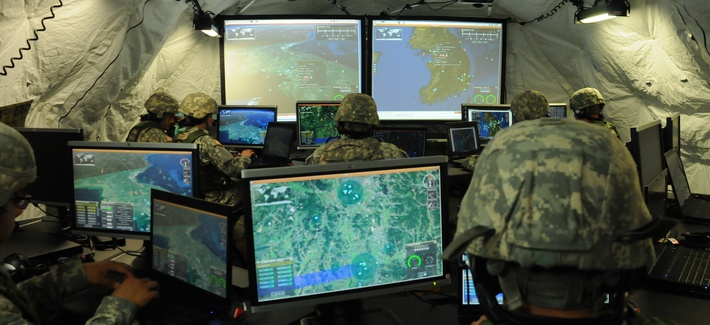

> "The military machine, the Army and all belonging to it, is in fact simple, and appears on this account easy to manage. But let us reflect that no part of it is in one piece, that it is composed entirely of individuals, each of which keeps up its own friction in all directions." -- Karl Von Clausewitz

The historian and military theorist Carl von Clausewitz always felt revulsion that a people's militia, the French revolutionary army, had defeated the armed forces of the German monarchy. That feeling ran so deep that when Napoleon's invasion of Russia came, he opposed the official Prussian position of supporting France and resigned from the army. He then made his way clandestinely to Saint Petersburg to offer his services to Tsar Alexander I, hoping to free Prussia from French domination.

He set down his reflections after the Napoleonic wars in a series of manuscripts, which were published posthumously by his wife after the officer died of cholera at the age of 51.

Of his theory on how to approach the strategy and tactics of war, the elements that stand out most are the concepts of Fog of War and Friction, because of how universal and how current they remain.

## Fog of war

The term coined by Clausewitz refers to the confusion that reigns during an armed conflict. It's a metaphor inspired by the clouds of smoke from cannon and musket fire, and by the dust raised by cavalry charges in the battles of those days, which kept anyone from seeing clearly how the battle was unfolding[^1].

Clausewitz's point is that as the conflict unfolds a great deal of confusion arises from various factors such as delays, confusion, uncertainty, and so on, which makes it hard to coordinate and plan operations.

A large part of the work of modern strategists is minimizing the effects of the fog of war. Today many military processes are supported by technology, but even so it remains hard to master.

## Too much information

Military theorists have tackled the problem of the fog of war by bringing in more information, in a timely way and as efficiently as possible. With the help of information technology they have developed command, control, communications, computers, intelligence, surveillance and reconnaissance (C4ISR) systems, and COP (Common Operating Picture) systems, which give commanders the ability to visualize every aspect of the battlefield in real time, including the enemy.

Even so, it doesn't guarantee the success of war operations. In 2004, during the battle of Fallujah, U.S. Marine and Army units couldn't communicate effectively[^2], as a result, paradoxically, of the excess of communications and of the COP systems used by both services to support the battle [^3].

The need to report up to operational command creates another problem: the platoon leader carries a computer that serves to monitor his unit centrally. This creates an additional difficulty for him, since he has to control his unit and serve the demands of the technology. Since both require his attention, neither gets all of it.

Add to that the fact that commanders have a limited capacity to absorb so much information. Faced with this, the strategy is to deceive the commander, one shrewdly adopted by irregular, or people's, combatants, as Clausewitz would say.

## Friction

The other element Clausewitz identified is the friction of war.

On top of the problem that strategic or tactical decisions are hard to make because of the fog of war, there's the problem that it's hard to get the orders issued carried out properly, thanks to the phenomenon of friction.

Clausewitz says: "Everything in war is very simple, but the simplest thing is difficult. The difficulties accumulate and end by producing a kind of friction." And he goes on to show us that this friction affects opportunity, resulting in effects that can't be determined, since they are produced by chance. Simply, "Friction is the force that makes the apparently easy so difficult." [^4]

Clausewitz identifies eight major sources of "tremendous friction"[^5]:

- insufficient knowledge of the enemy
- rumors (information gained by remote observation or spies)
- uncertainty about one's own strength and position
- the uncertainties that cause friendly troops to tend to exaggerate their own difficulties
- differences between expectations and reality
- the fact that one's own army is never as strong as it appears on paper
- the difficulties in keeping an army supplied
- the tendency to change or abandon well-thought-out plans when confronted with the vivid physical images and perceptions of the battlefield

There's a certain amount of overlap and redundancy in this list, but let's bear in mind that it's a complete and posthumous work.

## Not even the best plans turn out as expected

The important thing is to consider that there are many causes and sources of this phenomenon, and that on the other hand it's impossible to ever know everything, because trying to control everything also generates more friction.

In short, while we recognize the phenomenon of the fog of war and of friction, the important thing is knowing that these phenomena exist and keep the commander from making fully informed decisions, and that his orders won't turn out the way he expects.

This, of course, applies to other leadership scenarios too. It isn't only good for war.

Right now, as a result of the COVID-19 pandemic, we're in a scenario of high uncertainty, with a lot of fog of war.

How did the best commanders do it?

How do irregular forces do it?

If you look at the history, the phenomenon that irritated Clausewitz, and that led him to analyze the strategies of war, is that irregular, or people's, forces can end up being more successful than professional forces with extensive training or even technology.

Just look at the history of the wars the United States has waged from Vietnam to date.

The opponents use simple tactics, without sophisticated coordination. Often they're small cells that resort to guerrilla tactics or urban warfare. Without much communications technology, and with plenty of fanaticism or patriotism, driven by fighting for a cause they consider just, against a superior adversary loaded with technology.

This reminds me of the old argument between the Command and Control management model and agile or lean management.

Management by Command and Control runs into the phenomena Clausewitz identified 200 years ago. And what's worse, it causes more friction, creating a vicious circle.

You can surely identify plenty of sources of friction in your own work. Those are part of the causes of what Lean calls "Waste"[^6]. Identifying them may well be the first step toward improving.

[^1]: Wikipedia: ["Niebla de guerra"](https://es.wikipedia.org/wiki/Niebla_de_guerra)

[^2]: "The Relevance of Clausewitz’s Fog and Friction in a Digital Age Essay", online at <https://ivypanda.com/essays/the-relevance-of-clausewitzs-fog-and-friction-in-a-digital-age/>, accessed April 26, 2020.

[^3]: Matt M. Matthews, "Operation Al Fajr: A Study in Army and Marine Corps Joint Operations". Occasional Paper, (Fort Leavenworth, KS: Combat Studies Institute), 79. Cited in [^2].

[^4]:  Carl Von Clausewitz, C. On War. Ed. by Michael Howard and Peter Paret (Princeton: University Press, 1984). Cited in [^2].

[^5]: Barry D. Watts, "Clausewitzian Friction and Future War", revised edition, PDF online: <https://apps.dtic.mil/dtic/tr/fulltext/u2/a427577.pdf>

[^6]: Curiously, The Lean Way identifies eight sources of Waste, just as Clausewitz identified eight sources of friction: <https://theleanway.net/The-8-Wastes-of-Lean>
