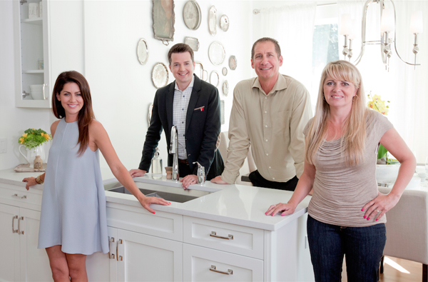

In these days of pandemic, remote work and quarantine, besides changing a number of habits, we've been spending a lot more time with our families. That's the bright side of this whole situation.

One of those shared activities is watching TV. It used to be very rare for us to turn on the TV at home to watch a cable channel, but these days, besides keeping up with the news, we look for a bit of distraction.

Among the most entertaining options are the remodeling and construction shows on Discovery Home & Health, which I'm sure many of you know. The interesting part is that these reality shows hold a few lessons for software development, and today I want to share some thoughts about that.

I'm going to focus on three shows: "Love It or List It Vancouver", "Good Bones", and the most popular one: "Property Brothers".

## The adventures and misadventures of Jill and Todd

"Love It or List It Vancouver" is part of a TV franchise, with several variants set in different cities around the world.



The concept of the show goes like this: a couple has a dilemma about their house, they don't know whether to renovate it or sell it. One member of the couple leans toward selling, while the other would rather remodel because they're attached to the home, with all its memories and affections.

To help them decide, two characters show up, and they are the stars of the show. A real estate agent (Todd Talbot, in this version of the franchise) who is in charge of showing them houses they could buy. The other is an interior designer (Jillian Harris in this case), who will propose the remodeling and improvements they need to take on to add value to their house. The two hosts compete to see who gets their way: the couple stays in their house, or chooses to sell it.

### Requirements analysis

The couple's request is to resolve their dilemma: sell the house or remodel it. The couple doesn't know what to do, but to settle it the show plays a "trick" on them: it forces them to do a remodel, with the incentive that it will raise the value of the house, and with that extra money they can make the decision to sell. So there is really only one decision: to sell or not to sell.

The analogy with a software project would be deciding between modifying an existing system or acquiring a new one. Unlike what they do on the show, we can't make the improvement and then sell our software so we can buy the new one. I've never seen that happen, and it strikes me as an unreal scenario (but you never know).

But we can do something similar: build a proof of concept, or a prototype[^1], to help us decide. The advantage of prototypes and proofs of concept is that they are quick to build and cheap.

What we see on the show is that after introducing us to the couple and their house, the hosts, the real estate agent and the designer, visit the house on their own and get an idea of the problems that brought the couple to this point.

Then the four of them get together and do the **"requirements gathering"**[^2]. The requirements are different, though complementary, for each of the hosts. For the designer it's a list of things to change or repair. For the real estate agent it's a set of features that must be identical to or better than what the house already has, plus a few new desirable ones.

This is important and I want you to notice it, so I'll insist. The requirements lists are different, because each one offers a different solution to the couple's **"focal challenge"**[^3], which we could define as "improving their quality of life and how much they enjoy the house they live in".

Todd's solution, "buy a new house", poses the challenge of finding a house they like enough to leave their current home despite all the emotional ties they may have to it.
Jillian's focal challenge is for the couple to stay in the house after the improvements she is going to make.

### Project execution

With the requirements list clear, the show gets going and the problems start, which creates the dramatic tension of the show.

Todd is a cheerful and very optimistic guy. He looks for houses and shows them to the couple in a friendly, likable way. He's the one who gives the show its fun, comedic side. Sometimes he has a hard time convincing the future buyers, who raise objection after objection, but he deals with it and, through "successive approximations", gets closer to the house the couple is looking for. His main constraint is the purchase budget. But in a way he leans on Jillian's work: he trusts that her work will raise the value of the house, which is all grist for his mill.

Jillian brings the drama. She is the one who runs into the surprises. She keeps an emergency reserve for the unexpected, but it's typical of the show to run into real disasters.



\
Floods, termites, asbestos, faulty wiring or plumbing. There are always incidents, because they start from a house that has already been lived in, and houses need maintenance.
Sometimes the occupants have no idea of the problems their house has. There are also cases where they caused the problems themselves in the past, with incomplete or badly executed renovations.

Jillian has to give them the bad news, and she always gets criticized. All of this is exaggerated, of course; after all, this is a "reality show". But it does reflect a lot of what happens when we decide to do maintenance on our houses.

Here the classic solution to the problems that come up is always the same. When something unexpected happens, they dip into the emergency fund. If that's not enough, they ask the owners for more. If the owners agree, they move ahead with the extra money. If not, then one of the improvements they asked for has to be sacrificed.

This is what we call **"scope reduction"** in project management. If the budget isn't enough, something on the requirements list has to go. The client will complain and be upset, obviously, but this is where Jill's negotiating skill comes in: like a good **"project manager"**, she gets the client to accept this new reality brought on by the unexpected. She usually makes up for the bad moment with some extra improvement, a design touch in the final delivery.

### Delivery

The project has a deadline. If there have been no delays, the four of them meet in the renovated house. Which always looks spectacular.

The show reminds us of what Jill couldn't complete, along with the houses Todd showed the couple, with the pros and cons of each one.

Todd walks up to the couple and shows them the new value their house has reached after Jill's improvements. With that they make their decision, and we find out who won.

I've noticed that couples tend to sell the greater the value added by the repairs. But the truth is that it's not easy to predict the decision they'll make. It's a game I play, though: trying to find some pattern that tells me how they decide.

It's an entertaining show and it has given us some interesting concepts:

- The importance of really understanding our client's focal challenge and needs.
- That we can replicate what Jill does through prototypes or proofs of concept.
- That if we are going to acquire software, we should look at several options and check them against our requirements list. See how close each one gets to satisfying that list with the widest coverage.
- How to manage the surprises that hit our budget by cutting scope.

On to the next show.

## The joy of Good Bones



If anything defines this second show, it's the joy and optimism of Mina and her mother Karen.

It all started with a project by Karen Laine, a lawyer, who founded the company ["Two Chicks and a Hammer"](https://www.2chicksandahammer.com/) together with the daughter from her first marriage, Mina Starsiak, in 2007.

The company specializes in renovating abandoned houses in the Fountain Square and Bates-Hendricks neighborhoods of Indianapolis.

They were discovered by HGTV in 2014, and aired their first pilot in May 2015. That's how "Good Bones" was born, the reality show we know in Latin America as "Las Renovadoras".

The name Good Bones refers to the fact that they look for and buy houses whose structure is solid and will stand up to a good remodel. Sometimes they buy an abandoned house for about 4,500 dollars and can sell it for several hundred thousand after the renovation.

In software we have architecture too, and the "good bones" are the design and layout of the components of our architecture.

Our software shouldn't decay to the point where it has to be retired. Its retirement should be driven by business reasons or technological obsolescence.

The equivalent of what Mina and Karen do is harder to find in software development, but the closest thing is the way startups operate.

Mina and Karen risk their own money, and they take on a project in service of a broader vision: the urban renewal of Indianapolis. Each house is a contribution to that vision, and the money they make is reinvested in the next project.

Another analogy would be paying down "technical debt"[^4].



### Reducing technical debt

We can see each house that Mina and Karen rescue as a component of our architecture that needs to be modified.

But what would the "good bones" be?

It depends on the quality of your design. If it's well modularized, you'll have an easier time. If not, you have a lot of work ahead (like trying to straighten the wall in the picture).

Each module relates to another through an interface, something we call an [API](/blog/lnds/2009/03/20/como-dise%C3%B1ar-una-api/).

These days a lot of people hear API and think of an endpoint using the REST protocol. But the concept of an API is very old; it has been around since at least the 1970s. It took hold in the 1980s with the rise of Object-Oriented Programming and component development.

I remember when, to write applications for Windows 3.11, you had to master the famous Windows API. Over time concepts like OLE and DDE were introduced, which let us model our systems as sets of components. The same thing happened with RPC and later CORBA in other environments. This peaked in the nineties.

Component-based design was seen as the right way to build software.

The beauty of this design is that each component exposes an API, which is used by any other component that wants to access the services it provides. That's where the "good bones" are. If you at least have this separation, you can lean on it to replace the components.

If you're not that lucky, you'll have more work. In that case what you should do is call Todd Talbot and think about buying a new system :smile:.

What can we learn from Good Bones?

- If you work at a startup: the shared vision, and focusing on fulfilling that vision step by step. Just like they are doing with Indianapolis.
- If you have legacy code, look for the "good bones", those elements that hold up your architecture and are worth saving, and lean on them to improve your architecture or reduce technical debt.

## The kings of construction shows



The most popular and successful show in this genre is "Property Brothers", by the Scott twins.

Actually, they run several shows through their production company. By now they own, together with their third brother, a multimedia empire that includes books, videos, web series, several TV shows, events, product lines, and so on.

The twins are very famous in Canada, their home country, and in the United States, and right now they are producing a series about remodels alongside celebrities, whose premiere episode featured Brad Pitt.

Since they produce several shows, each one has a different structure, but let's focus on the most classic of their formats.

Their clients often have a budget far below their expectations. So the brothers take them to visit a house which, of course, has everything the clients dream of. But it's way beyond the money they have.

This exercise isn't cruel; it serves two purposes. The undeclared one is to confirm the requirements list. The second is to show them they have to stick to the budget, and for that the brothers offer an alternative: buy an older, cheaper house, and set aside part of the budget to remodel it.

After visiting several houses they are left with a couple of options. This is where Jonathan shows them animated videos that use virtual reality to show what the houses will look like after the remodel. This is crucial. The visualization is high quality, with great visual impact, and it helps the clients picture how the remodel will turn out and make the decision.

The project begins, and the clients take part in the initial demolition. But that's pretty much all they'll take part in. Here Jonathan keeps an iron grip on the project. He is the one who proposes the design, leads the team and manages the budget. He keeps the clients informed, and he is an excellent negotiator, but he gives very little ground to his clients' whims.

Another very important point is that the remodeling deadline is short, and **it is met**. I've rarely seen them fall behind on a project. That's why Jonathan doesn't allow the clients much involvement in the process: they tend to delay it or drive up costs with their ideas.

In general the remodel focuses on *certain parts of the house*, not all of it. Always the ones that show the most, like the kitchen, the dining room and the living room. The more budget available, the more rooms they can take on, but in general it's rare for them to remodel the whole house.

The closest analogy is what we call a **"Minimum Viable Product"**[^5] (or [MVP](https://en.wikipedia.org/wiki/Minimum_viable_product)).

An MVP is a finished product, but with just enough features to satisfy some customers. It gives us feedback we can use for the future development of the product.

You have to be careful to define the MVP well. And there are several techniques for getting there, like [Lean Inception](https://martinfowler.com/articles/lean-inception/), or [Design Sprint](https://www.gv.com/sprint/), or building a good prototype. These techniques are similar to Jonathan showing his virtual reality videos.

The most important thing when you define an MVP: the client must understand that it isn't everything, but what is viable given the time, the budget, and the business goals we want to address.

### High-performance builders

One of the most important traits of Property Brothers is the quality of the work, the way they meet fairly demanding deadlines, and their efficient use of technology and tools.

The polish of their work is beyond dispute. Someone will say they're actors and everything is done by others, but no: both Drew and Jonathan had fifteen years of experience remodeling houses before the show started, plus technical studies in construction at the Alberta Institute of Technology, and in management at the University of Calgary. Of course they have top-level teams, in both design and construction, who stand out more in other formats of the show (for example, in the series where the brothers compete at remodeling houses).

How you put teams together matters if you want excellent results.

A good team is able to estimate properly. In one episode a client asks them whether something shouldn't be set aside for contingencies; Scott's answer is that the budget always includes a 10% margin for contingencies. The other thing is that a good team meets the deadline it committed to. Not only that, it surprises you with the delivery. Every remodel is even better than the simulations they showed.

That is the mark of high-performance teams.

It comes from experience, commitment, good relationships, humor or a positive attitude, and above all continuous improvement, which requires a constant practice of reflection and self-criticism.

These are the things we should value in the Scott brothers:

- There is an inception process up front, which in the Scott brothers' case consists of visiting a house that has it all but at a higher cost. Then several 3D prototypes are shown, where the clients can decide which option to take.
- Notice that at the start of the show, while they visit the houses, the desired features appear on screen. When the show ends, those same features appear on screen again, indicating that expectations were met. It's the requirements list, which was refined in the inception phase.
- The expert is the one who defines what will be done at the technical level. After the inception phase the clients' visits become fewer and fewer. In fact they only take an active part in the initial demolition phase; after that they are invited in to validate certain decisions. Some clients are more "intrusive", and in that case Scott knows how to distract them with other activities.
- Sometimes the budget is so tight that the Scott brothers turn to the clients directly to do some of the work themselves, which saves money. You can do that in your projects too. Sometimes you can ask your users to help with testing, documentation, and so on.

## Let's get to work

Now that you have a few analogies, you can use them to steer some conversations about how to improve the way you manage software projects. I'm sure that if you watch some of these shows, several more analogies will occur to you. You can use this to change, to improve your process. I also showed you some concepts that are essential in modern software development. It surprises me that several of the techniques I mention in this article are unknown to a lot of people in the industry. It's my hope that presenting them this way will spark the curiosity to apply them.

## Notes

---

- Main illustration taken from unDraw <https://undraw.co/thankful>
- Images and video from the shows taken from Discovery Home & Health Channel, used for teaching purposes under fair use.
- Cartoon about intelligent design taken from Geek & Poke <http://geek-and-poke.com/> under CC-BY-3.0.
- Picture of the wall taken from this tweet: <https://twitter.com/moonpolysoft/status/1263459227697246208?s=20>.

[^1]: A "Proof of Concept" (PoC) is a mini project carried out to test whether an idea can be developed. It's used when exploring a new technology or tool. A "Prototype", on the other hand, is a model with some level of interaction that shows us what the final product will be. It has little graphic design, low resolution and low precision; what we care about here is validating the flows the user will move through, at a very low cost. It is not the final result, and it isn't reused to build the final product. It's nothing more than a mockup and should be made as cheaply as possible.

[^2]: A request (*requerimiento*) is a petition to get something done, and it normally comes from an authority. A requirement (*requisito*), on the other hand, is a quality, circumstance or thing that is required of something. So what we receive from our client is a request that contains a list of requirements. There is a lot of confusion around these terms in IT jargon, especially in Chile, where people mix up *requerimientos* and *requisitos*.

[^3]: If you don't know what a focal challenge is, I invite you to watch this HBR video: <https://www.youtube.com/watch?v=ItzQ7_UwZo4> and then the interpretation of the problem and its focal challenge <https://www.youtube.com/watch?v=x-irzSZezsA> made by our friends at [LeanSight](http://www.leansight.com/).

[^4]: Technical debt is a concept introduced by Ward Cunningham in 1992: <http://c2.com/doc/oopsla92.html>. Javier Garzas gives a good definition: "Technical debt is the cost and the interest you pay for doing things badly. The extra effort you pay to maintain a badly made software product, and everything that comes with it, like the cost of a bad image in front of customers, etc." (<https://www.javiergarzas.com/2012/11/deuda-tecnica-2.html>).

[^5]: A minimum viable product is exactly that, a **viable minimum**. The thing is, the concept is very hard to get across; many clients or users want everything in the first delivery. In my experience it's very difficult to make people understand this concept.
