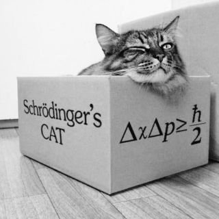

A while ago I ran into this funny post on Twitter, from the Richard Feynman tribute account:



(Meanwhile, inside the box, Schrödinger's cat plots its revenge)

If you've been living under a rock and don't understand why Schrödinger's Cat has become a pop culture meme, let me
explain what it's about.

In a moment of wicked creativity, after a long exchange of letters with Albert Einstein, the Austrian physicist Erwin Schrödinger proposed the famous thought experiment that bears his name.

The concept is this: you build a system consisting of a closed, opaque box, inside of which there is a cat, a bottle of poison gas, and a device containing a particle that could decay at any moment. A sensor is able to detect that decay and open the valve that holds the gas inside the bottle[^1], killing the cat.



The paradox Schrödinger poses is that unless we open the box and look inside, the poor cat is in an indeterminate state; it is neither alive nor dead. We'd say it's in an oscillating state, which physicists call superposition. In other words, we can say that until we open the box the cat is alive and dead at the same time.

Why did Schrödinger come up with this vile experiment? Why earn the hatred of cats, the true masters of this world?

This thought experiment (no, dear reader, as far as I know nobody has set up this nonsense in a lab) was conceived to open the discussion about the paradoxes quantum mechanics poses for our understanding of the world.



## The nature of objective reality

Quantum physicists have proposed several interpretations to get past this paradox, and save the kitty's life.

The *Copenhagen interpretation* tells us that the poor feline's state of health really is unknown until we open the box. At that moment what physicists call *"the collapse of the wave function"* takes place, and only then can we know whether the kitty survives such a cruel experience. This interpretation says it's the observer who modifies the state of the system, by the simple act of measuring that state. And this is irreversible and unavoidable every time we observe a physical phenomenon. Reality, then, is always fluctuating; the world beyond our senses is blurry, fuzzy; there is no way of knowing reality, and worst of all, when we make an observation we alter it. The bad part is that we can't control the effect of the observation.

The other interpretation is "many worlds", proposed by Hugh Everett in 1957. In one world the cat is dead, in the other it's alive, and when we make an observation it's as if our reality forked: we enter one world or the other. We don't notice, and each universe lives next to the other; "quantum decoherence" keeps us from observing all these worlds.

Some argue that the collapse of the wave function is real, objective, that it actually happens, that it isn't just an ad hoc hypothesis as the Copenhagen interpretation has it. That is, there is an objective reality out there, even if we don't observe it. In this view there are no branches opening up, no parallel universes. The cat is objectively dead or alive; it doesn't depend on what we observe. The limitation lies in our ability to observe that reality.

There is a relational interpretation, which says the changes depend on the relationships between the observer and the system. For the cat the wave function has already collapsed, but for an outside observer the system is in a state of superposition; only when the box is opened do the observer and the cat share the same information.

And so there are many ways to speculate about this phenomenon. That's another of Schrödinger's cruelties: handing us a problem we didn't know we had.

All this has given rise to all kinds of speculation: scientific, philosophical and, of course, pseudoscientific. Like the idea that we can alter reality with the power of our thoughts.

## What if humans are quantum computers?

The English mathematical physicist Roger Penrose has put forward controversial ideas, combining concepts from quantum theory and Gödel's famous theorem[^2].

In essence, Gödel proved that there are statements the human mind is able to understand as true, even though it's not possible to build formal proofs to validate them. The consequences of this incompleteness of formal systems (like logic or mathematics) are interesting, and I've written about this before, for example about its impact on entrepreneurship: <https://lnds.net/blog/lnds/2016/08/30/toda-empresa-es-de-software-o-lo-sera/>

Penrose is an advocate of the "Orchestrated Objective Reduction" hypothesis, and relies on a model which holds that consciousness originates at a deep level of quantum activity inside our neurons.

In essence, Penrose's ideas propose that our neurons work like qubits and that we human beings would be quantum computers, whose behavior, what we call consciousness, is orchestrated by what Penrose and Stuart Hameroff call microtubules.

Orchestration is a process by which proteins associated with the microtubules influence, or orchestrate, the reduction states of the qubits. This separates the superposed states and our mind gets a view of objective reality.

On the other hand, the Penrose-Lucas argument[^3] states that, since we humans are able to know the truth of Gödel's unprovable statements, human thought is not computable, at least not in the sense of the computers we have known and loved since the ideas of Turing and Von Neumann.

If the Penrose-Lucas argument is true, we would have to find the mechanism that explains this advantage of our mind over any computer built on formal systems.

However, it is accepted today that most of the laws of physics are computable (that is, algorithmic), as [I've told you on another occasion](http://lnds.net/blog/lnds/2012/05/18/todo-es-software/)[^4].

And here comes Penrose's clever move: for the physicist, the "collapse of the wave function" is a non-computable process.

In quantum mechanics the behavior of particles is described by "wave functions", which evolve according to the... drum roll... "Schrödinger equation". Non-stationary wave functions are linear combinations of the states of a system, which is known as "quantum superposition". When a quantum system interacts with a classical system, what's called "measuring an observable" takes place, and the system appears to "collapse" to a random state of that observable from a classical point of view[^5].

All these theories of Penrose and Hameroff have drawn a range of criticism, and so far they have defended themselves against each one. But the theories remain controversial, and hard to prove.

The theory rests on finding the right substrate to support Penrose's ideas, and that would be the microtubules. The cytoskeleton of neurons contains certain structures that could be the right candidates for carrying out the quantum processing Penrose's theories require.

In the 1990s Roger Penrose wrote a very interesting book called "The Emperor's New Mind". Besides being a brilliant work of popular science, it is also a critique of the possibility of creating a true Artificial Intelligence.



The central argument of that book is that it's not possible to create a real artificial intelligence, because we human beings have a capacity more powerful than what is possible with computable systems. It's the argument based on Gödel's theorem that I laid out above.

The solution Penrose proposes is that the human mind has these capacities thanks to capacities given to it by quantum mechanics, which is able to solve non-computable problems. But the physicist had no way of explaining where in our bodies these quantum computations could take place.

After reading the book, and because of his research work on neurons, Hameroff approached Penrose and they began a collaboration that has gone on for many years now, in search of that substrate that would explain Penrose's theory.

There are many criticisms of Penrose's approach, starting with his use of Gödel's theorem, which seems arbitrary, all the way to some better-founded criticisms from the world of biology.

Be that as it may, Penrose's ideas are still interesting, and it should be noted that some experiments show quantum entanglement effects in neurons, or computing capabilities at that level in our brain.

Who knows.

Maybe the answer to quantum computing is in our brains, or in the brains of cats, or maybe not.



[^1]: This was written in 1935, just a few years before the horrors of the gas chambers used for the mass killing of Jews in concentration camps during World War II. A paradoxical coincidence, considering that Schrödinger fled Germany in 1933 to avoid the Nazi persecution that was already under way.

[^2]: I gave a very brief description of Gödel's theorem in this article: <https://lnds.net/blog/lnds/2010/11/09/la-paradoja-de-pinocho-y-el-origen-de-la-computacion/>

[^3]: It's called that because both Roger Penrose and the philosopher John Lucas have put forward this argument for the superiority of the mind over formal (or computable) systems.

[^4]: See Chaitin's argument in this article: <http://lnds.net/blog/lnds/2012/05/18/todo-es-software/>.

[^5]: Strictly speaking, what I call a state is called an eigenstate, and observables are functions, for those of you with some advanced mathematical training. All of this is complicated, I know.
