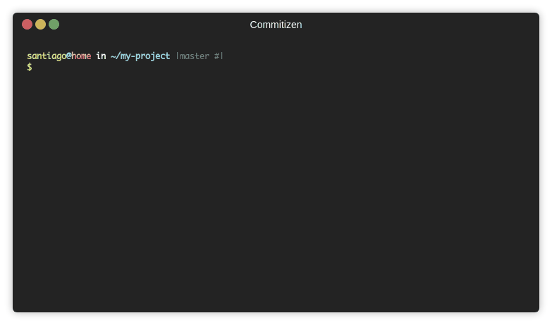

Keeping communication flowing is one of the biggest challenges when we work on a team, or on an open source project. One thing that helps is maintaining a set of standards, or common practices, that make communication and shared understanding easier.

For years now, open source communities have adopted a set of very simple but powerful practices that help them manage their code better.

Among these there are a few that I think every kind of development team should adopt.

## ReadMe first

In his article ["Readme Driven Development"](https://tom.preston-werner.com/2010/08/23/readme-driven-development.html), Tom Preston-Werner warns us:

> "A perfect implementation of the wrong specification is worthless. By the same principle a beautifully crafted library with no documentation is also damn near worthless. If your software solves the wrong problem or nobody can figure out how to use it, there’s something very bad going on."

The solution proposed by the GitHub founder is simple. Before we start our work we should write a document, called README.

In this document we specify what is going to be built. It's a description of the project and of its implementation in code. It usually describes the public interfaces and how to use them. Along with other considerations, like how to install the software, the steps to run it, and so on.

This file is normally written in [markdown](https://en.wikipedia.org/wiki/Markdown) format, which is supported by the most popular code hosting services, like GitHub or GitLab.

But why write this file before starting to code?
The GitHub founder explains the advantages of doing so:

> By writing your Readme first you give yourself some pretty significant advantages:
>
> - Most importantly, you’re giving yourself a chance to think through the project without the overhead of having to change code every time you change your mind about how something should be organized or what should be included in the Public API. Remember that feeling when you first started writing automated code tests and realized that you caught all kinds of errors that would have otherwise snuck into your codebase? That’s the exact same feeling you’ll have if you write the Readme for your project before you write the actual code.
> - As a byproduct of writing a Readme in order to know what you need to implement, you’ll have a very nice piece of documentation sitting in front of you. You’ll also find that it’s much easier to write this document at the beginning of the project when your excitement and motivation are at their highest. Retroactively writing a Readme is an absolute drag, and you’re sure to miss all kinds of important details when you do so.
> - If you’re working with a team of developers you get even more mileage out of your Readme. If everyone else on the team has access to this information before you’ve completed the project, then they can confidently start work on other projects that will interface with your code. Without any sort of defined interface, you have to code in serial or face reimplementing large portions of code.
> - It’s a lot simpler to have a discussion based on something written down. It’s easy to talk endlessly and in circles about a problem if nothing is ever put to text. The simple act of writing down a proposed solution means everyone has a concrete idea that can be argued about and iterated upon.

And that's the key. When we work as a team it matters to have a shared vision, and one of the best ways to get it is by sharing a document that we can discuss. Arguing at length while drawing circles in the air with your hands does not count as a shared vision.

Some teams write more formal documents. There are even document-driven methodologies. That last one strikes me as a bit extreme. But I do think it's important to sit down and think before building, and capturing that thinking in writing helps. Your future self will thank you.

## Keep a changelog

The changelog is a file that describes all the important changes in a project.
There is a project that describes a standard way of keeping a changelog: [Keep a Changelog](https://keepachangelog.com/en/1.0.0/)[^1].

The idea is very simple: you keep a file called `CHANGELOG.md`, which is a plain [markdown](https://en.wikipedia.org/wiki/Markdown) file
that contains all the changes worth noting, described in sequential order.

This is a fragment of a typical `CHANGELOG.md` file

    # Changelog
    All notable changes to this project will be documented in this file.

    The format is based on [Keep a Changelog](https://keepachangelog.com/en/1.0.0/),
    and this project adheres to [Semantic Versioning](https://semver.org/spec/v2.0.0.html).

    ## [Unreleased]

    ## [1.0.0] - 2017-06-20
    ### Added
    - New visual identity by [@tylerfortune8](https://github.com/tylerfortune8).
    - Version navigation.
    - Links to latest released version in previous versions.
    - "Why keep a changelog?" section.
    - "Who needs a changelog?" section.
    - "How do I make a changelog?" section.
    - "Frequently Asked Questions" section.

All the details on how to manage this file are described on the [Keep a Changelog](https://keepachangelog.com/en/1.0.0/) site,
so reading it is recommended to be clear on how to write this file.

But you'll notice that the file marks versions with a certain notation. It's Semantic Versioning, which is another practice I'm going to recommend.

## Semantic versioning

Semantic versioning is a convention for numbering the versions of our software.
Its definition is maintained on the [SemVer.org](https://semver.org) site. And in principle it's very simple.

In SemVer we use three numbers to designate a new version, and these numbers are separated by a dot, so the format looks something like this:

    1.0.1

We call the first number MAJOR, the second MINOR, and the third PATCH. So the format is:

    MAJOR.MINOR.PATCH

- MAJOR: incremented when you add a change that is incompatible with previous versions.
- MINOR: incremented when you add functionality that remains compatible with previous versions.
- PATCH: incremented when you fix bugs in the current version.

In the previous example, `1.0.1`, we can tell that it corresponds to version 1.0 of the product; however, it carries one or more bug fixes.

There are of course several details about how to manage versions, but the guide on the site is quite complete, and it's available in Spanish too: <https://semver.org/lang/es/>

## Conventional commits

[Conventional Commits](https://www.conventionalcommits.org/) is a way of writing the message in a structured form every time we make a commit in Git.

A conventional commit looks like this:

    <type>[optional scope]: <description>

    [optional body]

    [optional footer]

The `<type>` can be at least one of these:

- fix: where we document a fix
- feat: where we introduce new features to the software
- BREAKING CHANGE: a change that breaks backward compatibility (and therefore should affect the MAJOR value).

There are other possible types: chore, docs, style, refactor, perf, test and more, which are described on the official Conventional Commits site.

An example of a conventional commit[^2]:

    fix(core): fix some typos in class names

    See issue #45 for more details

    Closes #45

## Automating all of the above

There are tools that let you tie semantic commits together with CHANGELOG.md and SemVer.

A list is given on the Semantic Commits site: <https://www.conventionalcommits.org/en/about/#tooling-for-conventional-commits>

The idea is that by using conventional commits you help these tools work out the next version number
you should generate for your next release.

These tools also keep the CHANGELOG.md file up to date.

My favorite is one called commitizen. There are two implementations, one for node: <https://github.com/commitizen/cz-cli>, and another for python: <https://github.com/commitizen-tools/commitizen>.

Once you install it and configure it properly, the tool helps you write your commits, and then keep
your version number and CHANGELOG.md up to date

## One last tip

I always recommend publishing the version number in the "frontend" of your applications.
Sometimes you can create an "about" page that lists all the modules and APIs used, get the "release number" of each one (using SemVer) and show it on screen.

This practice helps a lot when you need to verify which version is installed in production, and to clear up and resolve failures quickly.

Automating versioning is easy with something like commitizen, but you can also have your continuous integration tool pick up that information and make it available in the next `build` of your application.

[^1]: It's available in several languages; this is the link to the documentation in Spanish: <https://keepachangelog.com/es-ES/1.0.0/>

[^2]: Here I've included the line `Closes #45`, which is very handy if you use [GitHub issues](https://guides.github.com/features/issues/)
