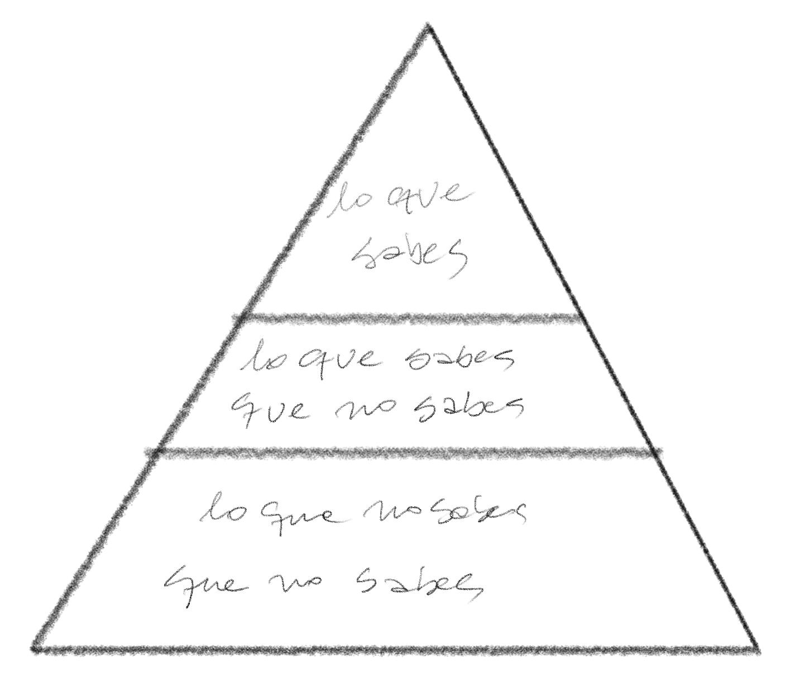
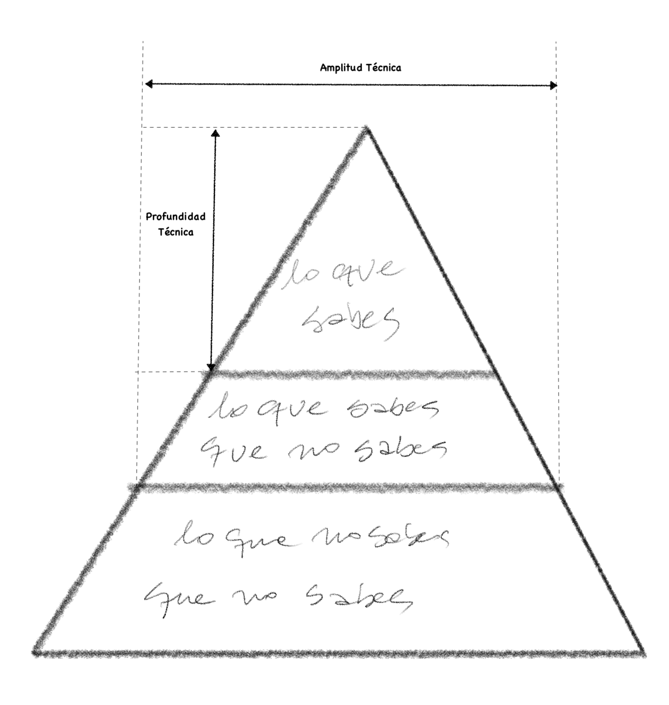

> As we know, There are known knowns.\
> There are things we know we know.\
> We also know\
> There are known unknowns.\
> That is to say\
> We know there are some things\
> We do not know.\
> But there are also unknown unknowns,\
> The ones we don\'t know\
> We don\'t know.
>
> -- [Donald Rumsfeld](http://www.slate.com/id/2081042/)

I don't know if there was ever some glorious era when it was possible to know everything about computing. Maybe a few noble founding fathers of our discipline, like Turing or von Neumann, had that privilege, but even then I doubt it.

In his 1972 Turing Award lecture, Dijkstra writes:

> "We shall do a much better programming job, provided that we approach the task with a full appreciation of its tremendous difficulty, provided that we stick to modest and elegant programming languages, provided that we respect the intrinsic limitations of the human mind and approach the task as *Very Humble Programmers*"[^1].

# The knowledge pyramid

Imagine that all the technical knowledge in the world could be piled up in the following pyramid:

As individuals we can follow Rumsfeld's advice and sort our knowledge into three categories:

- **Things you know**: the technologies, frameworks, languages and tools you use in your day-to-day work. For example, Python or JavaScript, languages you probably use and know very well. Maybe [Django](https://www.djangoproject.com) or [React](https://reactjs.org).
- **Things you know you don't know**: the technologies you've heard of but have little or no experience with. For example, you may have heard of [Clojure](https://clojure.org) or [Elm](https://elm-lang.org), but you've never programmed in those languages. Perhaps [Yew](https://yew.rs/docs/en/) or [Hoplon](https://hoplon.io).
- **Things we don't know we don't know**: the widest part of the pyramid, which holds all those technologies, frameworks and languages that could be the perfect solution to the problem you're trying to solve, except that, unfortunately, you don't know they exist.

But rather than driving us to despair, this concept helps us size up our ignorance, and therefore guide our efforts and even the development of our professional career.

When we start out we work our way through the tip of this pyramid, deepening our technical knowledge and, along the way, catching glimpses of everything we still have to tackle. We build up experience and skill. However, this tip of the pyramid doesn't just become the things you know and have mastered; it is also all the knowledge you have to keep fresh. Because "nothing is static in the software world"[^2].

That takes us to the next diagram, which describes our breadth and depth of knowledge:

## Knowledge by role

If we are **software developers** our goal, as programmers, is to increase the depth of our knowledge. But if you are a **software architect** you'll notice that you focus more and more on having a greater breadth of knowledge, without necessarily gaining technical depth.

The reason is that the software architect has to make decisions that take on board the technical capabilities and limitations of the resources at hand, in order to satisfy the new needs the business demands. In that sense, a breadth of knowledge about the variety of possible solutions is valuable, even if it means a sacrifice in the degree of skill (or expertise) you gain on any specific topic.

Many developers struggle when they migrate to the architect role. Because while as an architect your vision widens, in terms of the range of solutions you can propose, you fail when you try to achieve mastery of every one of the technologies you propose.

An architect can't be an expert in every technology, and so has to accept being ignorant of the deep detail. That's why the architect keeps a supporting role alongside the people who actually become specialists in each area (the development team). The modern architect doesn't detach completely from the development process, but isn't an essential part of the construction either, though they get a lot of feedback from their programmer colleagues.

## Full stack?

On the other hand, this pyramid helps us settle a dilemma that comes up again and again: what is a full stack developer?

As I said at the beginning of this article, I don't think there was ever a moment when someone held all the technical knowledge about computing. That is, I don't think the level of breadth and depth ever got to be total. Although the pyramid was surely smaller in other times.

But let's take a closer look at what a "full stack developer" would be.

First we'd have to define what the stack is. Does it mean the technology stack? Or does it mean the layers of the architecture? In the latter case, it alludes to technical knowledge from the persistence layer all the way to the front end. In the former, there are as many technology stacks as there are software solutions.
So the concept is muddled.

It's also used to describe a developer who knows about everything.
But as we've seen, it's impossible to know about everything. Either your knowledge is very broad but shallow, or very deep but narrow, because you don't have enough time to explore the pyramid of technical knowledge with all the dedication a position like that would require.
In other words, a Full Stack would have to be someone who has mastered the entire knowledge pyramid, which strikes me as impossible.

You could be full stack in one specific technology stack, like LAMP, or a framework like Ruby on Rails or Django. Or you can master SQL, Java, JavaScript, HTML and CSS and build a complete web application using servlets. But these days you'd be considered a dinosaur for doing that.

On the other hand, it's very hard to master every technology or keep up with the latest in reactive front-end frameworks. I'm not saying you couldn't get to know them, but master them? Impossible.

For example, I have general knowledge that goes from designing with microprocessors to operating a Kubernetes cluster, or from building a [CPU using only NAND gates](https://www.programando.org/blog/2013/06/01/desafio-junio-codigo-de-maquina/) to configuring a cloud native application using the [twelve-factor](https://12factor.net/) methodology. And even so I couldn't call myself a full stack developer, because while my knowledge is broad, it isn't that deep. On the other hand, this broad knowledge comes from the simple fact that I've spent many years programming and studying all sorts of technologies, since I've devoted my professional life to architecture more than to software development, and I'm pretty old by now. That saying about the devil knowing more from being old than from being the devil is very true. Even so I keep learning, and I have no idea how much of that pyramid I've covered (that's the terrible paradox of the "unknown unknowns").

If we drew this another way, we'd get a big T, where the horizontal bar shows our breadth of knowledge and the vertical one our level of specialization.
Each of us has traveled this pyramid differently over a career, forming our own T, like tunnels bored into a great mountain of knowledge.

I say the Full Stack developer doesn't exist. What exists are engineers and architects who travel this great mountain or pyramid of technical knowledge, from the surface down to the depths of our ignorance. Or as Sting would say, with a certain resonance with Dijkstra, we are humble miners and therefore, "We work the black seam together..."



Have a great new year...

[^1]: "The Humble Programmer", 1972 Turing Award Lecture, Edsger W. Dijkstra, EWD340 <https://www.cs.utexas.edu/~EWD/transcriptions/EWD03xx/EWD340.html>
[^2]: "Fundamentals of Software Architecture: An Engineering Approach", Mark Richards & Neal Ford, chapter 2, on which much of this article is based.
