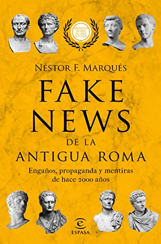
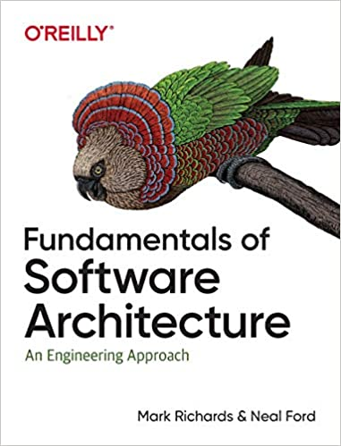
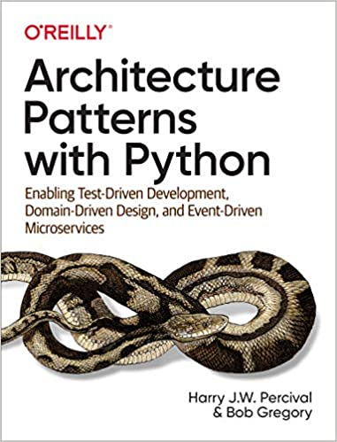
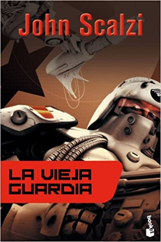
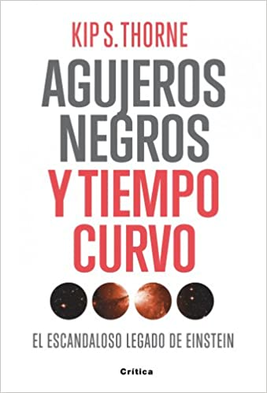
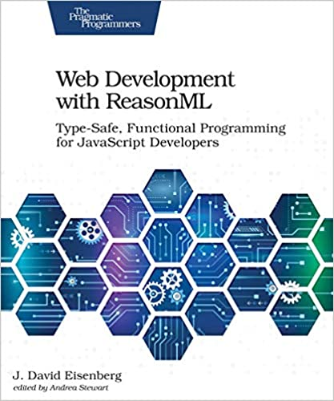

Reading is very important to me. I read a lot, and about all sorts of things. Like many readers, I also buy books that end up sitting there gathering dust, or taking up space on my Kindle. For years I've used [Good Reads](https://www.goodreads.com) to keep track of the books I read, and I rate them while I'm at it, but I'm terrible at writing reviews of them, which I should do, since that's the whole idea of the app, which also works as a social network.

On the other hand, I want to keep up the discipline of writing, and reviews are good exercise. So I'll kill two birds with one stone: I'll write the reviews here, for those who don't have access to [Good Reads](https://www.goodreads.com), and then try to copy them over there. This also gives me a memory aid for these books, and maybe it can be useful to anyone looking for something to read.

So I'm starting a new section on this blog with a monthly post, where I'll include the books I read during the period. Since January is already gone, this time I'll include January and February.

# January 2021

- ["Skyward"](https://amzn.to/37W4Zf4), by Brandon Sanderson ("Escuadrón" in the Spanish edition), military science fiction. A light, entertaining piece. It follows the classic template of the subgenre. Humans are confined to a planet and barely surviving. But they have to defend themselves from aliens who bomb the planet at regular intervals. The protagonist, Spensa, is a teenage girl, the daughter of a pilot who was shot down by his own comrades. She carries the stigma of being a coward's daughter, and because of it she's denied the chance to enter flight school, which is what she wants at any cost. Of course she overcomes those obstacles and gets into the academy, has a rough time of it, but discovers something very special and ends up saving the day at the end of the day. Sanderson writes very well; he's an author famous for his fantasy sagas and for creating the Cosmere universe. This book has a lot of nods to Robert Heinlein and a few to Orson Scott Card. It's fun, fast, light, but he's not at his best here. Still, it manages to hook you at the end with a good cliffhanger so you'll read the sequel.

- ["Starsight"](https://amzn.to/3szfAEo), by Brandon Sanderson ("Estelar" in the Spanish edition), the sequel to Skyward. Here we leave the world of the previous novel and the protagonist spies on the aliens who keep humans subjugated on the planet Detritus. We come to understand why the rest of the universe fears humans, and other mysteries turn up. The protagonist, with help from some very peculiar characters, solves these mysteries and fights to stop this war. She almost pulls it off, but once again we get a good hook for the third part of the saga, which unfortunately isn't out yet. It's better than the first part, even though it repeats the space academy template, and it shows great imagination in the conception of some of the alien races. So I'm left waiting for the third part, which comes out this year. (Sanderson keeps his fans up to date on his projects on his website: <https://www.brandonsanderson.com>, which is appreciated.)

- ["Fake news de la antigua Roma: Engaños, propaganda y mentiras de hace 2000 años"](https://amzn.to/3r0xboB) (Fake news from ancient Rome: deceptions, propaganda and lies from 2,000 years ago), Nestor F. Marqués González. Ancient history. I got to this book through a Twitter thread. I was expecting something lighter, but the author's academic style shows; he insists on including long paragraphs in Latin (with their translation, of course). Even so, it adds value by questioning and clearing up several things about the Romans or their emperors that aren't true, but rather the fruit of later misunderstandings, or outright fake news created by their enemies (like the Christians). Highlights include the account of Nero's real role in the fire of Rome, the true story of Constantine's conversion, and some interesting facts about Augustus and Caesar. It also explains how the myths about the origin of Rome served imperial political propaganda. He criticizes several authors, above all Robert Graves, whose books about Claudius are left in doubt after this one. For the ancient history buff, the book may be useful for revisiting some facts. In that sense it can be refreshing and it supports critical thinking. But I would have liked a somewhat lighter presentation. I think that unless you're a Roman history geek, like me, you're unlikely to finish this book.

- ["Fundamentals of Software Architecture: An Engineering Approach"](https://amzn.to/3r4X86c), Mark Richards. A very good guide for those who want to learn what the discipline of software architecture is about, and a good refresher and update for those of us who have been practicing it more or less unofficially. For me it was a much-needed refresh, and I recommend it because it gives good guidance on a series of modern techniques, patterns and methods for designing information systems. Very useful.

- ["Architecture Patterns with Python"](https://amzn.to/3bIOdAZ), Harry J.W. Percival & Bob Gregory. A good book, but it doesn't fully satisfy me. I think it's a good complement to "Microservices Patterns" by Chris Richardson (which I read last year), but focused on bringing those patterns to Python, mainly Flask. Super technical, with code examples, it's a good guide, but I don't feel it gave me anything new, except for understanding how to apply certain things from Java to Python, which will be very useful in my current job. By the way, one of the things I like about my new job is that we have full access to these O'Reilly books in digital form, which I intend to make very good use of.

# February 2021

- ["Old Man's War"](https://amzn.to/3bOygZY), John Scalzi. Military science fiction, again. But with a twist. Here the soldiers are recruited from among Earth's over-75s, to be part of the Colonial Defense Forces. It's the first in a famous Scalzi saga. From this author I had previously read Redshirts, a novel that parodies Star Trek, highly recommended (though not as funny as advertised). But I liked this novel, much more than Skyward. So the ones that follow are in my book queue. The author has a very dynamic style, and I'm sure these novels will end up as a movie or TV series on Netflix or Amazon.

- ["Black Holes and Time Warps: Einstein's Outrageous Legacy"](https://amzn.to/3dQL4lt), Kip S. Thorne. This scientist came to public attention a few years ago for advising Christopher Nolan on the film Interstellar. Thorne has the Nobel Prize for his contribution to building the LIGO gravitational wave detector. The book is from 1994, so back then LIGO was a project in its early stages and the first photograph of a black hole was more than 20 years away, but it's quite entertaining. I skipped several of the more technical sections and deep dives; it so happens that in my student days I had to read Stephen Hawking's "A Brief History of Time" to scrape through the modern physics course, so this book doesn't give me anything especially new on these topics, and it's not like I was going to understand them anyway :p. I was more interested in the anecdotes and the small history, like Eddington's snub of Chandrasekhar (was there some racism in it?), the curious bets between Thorne and Hawking, or the adventures with the Russian scientists in the middle of the Cold War. Curious that the LIGO project, although it gets a mention, doesn't stand out much in this book, given that it's what he ended up getting the Nobel for. I got to this book through [this recommendation](https://www.youtube.com/watch?v=NT3BqfQd7cU) from the scientist and YouTuber Javier Santaolalla. The book is good, but I'd like to read something more modern on the subject, in particular about the story behind the famous 2019 photograph, so if any reader of this post has a tip, I'll be grateful.

- ["Web Development with ReasonML: Type-Safe, Functional Programming for JavaScript Developers"](https://amzn.to/3uGeVTt), J. David Eisenberg. I had a hard time finishing this book; I started it last year and only finished it this year. It's dense, and although OCaml is a beautiful programming language, I have to admit that front-end programming isn't what attracts me most. Neither does this book's approach, which is boring as a manual, and really that's what it is, a detailed manual. Non-nerds will ask what could possibly be entertaining about a book on a programming language, but it can be done. There are remarkable books like Kernighan's or "Learn You a Haskell". I don't recommend it, although I do recommend looking into ReasonML.

And that's the first list. At the end of March we'll add more books read, with their brief reviews. If you have reading recommendations, they're welcome.

While I'm at it, let me tell you that I'm writing a new technical book, and you can already start reading it, because it's a series I'm publishing on my blog ["La Sombra de Dijkstra"](https://www.programando.org) (in Spanish). It's called ["El Camino del Backend Developer"](https://www.programando.org/category/backend-developer/) (The Way of the Backend Developer), and I invite you to read it.

