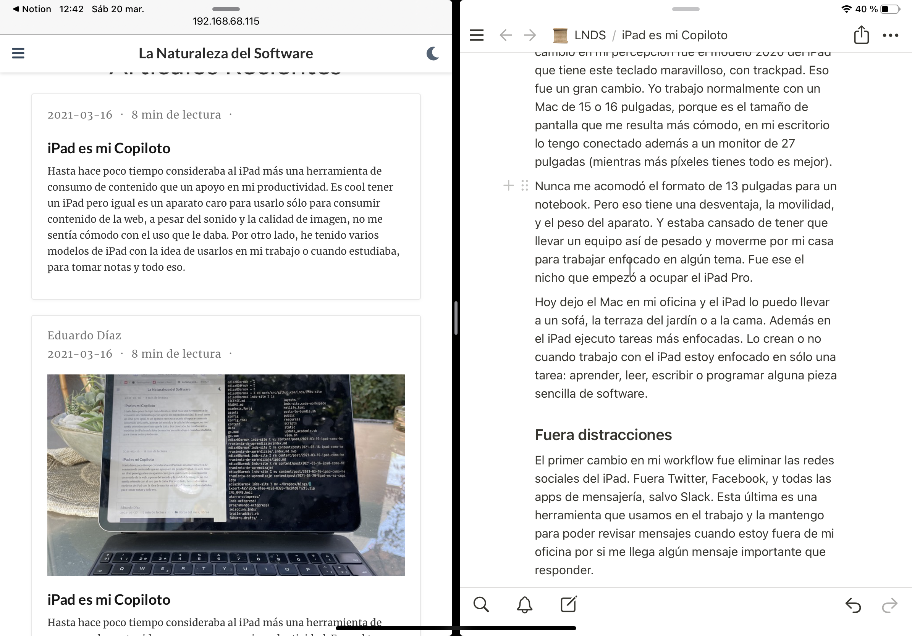
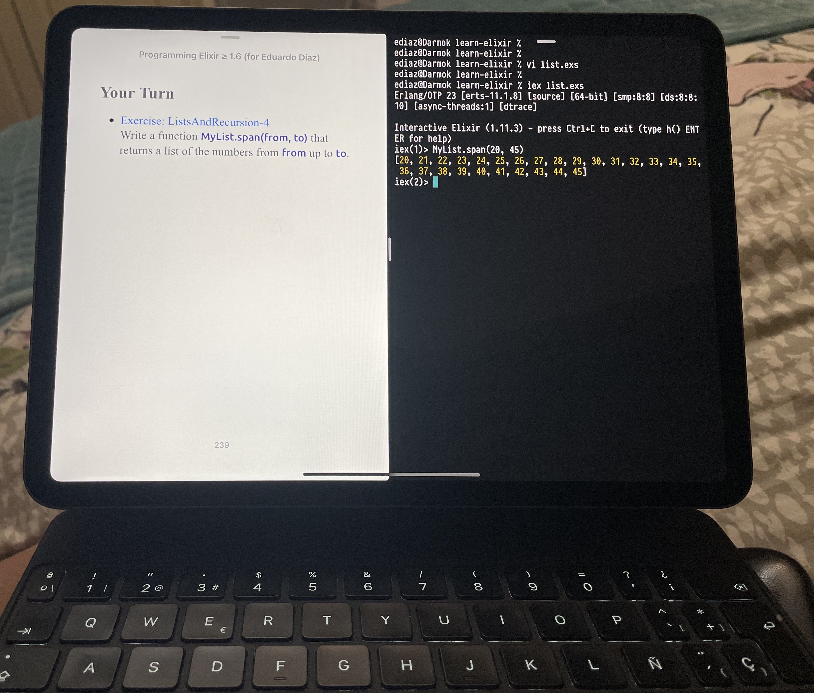
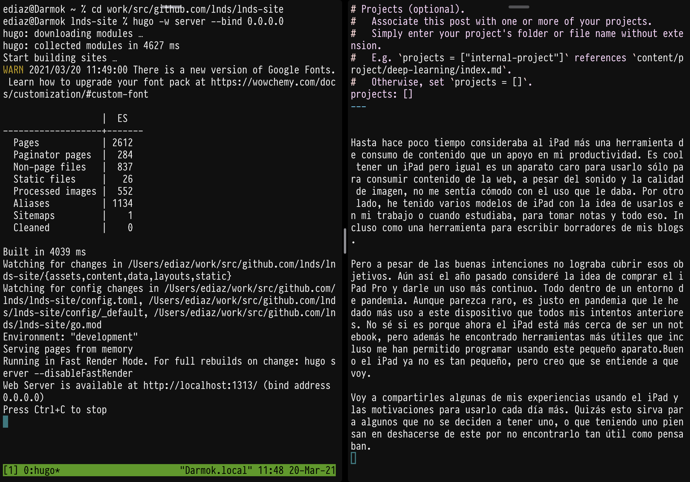
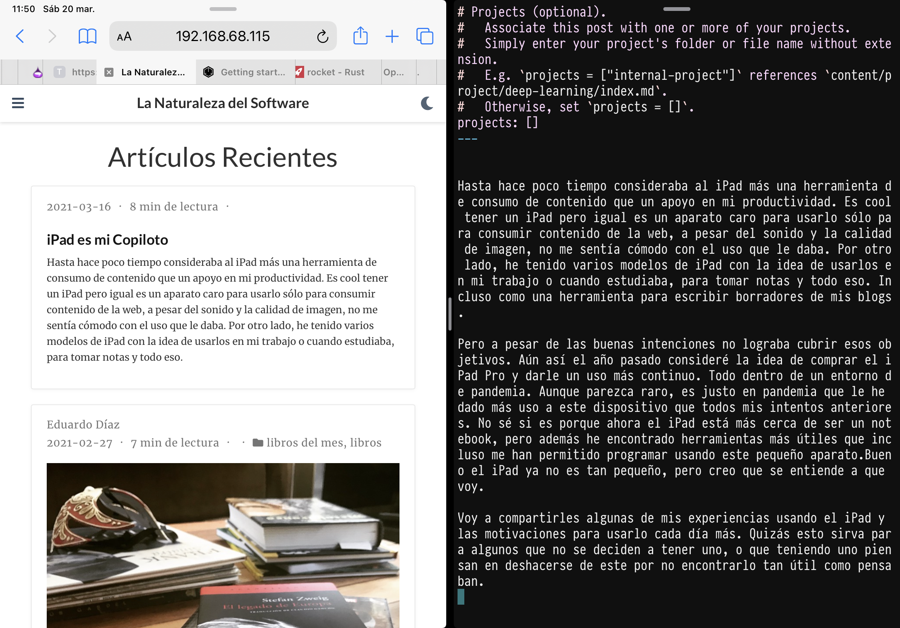

Until recently I thought of the iPad as a tool for consuming content more than as something that helped my productivity. It's cool to own an iPad, but it's still an expensive gadget to use only for consuming content from the web. Despite the sound and the image quality, I wasn't comfortable with the use I was giving it. On the other hand, I've owned a few earlier iPad models with the idea of using them at work or when I was studying, to take notes and all that. Even as a tool for drafting my blog posts.

But despite the good intentions, I never managed to meet those goals. Even so, last year I considered the idea of buying the iPad Pro and putting it to more continuous use. All of this in the middle of a pandemic.

Strange as it may seem, it's precisely during the pandemic that I've used this device more than in all my previous attempts. I don't know if it's because the iPad is now closer to being a laptop, but I've also found more useful tools, which have even let me program on this little gadget. Well, the iPad isn't that little anymore, but I think you get what I mean.

I'm going to share some of my experiences using the iPad and my reasons for using it more every day. Maybe this will help those who can't make up their minds about getting one, or who have one and are thinking of getting rid of it because it's not as useful as they thought.

One of the first reasons for this change in my perception was the 2020 iPad model, which has this wonderful keyboard, with a trackpad. That was a big change. I normally work on a 15 or 16 inch Mac, because that's the screen size I find most comfortable, and on my desk I also have it hooked up to a 27 inch monitor (because the more pixels you have, the better everything is).

The 13 inch format for a laptop never suited me. But that format has one advantage: mobility, and the weight of the machine. And I was tired of lugging around something that heavy to move around my house and work focused on some topic. That was the niche the iPad Pro started to fill.

Today I leave the Mac in my office, and the iPad I can take to a sofa, the garden terrace or bed. Besides, on the iPad I do more focused tasks.

## Distractions out

The first change in my workflow was removing social media from the iPad. Out went Twitter, Facebook and all the messaging apps, except Slack. That last one is a tool we use at work, and I keep it so I can check whether some important message has come in that I need to answer.

I didn't remove Netflix or YouTube, or other streaming apps, because the iPad has a spectacular screen and speakers and sometimes I watch content on it, and because I still keep that function for unwinding in my free time. I don't have games either. Most of the installed software is productivity tools.

## Focus

On the iPad you only have one active app at a time, and while there is multitasking, it isn't practical beyond having two apps visible in split screen. And that's not a bad thing. On the contrary, it's the secret that lets you use the iPad as a tool for focusing on one task.

What do I do on the iPad?

- Write, ideas and notes both for work and for my blogs
- Research, browsing the internet or going through books
- Read and study, books or blogs, learning about new technologies or trends
- Program, remotely accessing my computers[^1] or some server in the cloud.

## Tools I use

### Notes

For taking notes I use the Apple app that comes preinstalled, and [Notion](https://www.notion.so/). That one is a tool we use a lot at work, but it's very good for organizing your ideas, and above all for organizing research or preparing posts for my blog (like this one).

Apple's preinstalled tool lets you draw and has a mechanism that corrects geometric shapes, which is very useful for someone who draws as badly as I do. Since I teach, a couple of times I've used the option Zoom gives you to connect the iPad and use it as if it were a whiteboard in remote classes.

### Reading

Apart from the Kindle app and Apple's Books, I use a very handy tool to improve my reading experience. It's [ReadWise](https://readwise.io[]), which lets you organize your notes or the passages you highlight on your Kindle or in the reading apps. I also have the O'Reilly app installed, since I now have access to their online service thanks to my job.

### Programming and learning new technologies

This is the most interesting part. I've used the iPad to learn new languages, frameworks and technologies. A typical workflow is to split the screen as I show in the image. On the left side I have the book or web page I'm studying, and on the right side I open the Blink app.

[Blink](https://blink.sh) is a shell, terminal and ssh client that lets us reach any server. I keep my computers open so that I can get to them via SSH or MOSH. Since I'm at home I prefer SSH, because the latency is negligible and it keeps things simple. For remote servers I sometimes install [MOSH](https://mosh.org).

What's MOSH?

It's a protocol that improves the remote connection experience over what SSH gives you. I'll leave you a video that introduces this protocol, and I recommend it if you move around a lot with your iPad or if you want to access remote servers. This video explains what it's about:



When I use Blink, on the host I connect to I have VIM and TMUX, tools that let you work remotely in peace. I've learned to appreciate VIM all over again, which as you know [is one of my favorite editors](https://lnds.net/blog/lnds/2012/04/05/el-mejor-editor-de-texto-de-todo-el-mundo-mundial/).

Another utility I use is [Mocha WOL](https://apps.apple.com/es/app/mocha-wol/id422625778), a simple app for "waking up" a computer when it's idle.

If you use macOS you have to enable remote access on those machines and make sure the firewall filters don't block important ports. It's easy. For example, if you bring up a Django application you have to make sure it binds to the address 0.0.0.0. At that point macOS will ask you whether you want to receive incoming connections; you accept, and from then on a rule is set up so that you can reach your site from your iPad. Of course you need to know the IP of the server or computer you're accessing. Many routers can pin a device's IP, so that's worth considering to make your life easier. Blink keeps a list of the servers it commonly connects to, so that's a good place to put the IPs of the local computers you'll be accessing.

### Blogging

I use [Hugo](https://gohugo.io) to publish the blogs I maintain, and I have that application enabled along with the port it uses when you're testing. And this is the most complicated workflow when I use the iPad (more so than programming, I'd say).

My workflow for blogging from the iPad goes like this:

- I write the draft in Notion, normally in one go, or over several days. I keep an area in Notion specifically for blogging.
- I let the text rest in Notion, for one or several days.
- When I'm ready to publish I go back to the text, read it again, edit it, cut things, fix the wording and the spelling
- I export the text to Markdown
- I start an ssh session to my computer, where I bring up Hugo and copy the content into the right folder[^2], and I check the content in the browser. The image below shows what it looks like.
- I do the finishing touches in Blink using Vim. If they're very extensive I go back to Notion (because I can check the spelling better there) and repeat. These finishing touches are minor details and things like adding the tags and categories. For me Notion is the draft; the production text lives on GitHub.
- Now comes the most complicated part, which is adding images. Blink has several bugs with scp and I end up doing complicated juggling to move images to the computer where I keep my blog's sources.
- I commit and push the text to the main branch of the blog's repo on GitHub.
- I have [Netlify](https://www.netlify.com) set up as my publishing service. There, through an automated process, the pages are converted to static HTML and you can read them.

I'm not going to lie to you, I rarely do this. What I actually do is write in Notion and finish preparing the post on my computer, because it's much faster and simpler. But I've told you how it can be done if you use a tool like Hugo and don't want to leave the iPad.

This blogging workflow may be excessively complicated for 99.9% of the people who want to publish a blog, but if you like this kind of content, later on I'll tell you how you can blog in a thousand ways simpler than the one I just described.

Using Hugo suits me and I enjoy it, plus it's a more hacker way of blogging and that's cool 😎. But it's not for everyone.

### Reflections and lessons

The pandemic, apart from changing many of our habits and customs, has given us more free time in exchange. That gives us the chance to learn new things, and for that I think a tool like the iPad is a great help.

By removing the apps that distract you and installing productivity tools, you get sharper focus on your goals. Add to that the mobility factor. Today I can work or study on my garden terrace, on a sofa or even in bed. The iPad sits on top of my nightstand far longer than it used to. It's a great tool for jotting down quick notes. Or saving ideas for future posts. Preparing classes, or reading some work document over a coffee. I think the key is that it's a tool that lets you focus even more than a computer does. And that's how this versatile device has become my current copilot.

[^1]: I have 2 computers: one is the 16-inch MacBook I was given at work, and the other a Mac Mini with the M1 chip that I bought recently, which I'll probably talk about in a future article

[^2]: Blogging with Hugo can be much easier, and there are several useful tools to make this a simpler experience, but I like using this workflow because it's like programming.
