There's a story, probably apocryphal[^1], that says Frederick II of Prussia, having been told of the virtues of the potato, the tuber brought over from the Americas, orders his subjects to plant them and feed on them. The people obey their emperor's order, but when they eat the plants they get sick. That's when the ruler realizes the mistake and decides to help them by explaining how the potato is supposed to be eaten.

The reality may have been different. The fact is that there was a famine, and the potato was seen as a way to save Europe from starvation. There are stories that say Frederick forced the peasants to sow them at the risk of losing their ears if they didn't.

It's also said that in France people were reluctant to eat them, and that a nobleman decided to plant them and post armed guards to watch over the plants. Once he had stirred up plenty of anticipation he withdrew the guards, and people sneaked into the fields, driven by curiosity. They soon realized that what had been planted was the very tuber they kept rejecting. The people's reasoning was that if potatoes deserved that much care it was because they had to be something good and tasty, and that's how they became popular[^2].

Either way, we have this idea that the potato saved Europe from hunger. And it may be true. But that's not the point of this post. I want to go back to the image of the emperor of Prussia giving the order for the people to sow potatoes and feed on them.

You'll notice that an order like that is very imprecise, and it can lead to people eating badly, to precious food being wasted, and even to people getting sick.

The same thing happens when we roll out a policy or want to introduce a new technology. It's not enough to say "implement DevOps", for example. Somehow you have to get the necessary knowledge into the team and validate whether this new knowledge will be of any use.

And that's how the problem of knowledge management arises.

## Knowledge and information

When people take on knowledge management, many confuse knowledge with information and plan on the basis of the wrong distinctions. When you think knowledge management is only about giving access to information, you're like the careless emperor who simply hands out potatoes to his population.

What strategies do people undertake when they talk about knowledge management?

A typical strategy is: install a document management tool. So companies install something like Confluence (if they're advanced), Notion, or if they're more traditional, Sharepoint. And with that, all they've done is hand out potatoes.

Others reflect on this and deduce, correctly, that it's not just about acquiring tools, it's about organizing how they're used. So they establish policies and editorial rules. These tools fill up with standard templates and everyone documents following those guides, everything looks very well organized and the relevant information can be found. That's better. But even so, they're still organizing information, not knowledge.

To understand what managing knowledge really is, we're going to turn to this logical relation:

    Information(Data) + Knowledge => Decisions

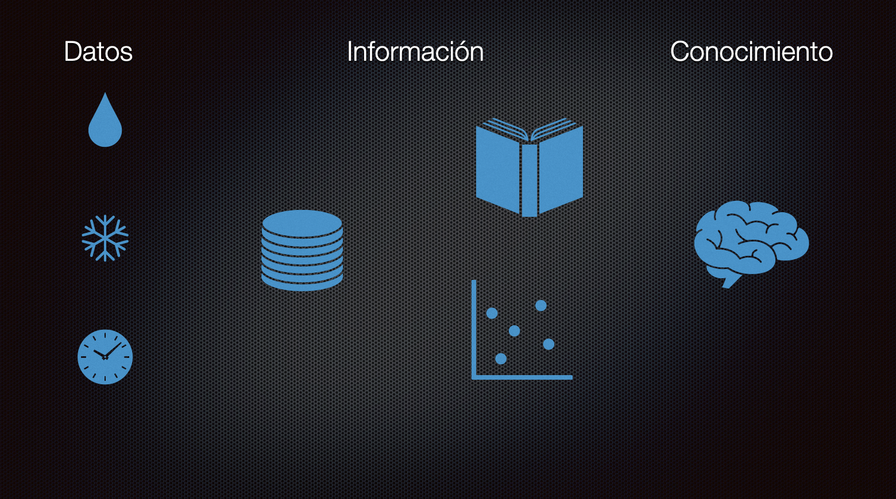

In the figure above I've put the three aspects we have to manage when we manage knowledge.

Data is the lowest stratum of what we have to manage. Data comes from the environment, or is produced by the things we build. The first form we invented in computing to organize it is the database.

Information is obtained from the analysis of that data. It's a higher level, one that can even be packaged into algorithms. Most organizations manage these first two layers well:

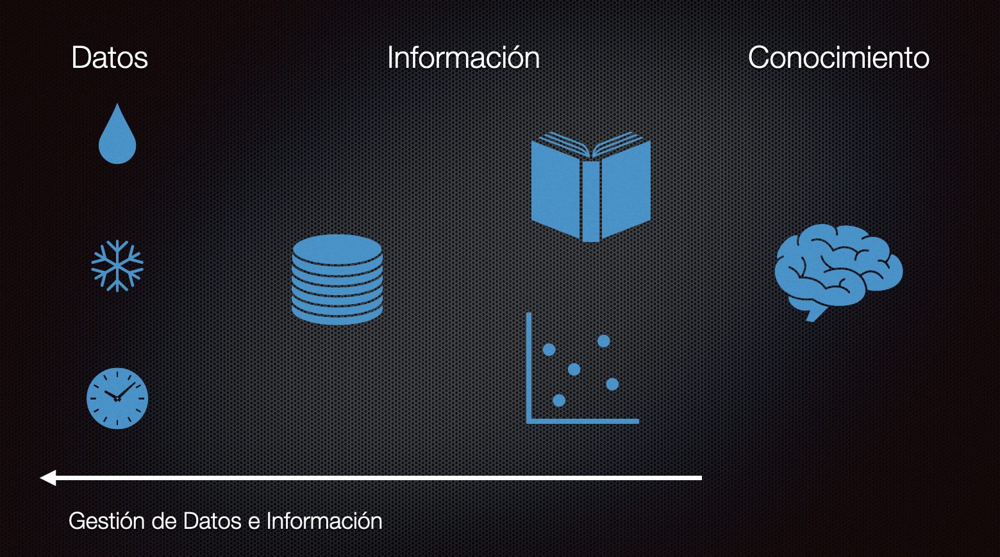

But knowledge has to do with knowing what to do with the information. And this is the hardest part, and few organizations manage to master this stage of development.

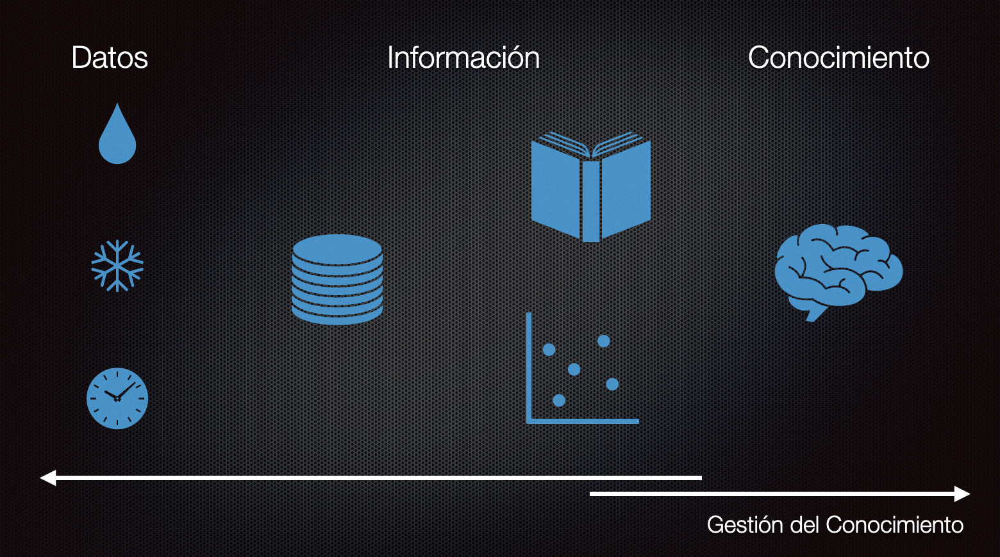

## Knowledge is in people

The first thing we have to understand is that knowledge can't be stored in information systems, because knowledge is in people. So knowledge management is also people management, and therefore it's part of the work of leaders.

But why manage knowledge?

The traditional answer is that knowledge is the key to innovation. Someone more ambitious might say that "knowledge is power". The important thing is to understand that you can't think in selfish terms when it comes to knowledge. That's a serious mistake. Knowledge gains strength when it's shared.

A few years ago I talked about the concepts of potential intelligence and kinetic intelligence (see ["On the coyote's intelligence"](/en/blog/lnds/2012/04/17/on-the-intelligence-of-the-coyote/)). This post owes a debt to that one, so I recommend reading it. The difference is that here I'll talk about how to manage what I called potential intelligence in that post, which in short is knowledge.

## Knowledge management and software development

Let's look at what happens in many companies. When it comes to managing the most important asset, which is the applications' source code, this is what happens:

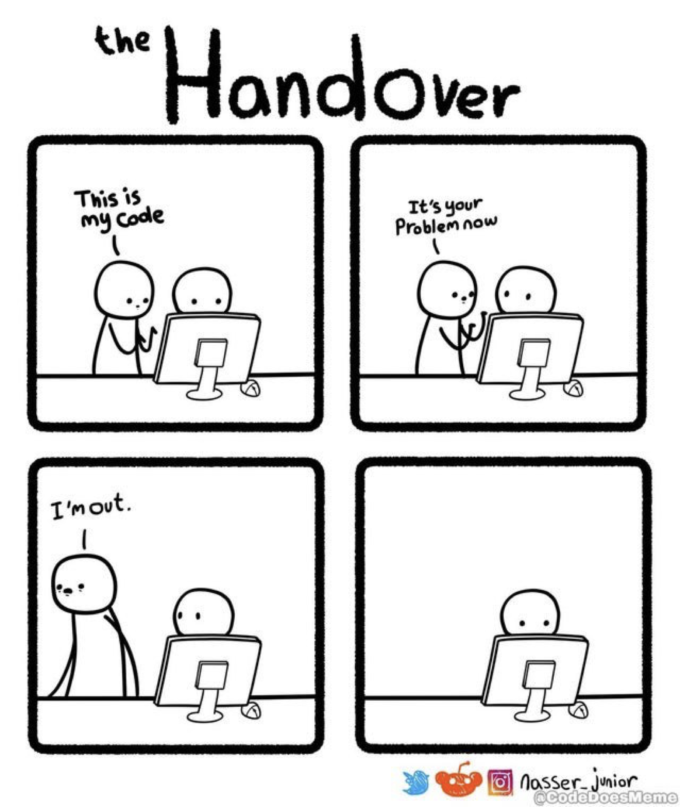

Many believe that having the code in a shared Git repository means the code is fully managed. That's low-level management, or a lack of management. What's worse, even now in the twenty-first century there are companies that don't even have distributed source code repositories. They don't even know what source control systems are!

If you don't manage knowledge you'll run into things like this:

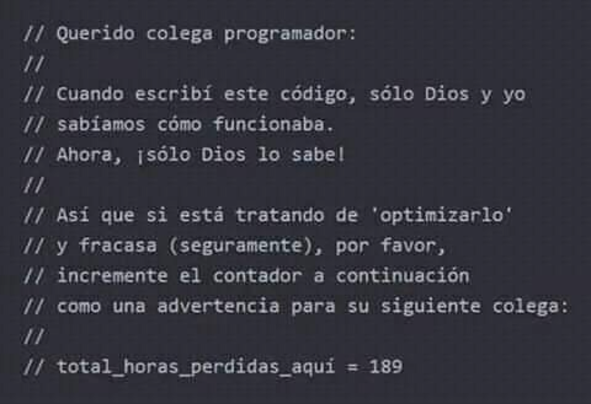

That's a great comment. It even has a metric!

If you're not convinced that knowledge management matters, then set up a metric for how much onboarding costs you, and how much the lack of knowledge management costs you in effort to move your projects forward.

## Dreystadt's techniques

Let me tell you another story, or rather tell you this story again[^3]:

In 1940 Germany was the leading country in optics, with factories like Carl Zeiss in Jena and Ernst Leitz in Wetzlar. There was nothing better outside Germany, and this was crucial for developing the optical instruments used, for example, in precision bombing.

That's why the German army considered optics one of its strategic resources. The German military believed it would take the Allies a generation to train "optical craftsmen" capable of producing high-quality bombsights like theirs.

In early 1940 the United States had a prototype of a quality bombsight, the "Norden", developed by the Dutch engineer Carl Norden. The trouble was that they didn't have an optical industry that could produce the thousands of sights the war demanded.

According to Peter Drucker, at the time the head of General Motors' Cadillac division, Nicholas Dreystadt, accepted the defense contract for mass production of the Norden bombsight. Everyone knew this job required highly skilled mechanics. During the war there was nobody to hire, least of all top-level mechanics.

These are Drucker's words in his memoirs:

> "The only labor available in Detroit was old black prostitutes.
> To everyone's horror Nick Dreystadt hired 2,000 of them.
> [...]
> Very few of these women could read, and the job required following long instructions. "We don't have time to teach them to read," said Nick, "and few of them would learn anyway." So he went to the workbench and built a dozen bombsights himself.
>
> When he knew how to do it, he took a camera and filmed the process. He mounted the frames of the film separately on a projector and synchronized them with a flow chart, in which a red light came on to show the operator what she had already done, a green light to tell her what she had to do next, and a yellow one to show her what she had to check before taking the next step.
>
> This is today's standard procedure for a mass assembly process; it was Dreystadt who invented it. Within a few weeks these illiterate, unskilled workers were turning out better work than the highly skilled mechanics had done before."

Today Drucker's account is considered heavily biased. It's also unclear how many African American women were hired, but it is true that Dreystadt invented a technique for training low-skilled, even illiterate, workers, men and women, using films and assembly line techniques. Unfortunately it's also true that these women lost their jobs to the veterans who came back from the war.

For all the controversy around Dreystadt's story, what we're left with is that with proper knowledge management we can pull off impressive achievements. But here is the key to knowledge management, and we're going to go through it in depth.

## The Nonaka and Takeuchi model

In the late 1980s and early 1990s, the Japanese researchers Ikujiro Nonaka and Hirotaka Takeuchi published a series of articles on management that became famous when they were published at Harvard. Among those texts were the first descriptions of the SCRUM process[^4] and an article that is very relevant to the topic at hand: "The Knowledge-Creating Company", published in the "Harvard Business Review" in 1991.

In this article the authors propose a knowledge management model, which I'll describe with the help of this chart:

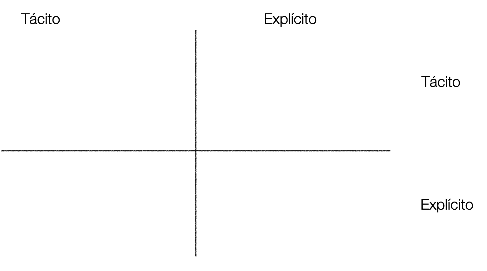

The authors start by recognizing that knowledge is in people, so what you need is a way of working that allows knowledge to be transferred between them.

So we start from the fact that one person's knowledge is tacit, and we want it to be tacit for others as well. The way to achieve this is through socialization. Sharing experiences, or living them together.

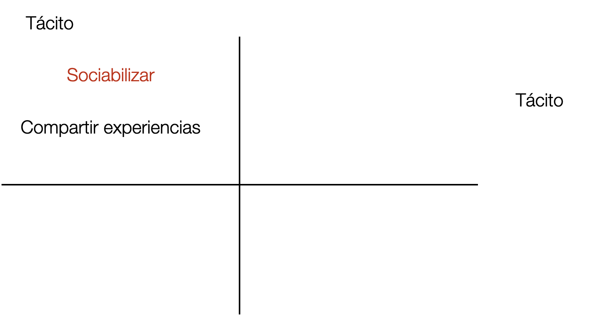

Next, what we want is for that tacit knowledge to become explicit. This is when we externalize our knowledge by sharing it with everyone, and start working out concepts that sum up what we know and let us share it easily with others and with newcomers. Metaphors are an example of this.

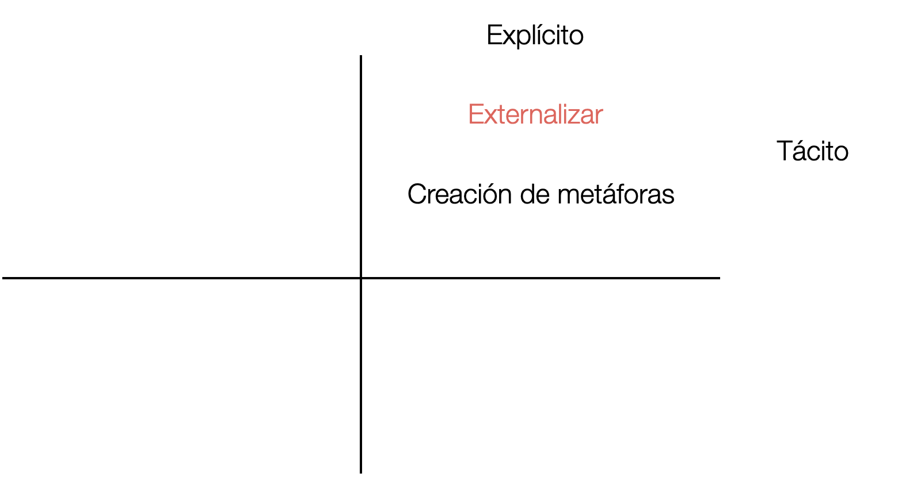

When we combine explicit knowledge with other explicit knowledge we are generating new knowledge. This is what's known as systematic knowledge, and it's a critical point in knowledge management. This is when we create new things, like products or new technologies.

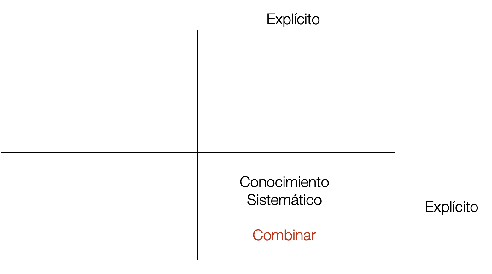

The last phase is internalizing the new knowledge. The new knowledge generated by the combination becomes new tacit knowledge for the members of the organization. And with that a new cycle begins.

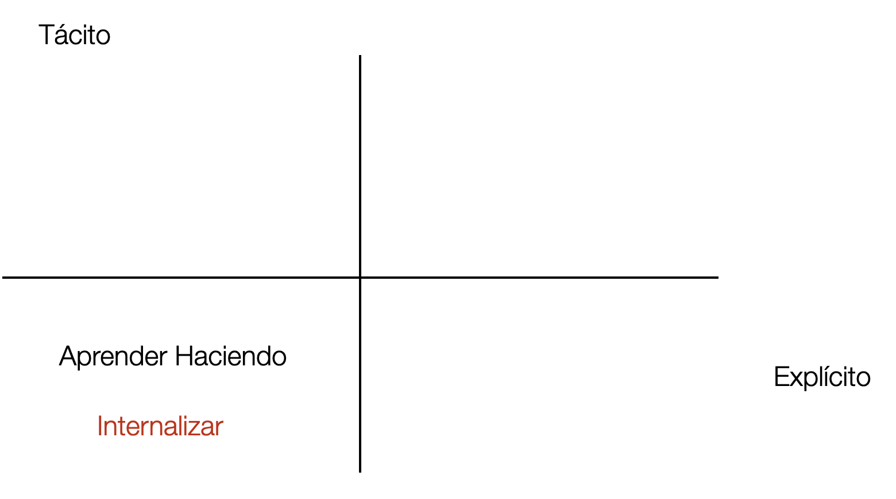

Let's sum it all up. The first stage of knowledge is when we pass knowledge between people (tacit-tacit). The second stage is when we externalize knowledge (tacit-explicit). The third stage is the combination of explicit knowledge (explicit-explicit). The final stage is when we internalize the newly acquired knowledge again (explicit-tacit).

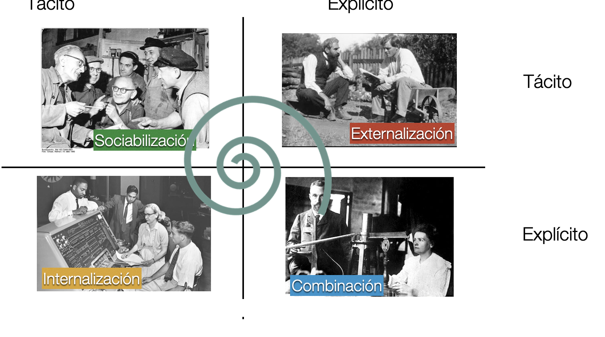

This whole cycle repeats over and over, producing a spiral in which knowledge keeps growing.

For Nonaka and Takeuchi, a knowledge-creating organization makes a point of:

- Acquiring and generating new knowledge
- Spreading knowledge throughout the organization
- Building what it has learned into new technologies

Another way to look at this is through this diagram:

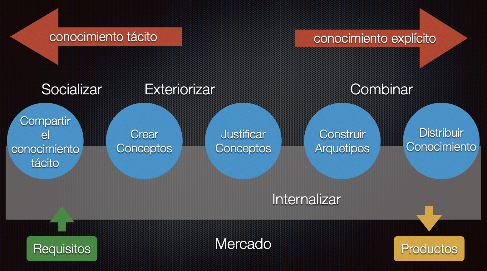

In a company, for example, we have requirements that come from the market. To tackle them it's good to have experts who bring us the tacit knowledge they hold, which lets us understand those requirements. Through socialization this knowledge starts to be shared and internalized by everyone, and then comes the concept creation phase, which is when we put into words ideas that might solve this need. When you externalize or establish a new concept you have to justify it. Once past that stage, we build archetypes that let us combine the earlier knowledge with the new knowledge. And we distribute this knowledge, which turns into new products that go to market, and into new knowledge that is internalized by the members of the organization.

## Knowledge creation and software development

Let's apply this to software development, and I think a meme is the best way to see it:

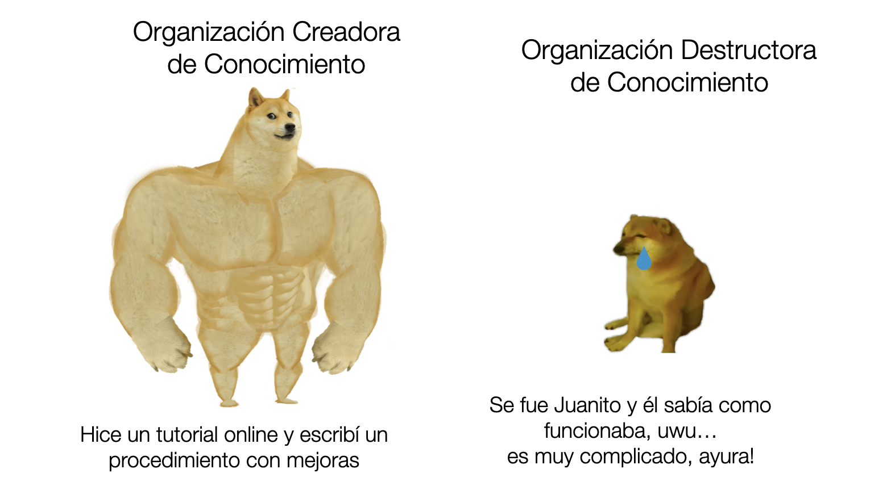

A knowledge-creating organization is strong. Even though the knowledge is in people, the organization doesn't lose that knowledge, because it has created mechanisms that let everyone share and internalize it.

How do you achieve this in practice?

It takes will and a lot of work. Because, as we've shown, this is a spiral process of continuous improvement.

For each phase of knowledge management there is a series of actions, techniques or tools you can use. Here are some examples:

- Socialize
  - Pair programming
  - Team meetings
  - Hallway conversations
  - Chat, Slack, Teams, Telegram, etc.
  - Show and tell
  - Retrospectives, prospectives, lessons learned
  - Self-criticism, asking for help, giving help
- Externalize
  - Meetups/webinars
  - Talks, onboarding sessions
  - Videos, documents, procedures, manuals
  - README, CHANGELOG, TODO
  - Courses, books
  - ALM tools (Jira, Clubhouse, Space, Gitlab, GitHub)
  - Document management tools (Notion, Confluence, Sharepoint, wikis)
- Combine
  - Service design
  - New products/services
  - Requirements analysis
  - User experience
  - Planning, estimation poker
  - Designs and architectures
  - Building blocks
  - Development guides
  - Project documentation
  - User manuals
  - Strategic plans
- Internalize
  - Peer review
  - Code inspections
  - "Best practices"
  - Egoless programming
  - Style guides
  - Estimation history
  - Test benches
  - DevOps/NoOps/GitOps
  - Technical debt reduction
  - Continuous improvement, Deming cycle, Goldratt's Theory of Constraints

As Nonaka and Takeuchi point out, this is essential to sustaining a modern company or organization.

So it would be a good idea to start now.

How? Well, one way is to read this article, spread it, combine it and internalize it in your own organization :wink:.

[^1]: Or maybe I made it up out of a constructed memory, because I believe this story is mentioned in that animated series "Once Upon a Time... Man" that I watched as a kid.

[^2]: There are versions of this story in which the French nobleman is replaced by Frederick II himself.

[^3]: I originally talked about Dreystadt in this post: ["Dreystadt's techniques"](/en/blog/lnds/2009/11/14/dreystadts-techniques/).

[^4]: In an article titled "The New New Product Development Game".
