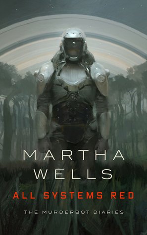
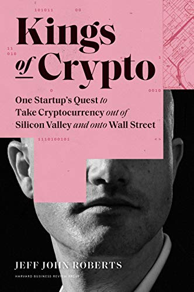
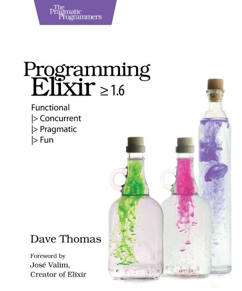
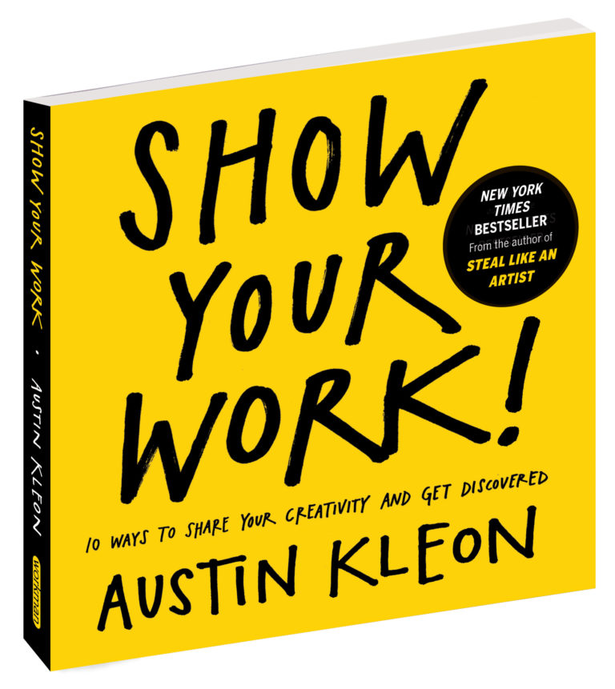
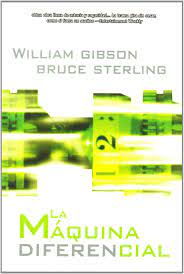

As [promised](/en/blog/lnds/2021/02/27/books-of-the-month-january-february-2021/), at the end of each month I'll post the books I read during the period. So without further ado, here are the books for March 2021.

## The Murderbot Diaries

It's actually 4 books:

    - All Systems Red
    - Artificial Condition
    - Rogue Protocol
    - Exit Strategy

They're short, easy reads (novellas) that are part of this series by the writer Martha Wells. It's a saga in a cyberpunk/space style.

They're a lot of fun, with some dark humor, and very fast-paced. Although in a way they feel like an exercise by the author to work her way into the world of science fiction, since apparently she built her career writing fantasy. I got to this series through a recommendation from my son, and I liked them quite a bit. There are some details that, as a computing person, I can't let slide. For example, the idea of "hacking" is very much in the style of what you see in American TV series or Hollywood movies, which I really don't like. Only in the last book does the author make a bit more sense of the protagonist's feats. The other thing is that the protagonist is a robot, but that's a problem, because you'd imagine an AI would operate at a speed of thought quite different from what comes across in the story, so on this point you have to suspend logic (and your technical knowledge) a little to accept this character. Other than that, it works pretty well. I don't know why it sometimes reminded me of [Ash](https://en.wikipedia.org/wiki/Ash_(Alien)), the android in Alien, even though Murderbot (that's the protagonist's name) is quite different (maybe more like the Terminator), but there are similarities in the fact that it belongs to a corporation, for example. Also, I'm not sure why, it reminded me a bit of the novels of [Rudy Rucker](https://en.wikipedia.org/wiki/Rudy_Rucker); there seems to be some influence there.

Highly recommended, and I'm going to read the fifth book soon, which is a full-fledged novel, to see how this character evolves and how its world develops.

## Kings of Crypto

This book by Jeff John Roberts tells the story of Coinbase, the startup that became one of the most important cryptocurrency exchanges. It tells how they took a controversial strategy and established themselves as a bridge between the world of cryptocurrency activists, Wall Street and even the United States government. It moves fast and lets someone who knows nothing about Bitcoin and cryptocurrencies understand this world. It also explains very well, and in simple terms, how blockchain works, and Ethereum in particular. It helped me clear up some doubts I had about this whole world, which I'm quite skeptical of. But after reading this book I got the itch to get my hands dirty with Ethereum and smart contracts, though that's something I'll put off until I have more time.

## Programming Elixir: Functional |> Concurrent |> Pragmatic |> Fun

[Dave Thomas](https://en.wikipedia.org/wiki/Dave_Thomas_(programmer)) is the co-author of the by now classic ["The Pragmatic Programmer"](https://pragprog.com/titles/tpp20/the-pragmatic-programmer-20th-anniversary-edition/), as well as one of the original signatories of the Agile Manifesto. He's a very prolific author, and he even founded his own publishing house, "The Pragmatic Bookshelf", which has put out several very good books.

This book introduces Elixir, a sort of dialect of Erlang, though with a very interesting syntax. It's one of the most interesting languages of recent times, and one I intend to write a good deal about later on (I'll explain the reasons in future articles).

A good introductory book, well written and practical. I recommend it to anyone who wants to learn Elixir.

## Show Your Work

By Austin Kleon. This book had been recommended to me a while ago, and after seeing a famous YouTuber recommend it too, I decided to read it once and for all. It's one of those books with advice on developing your presence on the net, or as the experts say: "personal marketing".

If I write this blog it's because I want it to be read. So it's natural to look for advice on how to promote my work online. But this isn't a book that offers you tricks or techniques for making your blog a success. What it actually gives you is some fairly sensible and honest advice on how to approach your creative process and share it in a way that generates legitimate interest among your potential readers or followers.

In the end it all comes down to the passion you put into what you do, so you probably won't find anything new in this book, but it's useful to read these things from time to time to reflect on your strategies for promotion, and for personal growth at the same time.

## The Difference Engine

This is an alternate history co-written by William Gibson and Bruce Sterling. It's one of the first novels of the steampunk subgenre. It shows us a world in which [Charles Babbage](https://lnds.net/blog/lnds/2011/10/18/desde-siempre/) succeeds in building his computing machine, and [Ada](https://lnds.net/blog/lnds/2009/01/17/la-primera-analista-de-sistemas/) is the respected daughter of Lord Byron, who has not abandoned her and is even the prime minister of Great Britain.

It's a thriller, with echoes of the works of Jules Verne. The novel rests on a conspiracy that struck me as somewhat contrived, but it has a twist at the end that's interesting. It's fascinating to think about how everything would be if computers had been created a hundred years before Turing laid out his first theoretical model of computation. Gibson and Sterling shine in this novel, which received the Nebula award in 1991. Highly recommended.

And you, what books have you read this month? Any you'd recommend?

See you next month.

