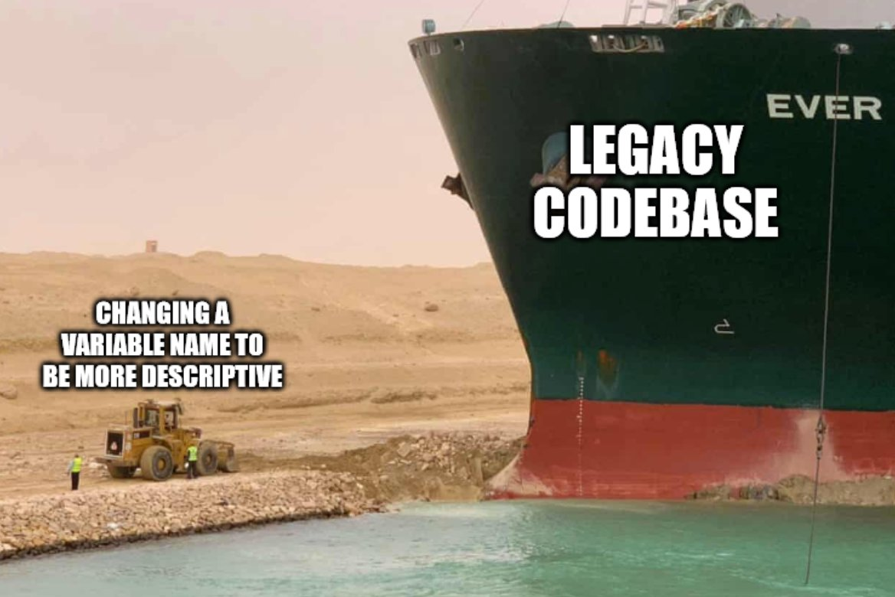
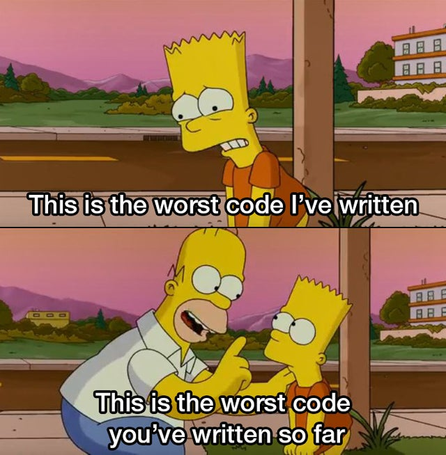

There's an important problem in software engineering that I've devoted part of my time to for at least the last four or five years. It's an idea, or an intuition, that for now we'll call "software entropy". And to get the conversation going, I'll show you some tweets and memes:





I'm going to start with the most theoretical side of the problem. For that we'll first go over the work of Lehman and Bélády, which dates back to the 1970s and 1980s.



Back then, Meir M. Lehman, together with László Bélády, formulated a series of propositions that ended up being known as "Lehman's laws of software evolution".

These "laws" describe a certain balance of forces that drive the development of new software. On one side we have forces that push new development forward, and on the other, forces that slow progress down.

To understand the context of these claims, we'll start by going over a 1980 paper by Lehman, where he introduces certain categories, or classes, of software.

Until then, programs were classified only by their scale, that is, large programs and small ones (non large). That classification wasn't satisfactory back then (and much less so now).

Lehman starts by recognizing that every program is a model of reality. Or as he puts it: _"at the very least, any program is a model of a model within a theory of a model of an abstraction of some portion of the world or of some universe of discourse"_ 🤯.

Lehman introduces three classes: S, P and E.

S-programs are the software whose functionality is formally defined by a specification S. This is the program that comes out of adhering to a formal method, or to a software development process that includes drawing up these specifications. The specification is very precise in this case: "given these inputs we expect these outputs".

According to Lehman, as software development methodologies evolve, all systems will be built as structures of s-programs. This diagram, taken from Lehman's paper, shows this class of programs:



In Lehman's view the specification, which is a formal definition of the problem, directs and controls the programmer's work toward creating a program that defines the desired solution. In this case the solution and its specification are static. If the problem is reformulated, then a new program has to be written (although to save time we can derive the new program from the existing one). In this class of programs the code can be modified internally, to improve its performance or its clarity, but it still preserves its adherence to the specification: given the same inputs, the same outputs are expected.

Lehman's next class of programs covers those where the specification is not precise. This specification is a model of an abstraction of a real-world situation that contains uncertainties, unknowns, arbitrary criteria, variations and so on. To some extent it reflects the personal view of the analyst who writes it. In this case both the formulation of the problem and its solution are an approximation of the reality of the world. Lehman called these kinds of programs P-programs ("real world problem solutions").



In this case there is a cycle of comparisons of this solution against the real environment. In s-programs the comparison is against the specification; in this other case the comparison is against reality: we check whether the values the program produces are valid in the context of the real world. The differences between the data derived from observation and the data derived from computation cause changes in our view of the world, in the perception of the problem, its formulation, the model, the specification and/or the implementation of the program. Whatever the cause of the difference, it means the code, and eventually its documentation, have to change. This effect can't be eliminated by declaring that the problem is a new problem (as we do with s-programs); what has changed is our perception of the same problem.

But there's another relevant fact we have to consider. Dissatisfaction will arise not only because the information received from the program is incomplete or incorrect, or because the original model was imperfect. Those imperfections can be overcome with time. What happens is that the world changes too, and those changes create pressure. So _p-programs_ will either undergo change permanently or gradually become less and less effective, in results and in cost.

The third class of programs is inherently more exposed to change. These are what Lehman calls E-programs. Consider the case of a logistics problem. One where we have different operators in the field who receive instructions through the application (on their phones, for example), and who in turn feed new information into the system. In this case, installing the program together with the whole associated system (devices, networks, etc.) changes the very nature of the problem to be solved. The program becomes part of the world it models.



Even if we leave aside the evaluation of the results of running the program in its operational environment, it has an intrinsic feedback loop like the one shown in _Fig. 3_. The initial analysis of this solution requires making predictions about the consequences of introducing this program and about its potential evolution.



Examples of e-programs abound, from operating systems to air traffic control systems. In all these cases the behavior of the application, the demands of the users and the support required will depend on the characteristics of the program. This will lead users to modify their behavior to adapt to the system, in order to minimize effort and maximize their effectiveness. Inevitably this leads to pressure for change. On top of that, exogenous pressures also cause changes in the environment where the application operates. New hardware, technological advances and even the evolution of society bring changes too. What's more, the nature and the rate of this evolution will be strongly influenced by the characteristics of the program, as new versions of it are released. Unlike other systems, here the pressure for change is permanent and internal. It's intrinsic to these systems.

It's clear that P-type and E-type programs are related; Lehman calls the union of these two classes A-type programs. Their big difference from the S type is their application to, and interaction with, the real world.

It's clear that s-programs arise in formal contexts, mathematics for example. An s-program can be the implementation of a mathematical or formal algorithm. An automaton, or, say, a specific function. The beauty of s-programs is that they can be rigorously proved from their specification. Many basic components of large programs are of type S. Some mathematical functions or procedures, for example. One can postulate that A systems can be partitioned into S-type subprograms; that's part of Lehman's thesis, and it's something we rely on when we build our systems: we decompose them into modules or functions that we can specify formally. That, at least, is the aspiration of almost every rigorous software development methodology.

Lehman postulates that it's always possible to decompose A-type programs into many S-type elements. But we know the effort it takes to get there is enormous. Because an s-program should not only be completely and precisely specified, it should also be possible to formally verify it from the specification. And doing that wouldn't be cost effective, given the intrinsic complexity that Lehman himself identifies.

In any case, Lehman does correctly identify that evolution is an intrinsic, feedback-driven property of software. With this he establishes what he calls the Laws of Program Evolution, which we summarize below:

  I. **Continuing Change:** A program that is used undergoes continual change or becomes progressively less useful.

  II. **Increasing Complexity:** As an evolving program is continually changed, its complexity, reflecting deteriorating structure, increases unless work is done to maintain or reduce it.
  
  III. **The Fundamental Law of Program Evolution:** Program evolution is subject to a dynamics which makes the programming process, and hence measures of global project and system attributes, self-regulating with statistically determinable trends and invariances.
  
  IV. **Conservation of Organizational Stability (Invariant Work Rate):** During the active life of a program the global activity rate in a programming project is statistically invariant.
  
  V. **Conservation of Familiarity (Perceived Complexity):** During the active life of a program the release content (changes, additions, deletions) of the successive releases of an evolving program is statistically invariant.

Today the first two of Lehman's laws are considered to still hold. The others are something Lehman drew from observing various systems and processes at the time. Their validity is something we'll explore later on.

The second law is interesting in this context, since it can be likened to the concept of entropy in thermodynamics, and it's the aspect of Lehman's proposal that seems most relevant to me. In the following articles of this series we'll explore these ideas in depth and see whether it's possible to measure software entropy, and in what way that can be useful to us.
