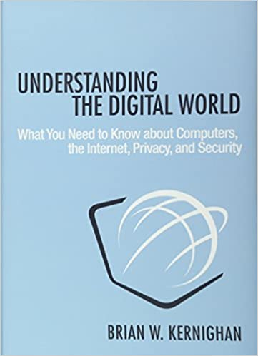
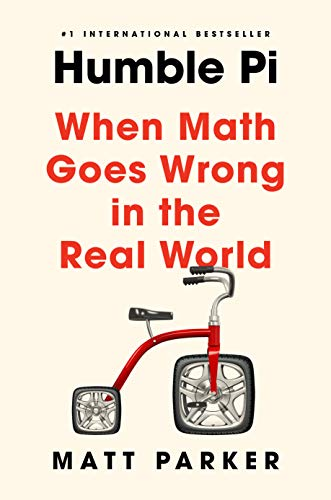
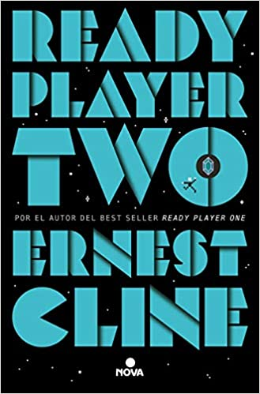
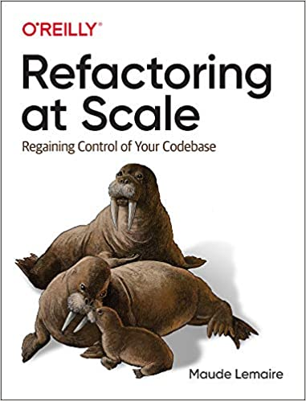
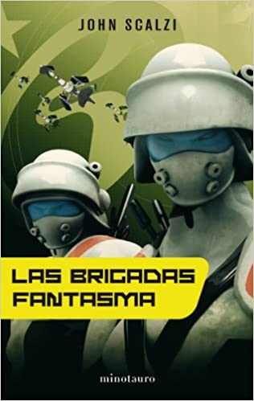

I [committed](/en/blog/lnds/2021/02/27/books-of-the-month-january-february-2021/) to keeping this log of the books I read each month, and I skipped April, so let's catch up with this post.

Writing these reviews helps me synthesize and remember what I've read. You can read to learn, or to have a good time, but also, at least in my case, to teach. This year I'm teaching undergraduates for the first time, so I picked several of these books to keep my knowledge current in cybersecurity and software engineering, which is mainly what I've been teaching. So here's the list.

# April 2021

## Understanding the Digital World

By Brian Kernighan. I like the way Kernighan writes, but this is not his best book. I skimmed this one quite a bit and skipped several sections. The book is based on a course Kernighan teaches at Princeton. It's a course for people who don't come from the tech world, and I can't think of a better teacher for the subject than Kernighan, an eyewitness to the development of several of the most important technologies of the last century.
That's why this book didn't give me much, but I recommend it to anyone who doesn't know much about technology and wants a basic understanding of how it works.

Amazon link: <https://amzn.to/3vCvwaT>

## Humble Pi: When Math Goes Wrong

By Matt Parker, the YouTuber known for the Stand-up Maths channel. I bought this book after watching [this talk he gave at Google](https://www.youtube.com/watch?v=34detVy-Hiw), where he talks about great mathematical mistakes. And that's what this book is about: mathematical mistakes, or engineering ones where math was involved. Matt is very funny on his YouTube channel and in his talks, and the book is a lot of fun. I already knew several of the algorithmic errors he mentions, because reading about catastrophic bugs is a hobby of mine. But I didn't know the Pac-Man bug in detail, so reading that story was really interesting. It has some very funny moments; there's a reason it topped the bestseller lists in England.

Amazon link: <https://amzn.to/3fvkLl7>

## Web Application Security: Exploitation and Countermeasures for Modern Web Applications

By Andrew Hoffman. A book to stay up to date on the most common kinds of vulnerabilities in modern web application development. It's recent, published late last year. For me the main contribution of this book is its strategy for analyzing websites in search of vulnerabilities. The book explains the main vulnerabilities websites have, how to exploit them and, of course, how to defend against them and avoid them in our own code. Very practical, and recommended.

Amazon link: <https://amzn.to/3hZ0C8O>

## The War of Art

By Steven Pressfield. I didn't like this book much, though I have to admit its first and last parts are powerful. It's a short little book, a manifesto for anyone who wants to devote themselves to the art of writing, though I think it applies to a lot more than that. For me the value is in the first part, where he talks about "Resistance", which is the author's name for procrastination. That part is very strong, with vivid imagery, and it resonated with me in ways I didn't expect. But then it turns mystical, derivative, a bit enlightened-guru. Some people may like that; I found that part jarring.

Amazon link: <https://amzn.to/3c4Ha6E>

# May 2021

## Ready Player Two

By Ernest Cline. I had to read it, even though Cline let me down badly with Armada. It's not that Ready Player One is a greaaaat book, but it has so many pop-culture references that are close to me that I liked it a lot, so I wanted to see what else he had to offer. And the first part of the book was a pleasant surprise: a more mature author, with some interesting reflections on what would happen in a world where we all decided to live in virtual reality. There's some interesting speculation in there. Then it gets into a story that repeats the template of the previous book: the riddles of a game have to be solved, only now the stakes are higher and more dangerous. I didn't much like the book's transhumanist ending, and you can tell Cline wanted to wrap up this saga once and for all. Honestly, that's fine. I think that if he digs deeper into what he shows in the first part of this book, Cline could become a more interesting and profound science fiction author, and not just a writer of novels to pass the time.

Amazon link: <https://amzn.to/3yQIi7S>

## Refactoring at Scale: Regaining Control of Your Codebase

By Maude Lemaire. A book I found while researching for a class where I'd be talking about refactoring. The contribution from Lemaire, an engineer at Slack, is that she shows us real cases of refactoring at massive scale (at Slack, no less). The classic refactoring books talk about the small scale: functions, at most classes or modules. But what happens when you have a codebase of millions of lines of code, maintained by hundreds or sometimes thousands of developers? It's a problem I never thought I'd run into in my life, and yet right now it's part of my job. This guide strikes me as an important contribution on the subject, highly recommended. It's another book that came out late last year.

Amazon link: <https://amzn.to/34teMqR>

## The Ghost Brigades

By John Scalzi, the second part of the [Old Man's War](/en/blog/lnds/2021/02/27/books-of-the-month-january-february-2021/#february-2021) saga. This time the story involves a soldier from the Ghost Brigades, which are mentioned in the first novel of the saga. The protagonist of the first part doesn't appear, but his love interest, Lieutenant Jane Sagan, does, though she isn't the protagonist. There's less action than in Old Man's War, but an interesting intrigue, and it introduces the elements that will be central to the third part of the saga. I really liked the material about transferring consciousness into cloned bodies. Here he elaborates a bit more on the concepts he introduces in the first part, but they shine brighter in the next book.

Amazon link: <https://amzn.to/2TorBjH>

## The Last Colony

By John Scalzi. It so happens that I made a mistake and read this book before The Ghost Brigades, but it didn't matter much. I liked this book a lot and found Scalzi in fine form as a storyteller here. There's even less military action, but there is a galaxy-wide intrigue that puts it on a level with Asimov's work, like Foundation. I think Scalzi's writing reaches its high point in this book. It may also be that the central character is something of an alter ego for Scalzi. It's very funny and has a more political plot than the earlier books in the saga. A lot of people don't like it, maybe because they prefer the military action, but for me it's the other way around. Besides, I find there's more humor, and the writer's style in this book is more to my liking.

Amazon link: <https://amzn.to/3wHgctM>

Those are the mini mini reviews of what I read over these last two months. We'll be back soon with the series on software entropy. If you have books to recommend, I'll be waiting for them in the comments.
