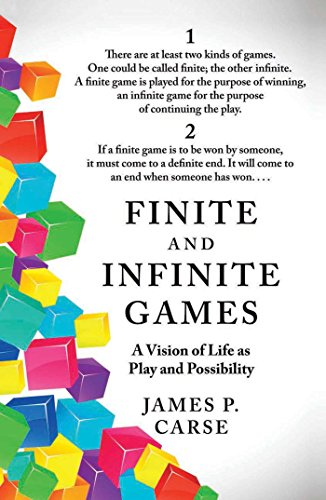
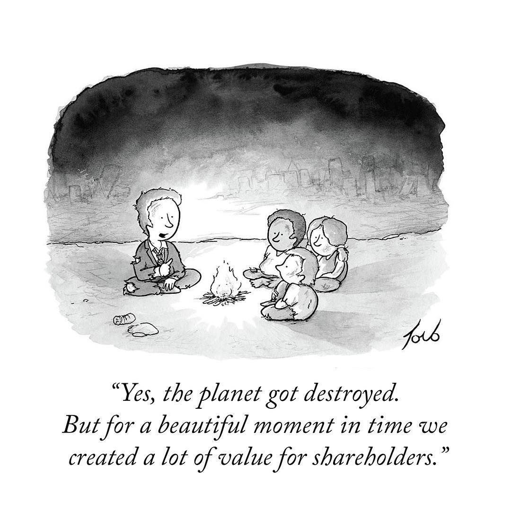

    "Life can only be understood backwards, but it must be lived forwards" -- Soren Kierkegaard

Several interesting things have happened at Cornershop, as I'm sure many of you already know. The other day, in the relevant Slack channel, we got word of a particular milestone for Chile, and along with the congratulations one coworker's comment was: "I remember when all this was fields" :smile:.

The funny thing is that when I read it I was literally out in the fields.

The perks of remote work.

Or a product of connectivity, because I remember when "all this was fields", at least as far as telecommunications go.

I'm writing these words from a little plot of land in the countryside, in the Ñuble region of southern Chile, enjoying the rural quiet and trying to ride out the cold.

No, I haven't moved to the country yet, though the possibility is there, and I'm sure escaping out this way more often will become a habit. I imagine that a few decades from now some of our children will come out to their parents' land and tell our descendants: "I remember when all this was fields!"

I'm witnessing the birth of something new for our family. Of course right now it's all fields, but in a few months, we hope, it will be a pleasant refuge.

But a lot of things are changing around me. My country, for example, is going through a period of deep transformations, and we're starting a stage of rewriting the rules by which we live together. Some people are expectant, some are scared, and there's no shortage of those who see it all with great pessimism. I suspect those who fear the most do so because they don't understand these historical movements.

One curious thing is that some people believe this is a simple technical process. As if it were a matter of sitting down and writing a simple algorithm for citizen behavior.

What is happening is the drafting of a proposal for the "**Political** Constitution of Chile". It says so right in the title: "political". How do they expect the process not to be political?

# Chaos

I'm calm.

The Greek myths tell us that Order, the Cosmos, arose from Chaos.

Things are like that at the beginning: chaotic, almost without apparent sense.

There's an urgency to get started and we take several false steps, we make mistakes, we make quick decisions, maybe not very well thought out, but we keep moving forward, at whatever speed we choose to give it, depending on our spirit and our need.

But it isn't easy when an organization brings together people of many sensibilities and interests. And even less so when you have the ones who, as we say in Chile, "turn the screws backwards" and want everything to fail.

# E-programs and the infinite game

Another interesting thing is the changes in my working life. I have to say I like my current job a lot.

I've been reflecting a lot these past months, and one of the conclusions I've reached is that in my professional life I had never worked on challenges like the ones I face now. I'm not underrating my previous jobs. What I'm saying is that I'm facing challenges of a different nature.

If you remember what I wrote about [Lehman's ideas](/en/blog/lnds/2021/05/08/lets-talk-about-software-entropy/), there we saw that certain kinds of systems exist, which the author calls `E-Programs`: solutions that don't just evolve to meet new external needs, but profoundly alter their environment and the people who operate them, creating a feedback loop that increases their intrinsic complexity.

As an engineer I've built plenty of S-type or P-type systems, as Lehman calls them. What happens with these programs is that we have to adapt our solution to new, more refined abstractions of the world. That happens because, in general, these new abstractions come out of rules, laws, decrees or new procedures dictated by those who aim to regulate the complexity of human society. They aren't evolutionary systems in themselves; they are regulated systems. Their complexity lies in how arbitrary the requirements are. But they don't fundamentally alter the environment or the people.

Cornershop, though, works like an `E-Program`, just like many startups and innovative companies. Their products or services create new operating realities, different ways of doing things, and that generates new needs and drives behavior changes in entire societies. Cornershop was born as a way to save people time. But the pandemic changed Cornershop too, because it had to respond to the changes the pandemic demanded. And those changes in turn modified habits and produced new behaviors in the people who use the service. That creates new challenges and changes that affect society.

Zoom, Cornershop, Teams, Miro, and so many other tools and services we've brought into our lives arrived and changed us. They are part of our lives and have changed many of the dynamics we use to organize our lives and our work. They are new forces that generate new challenges. The E-Program alters society, and society alters the E-Program. If you can already deliver the product to me the same day, why can't you deliver it even sooner? The barriers move. The goalposts shift. The rules change, and E systems make those changes speed up.

We'll live in a new society, more used to masks in public (even if governments don't like the idea). With vaccines every six months, and announcements of a new pandemic every two years. And these technologies will be right there with us. New solutions will come up too. Some will be regulatory, others evolutionary. P-type solutions, E-type solutions. Keep an eye on the E-type ones; those are the most valuable.

Another way to look at it is that Cornershop, along with several startups, especially the ones they call unicorns, plays what some call an "Infinite Game".

The concept of finite and infinite games was introduced by James P. Carse in the book ["Finite and Infinite Games"](https://amzn.to/3AU0jDf).

There are finite games, which are played for the purpose of winning. It is a bounded activity, where the game can be ended when the players reach mutual agreement. Many human activities are described in terms of the finite game metaphor: wars, politics, sports, and so on. When you're playing finite games your only goal is to win.

Infinite games, on the other hand, are played only for the purpose of continuing to play. You never win an infinite game. This metaphor covers activities like learning, culture, building a community, or any kind of exploration that isn't defined by a set of pre-agreed rules that limit it. The point of the game is to draw new players into it, so that they can play too. You never "win"; continuing to play is the reward, and it becomes ever more valuable and appreciated.

Alex Danco, in his article ["Why The Canadian Tech Scene Doesn't Work"](https://alexdanco.com/2021/01/11/why-the-canadian-tech-scene-doesnt-work/), explains how this idea of the infinite game is what motivates a certain kind of entrepreneur and angel investor, and what separates successful startup ecosystems from the not-so-successful ones.

Reading the article I see a lot of the Chilean reality. Not long ago a right-wing economist tried to score a political point by using Cornershop's success to disparage the role of the state. In my opinion that economist understands nothing ([when have they ever understood anything?](/en/blog/lnds/2011/07/28/experts-foxes-and-hedgehogs/)). Cornershop succeeded _in spite of_ the Chilean private and public environment. The key to understanding this is understanding the idea of the infinite game.

The infinite game is not the privilege of entrepreneurs, or of unicorn companies. It has to do with your decision to keep playing again and again in order to grow, to cultivate yourself beyond the limits that others impose on you or that you impose on yourself. It means you stop thinking about winning; it means enjoying the pleasure of playing.

# Complex systems and chaos

These last few months at Cornershop have been very challenging, complex, but enriching. My wife says it shows that I'm having a good time.

I think I made a good decision. It's a great company and, sure, now that it has become famous, you get congratulations and best wishes from all over.

Yes, _"it's awesome"_, I won't deny it. But that success has a lot to do with a way of doing things, the thing they call culture.

And the first thing to understand is that culture is the key to the success of any company. If the culture has that finite game mentality, like the idea of "maximizing shareholder value", its capabilities will therefore be limited and not very motivating.

In every complex system, apparent order arises as an emergent property, a product of the complexity of the interactions triggered by a few simple rules.

That is what has happened with Cornershop. To understand how it works I think of the somewhat _oxymoronic_ concept of "Controlled Chaos".

I'll try to explain it through one of the aspects where the contrast is sharpest, and which is easy to explain.

I've [told you before about my professional life](/category/el-fin-de-la-agilidad/), and about Previred in particular.
As I've said, at Previred I was lucky enough to build, with a lot of freedom, [my own development unit](/en/blog/lnds/2019/08/15/the-end-of-agile-xii/). So I got to try out different development processes, more or less agile. Over time, something came to characterize us as a team.
Even though we were a small team, we were focused on building several new products or services.

We had some of this infinite game mentality, inside a finite game, mind you.

Still, we kept colliding with certain ways of operating that were already established in how the company worked.

One of those ideas was the opposition to doing many production deployments. It was a concept that some even saw as improper, messy, chaotic, even dangerous. When we hit sixty deployments a year they looked at us like we were freaks. Even so, I always found that number of changes per year insufficient, and I invested time and effort, over the years I spent at the company, trying to show how important continuous delivery is.

In the end this vision gained acceptance. More agile processes were brought in, and by the time I left, the idea of having a few hundred production deployments a year had become normal. Of course I'm proud of that achievement, but I was always aware that it was still not enough.

When I arrived at Cornershop I was already expecting to see a few dozen changes a day (yes, a day). The reason I expected that is that I knew [Osvaldo Mena](https://twitter.com/omenar) and had heard those numbers in his own words. In 2019 I had invited him to present the Cornershop experience to a group of people at Previred. I remember that in that talk he spoke about how they managed several dozen changes a day. Something that astonished some of my colleagues and leaders.

I'm sure Osvaldo had no idea what would happen just a couple of years later.

When I finally got to Cornershop, I had fallen short: the reality was that the number of changes in production had moved up to the next order of magnitude.

I'll explain it slowly, because for me it was a shock. I've even brought it up in the classes I teach to master's students.

I had driven a development process in which we reached around five hundred changes in production **a year**. When I joined Cornershop and saw how they handled changes in production, that whole figure, which took us a dozen years to reach, was something Cornershop comfortably beat, **every single day**. And they got there in less than two years.

And that is just one variable to consider.

Because that's how infinite games are. It's about growing and growing so you can keep inviting more people into the game.

Maybe some of you have seen ["La Clase"](http://www.laclase.cl), in particular the one where Osvaldo explains how Cornershop operates. I'll leave it here in case you haven't seen it:



I'll let you in on a secret: "things have changed". But of course, the current scale is much bigger than what Osvaldo describes in that video. On top of that, we've come a long way in these months and organizational changes have had to be made. But the culture and that agile spirit are still there.

Another variable: trust in developers. Software engineers are responsible for taking to production the changes they themselves made to the code. None of those complicated "change management" processes.

When a change is ready they merge it into the main branch and run the production deployment. We trust that we're working with responsible professionals who will take charge of fixing whatever problems they may cause in production.

And when something happens, everybody helps. What's more, it's very common for someone on Slack to ask for help tackling a problem, to request a pull request review, or to clear up a specific question, and there is always someone willing to pitch in.

There's a very strong SRE team. There's no such thing here as the "sysadmin", or the misnamed "devops". These are engineers who don't just build tooling and support operations, but can fix bugs, write code and contribute very sharp observations about the code or the architecture.

Everything gets discussed very frankly and straight to the point. Nobody wastes your time on irrelevant things. There are none of those controls on top of controls that only serve to dilute responsibility. Here [No Bullshit](/en/blog/lnds/2013/02/15/the-road-to-innovation/) is for real.

# Show me the code

In one of the first projects I've taken part in these past months, I made an estimation mistake in the proposed architecture and of course we had problems. "Back to the whiteboard", or something along those lines, was the comment I got. No grief, no argument. Yes, I had screwed up, and I was expected to help with the solution.

The organization was something I struggled to understand at first. No, you won't find an org chart at Cornershop. There are leaders, of course; this isn't anarchy. But I have to say that, to my delight, in many respects the operation has a lot of anarchy in it, in the good sense of the word.

It's this idea of "controlled chaos". It's an organization where hundreds of projects are running at the same time. So one team may be building something that can interfere with another team's work, or they may benefit from the synergy. All of this means we have to talk and coordinate a lot.

We're quite self-critical, and respectful of other people's work and expertise. But we know we have to move fast, though we don't want to break everything by going that fast either, no. This isn't the famous "move fast and break things". We care deeply about scalability and security. But the security teams don't get in the way of the business. Goodbye to those boring, useless security talks. Security is something we're all aware of; we don't try to dilute that responsibility by creating superstructures and job titles that add no value. Of course we have to worry more and more about compliance, but I'm sure those more "regulatory" aspects will be solved with intelligence and engineering rather than bureaucracy.

Most important of all, the leaders don't just know their stuff. Our most technical leaders didn't just write the first lines of code at Cornershop; they are still writing them.

That inspires me. To me it matters that a leader be respected not only for the ability to align the team; if they also know very well what needs to be done, and how to do it, all the better. But what also matters is that they trust you, respect you, understand you and listen to you. Keeping that up while growing at the same time is a challenge. But they know what they need in order to scale, and they've brought in the right people to help make it happen.

Because we're growing a lot. We're already hundreds of engineers contributing thousands of lines of code, designs, architectures, services, processes, documentation, every day. All of us playing the infinite game. So we'll keep growing. I'm sure thousands of changes a day will be the norm a few months from now.

Let me put it another way: I used to prepare a PowerPoint presentation. Now when I want to make a point I can put the Python source code of a spike, or a PoC, in a GitHub repo, and there it is for us to clear things up.

# Constructive chaos

So, I'm in a process of change and reinvention, but in an environment very close to the ideal I've always looked for, and of course I'm proud to be able to contribute.

Because of all of the above, and given my experience over these months at Cornershop, I'm going to improve the definition: rather than "Organized Chaos", I'll use the expression "Constructive Chaos".

I'm in the middle of a whirlwind of change, of growth, of expansion, of integration. Of unknowns, of fierce competition, of uncertainty, of fears and hopes.

So I know what chaos can achieve. I'm not afraid of chaos. Chaos energizes me.

The people who fear chaos, the ones who argue for permanent order, are people who don't understand the creative power of chaos.

The power of constructive chaos.

Don't be afraid of constructive chaos. Remember, there was a time when all this was fields...
