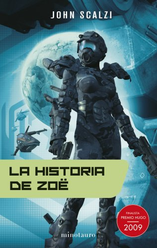
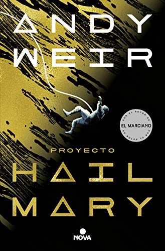
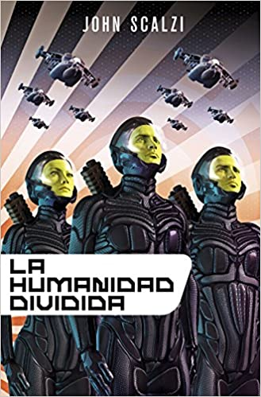
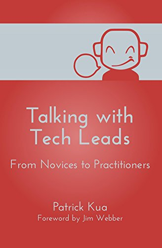
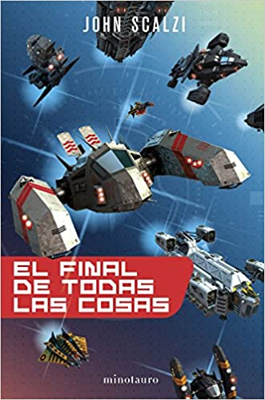
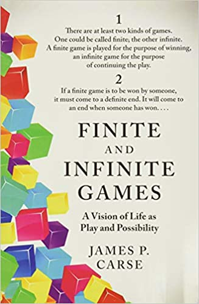
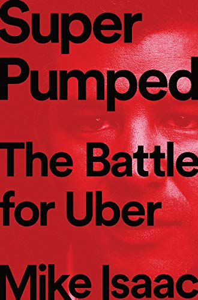
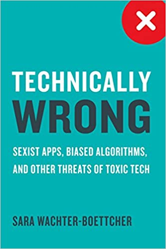

I was remembering today that blogs were originally something like digital diaries, or personal logbooks. The term comes from WebLog, that is, a log on the web, later shortened into the neologism Blog. So since this is my personal log, it makes a lot of sense to keep up this record of the books I've read.

Of course, the cadence I originally promised was one post a month with my reading for the period, which I've had a hard time keeping up: that's two posts in a row now that hold the lists for two months. Oh well, something to improve, just like how often I write for this log.

If you want to go through the list of all the previous books, you can find them at this link to the category: <https://lnds.net/en/category/books-of-the-month/>.

On to the list of books read over these last two months.

## June 2021

### _"Zoe's Tale"_ ---   John Scalzi

This is the fourth installment of the Colonial Defense Forces saga, also known as "Old Man's War"; I've already talked about the earlier books in the saga. Here we get the story of "The Last Colony", but told from the point of view of another character, Zoë, a teenager who carries the enormous responsibility of being revered almost as a deity by an entire alien species. This book tells the same story, but it clears up a couple of things that stay hidden from us in "The Last Colony". It's a risky move by the author, but he still manages to keep you entertained while telling you basically the same story, with details you couldn't have known before and with the added perspective of other races and characters outside the familiar ones from the first books of the saga. Scalzi keeps entertaining and exploring this universe. So he manages to keep up the interest in the saga.

[Available on Amazon >>](https://amzn.to/3C25p0H)

### _"Project Hail Mary"_ --- Andy Weir

Andy Weir rose to fame with "The Martian", which was made into a movie directed by Ridley Scott and starring Matt Damon. His second novel, Artemis, was something of a letdown for me. But here he is back to entertaining and fascinating with a thriller backed by a lot of science. The story uses a formula similar to "The Martian": a lone astronaut facing an extreme life-or-death situation. This time, though, the astronaut wakes up from hibernation on a ship that is making an interstellar trip. Not only is he completely alone (his crewmates have died), he also has amnesia, and little by little he discovers that he is on a mission to save life on Earth, no less. It's a lot of fun, and it packs in a lot of science presented in an entertaining way, as it gets used to solve the various challenges the protagonist faces. The speculation looks plausible and quite well grounded. And it comes with the dose of humor that marked his first novel. I highly recommend this novel; you'll have a great time reading it, and I'm sure a movie will be made of this book.

[Available on Amazon >>](https://amzn.to/3lkNufM)

### _"The Human Division"_ -- John Scalzi

The fifth book of the "Old Man's War" saga. Here we deal with the consequences of the events in "The Last Colony" and "Zoe's Tale". The point of view this time belongs to a character who shows up as a secondary figure in the first novels of the saga. This soldier supports a diplomatic team that gets assigned a series of nearly impossible missions, "The B-Team". Little by little this group uncovers a strange conspiracy that ends up affecting Earth itself. More than a novel, it's a series of episodes tied together around the adventures of the "B-Team". So you're left waiting for a new novel to arrive. The quality of the episodes is somewhat uneven, but it still entertains and keeps up the interest in the universe of this saga.

[Available on Amazon >>](https://amzn.to/2Vlshrl)

### _"Talking With Tech Leads"_ -- Patrick Kua

It's a collection of interviews with technical leaders at different levels, just as the title says: from novices to seasoned practitioners. The main problem with this book is the lack of variety in the companies and backgrounds of the people interviewed. I'm not sure I'd recommend it; I think Coders at Work is a much better book in this style. Still, there are few books that take on the perspective of technical leaders, so there are some gems to be pulled out of this one. Recommended for someone who is starting out in technical leadership, so they understand they're not alone in many of the aspects and challenges of this new role.

[Available on Amazon >>](https://amzn.to/3fe2to8)

## July 2021

### _"The End of All Things"_ --- John Scalzi

Another book that isn't a novel in itself either, but four novellas that wrap up the "Old Man's War" saga. The first of these novellas tells the story of a man whose brain is ripped out of his body to be built into a spaceship. It has a lot of cyberpunk elements, and it's the one I liked best of the four. I think it's a "worthy" ending for the series, but I suspect Scalzi was already somewhat tired and short on ideas for the universe he created. There are still plenty of political ideas and interesting intrigue in the last two chapters of the saga, but I suspect it isn't a path the author would have enjoyed exploring. I think it's an entertaining saga and worth reading if that's all you're looking for.

[Available on Amazon >>](https://amzn.to/37aBYLJ)

### _"When We Cease to Understand the World"_ --- Benjamin Labatut

The best book I've read this year, so far. I liked it a lot, and I'm not the only one. This book became famous because Obama recommended it on his summer reading list. It's a very short book that you read almost in one sitting. It's very well written. To me, the author's style at times recalls the themes that obsessed Jorge Luis Borges, and the historical fascination and chronicles of Stefan Zweig. The stories revolve around science, the madness that physics or mathematics can drive you to, and the tremendous abyss and challenge posed by a deep understanding of how nature works. It really is one of those books you never forget, and that hit you harder than you expect.

[Available on Amazon >>](https://amzn.to/3fciqLt)

### _"Finite and Infinite Games"_ --- James P. Carse

This is a somewhat "philosophical" book with a single, very simple idea: "there are finite games and infinite games", which I [talked about in my previous post](/en/blog/lnds/2021/07/11/when-all-this-was-fields/). The idea is interesting, even brilliant; the book, not so much. After the first chapter I found the rest boring, even pretentious. But I suspect there are people it will resonate with quite a bit, because the idea of the infinite game is very powerful all the same.

[Available on Amazon >>](https://amzn.to/3C09e6G)

### _"Super Pumped: The Battle for Uber"_ --- Mike Isaac

A work of journalism, written by the Times reporter who closely followed the rise and fall of Travis Kalanick, Uber's former CEO. The book centers on the story of how Kalanick took control of the company, and the internal fight that followed to oust him. I don't consider it a very good book. The author leans on the controversy around Kalanick, but with the material for a great book in hand, he doesn't pull it off. It could have served as a great reflection on the effect of toxic leadership and the downsides of the tech industry in Silicon Valley, but it ends up being just a long magazine piece.

[Available on Amazon >>](https://amzn.to/3llopRV)

### _"Technically Wrong"_ --- Sara Wachter-Boettcher

This book is a critique of biased algorithms, of sexism in apps, of the lack of diversity in the tech world. It has several interesting reflections, so I highly recommend it to those of us who design apps or websites, UX experts, designers and architects. Her critique of the use of "Personas" in interaction design, for example, is remarkable, and she proposes ways to do it better. It's not a technical book, but it has several recommendations on how we can improve our designs to avoid bias, or to avoid creating experiences that are offensive or unpleasant for our users. Highly recommended for staying alert to what we do wrong in technology and the toxic effects it can have on society.

[Available on Amazon >>](https://amzn.to/3jcy1vJ)

And those are the books I've read over these last two months. I'd love to hear about what you're reading, and I hope you'll recommend books for me to read and review.

