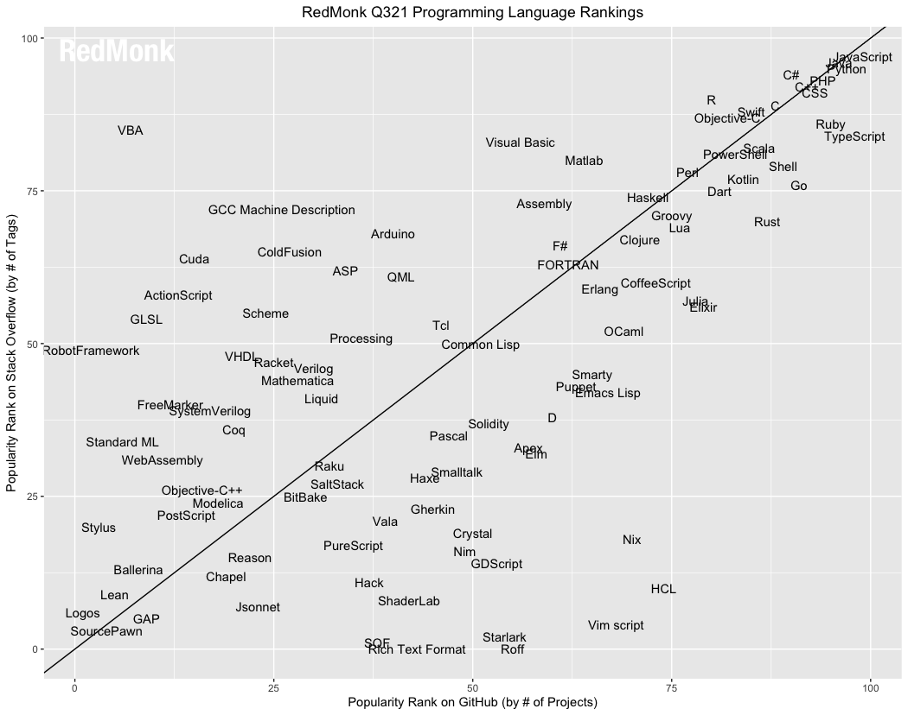
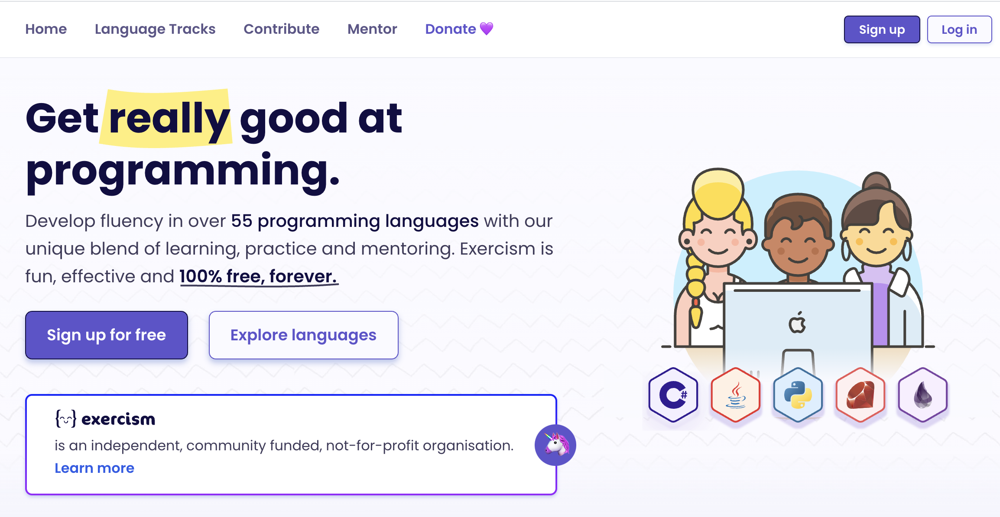

I recently came across this tweet:



> (JavaScript is difficult to learn but easy to master.
> Python is easy to learn but difficult to master)

And to a certain extent it's quite true. At least as far as Python goes.

It turns out Python has a very simple syntax and can be learned in a few hours, but there are loads of details you only pick up over the years.

## Language families

A language isn't just its grammar and syntax; it also includes things like the semantics of each statement, the memory model, the way it executes, the kind of paradigm it implements, and so on.

Some people believe all languages are alike, which isn't true, of course. There may be similarities, but those come from the way languages have evolved.

There are several families of languages. For example, the [ALGOL family](https://en.wikipedia.org/wiki/Generational_list_of_programming_languages#ALGOL_based), from which important languages derived, such as [Pascal](https://en.wikipedia.org/wiki/Pascal_(programming_language)), [Modula](https://www.modula2.org), [Oberon](http://www.projectoberon.com), [Simula](http://www.simula67.info) and, from those, [C](https://www.iso.org/standard/74528.html), which formed its own family that includes [C++](https://isocpp.org), [C#](https://docs.microsoft.com/en-us/dotnet/csharp/), [Java](http://oracle.com/java/), [Rust](https://www.rust-lang.org) and [Python](https://www.python.org), among many others.

Then there's the [Simula family](https://en.wikipedia.org/wiki/Generational_list_of_programming_languages#Simula_based), the root of many of the object-oriented languages, from Smalltalk to Ruby. This family also includes [Objective C](https://developer.apple.com/library/archive/documentation/Cocoa/Conceptual/ProgrammingWithObjectiveC/Introduction/Introduction.html) and [Swift](https://swift.org), the languages used on Apple's operating systems.

Another important family is [LISP](https://en.wikipedia.org/wiki/Generational_list_of_programming_languages#Lisp_based), one of the oldest and noblest, whose descendants reach all the way to [Racket](https://racket-lang.org) and [Clojure](https://clojure.org), by way of the distinguished [Scheme](http://www.scheme-reports.org).

Another functional family is [ML](https://en.wikipedia.org/wiki/Generational_list_of_programming_languages#ML_based), and among its heirs we find [OCaml](https://ocaml.org), [Haskell](https://www.haskell.org) and also [Rust](https://www.rust-lang.org).

But families cross. For example, [Scala](http://www.scala-lang.org) has roots in the ML family and in the ALGOL family (through Java). Or [JavaScript](https://www.ecma-international.org/publications-and-standards/standards/ecma-262/), which has ancestors in SmallTalk through [Self](https://selflanguage.org), and of course in ALGOL through C.

Wikipedia has a fairly extensive list of the genealogy of various programming languages: <https://en.wikipedia.org/wiki/Generational_list_of_programming_languages>

It may not seem like it, but knowing this genealogy turns out to be quite useful. If functional languages are your thing, you can choose between the LISP family and the ML family, and the big difference will be the syntax. You'll notice that Elixir has a very different syntax from Clojure, but you can approach problems the same way, following the functional paradigm.

On the other hand, you'll notice that JavaScript and Java share a somewhat similar syntax, because they have the same root, which comes from the influence of C++, but they are languages whose model for implementing the object-oriented paradigm is quite different. Because JavaScript carries the influence of Self and Scheme.

So knowing the syntax isn't enough; it's those extra details that will help you reach mastery in these languages.

##  Which languages should you learn?

A language's popularity matters if you want to program in it professionally. You have to look at what the market uses. In Chile, for example, there's heavy use of Java, JavaScript and C# in corporate environments, and in startups Python, JavaScript, Ruby and PHP are strong.

If you want to play it safe, JavaScript is a good choice; it covers both the front end and the back end.

If you're interested in the world of data science, keep in mind that a command of mathematics, statistics in particular, matters more than the programming language. Even so, in this domain SQL, Python and R are important.

Most programmers will never move beyond the languages mentioned. But in my opinion it's worth learning other languages, because they can help you get better as a programmer.

## Language rankings

In any case, to try to answer this question, there are several sites that attempt to build a ranking of programming languages. .

### TIOBE

The TIOBE INDEX: <https://www.tiobe.com/tiobe-index/> may be one of the best-known rankings.

For 2021 it puts these languages in the top 10:

1. C
2. Python
3. Java
4. C++
5. C#
6. Visual Basic
7. JavaScript
8. PHP
9. Assembly Language
10. SQL

The problem with this index is that it's based mainly on searches on sites like Google, Bing, Yahoo!, Wikipedia, Amazon, YouTube and Baidu.

C is a language very few programmers use compared to JavaScript and PHP, so why is it in first place? Probably because mastering it takes more lookups. By the same token, the appearance of Visual Basic and Assembly looks very odd.

### RedMonk

Redmonk uses a more thorough methodology than TIOBE: it analyzes repositories on GitHub and questions on StackOverflow.

Redmonk's methodology is described in its annual report: <https://redmonk.com/sogrady/2021/08/05/language-rankings-6-21/>

For 2021 the top 10 are:

1. JavaScript
2. Python
2. Java
4. PHP
5. CSS
5. C++
5. C#
8. TypeScript
9. Ruby
10. C
11. Swift

You'll notice the problem of including CSS as a programming language, which is why I've included Swift in the list.

### StackOverflow

The StackOverflow site runs a survey that looks at various aspects of the developers who use the service. From demographics to salaries. The survey is very interesting and you can read it in detail here: <https://insights.stackoverflow.com/survey/2021>.

There's no language ranking as such, but they ask about the most used technologies, and if we filter by programming languages we get:

1. JavaScript
2. Python
3. SQL
4. Java
5. TypeScript
6. C#
7. C++
8. PHP
9. C
10. Go

## How to learn and practice a new language

Whether you want to open up opportunities in a new market, or you want to improve and reach mastery in some language, there are several sites that let you practice by solving exercises. Here are a few I recommend:

### EulerProject

Web: <https://projecteuler.net>

This is the simplest of all the sites I'm going to show you. The idea here is to solve a challenge using any programming language. Normally what you have to do is answer a question. Sometimes the answer is a single number, but to get to it you'll have to implement some algorithm.

- Help/Community: the concepts behind a challenge are revealed to you only after you solve it. There are forums for discussing each challenge that you can consult afterwards.
- Languages: any, because it doesn't matter how you arrive at the answer, though it's common to post the code for your solution in the forums.
- What it's good for: challenging your understanding of algorithms, improving your math skills, if you like solving logic or math puzzles

### CodeWars

Web: <https://www.codewars.com>

This site has a more complete interface. In fact it provides an online IDE and has a ranking system based on the ranks used in the game of Go. It offers various challenges, and as you solve them you earn "honor" and move up in your ranking.

- Help/Community: It has a training mode, and also a forum for each challenge. It implements challenges and "katas", and you can see the difficulty level before taking one on. You can look at other people's solutions before submitting your own, but if you do that it adds no points to your profile.
- Languages: the list runs to about 45 languages.
- What it's good for: improving your command of a language. Getting better at solving algorithms. Preparing for a technical interview.
- Additional features: ranking system. When you sign up you set your own experience level, which goes from apprentice to senior. The site is owned by [Qualified](https://www.qualified.io/), which provides services to companies and educators. So by taking part in this site you may be contacted by the recruiters they offer services to.

### Exercism

Web: <https://exercism.org/>

This site launched its version 3 on September 1 of this year. It's a site very much geared toward teaching the details of each language through exercises that are simple but can be quite revealing. It's my favorite site for practicing.

- Scope: learning to program, learning new languages, mastering a language
- Help/Community: It has two modes: learning or practice. In learning mode you can request the help of a mentor. You can iterate on your solution several times. After submitting the first iteration of your solution you can look through the community's solutions, which lets you improve by learning from others.
- What it's good for: learning from scratch. Mastering the features specific to a language. Learning a new language.
- Additional features: it has a ranking where you earn points for solving exercises, or for taking part in the community in various ways, whether as a mentor, by reporting or fixing bugs, or by helping improve the site (which is open source). It also includes badges that are revealed as you participate in the site. You can also donate to the site to help support its operation.

Personally, I take part as a mentor on the Clojure and Rust tracks. I like this site a lot for its sense of community. If you want to devote part of your time to helping others learn to program, or to improve their skills, this site is a good and positive way to do it.

There are more sites, [HackerRank](https://www.hackerrank.com/) for example, where you can take part in challenges, and even in formal interview processes. If you have a favorite site, I invite you to share it in a comment on this post.
