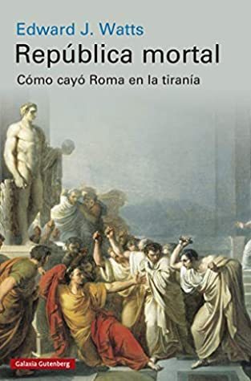
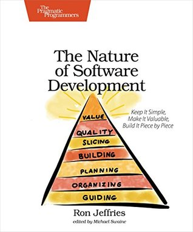
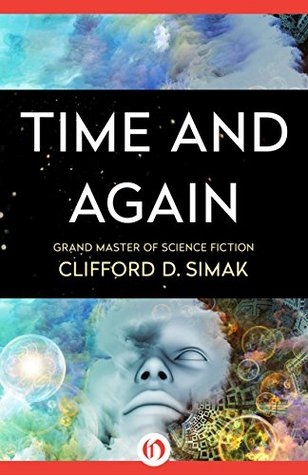
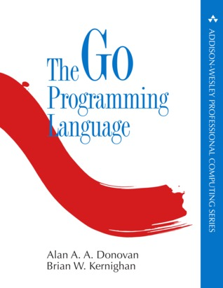
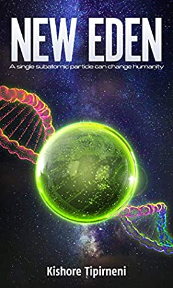
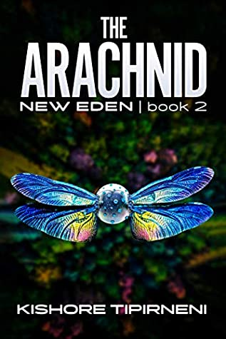
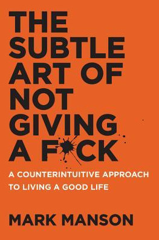
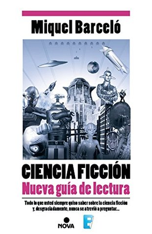

I've been struggling to write on this blog. I think I need to organize my time and carve out room to publish my notes and ideas, and we're working on that. Meanwhile, to keep the muscle in shape, here's the update on my monthly reading, which I promised to log in this journal.
If you want to go through all the previous books, you can find them at this link to the category: <https://lnds.net/en/category/books-of-the-month/>.

## August 2021

### Mortal Republic -- Edward J. Watts

This book tells the story of the fall of the Roman Republic, ending with the rise of the Empire under Octavian (Caesar Augustus). Its central message is "No republic is eternal. It lives only as long as its citizens want it." And there's a warning in it. It's interesting that this book is contemporary with the Trump administration and with the crises in several countries, Chile among them. The subject is interesting, but I feel the author takes a lot of detours to get to his thesis, which has to do with the triumph of populism and what he calls the balance of power between the elite and the people that Rome supposedly achieved in its early years. But I don't think he reckons with the fact that this initial balance rested on tremendous inequality, the very thing the strongmen who show up later try to fix (by offering land to the legionaries, for example). One fact I didn't know: Octavian personally inherited the entire kingdom of Egypt, without having to answer to Rome for that property, which made him the richest and most powerful person in the ancient world. In any case, an interesting book for anyone who wants to learn some history and project it onto modern reality, with some caution, of course.

[Available on Amazon >>](https://amzn.to/3BcTWdP)

### The Nature of Software Development -- Ron Jeffries

Ron Jeffries is an important voice in the agile community. He is one of the founders of Extreme Programming and one of the signatories of the Agile Manifesto. This book is from 2015 and reads like a synthesis of Jeffries's view of what matters, where what matters is the value you deliver in each iteration. It can be seen as a good introductory text on agile principles, whatever methodology you adopt. If you already know this material you won't find much that's new, which was my case.

[Available on Amazon >>](https://amzn.to/3mpn8s6)

### Time and Again -- Clifford D. Simak

Simak is one of the classic science fiction authors. I remember really liking Way Station back in the day, and I've read some of his short stories over the years. I might have enjoyed this book more some 20 years ago; today I had a hard time finishing it. It's not that it lacks merit. It's a good book, with some deep and interesting philosophical questions, but everything starts to get tangled up with time travel and a prose that takes its time (well, that's Simak's style). Also, since I read it in English, I noticed the author's style felt dated to me, or unusual, but that may be more my problem and my lack of exposure to English literature in its native tongue.

[Available on Amazon >>](https://amzn.to/3FlZC83)

### The Go Programming Language -- Alan Donovan, Brian Kernighan

Alan Donovan was involved in the original development of the Go programming language, and Kernighan, well, is Kernighan, so this book emulates the Kernighan and Ritchie classic on C. Bringing in the founding father as co-author was surely a good move (very shrewd, Donovan). I've had this book on my shelf for years, but I had never made it past the first chapters. These last two months I made the time to read it while working through the exercises. It's a long book, but it has everything you need to master Go. Very well written and very practical. Like every book of this kind it demands time and dedication to practice what you learn, and it let me fill in gaps I had about the language. Highly recommended, and still very current, because fortunately Go stays fairly stable.

[Available on Amazon >>](https://amzn.to/2Ykc0os)

## September 2021

### New Eden - Kishore Tipirneni

The first part of a saga, self-published by this rookie author (very much a rookie). This is no Simak. It's an amateur's book, one that maybe aims to emulate Andy Weir, though with less talent. Still, it entertains and puts forward a couple of interesting ideas, mixing information theory, quantum mechanics and musings on the origin of life. It did manage to keep me hooked, maybe because it's one of the few novels that takes certain ideas about information and software to a cosmic scale. The problem lies in some basic structural mistakes, a pile of situations that aren't believable at all, forced dialogue, thin character development, and long conversations about religion that mostly slow things down and distract. But I've read things by great science fiction writers that are worse (and not only in their first novels, Arthur Clarke for example). If you want something light, but with a couple of fascinating and feasible ideas, you may like it.

[Available on Amazon >>](https://amzn.to/3uIEDqU)

### The Arachnoid -- Kishore Tipirneni

Second part of the saga, with a very B-movie name, and the plot lives up to it: there's more cinematic action here, but it still takes a little time to dig into its speculations about information, life and the meaning of the universe. Despite the lighter plot, this book is better developed than the first one. Who knows, maybe they'll make a movie out of this. I think I've given this author a lot of chances, but what the hell, I've sat through marathons of bad science fiction shows and these books are better (well, it's not a very high bar either).

[Available on Amazon >>](https://amzn.to/3uQCJVh)

### The Subtle Art of Not Giving a F*ck -- Mark Manson

A blogger's book, and very fitting for those who criticize me for reading sagas by amateurs who self-publish on Amazon. How to be a cynic if you also happen to be a millennial, or why you should drop the idea that everything has to be success and happiness. It's a self-help book in the end, but the good kind. Several things resonate with me because they are largely part of my own way of facing life, so I can't criticize the author much. Even so, I think you're better off reading Cioran or an actual philosopher to reach better conclusions. But that's my opinion and you shouldn't give a damn about it. Decide for yourself what to read.

[Available on Amazon >>](https://amzn.to/3mw8ejT)

### Ciencia Ficción. Nueva Guía de lectura (Science Fiction: A New Reading Guide) -- Miquel Barceló

I read the first guide he published back in the nineties, and it was my guide for reading several of my favorite science fiction books. I was hoping to find new things, but I see I've already picked many of the titles he mentions here, so there's not much room left for me to explore. Still, it's a highly recommended read for anyone starting out in this world who wants to read books or sagas that are worth it. I did miss some more modern titles (like the whole Expanse saga), but that's fine.

[Available on Amazon >>](https://amzn.to/3uJzm2h)

