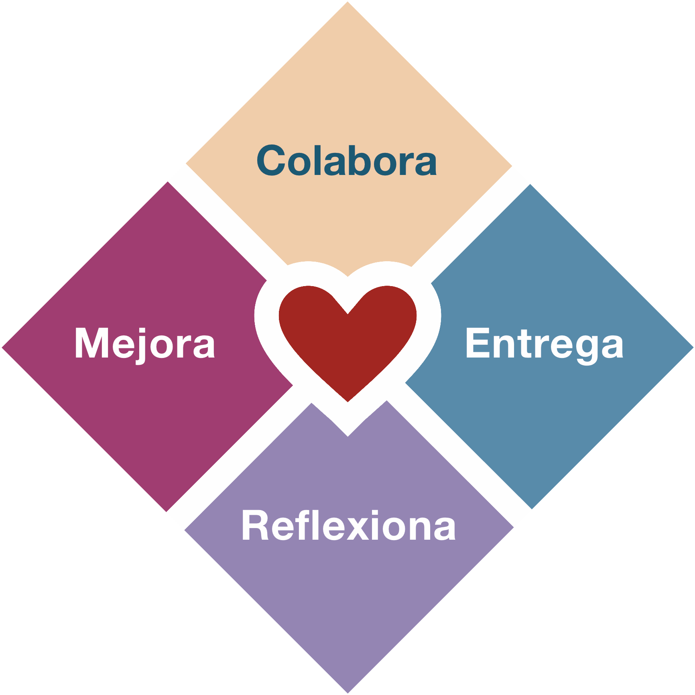
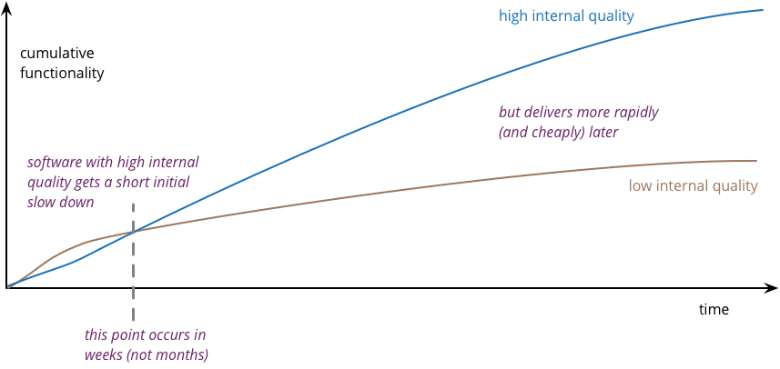

> The principles of lust\
> Are burnt in your mind\
> Do what you want\
> Do it until you find Love\
> -- Enigma

When we start adopting agile, the usual thing is to focus on the [four values](https://agilemanifesto.org/iso/es/manifesto.html), you know, the ones that say:

- Individuals and interactions over processes and tools
- Working software over comprehensive documentation
- Customer collaboration over contract negotiation
- Responding to change over following a plan

That's all very well, but I've seen organizations that claim to adopt agile without respecting those values. The classic example is the violation of the first value: instead of encouraging interaction between individuals, teams are told to adopt SCRUM and use JIRA, imposing a process and a tool.

It sounds funny, but in the long run it isn't, even though it's a very common mistake. I made several mistakes myself when I ran development teams trying to adopt agile.

There's some desperation in it, because the truth is that when you're in a leadership position you have to answer for your decisions, and a lot of people expect results, preferably fast.

So, out of this desperation, different kinds of "agile" emerge.

- ["Cargo cult"](https://en.wikipedia.org/wiki/Cargo_cult) agile. It's about performing "the ceremonies" without understanding why. Or covering the windows with post-its, forgetting along the way that windows are there to let the light in.

- "Do it yourselves" agile, or anarchy by decree. The bosses tell the teams they have to organize themselves. Supposedly this empowers them, but in reality it leaves them to their fate, and who knows, if they fail it won't be the leaders' fault and everyone can go back to what "has always worked".

- Hippie agile. Here we focus on the fun activities, or the ones that make people feel good, where "kudo cards" matter more than features shipped to production.

- Scientific agile. Where we formulate hypotheses and try to validate them in
each iteration, setting up metrics that will let us formulate new hypotheses, and so on ad infinitum.

- Sociological agile. We establish organizational taxonomies and measure in each iteration how far we've moved across some roadmap, devoting our retrospectives to figuring out which stage of evolution we're in, instead of looking at how much software we've built.

And I'm sure there are several more that you've identified yourselves.

The identity crisis is such that the founders of the agile movement have taken to preaching a return to the origins and reorganizing their followers, creating new movements or writing books.

Alistair Cockburn, with his [Heart of Agile](https://heartofagile.com), tries to go back to four stages that would be the essence of agile: Collaborate, Deliver, Reflect and Improve.

Ron Jeffries, in his [Nature of Software Development](https://amzn.to/3mpn8s6), reminds us that what matters is the ongoing delivery of value.

But these fundamentals have always been there. If we weren't too lazy to click that link that says ["Twelve Principles of Agile Software"](https://agilemanifesto.org/iso/es/principles.html), we'd save ourselves several missteps.

It's easier to learn and recite four values than to study the twelve principles that hold them up.

But let's make the effort, because those principles were put there because they sum up the discussions the original signatories of the Agile Manifesto had. There must be some distilled experience and wisdom in there:

## Principle 1: early and continuous delivery of value

> "Our highest priority is to satisfy the customer
> through early and continuous delivery
> of valuable software."

Valuable software, that's the ultimate goal.

And what is value?

Ron Jeffries says value is what we want. What we, as a team, want (see principle 4). Value is simply what you want, whatever you care about.

From the book ["The Nature of Software Development"](https://amzn.to/3mpn8s6):

> "Agile methods ask us to order the things we do based on value. Sometimes we say _business value_ or _customer value_, as if these labels helped. In a way they do, because they can make us think about things we value in the sense that they are "good for the business" or "good for the customer". But they are far from the only kind of value we should consider. [...]
> We might choose a strategic direction for our product. We decide we need information about what users might prefer, so we build a few prototypes and show them to prospective users.
>
> We value information.
>
> Our product might be saving lives, perhaps helping with the rapid deployment of a vaccine around the world. We decide to choose the next features to build based on the number of lives saved by them.
>
> We value human life."

Jeffries warns us that we can value more things, such as the environment, or capital, or the speed of the product, or progress, or people's happiness, or pleasure, creativity, money, and so on.

The skill of the leader, the product owner, or whatever you call them, is put to the test when deciding which of all these things we care about will be the ones we build next.

They have to look deeply at all the things that are valued in order to choose the development sequence that gives us the best possible result as a return on our investment (of time, of money, of effort).

## Principle 2: welcome change

> "Welcome changing requirements, even late in
> development. Agile processes harness change for
> the customer's competitive advantage."

This is one of the principles that meets the most resistance among developers, especially the older ones. In part it's because we haven't applied the fourth principle, nor have we deeply understood the first and fourth values.

This isn't about setting up a contract between a customer (the business people) and a supplier (the development team). By working together, each member of the team contributes observations and values change, because they know they can respond to it, painlessly, flexibly and fast, but also because they are all **committed** to the success of the product, and that commitment helps them welcome change.

## Principle 3: deliver working software

> "Deliver working software frequently, from a
> couple of weeks to a couple of months, with a
> preference to the shorter timescale."

Here's where the concept of short delivery cycles shows up. We're even given specific parameters, from two weeks to two months (8 to 9 weeks). But the important thing is that we deliver software that works at the end of these short cycles.

This is one of the first things that tends to be forgotten. Many teams just turn big waterfalls into mini waterfalls, and have a sprint where they design the database, another sprint where they design internal libraries, while the user keeps waiting months to get something to use. Working software, that's what we have to deliver in every cycle.

Another thing that happens is turning this into a rigid time box. You can do one of two things: set the rigid time box and deliver whatever you manage to complete within it, or be flexible about it, because you don't want to deliver something incomplete. What matters here is adapting to reality, without using that flexibility as an excuse to stretch or postpone delivery.

## Principle 4: business and development working together

> "Business people and developers must work
> together daily throughout the project."

This is very important. I already said it above. It's not a customer/supplier relationship. It's about working together, sharing successes and failures together. It's a mutual commitment to work daily throughout the project.

It's no use if the "customers" drop off a list of requirements, vanish, and come back at the end to demand compliance.

Throughout development the team keeps discovering ambiguities and definitions that are incomplete, imprecise or contradictory. They have to be resolved together. Without this daily interaction you lose time, you lose agility.

## Principle 5: motivation and trust

> "Build projects around motivated individuals.
> Give them the environment and support they need,
> and trust them to get the job done."

Empowerment isn't declared by decree.

If leadership doesn't commit to the team, and to the change, there will be no results. And it goes beyond motivational talks. It's about everything: environment, tools, climate, trust, openness, listening, standing by people, and a whole lot of things that are hard to tackle but very necessary.

## Principle 6: face-to-face conversation

> "The most efficient and effective method of
> conveying information to and within a development
> team is face-to-face conversation."

Interactions between people, and the best one is face-to-face conversation. That includes the difficult conversations.

It's probably the hardest thing to achieve at first: the trust that lets team members tell each other what needs to be said. Beware of fake cordiality. It's not about building an environment full of conflict either. You have to accept that conflicts will come up, but not let them escalate, or stay hidden, or latent.

As with almost everything in leadership, the best way is to teach by example. A distant leader doesn't help create this environment; a leader who opens up and makes room for trust to grow is a great path. Nobody wants those bosses who lock themselves in their office filling out Excel spreadsheets, or who fancy themselves lone wolves and don't get involved with their employees.

## Principle 7: the most important metric is working software

> "Working software is the primary measure of progress."

The most forgotten principle. It's not how many sprints we've done, or the maturity level, or how many agile values we carry engraved in our hearts, or whether we're all friends, or happy. This has always been about building software that works.

It's true that people have tried to use agile in other areas, but let's remember this is the "Manifesto for Agile Software Development". It's not the manifesto for improving operations, restructuring the company's legal department, or writing a constitution.

Several colleagues want this used for everything. I'm not so sure that's possible. We're not even that sure it works for developing software (and there's plenty of software that isn't developed following agile processes anyway).

You can use these principles and values in other spaces, but nothing is guaranteed. This was conceived for the specific domain of software development, so be careful applying it to other activities. It takes additional effort to adapt these principles. That's my opinion, at least.

## Principle 8: sustainable development

> "Agile processes promote sustainable development.
> The sponsors, developers, and users should be able
> to maintain a constant pace indefinitely."

Rhythm and ritual, as a software engineering professor of mine used to say.

A classic mistake is that once a team gels, it gets taken apart and its members are redistributed to other teams. If the team is successful you have to keep it together. That's key to ensuring sustainability.

## Principle 9: technical excellence

> "Continuous attention to technical excellence
> and good design enhances agility."

It's about having people who are prepared, competent, skilled, able to understand the problem and design quality solutions. Without excellence in design, without quality in the code, all we'll get is delays.

As this chart by Martin Fowler[^1] shows, quality software lets you build more functionality over time:

Software has to be done right from the start. It's not about releasing features quickly. The software has to be solid, so that in each iteration we focus on delivering new value instead of fixing bugs.

[^1]: Fowler, ["Is High Quality Software Worth the Cost?"](https://martinfowler.com/articles/is-quality-worth-cost.html)

## Principle 10: simplicity

> "Simplicity--the art of maximizing the amount
> of work not done--is essential."

I like to say that "the best line of code is the one that never gets written". You have to know how to discard. When they talk about maximizing the amount of work not done, what they're telling us is that you don't have to do everything.

Some people's eyes are bigger than their stomachs. They go to a restaurant and order a huge, appetizing meal only to eat a fraction of the food, and the rest goes to waste. It's common to ask for more than what's really needed. Or to design with an urge to generalize that later never pays off. Learning to discard, to resist the temptation to generalize, to stop loading ourselves with work that isn't worth it, that's what's essential.

## Principle 11: architecture

> "The best architectures, requirements, and designs
> emerge from self-organizing teams."

This point deserves an entire article. In many organizations the software architects become the great generators of impediments. I'm not saying there shouldn't be architecture. The point is to understand that the people best prepared to produce an architecture are the team members themselves.

But I'll reflect on this later on, and speaking of which, the last principle is about just that:

## Principle 12: reflect

> "At regular intervals, the team reflects on how
> to become more effective, then tunes and adjusts
> its behavior accordingly."

It's not about turning the retrospective into a reflection on how we feel and expressing our feelings, as if this were a reality show, or as if the goal were to cry and hug at the end. Nor is it about making the retrospective a party to share cake and hugs and celebrate how well we work as a team.

It's the space to reflect on mistakes and lessons learned, and to take stock of our skills. If we don't learn from our failures, if we don't find the root cause of our mistakes, there's little we can do to improve.

# You will never be agile

Those are the twelve principles. As you can see, the four values derive from these principles, but the principles clarify the meaning of the values. You can't uphold the agile values without deeply understanding their principles.

The truth is I don't know any fully agile organizations.

In the [final stretch of my tenure with my team at Previred](/en/blog/lnds/2019/08/15/the-end-of-agile-xii/), I had a presentation that opened with the line: "WE ARE NOT AGILE".

I usually showed it to prospective vendors, or to people joining the team.
It wasn't just a statement to grab attention. It was the admission of a great truth. Despite all your efforts, it's very hard to live up to all the values and principles of agile.

Even more so in many organizations, where there are plenty of structural impediments. What happens is that all of us, at every level, want to stay where we are. What they call "the comfort zone". After all, what we want most is security, and once you reach the corporate summit, are you going to want to leave? So that truth, so brutally stated, is something you need to keep in mind.

I believe nobody will ever manage to be fully agile inside a traditional corporate world, something that took me a long time to accept. To get there you'd have to change so much, and threaten the security of so many people, that it isn't going to happen. So better to accept that you won't be agile, but you can see these principles and values as an aspiration, a utopian goal, an ideal, and try to fit in, within the constraints you have, the best of each one. And if you can't pull it off, if you feel you're not being backed, or that what you're doing makes no sense, well, there are always places that are closer to these ideals than others.

