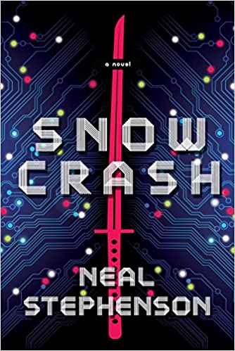

## Dune's AI-free world

> "We learned a negative thing from computers, that the setting of guidelines belongs to humans, not to machines."
> 
> "Eventually humans became little more than decisionless robots themselves, left without an understanding of their natural existence."
>
> -- Quotes taken from "Legends of Dune: The Butlerian Jihad", by Brian Herbert and Kevin J. Anderson
 
It's an interesting coincidence in timing: the release of the new film version of Dune and the launch of the Metaverse by Facebook (or Meta).

For those who don't know, the events of Dune take place millennia after the **"Butlerian Jihad"**, a final war between humans and machines. These events are mentioned in Frank Herbert's original novels, and detailed years later by his son Brian and Kevin J. Anderson in the Legends of Dune series.

In a recent clip, director Denis Villeneuve explains how fascinated he was by the idea of opening his film with a scene in a library:
 
>  "... it's a beautiful counterpoint, one that tells us many things about the world of Dune. There are no computers in this world, and Artificial Intelligence has been banned. There is no more Artificial Intelligence. Dune is about the triumph of the human spirit"



 

## Metaverse

I wonder whether Mark Zuckerberg has a library, a real one, not one built in that fantasy world of his he calls the MetaVerse[^1]. I also don't know whether he has read ["Snow Crash"](https://amzn.to/3EMSGzx), because the MetaVerse is a concept that comes from that novel.

Published in 1992 and written by Neal Stephenson, its title pays homage to [Neuromancer](https://amzn.to/3CSmtpS), by William Gibson, another great cyberpunk novel, which opens with this line:

> "The sky above the port was the color of television, tuned to a dead channel."
 
Old TV sets showed us this image when they were on but had no signal:

The term snow crash was adopted by users of the early Macs to refer to what appeared on the screen when their machines failed[^2]:



 

It was Gibson who coined the term Cyberspace. But Stephenson decided to call it the Metaverse, the universe beyond our own.

In Snow Crash the protagonist is a pizza delivery guy, but in the Metaverse he takes on the persona of a samurai warrior prince. The author calls this virtual identity an "Avatar", a term we have also adopted for our digital personas in online games, or for the images we use to identify ourselves on social media.

But in the novel the term snow crash names a virus, one that spreads in both the real and the virtual world in the form of a drug. This virus strips people of the ability to think creatively or independently, and leaves them limited to executing routines that cannot be modified.

Now, if you're reading this on your phone, I'm sure you move through the text with a flick of your index finger, from bottom to top. That repetitive action is called infinite scrolling.
It's the same motion you use to go through stories and pictures on Instagram, or the timeline of your "friends" on Facebook or Twitter, or the videos on TikTok.

This infinite scrolling in mobile apps is designed to make these applications irresistible and addictive. Something psychologists call addictive behaviors[^3].

We have been infected by an alpha version of snow crash, one that hasn't yet reached its full potential.

You can already extrapolate what will happen with the metaverse that companies like Facebook or Microsoft[^4] want to push. A fully immersive experience and, of course, more addictive than on the phone.



This experience, which is sure to be addictive, will be adopted massively, that much is certain, thanks to the push of another phenomenon: FOMO.

## FOMO

FOMO comes from Fear Of Missing Out.

FOMO refers to that feeling or perception that others are having more fun, living better, or experiencing better things than you are.

It breeds a deep feeling of envy and hurts self-esteem, something that services like Facebook or Instagram make worse.

FOMO has been with us for a long time. It's an old feeling, with traces of it in ancient texts. But it only began to be studied a few decades ago. It was in 1996 that the term was coined by none other than a marketing expert, Dan Herman, which is very telling.

In marketing, FOMO is used to manipulate your intent to buy. In [a 2013 study](https://www.sciencedirect.com/science/article/pii/S0747563213000800) FOMO is defined like this:

> “Defined as a pervasive apprehension that others might be having rewarding experiences from which one is absent, FoMO is characterized by the desire to stay continually connected with what others are doing.”

It's estimated that almost 70% of millennials experience FOMO, and that they make their purchases driven by this feeling. Almost 60% of social media users are affected by it[^5].

As for the impact on social media, what happens is that people compare their lives with the dazzling moments of other people's lives (advertised on their social networks). So their sense of normality takes a hit, because they feel they're doing worse than their peers (friends or colleagues).

When you're on social media you can see detailed photos or videos of your peers having fun without you, something that didn't happen in previous generations. That's why this phenomenon is so dangerous for the youngest.

Social networks have created an ideal platform for showing off. It's the place where things, events, even happiness itself are put on display. Social media users compare their photogenic experiences, and many are left behind thinking about everything they lack.

The worst part is that the social networks know this happens, and they don't give a damn. What they're after is more attention, and that's why they sell this addiction, this drug, this MVP version of Snow Crash.

In the Metaverse it will be possible to create new realities and, of course, the best ones, the most richly detailed, the most powerful avatars, the most beautiful virtual spaces, will be available to those with the most resources. The feeling of FOMO will be worse.

## The danger of Facebook

It's known that Facebook ran an experiment to see whether it could manipulate people's positive and negative feelings. In 2014 they published their results in [PNAS](https://www.pnas.org/content/111/24/8788.full), and the paper's summary says:

> We show, via a massive (N = 689,003) experiment on Facebook, that emotional states can be transferred to others via emotional contagion, leading people to experience the same emotions without their awareness. We provide experimental evidence that emotional contagion occurs without direct interaction between people (exposure to a friend expressing an emotion is sufficient), and in the complete absence of nonverbal cues.
 
And all of that has been used by various extremist groups, terrorists, politicians, to manipulate people's feelings and even their behavior, as several recent publications show us, or as you can read in the book ["An Ugly Truth: Inside Facebook's Battle for Domination"](https://amzn.to/3nYf02t), by Sheera Frenkel and Cecilia Kang.

FOMO, addictive behaviors, the manipulation of feelings: these are all negative aspects of social media, the origin of new illnesses and disorders that are affecting our society. The question is, how much longer will we let them keep spreading without doing anything about it?

It's time, at the very least, to question how long we spend glued to our phones, and above all to watch what is happening with the youngest.

You have to understand that Facebook acts only out of money. They want your attention. They want to keep you trapped for as long as possible.

I've decided to uninstall the Instagram, Messenger and Facebook apps from my phone, and to limit my use of WhatsApp (I'd like everybody to migrate to other messaging platforms).

I don't want to delete my accounts yet. I've thought about the security and identity theft angles, and I prefer to keep my Facebook and Instagram accounts at the bare minimum, and when I do get around to using them it will be from the PC.

It's a worrying subject, and I think it's important that we inform ourselves about the damage Facebook (or Meta) has done to society. And also that we raise awareness of these phenomena that affect people, from FOMO to cyber dependencies. That's why I don't much like the idea of the Metaverse, however cool it may look. I won't deny that a virtual world you enter through virtual reality is fascinating, but the problem is who is going to control that metaverse, and to what ends. In the end, as they say in the Dune universe:

> "We learned a negative thing from computers, that the setting of guidelines belongs to humans, not to machines."

The real enemy isn't AI. It's the humans who set the guidelines for that AI and for all the other algorithms that manipulate us.

**Did you like it?** [You can support me with a coffee](https://ko-fi.com/X8X420K04)



[^1]: During 2015 Zuckerberg published 23 book recommendations. The first one on his list sold out on Amazon after the Facebook founder recommended it to his millions of followers on the platform.

[^2]: Stephenson tells this story in his essay ["In the Beginning... Was the Command Line"](https://amzn.to/3065bYa).

[^3]: You can find more information about this in this Wired article <https://www.wired.com/2017/03/irresistible-the-rise-of-addictive-technology-and-the-business-of-keeping-us-hooked/>

[^4]: On what Microsoft is planning for the Metaverse, you can read this piece from The Verge about the plans for Teams 3D <https://www.theverge.com/2021/11/2/22758974/microsoft-teams-metaverse-mesh-3d-avatars-meetings-features>

[^5]: Sources: <https://mumbrella.com.au/fomo-millennials-may-not-ones-missing-462272>, <https://strategyonline.ca/2015/03/09/the-impact-of-fomo/>, <https://strategyonline.ca/2015/03/09/the-impact-of-fomo/>
