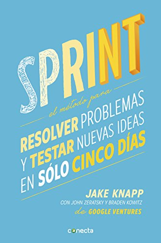
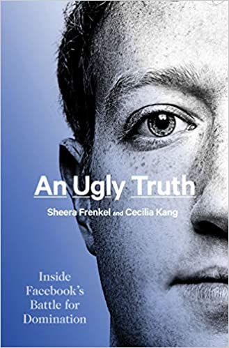
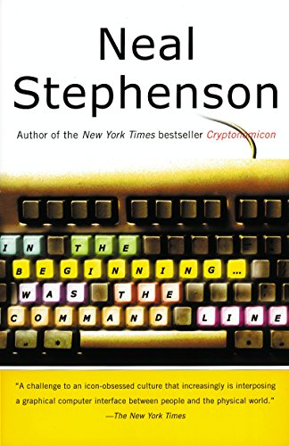

We continue with the log of the books I've read this year, this time covering the month of October. Here goes the list. I've been thinking of publishing a list of recommended books at the end of the year, so stay tuned.

## October 2021 reading

### Machines Like Me - Ian McEwan

Ian McEwan is, supposedly, one of the most important British writers since 1945, according to The Times. If so, it doesn't show in this novel. Honestly one of the most uneven things I've read in a while. I felt almost cheated. Because there's an interesting promise. It's a kind of alternate history in which Alan Turing hasn't died and artificial intelligence gets developed many decades earlier, so that by 1982 intelligent androids already exist.

It's a world where England loses in the Falklands, where Turing is a millionaire and lives openly as a gay man, and history unfolds differently. But the main character is bland, a person who has held various jobs ad hoc to fit the needs of the novel, a man of about thirty-two, in love with a neighbor ten years younger, she with a strange and somewhat sordid backstory. This character has some money because he plays the stock market. That's supposedly what he does for a living, but in a very unprofessional way. He's really like those characters in Latin American soap operas: in practice he doesn't work. Well, with that spare money he buys himself an android, and from there a pseudo-triangle takes shape and the cheap soap opera drama begins. It actually could have been interesting, but even the android and the reflections on computing and artificial intelligence are very basic, and some are quite wrong. It also gets into the subject of sexual abuse of women, but in a way that's somewhere between inappropriate and fairly simplistic, in my opinion. Some people will like it, but I think it has deep narrative and thematic flaws, as if he had researched some subjects only superficially.

[Available on Amazon >>](https://amzn.to/3H1ZlaV)

### Sprint: How to Solve Big Problems and Test New Ideas in Just Five Days - Jake Knapp & John Zeratsky

This is actually a reread (on Kindle) of this book, which I bought a couple of years ago. I reread it to refresh the methodology, which is part of one of the courses I teach at the university. This method, or technique, is super intensive and promises to develop a prototype in five days. It has a set of very well-defined principles and techniques, which have also been expanding over time, heavily based on the principles of Design Thinking. As with every methodology of this kind, its success depends a lot on the ability to mobilize the organization behind its goals. But besides being an introduction to the technique, the book contains real examples of its use in various startups.

[Available on Amazon >>](https://amzn.to/3khcbsp)

### An Ugly Truth: Inside Facebook's Battle for Domination - Sheera Frenkel & Cecilia Kang

The book is by two New York Times journalists, and it lays out a series of Facebook incidents that have been covered in various sources, but for me it was interesting to read them here, because there were some I didn't know about. The authors supposedly based their work on hundreds of interviews and on public and anonymous sources. I found the book short, and lacking in depth. It's not completely up to date, but it's fairly close to the recent leaks by Facebook employees. The conclusion you reach is that Zuckerberg's management is terrible, and that he couldn't care less about dealing with these issues. That's probably true, judging by what's going on. Recommended, though I insist I would have liked something longer and more detailed.

[Available on Amazon >>](https://amzn.to/3kiBU3p)

### In the Beginning... Was the Command Line - Neal Stephenson

This is an essay written around 1999, mainly about the operating systems that ruled at the time, and the rise of Linux. It's almost an essay to convince you to use Linux, or better yet BeOS (yes, the book is that old). But it's fun anyway, because there's a part where he reflects on the practices of the big companies with respect to technology, and several of the diagnoses the author applies to Microsoft and Apple apply to many of today's big tech companies. Besides, I'm a Stephenson fan and I've decided I'm going to read all of his work eventually, so I was missing this one.

[Available on Amazon >>](https://amzn.to/3khi6O0)

These are the books I've read this month. Tell me, what are you reading?
